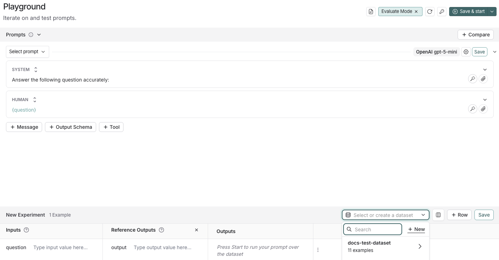
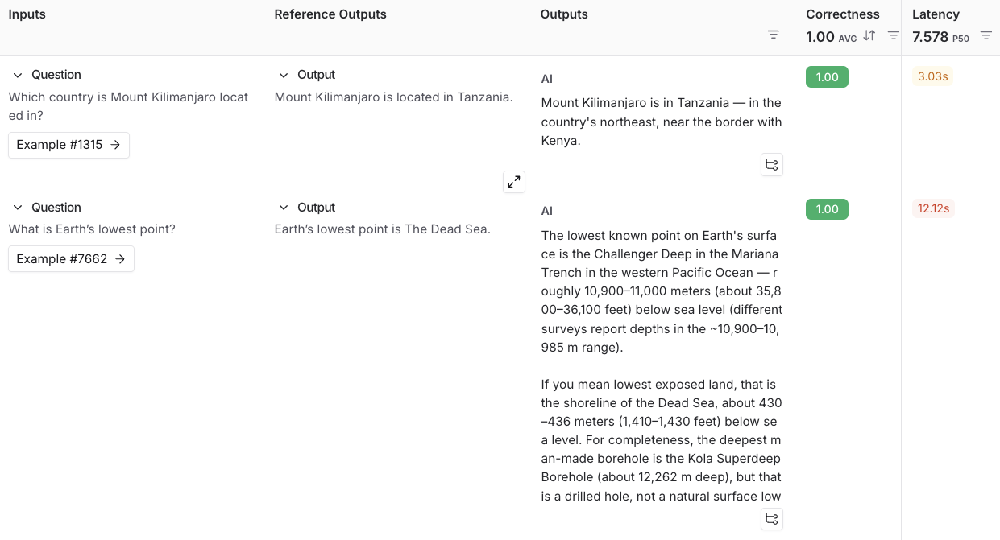
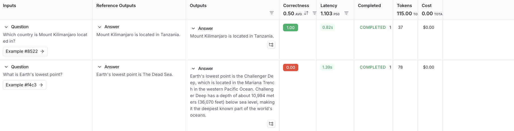

# Evaluation quickstart

[*Evaluations*](Evaluation%20concepts.md) are a quantitative way to measure the performance of LLM applications. LLMs can behave unpredictably, even small changes to prompts, models, or inputs can significantly affect results. Evaluations provide a structured way to identify failures, compare versions, and build more reliable AI applications.

Running an evaluation in LangSmith requires three key components:

* [*Dataset*](Evaluation%20concepts.md#datasets): A set of test inputs (and optionally, expected outputs).
* [*Target function*](../Datasets%20%26%20Experiments/Evaluation%20techniques/Define%20evaluation%20target/How%20to%20define%20a%20target%20function%20to%20evaluate.md): The part of your application you want to test—this might be a single LLM call with a new prompt, one module, or your entire workflow.
* [*Evaluators*](Evaluation%20concepts.md#evaluators): Functions that score your target function’s outputs.

This quickstart guides you through running a starter evaluation that checks the correctness of LLM responses, using either the LangSmith SDK or UI.

## Prerequisites

Before you begin, make sure you have:

* **A LangSmith account**: Sign up or log in at [smith.langchain.com](https://smith.langchain.com?utm_source=docs&utm_medium=cta&utm_campaign=langsmith-signup&utm_content=langsmith-evaluation-quickstart).
* **A LangSmith API key**: Follow the [Create an API key](../../LangSmith%20setup/Account/Create%20an%20account%20and%20API%20key.md) guide.
* **An OpenAI API key**: Generate this from the [OpenAI dashboard](https://platform.openai.com/account/api-keys).

**Select the UI or SDK filter for instructions:**

> [tab] UI
>
> ## 1. Set workspace secrets
>
> In the [LangSmith UI](https://smith.langchain.com?utm_source=docs&utm_medium=cta&utm_campaign=langsmith-signup&utm_content=snippets-langsmith-set-workspace-secrets), ensure that your API key is set as a [workspace secret](../../LangSmith%20setup/Govern/Organization/Workspace%20setup/Set%20up%20hierarchy.md#configure-workspace-settings).
>
> Adding workspace secrets requires permission to manage secrets in the workspace. If you do not have it, ask a workspace admin to add the secret for you or to grant you access.
>
> To add a workspace secret:
>
> 1. Navigate to  **Settings** > **Integrations** > **Provider secrets**.
>
> 2. Select **+ Secret**.
>
> 3. Under **Provider**, select your model provider. LangSmith names the secret with the environment variable the provider expects, such as `OPENAI_API_KEY`. Enter your secret in that field.
>
>    If your provider is not listed, leave **Custom** as the provider. Enter the environment variable name your provider expects as the **Key** and your API key as the **Value**.
>
> 4. Select **Save**.
>
> > [!NOTE]
> >
> > If your provider authenticates with OAuth2 `client_credentials`, configure the credentials on the model configuration instead. Workspace secrets are not required in that case. See [OAuth client credentials](../../LangSmith%20setup/Govern/Organization/Workspace%20setup/Manage%20model%20configurations.md#oauth-client-credentials).
>
> ## 2. Create a prompt
>
> The [Playground](../../Deploy/Prompt%20%26%20Context%20Hub/Prompts/Prompt%20engineering%20concepts.md#playground) makes it possible to run evaluations over different prompts, new models, or test different model configurations.
>
> 1. In the [LangSmith UI](https://smith.langchain.com?utm_source=docs&utm_medium=cta&utm_campaign=langsmith-signup&utm_content=langsmith-evaluation-quickstart), click **Playground** in the sidebar.
> 2. Under the **Prompts** panel, modify the **system** prompt to:
>
>    ```
>    Answer the following question accurately:
>    ```
>
>    Leave the **Human** message as is: `{question}`.
>
> ## 3. Create a dataset
>
> 1. Click **Set up Evaluation**, which will open a **New Experiment** table at the bottom of the page.
>
> 2. In the **Select or create a new dataset** dropdown, click the **+ New** button to create a new dataset.
>
>    
>
> 3. Add the following examples to the dataset:
>
>    | Inputs | Reference Outputs |
>    | - | - |
>    | question: Which country is Mount Kilimanjaro located in? | output: Mount Kilimanjaro is located in Tanzania. |
>    | question: What is Earth's lowest point? | output: Earth's lowest point is The Dead Sea. |
>
> 4. Click **Save** and enter a name to save your newly created dataset.
>
> ## 4. Add an evaluator
>
> 1. Click **+ Evaluator** and select **Correctness** from the **Prebuilt Evaluator** options.
> 2. In the **Correctness** panel, click **Save**.
>
> ## 5. Run your evaluation
>
> 1. Select  **Start** on the top right to run your evaluation. This will create an [*experiment*](Evaluation%20concepts.md#experiment) with a preview in the **New Experiment** table. You can view in full by clicking the experiment name.
>
>    
>
> ## Next steps
>
> > [!TIP]
> >
> > To learn more about running experiments in LangSmith, read the [evaluation conceptual guide](Evaluation%20concepts.md).
>
> * For more details on evaluations, refer to the [Evaluation documentation](LangSmith%20Evaluation.md).
> * Learn how to [create and manage datasets in the UI](../Datasets%20%26%20Experiments/Datasets/Create%20a%20dataset/Create%20and%20manage%20datasets%20in%20the%20UI.md#create-a-dataset-and-add-examples).
> * Learn how to [run an evaluation from the Playground](../Datasets%20%26%20Experiments/Run%20an%20evaluation/Run%20an%20evaluation%20from%20the%20Playground.md).

> [tab] SDK
>
> > [!TIP]
> >
> > This guide uses prebuilt LLM-as-judge evaluators from the open-source [`openevals`](https://github.com/langchain-ai/openevals) package. OpenEvals includes a set of commonly used evaluators and is a great starting point if you're new to evaluations. If you want greater flexibility in how you evaluate your apps, you can also [define completely custom evaluators](../Evaluators/Evaluator%20types/UI/How%20to%20define%20a%20code%20evaluator.md).
>
> ## 1. Install dependencies
>
> In your terminal, create a directory for your project and install the dependencies in your environment:
>
> ```bash Python theme={"theme":{"light":"catppuccin-latte","dark":"catppuccin-mocha"}}
> mkdir ls-evaluation-quickstart && cd ls-evaluation-quickstart
> python -m venv .venv && source .venv/bin/activate
> python -m pip install --upgrade pip
> pip install -U langsmith openevals openai
> ```
>
> ```bash TypeScript theme={"theme":{"light":"catppuccin-latte","dark":"catppuccin-mocha"}}
> mkdir ls-evaluation-quickstart-ts && cd ls-evaluation-quickstart-ts
> npm init -y
> npm install langsmith openevals openai
> npx tsc --init
> ```
>
> > [!NOTE]
> >
> > If you are using `yarn` as your package manager, you will also need to manually install `@langchain/core` as a peer dependency of `openevals`. This is not required for LangSmith evals in general, you may define evaluators [using arbitrary custom code](../Evaluators/Evaluator%20types/UI/How%20to%20define%20a%20code%20evaluator.md).
>
> ## 2. Set up environment variables
>
> Set the following environment variables:
>
> * `LANGSMITH_TRACING`
> * `LANGSMITH_API_KEY`
> * `OPENAI_API_KEY` (or your LLM provider's API key)
> * (optional) `LANGSMITH_WORKSPACE_ID`: If your LangSmith API key is linked to multiple [workspaces](../../LangSmith%20setup/Govern/Organization/Overview.md#workspaces), set this variable to specify which workspace to use.
>
> ```bash theme={"theme":{"light":"catppuccin-latte","dark":"catppuccin-mocha"}}
> export LANGSMITH_TRACING=true
> export LANGSMITH_API_KEY="<API_KEY>"
> export OPENAI_API_KEY="<API_KEY>"
> export LANGSMITH_WORKSPACE_ID="<your-workspace-id>"
> ```
>
> > [!NOTE]
> >
> > If you're using Anthropic, use the [Anthropic wrapper](../../Monitor/Trace/Tracing%20setup/Integrations/LLM%20providers/Trace%20with%20Anthropic.md) to trace your calls. For other providers, use [the traceable wrapper](../../Monitor/Trace/Tracing%20setup/Manual%20instrumentation/Custom%20instrumentation.md#use-%40traceable-%2F-traceable).
>
> ## 3. Create a dataset
>
> 1. Create a file and add the following code, which will:
>
>    * Import the `Client` to connect to LangSmith.
>    * Create a dataset.
>    * Define example [*inputs* and *outputs*](Evaluation%20concepts.md#examples).
>    * Associate the input and output pairs with that dataset in LangSmith so they can be used in evaluations.
>
>    ```python Python theme={"theme":{"light":"catppuccin-latte","dark":"catppuccin-mocha"}}
>    # dataset.py
>    from langsmith import Client
>
>    def main():
>        client = Client()
>
>        # Programmatically create a dataset in LangSmith
>        dataset = client.create_dataset(
>            dataset_name="Sample dataset",
>            description="A sample dataset in LangSmith."
>        )
>
>        # Create examples
>        examples = [
>            {
>                "inputs": {"question": "Which country is Mount Kilimanjaro located in?"},
>                "outputs": {"answer": "Mount Kilimanjaro is located in Tanzania."},
>            },
>            {
>                "inputs": {"question": "What is Earth's lowest point?"},
>                "outputs": {"answer": "Earth's lowest point is The Dead Sea."},
>            },
>        ]
>
>        # Add examples to the dataset
>        client.create_examples(dataset_id=dataset.id, examples=examples)
>        print("Created dataset:", dataset.name)
>
>    if __name__ == "__main__":
>        main()
>    ```
>
>    ```ts TypeScript theme={"theme":{"light":"catppuccin-latte","dark":"catppuccin-mocha"}}
>    // dataset.ts
>    import { Client } from "langsmith";
>
>    async function main() {
>    const client = new Client();
>
>    const dataset = await client.createDataset(
>        "Sample dataset",
>        { description: "A sample dataset in LangSmith." }
>    );
>
>    // Define examples
>    const inputs = [
>        { question: "Which country is Mount Kilimanjaro located in?" },
>        { question: "What is Earth's lowest point?" },
>    ];
>    const outputs = [
>        { answer: "Mount Kilimanjaro is located in Tanzania." },
>        { answer: "Earth's lowest point is The Dead Sea." },
>    ];
>
>    await client.createExamples({
>        datasetId: dataset.id,
>        inputs,
>        outputs,
>    });
>
>    console.log("Created dataset:", dataset.name);
>    }
>
>    main().catch((e) => {
>        console.error(e);
>        process.exit(1);
>    });
>    ```
>
> 2. In your terminal, run the `dataset` file to create the datasets you'll use to evaluate your app:
>
>    ```bash Python theme={"theme":{"light":"catppuccin-latte","dark":"catppuccin-mocha"}}
>    python dataset.py
>    ```
>
>    ```bash TypeScript theme={"theme":{"light":"catppuccin-latte","dark":"catppuccin-mocha"}}
>    npx ts-node dataset.ts
>    ```
>
>    You'll see the following output:
>
>    ```bash theme={"theme":{"light":"catppuccin-latte","dark":"catppuccin-mocha"}}
>    Created dataset: Sample dataset
>    ```
>
> ## 4. Create your target function
>
> Define a [target function](../Datasets%20%26%20Experiments/Evaluation%20techniques/Define%20evaluation%20target/How%20to%20define%20a%20target%20function%20to%20evaluate.md) that contains what you're evaluating. In this guide, you'll define a target function that contains a single LLM call to answer a question.
>
> Add the following to an `eval` file:
>
> ```python Python theme={"theme":{"light":"catppuccin-latte","dark":"catppuccin-mocha"}}
> # eval.py
> from langsmith import Client, wrappers
> from openai import OpenAI
>
> # Wrap the OpenAI client for LangSmith tracing
> openai_client = wrappers.wrap_openai(OpenAI())
>
> # Define the application logic you want to evaluate inside a target function
> # The SDK will automatically send the inputs from the dataset to your target function
> def target(inputs: dict) -> dict:
>     response = openai_client.chat.completions.create(
>         model="gpt-6-luna",
>         messages=[
>             {"role": "system", "content": "Answer the following question accurately"},
>             {"role": "user", "content": inputs["question"]},
>         ],
>     )
>     return {"answer": response.choices[0].message.content.strip()}
> ```
>
> ```ts TypeScript theme={"theme":{"light":"catppuccin-latte","dark":"catppuccin-mocha"}}
> // eval.ts
> import { evaluate } from "langsmith/evaluation";
> import { wrapOpenAI } from "langsmith/wrappers/openai";
> import OpenAI from "openai";
>
> const openaiClient = wrapOpenAI(new OpenAI());
>
> async function target(inputs: Record<string, any>): Promise<Record<string, any>> {
>   const question = String(inputs.question ?? "");
>   const resp = await openaiClient.chat.completions.create({
>     model: "gpt-6-luna",
>     messages: [
>       { role: "system", content: "Answer the following question accurately" },
>       { role: "user", content: question },
>     ],
>   });
>   return { answer: resp.choices[0].message.content?.trim() ?? "" };
> }
> ```
>
> ## 5. Define an evaluator
>
> In this step, you’re telling LangSmith how to grade the answers your app produces.
>
> Import a prebuilt evaluation prompt (`CORRECTNESS_PROMPT`) from [`openevals`](https://github.com/langchain-ai/openevals) and a helper that wraps it into an [*LLM-as-judge evaluator*](Evaluation%20concepts.md#llm-as-judge), which will score the application's output.
>
> > [!NOTE]
> >
> > `CORRECTNESS_PROMPT` is just an f-string with variables for `"inputs"`, `"outputs"`, and `"reference_outputs"`. See [customizing OpenEvals prompts](https://github.com/langchain-ai/openevals#customizing-prompts) for more information.
>
> The evaluator compares:
>
> * `inputs`: what was passed into your target function (e.g., the question text).
> * `outputs`: what your target function returned (e.g., the model’s answer).
> * `reference_outputs`: the ground truth answers you attached to each dataset example in [Step 3](#3-create-a-dataset).
>
> Add the following highlighted code to your `eval` file:
>
> ```python Python highlight={3,4,21-31} theme={"theme":{"light":"catppuccin-latte","dark":"catppuccin-mocha"}}
> from langsmith import Client, wrappers
> from openai import OpenAI
> from openevals.llm import create_llm_as_judge
> from openevals.prompts import CORRECTNESS_PROMPT
>
> # Wrap the OpenAI client for LangSmith tracing
> openai_client = wrappers.wrap_openai(OpenAI())
>
> # Define the application logic you want to evaluate inside a target function
> # The SDK will automatically send the inputs from the dataset to your target function
> def target(inputs: dict) -> dict:
>     response = openai_client.chat.completions.create(
>         model="gpt-6-luna",
>         messages=[
>             {"role": "system", "content": "Answer the following question accurately"},
>             {"role": "user", "content": inputs["question"]},
>         ],
>     )
>     return {"answer": response.choices[0].message.content.strip()}
>
> def correctness_evaluator(inputs: dict, outputs: dict, reference_outputs: dict):
>     evaluator = create_llm_as_judge(
>         prompt=CORRECTNESS_PROMPT,
>         model="openai:gpt-6.1-sol",
>         feedback_key="correctness",
>     )
>     return evaluator(
>         inputs=inputs,
>         outputs=outputs,
>         reference_outputs=reference_outputs
>     )
> ```
>
> ```ts TypeScript highlight={4,20-37} theme={"theme":{"light":"catppuccin-latte","dark":"catppuccin-mocha"}}
> import { evaluate } from "langsmith/evaluation";
> import { wrapOpenAI } from "langsmith/wrappers/openai";
> import OpenAI from "openai";
> import { createLLMAsJudge, CORRECTNESS_PROMPT } from "openevals";
>
> const openaiClient = wrapOpenAI(new OpenAI());
>
> async function target(inputs: Record<string, any>): Promise<Record<string, any>> {
>   const question = String(inputs.question ?? "");
>   const resp = await openaiClient.chat.completions.create({
>     model: "gpt-6-luna",
>     messages: [
>       { role: "system", content: "Answer the following question accurately" },
>       { role: "user", content: question },
>     ],
>   });
>   return { answer: resp.choices[0].message.content?.trim() ?? "" };
> }
>
> const judge = createLLMAsJudge({
>   prompt: CORRECTNESS_PROMPT,
>   model: "openai:gpt-6.1-sol",
>   feedbackKey: "correctness",
> });
>
> async function correctnessEvaluator(run: {
>   inputs: Record<string, any>;
>   outputs: Record<string, any>;
>   referenceOutputs?: Record<string, any>;
> }) {
>   return judge({
>     inputs: run.inputs,
>     outputs: run.outputs,
>     // OpenEvals expects snake_case here:
>     reference_outputs: run.referenceOutputs,
>   });
> }
> ```
>
> ## 6. Run and view results
>
> To run the evaluation experiment, you'll call `evaluate(...)`, which:
>
> * Pulls example from the dataset you created in [Step 3](#3-create-a-dataset).
>
> * Sends each example's inputs to your target function from [Step 4](#4-add-an-evaluator).
>
> * Collects the outputs (the model's answers).
>
> * Passes the outputs along with the `reference_outputs` to your evaluator from [Step 5](#5-define-an-evaluator).
>
> * Records all results in LangSmith as an experiment, so you can view them in the UI.
>
> 1. Add the highlighted code to your `eval` file:
>
>    ```python Python highlight={33-49} theme={"theme":{"light":"catppuccin-latte","dark":"catppuccin-mocha"}}
>    from langsmith import Client, wrappers
>    from openai import OpenAI
>    from openevals.llm import create_llm_as_judge
>    from openevals.prompts import CORRECTNESS_PROMPT
>
>    # Wrap the OpenAI client for LangSmith tracing
>    openai_client = wrappers.wrap_openai(OpenAI())
>
>    # Define the application logic you want to evaluate inside a target function
>    # The SDK will automatically send the inputs from the dataset to your target function
>    def target(inputs: dict) -> dict:
>        response = openai_client.chat.completions.create(
>            model="gpt-6-luna",
>            messages=[
>                {"role": "system", "content": "Answer the following question accurately"},
>                {"role": "user", "content": inputs["question"]},
>            ],
>        )
>        return {"answer": response.choices[0].message.content.strip()}
>
>    def correctness_evaluator(inputs: dict, outputs: dict, reference_outputs: dict):
>        evaluator = create_llm_as_judge(
>            prompt=CORRECTNESS_PROMPT,
>            model="openai:gpt-6.1-sol",
>            feedback_key="correctness",
>        )
>        return evaluator(
>            inputs=inputs,
>            outputs=outputs,
>            reference_outputs=reference_outputs
>        )
>
>    # After running the evaluation, a link will be provided to view the results in langsmith
>    def main():
>        client = Client()
>        experiment_results = client.evaluate(
>            target,
>            data="Sample dataset",
>            evaluators=[
>                correctness_evaluator,
>                # can add multiple evaluators here
>            ],
>            experiment_prefix="first-eval-in-langsmith",
>            max_concurrency=2,
>        )
>        print(experiment_results)
>
>    if __name__ == "__main__":
>        main()
>    ```
>
>    ```ts TypeScript highlight={39-55} theme={"theme":{"light":"catppuccin-latte","dark":"catppuccin-mocha"}}
>    import { evaluate } from "langsmith/evaluation";
>    import { wrapOpenAI } from "langsmith/wrappers/openai";   // helper to wrap OpenAI client
>    import OpenAI from "openai";                              // model provider
>    import { createLLMAsJudge, CORRECTNESS_PROMPT } from "openevals"; // evaluator tools
>
>    const openaiClient = wrapOpenAI(new OpenAI());
>
>    async function target(inputs: Record<string, any>): Promise<Record<string, any>> {
>    const question = String(inputs.question ?? "");
>    const resp = await openaiClient.chat.completions.create({
>        model: "gpt-6-luna",
>        messages: [
>        { role: "system", content: "Answer the following question accurately" },
>        { role: "user", content: question },
>        ],
>    });
>    return { answer: resp.choices[0].message.content?.trim() ?? "" };
>    }
>
>    const judge = createLLMAsJudge({
>    prompt: CORRECTNESS_PROMPT,
>    model: "openai:gpt-6.1-sol",
>    feedbackKey: "correctness",
>    });
>
>    async function correctnessEvaluator(run: {
>    inputs: Record<string, any>;
>    outputs: Record<string, any>;
>    referenceOutputs?: Record<string, any>;
>    }) {
>    return judge({
>        inputs: run.inputs,
>        outputs: run.outputs,
>        // OpenEvals expects snake_case here:
>        reference_outputs: run.referenceOutputs,
>    });
>    }
>
>    async function main() {
>    const datasetName = process.env.DATASET_NAME ?? "Sample dataset";
>
>    const results = await evaluate(target, {
>        data: datasetName,
>        evaluators: [correctnessEvaluator],
>        experimentPrefix: "first-eval-in-langsmith",
>        maxConcurrency: 2,
>    });
>
>    console.log(results);
>    }
>
>    main().catch((e) => {
>    console.error(e);
>    process.exit(1);
>    });
>    ```
>
> 2. Run your evaluator:
>
>    ```bash Python theme={"theme":{"light":"catppuccin-latte","dark":"catppuccin-mocha"}}
>    python eval.py
>    ```
>
>    ```bash TypeScript theme={"theme":{"light":"catppuccin-latte","dark":"catppuccin-mocha"}}
>    npx ts-node eval.ts
>    ```
>
> 3. You'll receive a link to view the evaluation results and metadata for the experiment results:
>
>    ```
>    View the evaluation results for experiment: 'first-eval-in-langsmith-00000000' at: https://smith.langchain.com/o/6551f9c4-2685-4a08-86b9-1b29643deb3d/datasets/e5fde557-c274-4e49-b39d-000000000000/compare?selectedSessions=70b11778-6a28-4cdb-be81-000000000000
>
>    <ExperimentResults first-eval-in-langsmith-00000000>
>    ```
>
> 4. Follow the link in the output of your evaluation run to access the **Datasets & Experiments** page in the [LangSmith UI](https://smith.langchain.com?utm_source=docs&utm_medium=cta&utm_campaign=langsmith-signup&utm_content=langsmith-evaluation-quickstart), and explore the results of the experiment. This will direct you to the created experiment with a table showing the **Inputs**, **Reference Output**, and **Outputs**. You can select a dataset to open an expanded view of the results.
>
>    
>
> ## Next steps
>
> Here are some topics you might want to explore next:
>
> * [Evaluation concepts](Evaluation%20concepts.md) provides descriptions of the key terminology for evaluations in LangSmith.
> * [OpenEvals README](https://github.com/langchain-ai/openevals) to see all available prebuilt evaluators and how to customize them.
> * [Define custom evaluators](../Evaluators/Evaluator%20types/UI/How%20to%20define%20a%20code%20evaluator.md).
> * [Python](../../Monitor/Reference/langsmith%20%28smith-python-sdk%29.md) or [TypeScript](../../Monitor/Reference/langsmith%20%28smith-js-ts-sdk%29.md) SDK references for comprehensive descriptions of every class and function.
