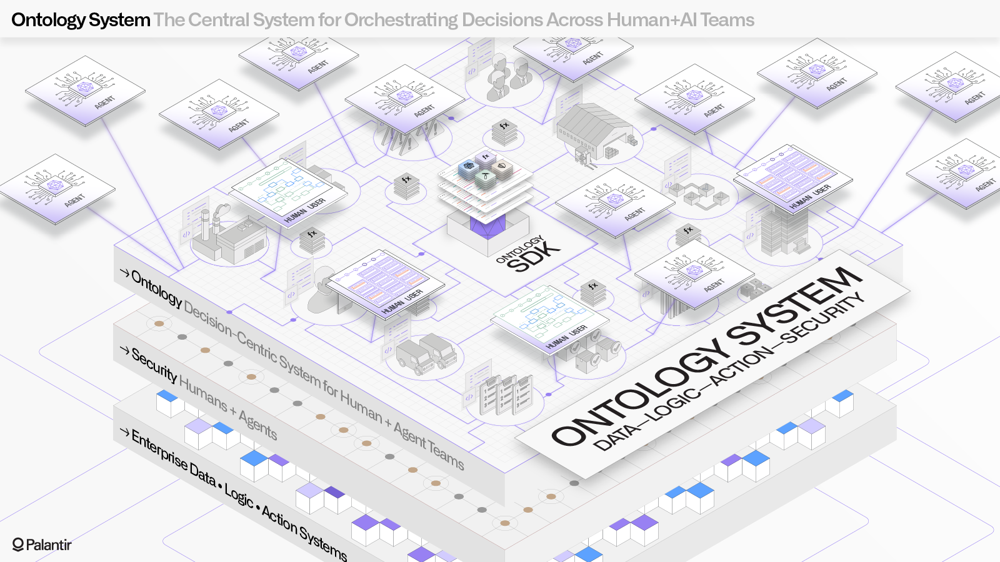

:::callout{theme="warning"}
注意：以下翻译的准确性尚未经过验证。这是使用 [AIP ↗](https://www.palantir.com/platforms/aip/) 从原始英文文本进行的机器翻译。
:::

# Ontology搭建

Palantir **Ontology** 是组织的操作层。Ontology 位于集成到Palantir平台中的数字资产（数据集和模型）之上，并将它们与真实世界的对应物连接起来，从工厂、设备、产品等物理资产到客户订单或金融交易等概念。在许多情况下，Ontology 充当组织的数字孪生体，包含启用各种应用案例所需的语义元素（objects、属性、链接）和动力元素（操作、函数、动态安全）。

## Object和链接类型

通过将现有数据源映射到Ontology 中的**objects、属性和链接**来定义组织的语义。远远超越数据目录或模式设计解决方案，Ontology 允许您为终端用户工作流定义一个强大的基础，包括所有字段的丰富元数据，并为所有更改提供细粒度的安全性和治理。

了解有关创建Ontology语义元素的信息：[object类型](%E5%AE%9A%E4%B9%89%E6%9C%AC%E4%BD%93/%E5%AF%B9%E8%B1%A1%E9%93%BE%E6%8E%A5%E7%B1%BB%E5%9E%8B/Object%20types/%E6%A6%82%E8%A7%88.md) 和 [链接类型](%E5%AE%9A%E4%B9%89%E6%9C%AC%E4%BD%93/%E5%AF%B9%E8%B1%A1%E9%93%BE%E6%8E%A5%E7%B1%BB%E5%9E%8B/Link%20types/%E6%A6%82%E8%BF%B0.md)。

## 操作类型和函数

组织的动力元素——在遵守组织控制和治理的同时实现更改——是在Ontology中使用**操作类型**和**函数**定义的。操作类型使您能够从组织中的操作员捕获数据或协调连接到现有系统的决策过程，而函数则提供了一种以任意复杂性编写和演变业务逻辑的方法。

了解有关创建Ontology动力元素的信息：[操作类型](%E5%AE%9A%E4%B9%89%E6%9C%AC%E4%BD%93/%E5%8A%A8%E4%BD%9C%E7%B1%BB%E5%9E%8B/%E6%A6%82%E8%BF%B0.md) 和 [函数](%E5%AE%9A%E4%B9%89%E6%9C%AC%E4%BD%93/%E5%87%BD%E6%95%B0/%E6%A6%82%E8%BF%B0.md)。

## 接口

**接口**是描述object类型及其功能的Ontology类型。接口提供object类型的多态性，允许对具有共同形状的object类型进行一致的建模和交互。

了解更多关于[接口](%E5%AE%9A%E4%B9%89%E6%9C%AC%E4%BD%93/%E6%8E%A5%E5%8F%A3/%E6%A6%82%E8%BF%B0.md)的信息。

## 支持决策制定

投资Ontology的目标是促进大规模的组织更好地做出决策。为实现这一目标，Ontology 深度集成到Palantir的面向用户的分析和操作工具中：用户可以创建可重用的Object视图，在Object Explorer中搜索感兴趣的object，在Quiver中进行复杂分析，在Workshop中搭建高质量的应用程序等。

[了解更多关于如何在面向用户的应用程序中利用Ontology的信息。](%E5%9F%BA%E4%BA%8EOntology%E7%9A%84%E5%BA%94%E7%94%A8%E7%A8%8B%E5%BA%8F.md)
