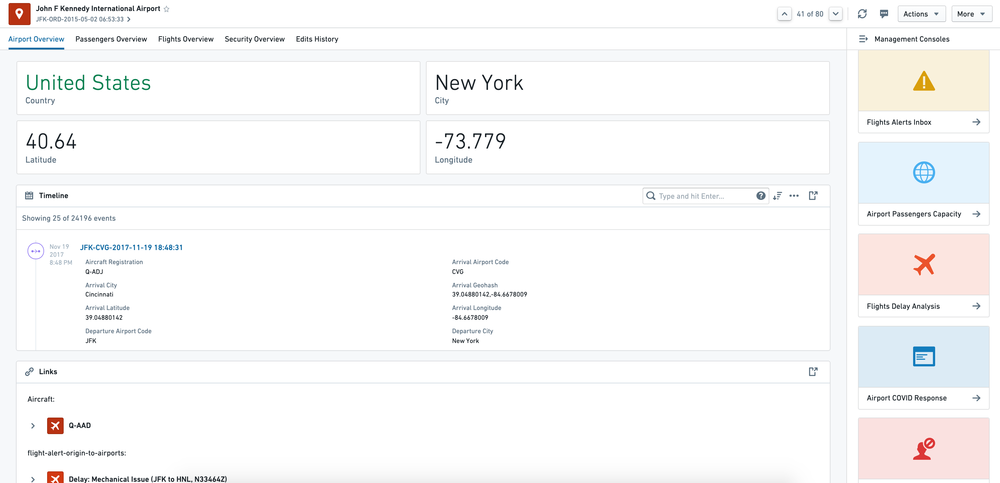
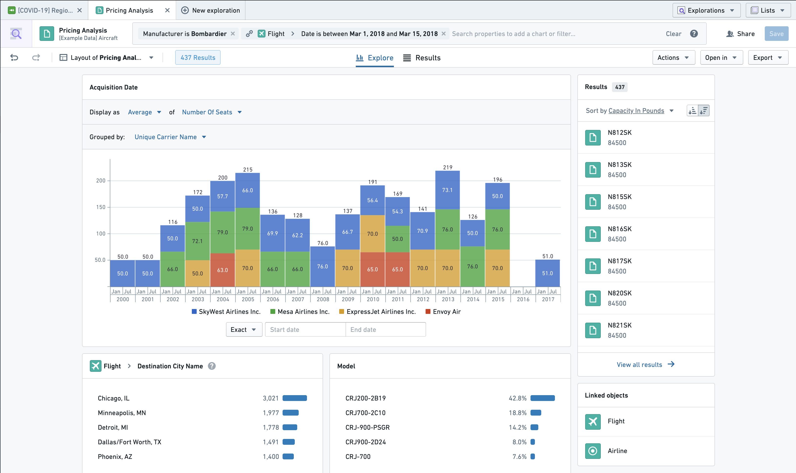
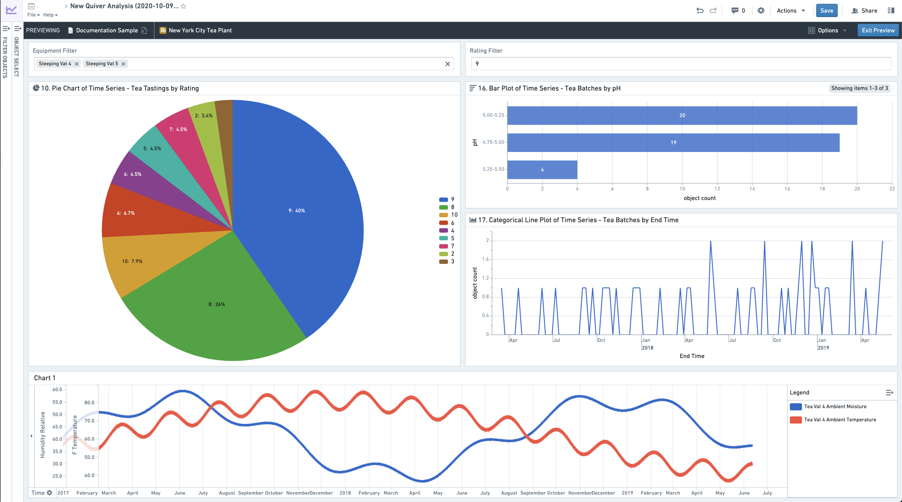
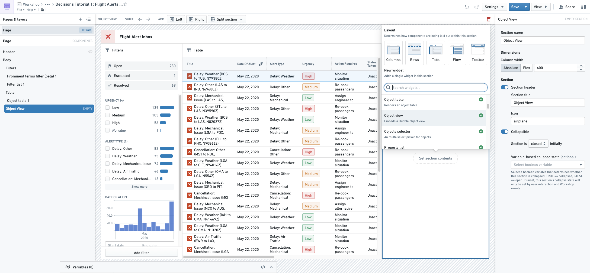
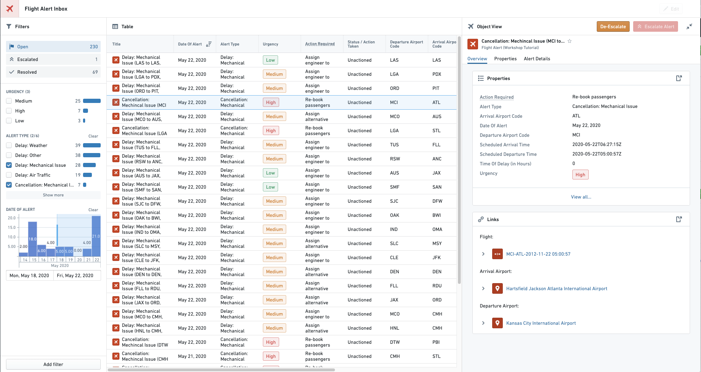
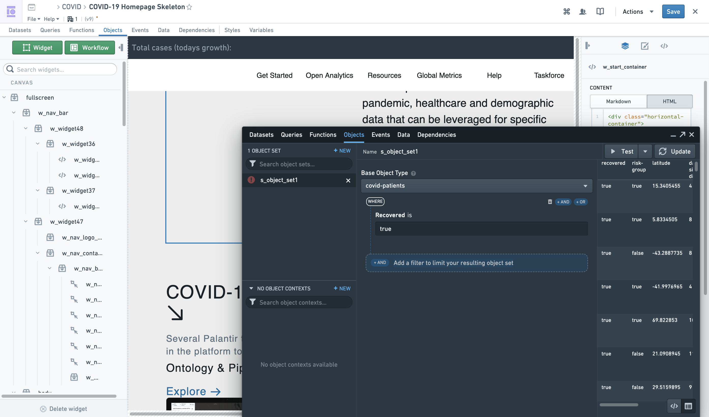
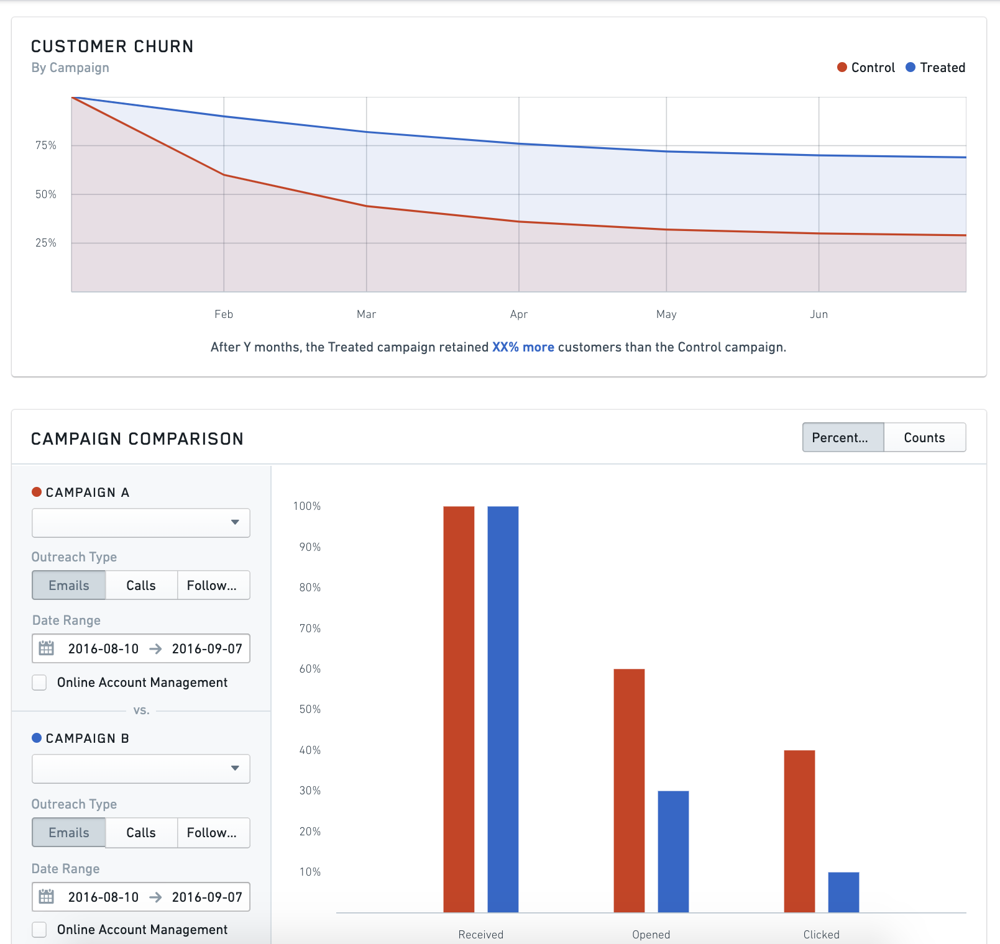
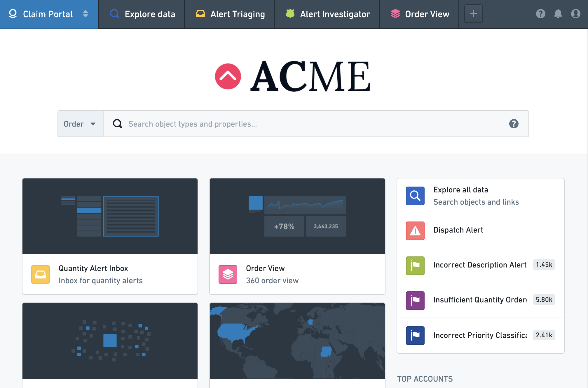
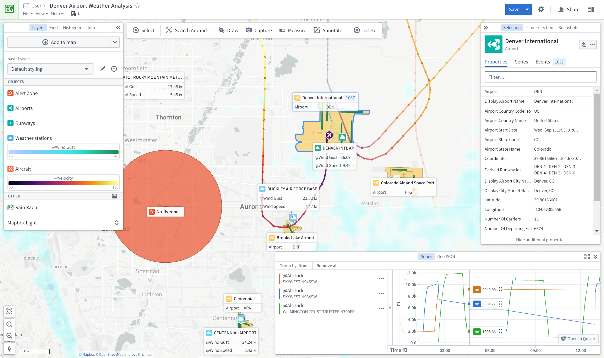

:::callout{theme="warning"}
注意：以下翻译的准确性尚未经过验证。这是使用 [AIP ↗](https://www.palantir.com/platforms/aip/) 从原始英文文本进行的机器翻译。
:::

# 基于Ontology的应用程序

Foundry包含许多在Ontology上原生运行的应用程序。这些对象感知的应用程序共同提供了一个强大的分析和操作平台，支持各种应用案例和用户配置文件。

要了解更多关于为何设置Ontology和使用对象感知应用程序的价值，请参见[此页面](%E4%B8%BA%E4%BB%80%E4%B9%88%E5%88%9B%E5%BB%BAOntology%EF%BC%9F.md)。

此页面提供可用应用程序的参考，并解释何时应使用每个应用程序：

* [应用程序参考](#application-reference)
* [应用程序比较](#application-comparison)

## 应用程序参考

### Object Views

[**Object Views**](%E5%BA%94%E7%94%A8/%E5%AF%B9%E8%B1%A1%E8%A7%86%E5%9B%BE/%E6%A6%82%E8%A7%88.md) 是与特定对象相关的所有信息和工作流的中心枢纽。这包括关于对象的关键“生物数据”、任何链接的对象、相关的关键指标，以及与该对象相关的关键分析、仪表盘和应用程序的链接（或嵌入）。

例如，`Airport`对象类型的对象视图可能为每个`Airport`对象提供以下信息：

* 生物数据，如`country`、`city`、`longitude`、`latitude`等。
* 所有链接到`Airport`的`Aircraft`对象和`Flight`对象的360度视图
* 嵌入的`Airport Covid Response`工作流
* 与`Airport`相关的`Flight delay`事件的`Root-Cause Analysis`链接

### Object Explorer

[**Object Explorer**](%E5%BA%94%E7%94%A8/%E5%AF%B9%E8%B1%A1%E6%B5%8F%E8%A7%88%E5%99%A8/%E6%A6%82%E8%BF%B0.md) 是一个用于回答Ontology层中任何问题的搜索和分析工具。用户可以通过视觉上构建搜索查询，从简单的筛选到Search Arounds来寻找感兴趣的对象。然后，他们可以使用探索视图或将其视为结果表来探索所得到的对象集。此外，用户可以比较和对比对象集，并对对象集执行批量操作（例如，数据输出）。然后，用户可以导出对象集或在兼容应用程序中打开它们，如Workshop。

探索视图是一组预设和可配置的可视化（如图表或地图），用户可以进一步利用它们深入到特定对象的子集。Object Explorer不需要预配置，面向技术要求较低的用户。

### Quiver

[**Quiver**](https://www.palantir.com/docs/foundry/quiver/overview/) 通过一个视觉的点击界面和一个强大的图表库在Ontology层中实现高级分析工作流。Quiver可用于支持从简单线性钻取分析到具有聚合和统计函数的高度分支和复杂分析的任何内容。Quiver还支持原生时间序列分析。Quiver分析可以模板化为只读仪表盘，以便更广泛的消费。

### Workshop

[**Workshop**](https://www.palantir.com/docs/foundry/workshop/overview/) 在Ontology层上实现无需代码的应用程序搭建。Workshop中搭建的应用程序比其他点击工具创建的典型仪表盘更具动态性和互动性。

通过利用高质量的[设计](https://www.palantir.com/docs/foundry/workshop/concepts-layouts/)和易于使用但复杂的[事件系统](https://www.palantir.com/docs/foundry/workshop/concepts-events/)，Workshop应用程序旨在像自定义React应用程序一样用户友好和高质量。

*Workshop编辑器视图*

*最终Workshop模块*

### Slate

[**Slate**](https://www.palantir.com/docs/foundry/slate/overview/) 是Foundry的一个灵活应用程序构建器，需要比Workshop更多的技术配置和代码。Slate应用程序与Ontology层交互，但也可以直接与Foundry数据集交互。Slate基于Web开发范式实现了显著的视觉定制，并且具有广泛的可用功能，但也需要比Workshop更多的技术知识来构建和维护应用程序。

*Slate编辑器视图*

*Slate应用程序视图*

### Carbon

[**Carbon**](https://www.palantir.com/docs/foundry/carbon/overview/) 允许在Foundry中组合多个资源或应用程序，为操作用户创建高度策划的*工作空间*。通过允许您组合分析结果（如仪表盘）、在Workshop或Slate中搭建的应用程序，以及开箱即用的功能（如Object Views和Object Explorer），Carbon使工作流构建者能够进行“最后一公里”的定制，以为最终用户创建一个高度定制和可用的体验。

### Map

[**Map**](%E5%BA%94%E7%94%A8/%E5%9C%B0%E5%9B%BE/%E6%A6%82%E8%A7%88.md) 应用程序允许您在地理空间背景中汇集和分析对象及其他数据。

## 应用程序比较

每个对象感知的应用程序在几个方面有所不同。三个特别重要的方面是：

* [主要应用案例](#use-case)，
* [工作流风格](#workflow-style)，以及
* 应用程序的[配置模型](#configuration-model)。

| Foundry应用程序 | [主要应用案例](#use-case) | [工作流风格](#workflow-style) | [配置模型](#configuration-model) | 对象或数据集 |
| --- | --- | --- | --- | --- |
|[Object Views](#object-views) | 发现 | 特定工作流 | 可直接使用 | Object |
|[Object Explorer](#object-explorer) | 发现与分析 | 探索性 | 可直接使用 | Object |
|[Quiver](#quiver) | 分析与仪表盘 | 探索性（分析模式）；特定工作流（仪表盘模式） | 可直接使用（分析模式）；可定制（仪表盘模式） | Object |
|[Workshop](#workshop) | 应用程序与仪表盘 | 特定工作流 | 可定制 | Object |
|[Slate](#slate) | 应用程序与仪表盘（复杂） | 特定工作流 | 可定制 | Object（推荐）和数据集 |
|[Map](#map) | 地理空间 | 探索性或特定工作流 | 可直接使用 | Object |

### 应用案例

对象感知应用程序支持的主要应用案例有**发现**、**分析**、**仪表盘**和**应用程序**。

* **发现**使用户能够找到正确的信息或工作流。发现主要通过两个核心功能实现：策划内容中心和搜索。策划内容中心（有时称为登录页面或“360视图”）从任何用户的全面标准视图到特定用户组或应用案例的目标视图。搜索功能通过关键字的自由文本搜索以及通过链接遍历或深入的更迭搜索来支持发现。
* **分析**使用户能够回答广泛的问题。这些问题从简单的（*给定产品的平均客户保留率是多少？*）到非常复杂的（*三个不同客户群在保留率和总收入上的比较如何随着时间的推移，在所有产品和每个单独产品中进行比较？*）。分析路径是探索性的，这意味着它是由最终用户自己定义的，通常是高度迭代的；在初始问题得到解答后，新的问题被开发并纳入分析路径。
* **仪表盘**是预配置的可视化集合，主要由更广泛的消费者用户以只读方式消费。仪表盘通常用于将有意义的*分析*转化为经常性报告或操作监控。仪表盘的特点是大量的图表和其他可视化，但不像*应用程序*（见下文）那样可定制或互动。仪表盘通常参数化，以便用户可以筛选不同数据子集的可视化。
* **应用程序**是为特定用户群组解决特定问题而设计的互动定制操作界面。应用程序通常比仪表盘更复杂，并旨在使用户能够遵循特定和在轨道上的工作流。虽然应用程序可能包含一些策划的分析内容（例如，统计、图表、图形等）以执行决策，但它通常也具有若干工作流元素，并且经常捕获用户输入（例如，数据输出）。

### 工作流风格

对象感知应用程序针对主要工作流风格进行了优化。

* **探索性应用程序**不需要由“构建者”用户预先配置，并且在数据被建模到Ontology后，最终用户可以开箱即用地使用。在探索性应用程序中，最终用户定义他们的分析路径，可以回答许多未预先确定的问题。探索性应用程序通常包含一组搜索、可视化和变换功能以实现这一目标。主要探索性对象感知应用程序包括Object Explorer和Quiver。
* **特定工作流应用程序**需要由“构建者”用户预先配置，然后最终用户才能实际使用。这是典型的仪表盘或应用程序，它们有两个主要用户组：（1）配置特定仪表盘或应用程序的构建者组和（2）为其构建应用程序的下游最终用户。Workshop和Slate模块都需要由“构建者”用户在编辑模式下预配置。

某些应用程序如Quiver同时适应这两种工作流风格，因为虽然其主要模式是探索性的，但输出可以配置为更广泛消费的特定工作流工件。虽然Quiver分析高度探索性，但它们可以发布为Quiver仪表盘，可供更广泛的受众访问的预配置分析视图。

### 配置模型

配置模型描述了在最终用户可以利用之前，用户界面必须配置到何种程度。

* **可直接使用**的应用程序可以被用户有效且立即地使用，几乎不需要配置要求或维护负担。例如，Object Explorer几乎没有配置要求，一旦定义了Ontology，最终用户即可立即使用。
* **可定制**的应用程序需要前期投资（通常由一个单独的“构建者”用户）以实现一个解决特定用户问题的界面。这也意味着更高的持续维护成本。然而，生成的应用程序通常是一个适合特定工作流需要的界面。Workshop和Slate是这种类型定制的例子。
