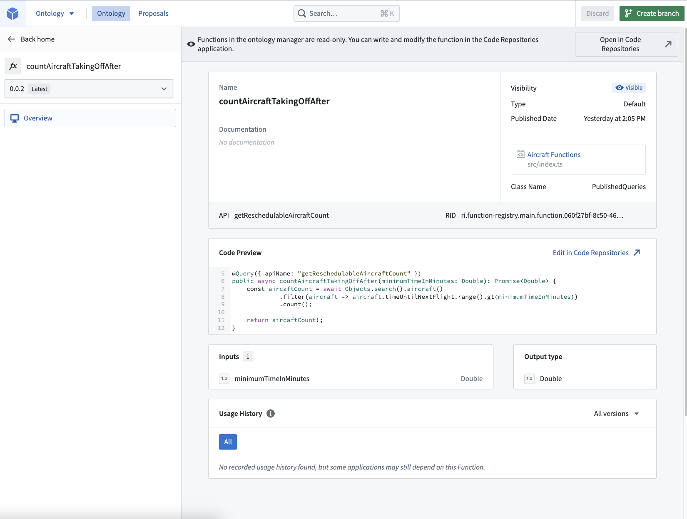

:::callout{theme="warning"}
注意：以下翻译的准确性尚未经过验证。这是使用 [AIP ↗](https://www.palantir.com/platforms/aip/) 从原始英文文本进行的机器翻译。
:::

# 查询

查询是只读的 函数 子集，可以通过[API 网关](https://www.palantir.com/docs/foundry/api/general/overview/introduction/) 非必填地公开。它们不能有任何副作用，比如修改 Ontology 或更改外部系统。如果需要通过 API 网关进行这些额外的编辑功能，您应该使用[操作](https://www.palantir.com/docs/foundry/api/ontology-resources/actions/apply-action/)。

## 查询装饰器

要使用 `Query` 装饰器，从 `@foundry/functions-api` 包中导入它。

```typescript
import { Query } from "@foundry/functions-api";
// 从 "@foundry/functions-api" 模块中导入 Query 类
```

装饰器还接受一个非必填参数 `apiName`，类型为 `字符串`，您可以用它来定义一个API名称。

### 示例：简单查询

这个简单查询的示例返回在特定时间后起飞的飞机数量。这里没有定义API名称。简单查询的行为类似于带有现有 [`@函数` 装饰器](../TypeScript%20basics/%E8%A3%85%E9%A5%B0%E5%99%A8.md) 的函数。

```typescript
import { Query, Double } from "@foundry/functions-api";
import { Objects, Aircraft } from "@foundry/ontology-api";

export class PublishedQueries {
    @Query()
    public async countAircraftTakingOffAfter(minimumTimeInMinutes: Double): Promise<Double> {
        // 搜索并过滤符合条件的飞机对象，条件是下一次航班的时间大于给定的分钟数
        const aircraftCount = await Objects.search().aircraft()
                 .filter(aircraft => aircraft.timeUntilNextFlight.range().gt(minimumTimeInMinutes))
                 .count(); // 计算满足条件的飞机数量

        return aircraftCount!; // 返回计算的飞机数量
    }
}
```

### 示例: API命名查询

为了通过Foundry的API访问查询，我们在`Query`装饰器中提供了一个名为`apiName`的非必填参数。下面的示例演示了如何通过[API网关](https://www.palantir.com/docs/foundry/api/general/overview/introduction/)公开之前的查询：

```typescript
import { Query, Double } from "@foundry/functions-api";
import { Objects, Aircraft } from "@foundry/ontology-api";

export class PublishedQueries {
    @Query({ apiName: "getReschedulableAircraftCount" })
    public async countAircraftTakingOffAfter(minimumTimeInMinutes: Double): Promise<Double> {
        // 使用Objects.search()搜索飞机对象
        const aircraftCount = await Objects.search().aircraft()
                 // 过滤出起飞时间距离当前时间大于minimumTimeInMinutes的飞机
                 .filter(aircraft => aircraft.timeUntilNextFlight.range().gt(minimumTimeInMinutes))
                 // 计算符合条件的飞机数量
                 .count();

        // 返回飞机数量
        return aircraftCount!;
    }
}
```

该代码定义了一个类 `PublishedQueries`，其中包含一个异步方法 `countAircraftTakingOffAfter`。这个方法通过 `Objects.search().aircraft()` 获取所有飞机对象，并过滤出那些距离下次起飞时间大于给定分钟数的飞机，最后返回符合条件的飞机数量。

## API 名称验证

查询的 `apiName` 必须是符合以下要求的字符串：

* 使用 `lowerCamelCase` 格式。
* 少于 100 个字符。
* 不包含前导数字。
* 在导入到存储库的所有 ontologies 中唯一。
  * 如果 `apiName` 不唯一，[标记过程](../%E5%85%A5%E9%97%A8.md#publish-the-function) 将失败，您需要更改名称。

此外，包含 API 命名查询的存储库必须从至少一个 Ontology 导入实体。

## 版本和更新 API 命名查询

API 命名查询将始终使用已发布查询的**最新标记版本**，并且不遵循与其他 Foundry 函数相同的语义版本控制范式。

要取消 API 名称与查询的关联并在 API 网关中中断它，您必须从 `Query` 装饰器中删除 API 名称并从存储库发布新标签。

:::callout{theme="neutral"}
更改装饰器中的 API 名称并发布新标签将中断消费者。仅支持查询的最新发布版本。

为了使消费者可以在不中断的情况下随时升级，您可能希望支持同一 API 名称的多个版本。要做到这一点，您必须在存储库中复制查询代码，并为其指定不同的 API 名称（例如 `getReschedulableAircraftCountV2`）。
:::

## 搜索和查看查询

与其他函数一样，您可以在 [Ontology 管理器](../../../%E5%BA%94%E7%94%A8/%E6%9C%AC%E4%BD%93%E7%AE%A1%E7%90%86%E5%99%A8/%E6%A6%82%E8%BF%B0.md) 中搜索和管理您的查询。您可以按查询名称或 API 名称搜索。

在下面的示例中，查询的 API 名称为 `getReschedulableAircraftCount`，查询名称为 `countAircraftTakingOffAfter`。



:::callout{theme="neutral"}
您可能需要更新存储库中的 `functions.json` 文件，通过将 `enableQueries` 属性设置为 true 来启用查询：

```typescript
{
  "enableQueries": true // 启用查询功能
}
```
:::

## 在其他函数库中调用查询

:::callout{theme="warning"}
将查询导入到其他函数代码库是一个测试功能，可能会发生更改。在此功能普遍可用之前，可能需要手动迁移。
:::

您可以从函数代码库左侧边栏的**资源导入**选项卡中导入查询（包括由AIP Logic发布的查询函数）。

然后，可以像调用任何其他函数一样在代码中导入并调用导入的查询函数。

```
## 示例：由 AIP Logic 暴露的查询函数
# 下面的查询函数示例由 AIP Logic 暴露，API 定义为 "generateAText":
import { Objects, Queries } from "@foundry/ontology-api";

export class MyFunctions {

    @Function()
    public async myFunction(subject: string): Promise<string> {
        // 注意：下面的语句等同于 `Queries.generateAText({ subject: subject });`
        return Queries.generateAText({ subject });
    }

}
```

:::callout{theme="warning"}
用户必须拥有所需权限以访问并触发AIP逻辑的依赖项，以成功运行导入的查询。
:::
