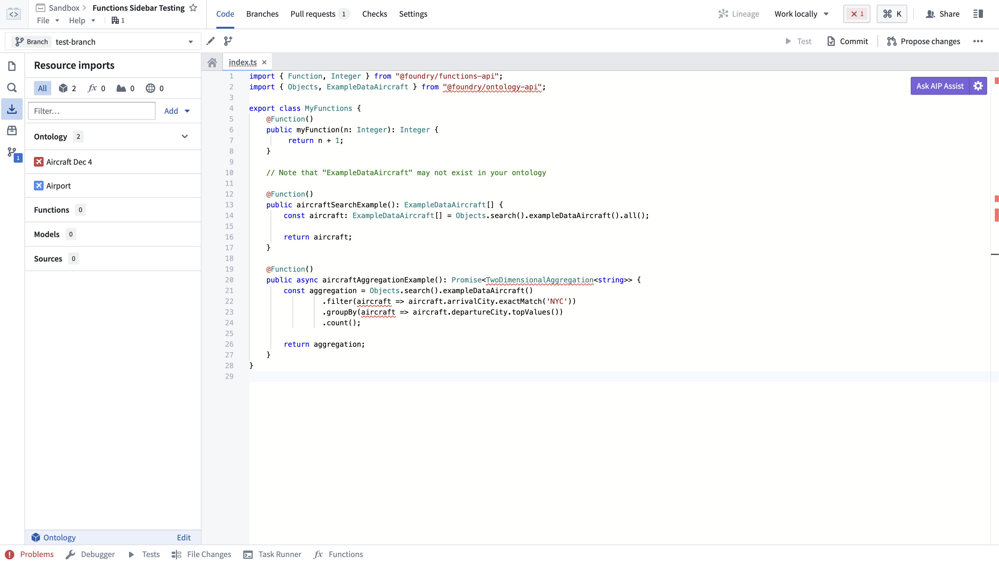
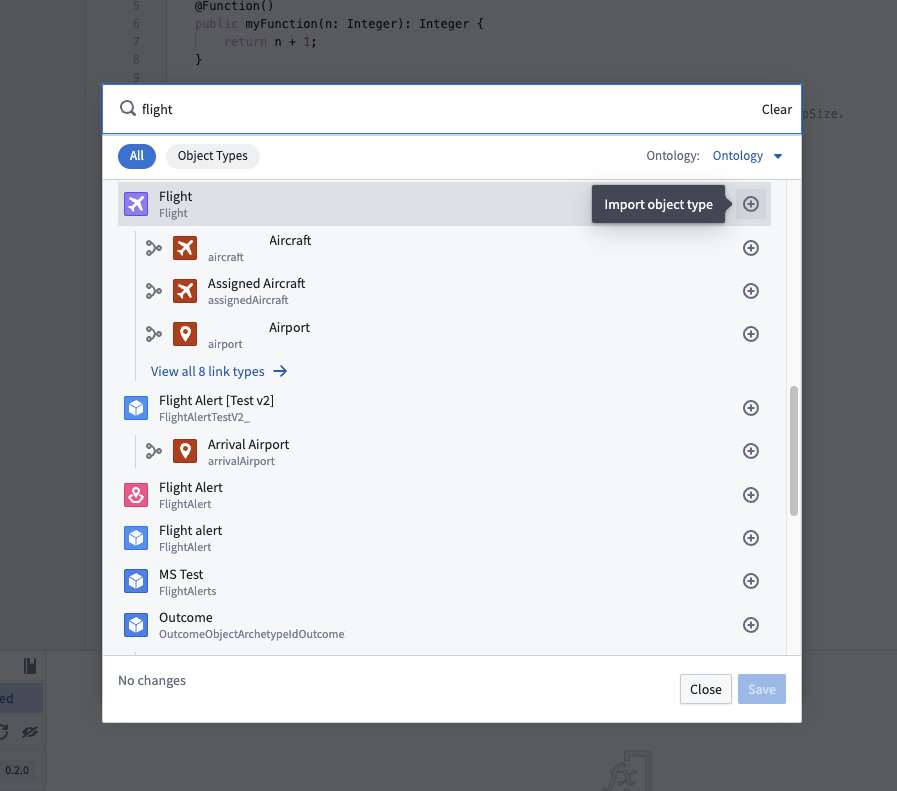
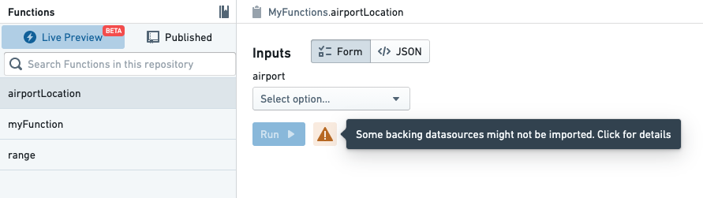
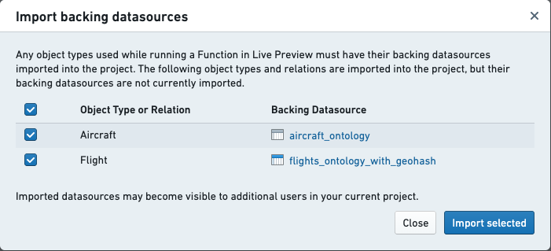
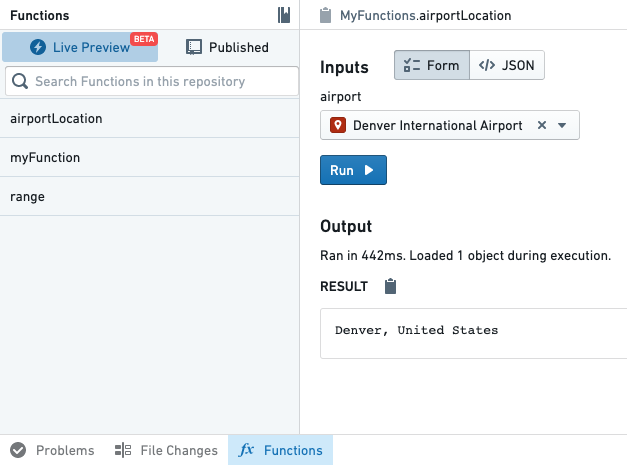
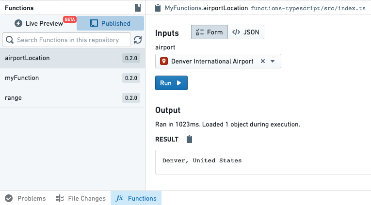

:::callout{theme="warning"}
注意：以下翻译的准确性尚未经过验证。这是使用 [AIP ↗](https://www.palantir.com/platforms/aip/) 从原始英文文本进行的机器翻译。
:::

# 入门

函数的核心功能之一是能够轻松访问已集成到Foundry Ontology中的数据。Ontology为您的组织提供数据的语义建模，使得访问结构化数据和在应用案例中重用逻辑变得容易。

:::callout{title="先决条件"}
本教程假设您已经创建并设置了一个TypeScript代码库。如果还没有，请先完成[入门](../%E5%85%A5%E9%97%A8.md)教程。
:::

### 导入Ontology类型

您要在函数中使用的任何Object或链接类型必须被导入到包含您代码库的项目中。点击**资源导入**侧边栏可以查看已导入到项目中的Object类型。



:::callout{theme="neutral"}
您的组织可能没有机场和航班对象。请使用您有权限访问的任意Object类型进行操作。
:::

要导入其他Object类型，您需要在**资源导入**侧边栏中选择**添加**按钮。如果尚未选择Ontology，系统将提示您选择一个Ontology。如果您至少有一个已导入的Ontology类型，所选Ontology将自动被解析。

一旦选择了Ontology，将出现一个搜索模式。您的Ontology将取决于您组织中可用的Object类型。首先选择几个Object类型及其连接的链接类型。在本例中，我们将导入机场和航班对象，以及它们之间的链接类型。



选择**确认选择**以将Ontology类型导入项目。代码助手将自动重启以重新生成代码绑定，以反映您所导入的新Object和链接类型。

在您的代码中，您现在可以从`@foundry/ontology-api`包中导入Ontology类型。如果您使用的是私有Ontology，包名将改为`@foundry/ontology-api/<ontology-api-name>`。

:::callout{title="私有Ontology"}
如果您使用的是私有Ontology，请在以下所有示例中将`@foundry/ontology-api`替换为`@foundry/ontology-api/your-private-ontology-api-name-here`。
:::

### 添加一个基于Object的函数

接下来，让我们使用刚刚导入的Object类型编写一个函数。您的代码将依赖于可用的Object类型、属性和链接类型。切换回**代码**选项卡，并尝试导入您刚添加的一个Object类型：

```typescript
import { Airport } from "@foundry/ontology-api";
// 从 @foundry/ontology-api 模块中导入 Airport 类
```

然后，编写一个以该Object为输入的函数：

```typescript
@Function()
public myObjectFunction(airport: Airport) {
    airport.
    // 这里的代码块定义了一个函数 `myObjectFunction`，它接受一个 `Airport` 类型的参数 `airport`
    // 目前函数体为空，可以在此处对 `airport` 对象进行操作
}
```

一旦代码助手启动，只需输入 `airport.` 即可查看可用属性和链接类型的自动完成：

在此示例中，我们使用[模板字符串 ↗](https://developer.mozilla.org/en-US/docs/Web/JavaScript/Reference/Template_literals#syntax)将机场的 `city` 和 `country` 字段组合成一个人类可读的位置：

```typescript
@Function() // 标记为一个函数
public airportLocation(airport: Airport): string { // 定义一个方法，接收一个类型为 Airport 的参数
    return `${airport.city}, ${airport.country}`; // 返回机场所在的城市和国家，格式为 "城市, 国家"
}
```

根据您自己的Ontology实验API，并编写一个基于您的Object类型返回值的函数。

### 在实时预览中测试

打开**函数助手**，切换到**实时预览**，然后选择您上面编写的函数。要在实时预览中运行一个基于对象的函数，您必须导入该对象类型的支持数据源。点击**运行按钮**旁边的警告图标：



然后，使用对话框导入您的对象类型的支持数据源：



导入数据源后，选择一个对象并点击**运行**以查看结果：



:::callout{theme="warning" title="实时预览权限"}
实时预览中对象类型的权限由[TypeScript库对底层每个对象类型的支持数据源的权限](../%E6%9D%83%E9%99%90.md#object-loading-permissions)决定。在测试[创建通知的函数](../%E9%85%8D%E7%BD%AE%E9%80%9A%E7%9F%A5.md#configure-notifications)时，收件人的权限不会被强制执行。因此，一个创建通知的函数在实时预览中可能成功，但在Foundry中由其他操作使用时可能失败。

了解更多关于[为操作配置通知](../../%E5%8A%A8%E4%BD%9C%E7%B1%BB%E5%9E%8B/Side%20effects/%E9%80%9A%E7%9F%A5.md)的信息。
:::

### 发布新的函数

通过提交您的代码并使用**分支**选项卡发布一个新的标签来发布新的函数。一旦您的函数已发布，您可以使用**函数助手**进行测试。



函数发布后，您可以在整个平台的其他应用程序中开始使用它。

### 下一步

本教程仅触及在Objects上使用函数的表面。要了解更多，请尝试以下资源：

* 参考[Object API文档](API-%20Object%E5%92%8C%E9%93%BE%E6%8E%A5.md)以了解您可以对Object做什么
* 阅读[对象集文档](API%EF%BC%9A%E5%AF%B9%E8%B1%A1%E9%9B%86.md)以了解如何按需搜索对象和聚合
* 了解您可以如何[在平台中使用函数](../%E5%9C%A8%E5%B9%B3%E5%8F%B0%E4%B8%AD%E4%BD%BF%E7%94%A8%E5%87%BD%E6%95%B0.md)
