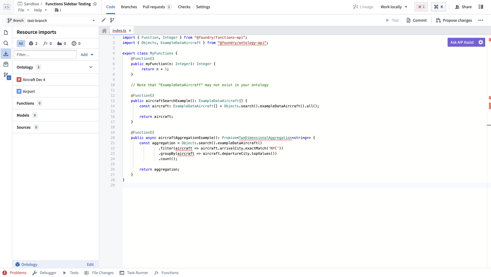
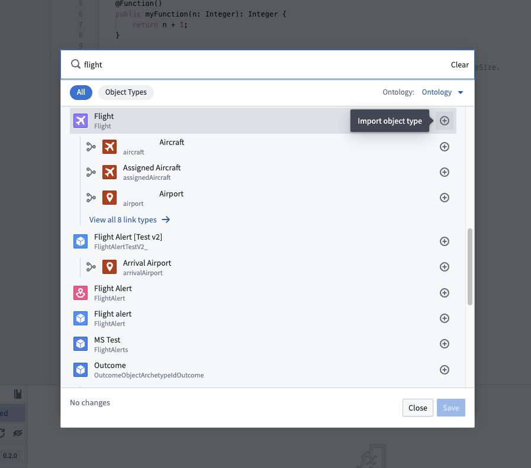
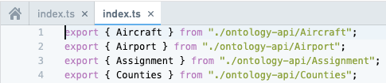

:::callout{theme="warning"}
注意：以下翻译的准确性尚未经过验证。这是使用 [AIP ↗](https://www.palantir.com/platforms/aip/) 从原始英文文本进行的机器翻译。
:::

# 导入Object和链接类型

任何您想在函数中使用的Object或链接类型都必须导入到包含您存储库的项目中。选择**资源导入**侧边栏以查看已导入到项目中的Object类型。

:::callout{theme="neutral"}
您的组织可能没有`Airport`和`Flight` Objects。在执行这些步骤时，请使用您有权限访问的任何Object类型。
:::

要导入其他Object类型，您需要在**资源导入**侧边栏中选择**添加**按钮。如果未选择任何Ontology，系统将提示您选择一个Ontology。如果您至少有一个已导入的Ontology类型，所选的Ontology将自动被解析。

一旦选择了Ontology，将出现一个搜索窗口。您的Ontology将取决于您组织中可用的Object类型。首先选择一些Object类型和连接它们的链接类型。在本例中，我们将导入`Airport`和`Flight` Objects，及其之间的链接类型。

选择**保存**以将Ontology类型导入到项目中。Code Assist将自动重启以重新生成代码绑定，反映您导入的新Object和链接类型。

在您的代码中，您现在可以从`@foundry/ontology-api`包中导入Ontology类型。如果您使用的是私有Ontology，包名称将为`@foundry/ontology-api/<ontology-api-name>`。

一旦Code Assist启动，您可以通过使用`Ctrl`+点击@foundry/ontology-api包名称查看所有可用的Object类型。打开的index.ts文件显示了您可以导入到代码中的所有有效Object类型：

如果您可以访问多个Ontology，您可以使用选择器来选择您想使用的Ontology。目前，不支持将多个Ontology导入到单个项目中。
