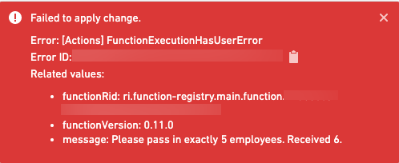

:::callout{theme="warning"}
注意：以下翻译的准确性尚未经过验证。这是使用 [AIP ↗](https://www.palantir.com/platforms/aip/) 从原始英文文本进行的机器翻译。
:::

# 抛出用户界面错误

在平台的其他部分运行函数时，例如Workshop或操作，您可能希望抛出带有详细信息的错误。为此，请从`@foundry/functions-api`包中抛出一个`UserFacingError`。例如：

```typescript
    import { Edits, OntologyEditFunction, UserFacingError } from "@foundry/functions-api";
    import { Employee } from "@foundry/ontology-api";

    @Edits(Employee)
    @OntologyEditFunction()
    public editExactlyFiveEmployees(employees: Employee[]): void {
        if (employees.length != 5) {
            // 检查传入的员工数量是否不等于5，如果不是则抛出一个用户可见的错误
            throw new UserFacingError(`Pass in exactly 5 employees. Received ${employees.length}.`);
        }
        ...
    }
```

当在[Workshop 应用程序](https://www.palantir.com/docs/foundry/workshop/functions-use/)中以[函数支持的操作](../../%E5%8A%A8%E4%BD%9C%E7%B1%BB%E5%9E%8B/Function-backed%20actions/%E6%A6%82%E8%BF%B0.md)运行此操作且员工数量不正确时，用户将看到以下错误：



通过添加详细的用户界面错误信息，您可以帮助您的函数的其他用户快速识别和解决问题。
