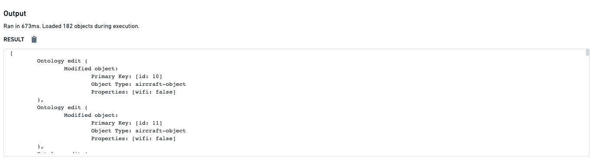

:::callout{theme="warning"}
注意：以下翻译的准确性尚未经过验证。这是使用 [AIP ↗](https://www.palantir.com/platforms/aip/) 从原始英文文本进行的机器翻译。
:::

# 概述

**Ontology 编辑**是指创建、修改或删除对象的概念。函数支持返回[Ontology 编辑](API-%20Ontology%E7%BC%96%E8%BE%91.md)，以在[函数支持的操作](../../%E5%8A%A8%E4%BD%9C%E7%B1%BB%E5%9E%8B/Function-backed%20actions/%E6%A6%82%E8%BF%B0.md)中使用。这些函数是使用`@OntologyEditFunction`装饰器编写的，该装饰器提供特殊语义，使编写函数更加容易。

函数提供了开箱即用的代码分析，以检测代码中引用的被编辑对象类型。这些检测到的对象类型用于提供操作的来源，并可能被[操作服务用于强制其权限](../../%E5%8A%A8%E4%BD%9C%E7%B1%BB%E5%9E%8B/%E6%9D%83%E9%99%90.md)。您可以在代码仓库的函数助手中检查这些被编辑的对象类型。如果引用了一个被编辑的对象类型但没有被检测到，您必须使用`@Edits([object type])`装饰器[手动指定](#manually-specifying-the-edited-object-type)对象类型，以强制操作权限的正确来源。您可以使用可用的API为Ontology编辑函数编写单元测试，以[验证Ontology编辑](../Unit%20testing/%E9%AA%8C%E8%AF%81Ontology%E7%BC%96%E8%BE%91.md)。

本文档的其余部分描述了Ontology编辑函数如何在幕后工作，以便为您提供对底层基础设施的更好理解。

### 编辑何时应用

关于Ontology编辑函数的一个常见误解是运行它们是否会更新Ontology中的对象。当您在**Authoring**中的函数助手中运行Ontology编辑函数时，编辑不会应用于实际对象。唯一使用函数更新对象的方法是按照[函数支持的操作](../../%E5%8A%A8%E4%BD%9C%E7%B1%BB%E5%9E%8B/Function-backed%20actions/%E6%A6%82%E8%BF%B0.md)文档中的描述配置一个操作以使用该函数。

这意味着您可以在函数助手中自由运行Ontology编辑函数，以验证各种输入的结果，而无需担心对象本身会被更新。



### 编辑如何被捕获

当执行Ontology编辑函数时，对象的所有更新都由函数基础设施捕获，并在函数执行结束时返回。这包括通过Objects.create() API创建的新对象，所有属性更新和对象删除。

编辑会被智能地合并，以便在一个操作中应用最小集合的编辑。例如，如果您创建一个新对象然后更新其属性，将返回一个包含属性更新的**创建对象**编辑。同样，更新现有对象的多个属性将返回一个包含所有属性编辑的**更新对象**编辑。删除一个对象将删除在删除之前所做的任何其他属性编辑。整个函数必须成功才能生成传递给执行原子事务的操作服务的编辑列表。

捕获的Ontology编辑作为函数执行的结果列表返回。这就是为什么Ontology编辑函数必须具有`void`或`Promise<void>`的返回类型：当它们被执行时，函数的真实返回类型是一个Ontology编辑列表，因此不可能同时返回其他值。

编辑在单个函数执行的整个生命周期内被捕获在一个单一的编辑存储中。这意味着即使这些辅助函数没有作为Ontology编辑函数发布，也可以调用创建、更新或删除对象的辅助函数。例如：

```typescript
export class HelperEditFunctions {
    @Edits(ObjectA, ObjectB)
    @OntologyEditFunction()
    public createAndLink(): void {
        // 创建对象A和对象B，并将它们链接在一起
        const objectA = this.createObjectA();
        const objectB = this.createObjectB();
        objectA.linkToB.set(objectB); // 将对象B设置为对象A的链接
    }

    /**
     * 尽管这些辅助函数没有用 @OntologyEditFunction() 注解，
     * 它们仍然可以创建用于其他编辑函数的新对象。
     */
    private createObjectA(): ObjectA {
        // 创建对象A并设置其属性
        const objectA = Objects.create().objectA(this.generateRandomId());
        objectA.prop1 = "example"; // 设置属性1
        objectA.prop2 = 42;        // 设置属性2
        return objectA;
    }

    private createObjectB(): ObjectB {
        // 创建对象B并设置其属性
        const objectB = Objects.create().objectB(this.generateRandomId());
        objectB.prop1 = "another example"; // 设置属性1
        return objectB;
    }

    /* 根据需要生成主键，例如
    import { Uuid } from "@foundry/functions-utils";
    private generateRandomId(){
       return Uuid.random(); // 生成随机UUID
    }
    */
}

```

### 检索编辑后的值

当在一个函数中进行编辑时，函数基础设施将在您读取它们时返回编辑后的值。例如，设置一个对象的属性然后检索它将返回新值：

```
// 将飞机的起飞时间设置为新的起飞时间
airplane.departureTime = newDepartureTime;
// 输出新的起飞时间到控制台
console.log(airplane.departureTime); // 将会输出 newDepartureTime
```

删除一个Object会将其从搜索结果中移除，并阻止访问其属性。

#### 注意事项：编辑和Object搜索

对Object和链接的更改将在您的函数执行完毕*之后*传播到[Objects.search() APIs](../Functions%20on%20objects/API%EF%BC%9A%E5%AF%B9%E8%B1%A1%E9%9B%86.md)。这意味着Objects.search() APIs将使用旧的Object、属性和链接。因此，搜索、筛选、周边搜索和聚合可能不会反映Ontology的编辑，包括创建和删除。您的函数需要手动处理这种情况。

在以下示例中，假设有一个ID为1的员工。

```typescript
import { OntologyEditFunction } from "@foundry/functions-api";
import { Employee, Objects } from "@foundry/ontology-api";

export class CaveatEditFunctions {
    @OntologyEditFunction()
    public async editAndSearch(): Promise<void> {
        // 搜索id为1的员工对象并修改其姓名为"Bob"
        let employeeOne = Objects.search().employee().filter(e => e.id.exactMatch(1)).all()[0];
        employeeOne.name = "Bob";

        // 打印搜索结果中姓名为"Bob"的员工数量
        console.log(await Objects.search().employee().filter(e => e.name.exactMatch("Bob")).count() ?? -1);
        // 预期结果: 1, 实际结果: 0
    }
}
```

在这段代码中，`editAndSearch` 方法尝试搜索一个特定ID的员工对象并修改其姓名，然后再检索出具有该姓名的员工数量。然而，代码的实际行为可能未能生效，导致员工姓名未被实际更新，因而搜索不到任何结果。

### 手动指定编辑的对象类型

函数智能分析您的代码中编辑的对象类型。此出处可能被其他服务（如操作）使用以执行权限管理。正确指定出处非常重要。
在少数情况下，您的代码的静态分析可能无法检测到所引用的编辑对象类型（例如，如果您将对象类型转换为`any`）。此时，您需要手动在函数顶部添加`@Edits([object type])`装饰器以指定对象类型。

#### 示例

在以下示例中，两个对象类型`Employee`和`Aircraft`由以下函数编辑：

```typescript
import { OntologyEditFunction } from "@foundry/functions-api";
import { Employee, Aircraft, Objects } from "@foundry/ontology-api";

export class ManuallySpecifyingObjectFunction {
    @OntologyEditFunction()
    public myFunction(): void {
        const x = Objects.search().aircraft().all()[0];
        x.businessCapacity = 3; // 设置飞机的商业容量为3

        const y = Objects.search().employee().all()[0];
        (y as any).department = ""; // 设置员工的部门为空字符串
        // 期望: "Employee" 和 "Aircraft" 对象类型都被检测到，
        // 实际: 只有 "aircraft" 对象类型被检测到
    }
}
```

这段代码定义了一个类 `ManuallySpecifyingObjectFunction`，其中包含一个名为 `myFunction` 的方法。该方法使用了 `OntologyEditFunction` 装饰器，说明这是一个用于编辑本体的函数。代码中通过 `Objects.search()` 方法搜索并获取第一个飞机和员工对象，然后分别对它们的一些属性进行修改。注意到在 `y` 对象的类型转换中使用了 `any` 类型，这可能是为了绕过类型检查。代码中注释指出了一个预期和实际行为不一致的问题。
您可以从代码库中的函数助手看到，仅检测到一个对象类型，即 `Aircraft`。这是因为第二个对象类型 `Employee` 被转换为 `any`，导致类型信息丢失。

[官方图片已失效：检测到的引用对象类型](https://www.palantir.com/docs/resources/foundry/functions/referenced-object-types-edited.png)

我们可以通过使用装饰器 `@Edits(Employee)` 手动指定对象类型来解决此问题。请记得 `import {Edits} from "@foundry/functions-api"`。

```typescript
import { OntologyEditFunction, Edits } from "@foundry/functions-api"; // 导入 Edits
import { Employee, Aircraft, Objects } from "@foundry/ontology-api";

export class ManuallySpecifyingObjectFunction {
    @Edits(Employee) // 这个装饰器手动指定对象类型 "Employee" 应该被添加到已编辑对象类型的来源列表中。
    @OntologyEditFunction()
    public myFunction(): void {
        // 搜索所有飞机对象并获取第一个
        const x = Objects.search().aircraft().all()[0];
        // 设置该飞机对象的业务容量为3
        x.businessCapacity = 3;

        // 搜索所有员工对象并获取第一个
        const y = Objects.search().employee().all()[0];
        // 将该员工对象的部门属性设为空字符串
        (y as any).department = ""
    }
}
```

您可以从代码库中的函数助手看到，所有已编辑的对象类型都被检测到。


> 配图缺失说明：本页有 1 个官方图片地址在抓取及重试时失效（返回 HTML 错误页）。下列地址保留用于溯源，未替换成其他版本的图片。

- 官方图片已失效：<https://www.palantir.com/docs/resources/foundry/functions/referenced-object-types-edited.png>
