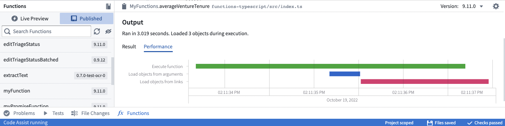

:::callout{theme="warning"}
注意：以下翻译的准确性尚未经过验证。这是使用 [AIP ↗](https://www.palantir.com/platforms/aip/) 从原始英文文本进行的机器翻译。
:::

# 优化性能

本节旨在描述用户在使用函数时最常遇到的性能问题，并记录优化代码以避免瓶颈的方法。

## 使用性能选项卡提升函数性能

性能选项卡为您提供了一个工具，用于分析和识别函数的性能问题。在函数运行后，可以在函数助手中找到此选项卡。



瀑布图用作横跨时间的水平条来表示操作。每个操作都有标记以指示时间的花费。

* **执行函数** 表示执行函数代码所花费的CPU时间。
* **从参数加载对象** 和 **从链接加载对象** 表示调用底层Ontology后端数据库服务（OSS）所花费的时间。

为提升性能，您可以：

* 使用Objects API来比Typescript更快速地聚合和遍历链接（如[下文](#prefer-using-the-objects-api-where-possible)所述）。
* 确保Ontology后端服务调用是并行进行的，以避免顺序加载。如果您有多个`async`/`await`调用，请使用`Promise.all`来并行`await`所有调用。
  * 例如，一个常见的模式是对列表中的每个对象使用`.map()`将调用映射到它们的Promises，然后对结果列表使用`Promise.all`。
* 避免不必要的嵌套循环，这可能会增加执行时间。

## 尽量使用Objects API

在使用[Workshop的派生属性](https://www.palantir.com/docs/foundry/workshop/widgets-object-table/#function-backed-columns)时，一个常见的模式是通过聚合每个Object的链接来计算属性值（例如，计算相关对象的数量）。

虽然下面的代码可以工作，但函数本身必须检索所有链接的对象，然后执行聚合（在此情况下，计算长度）：

```typescript
@Function()
public async getEmployeeProjectCount(employees: Employee[]): Promise<FunctionsMap<Employee, Integer>> {
    // 为每个员工调用workHistory.allAsync()方法，返回一个Promise数组
    const promises = employees.map(employee => employee.workHistory.allAsync());
    // 等待所有Promise完成，并将结果存入allEmployeeProjects数组
    const allEmployeeProjects = await Promise.all(promises);
    let functionsMap = new FunctionsMap();
    // 遍历每个员工，将其对应的项目数量加入functionsMap
    for (let i = 0; i < employees.length; i++) {
        functionsMap.set(employees[i], allEmployeeProjects[i].length);
    }
    // 返回包含员工与其项目数量的映射
    return functionsMap;
}
```

虽然上述内容利用了异步API和异步函数（见[优化链接遍历](#optimizing-link-traversals)），但通常使用Objects API提供的聚合方法更有利：

```typescript
@Function()
public async getEmployeeProjectCount(employees: Employee[]): Promise<FunctionsMap<Employee, Integer>> {
    const result: FunctionsMap<Employee, Integer> = new FunctionsMap();

    // 获取所有项目，这些项目的 employeeId 与传入的 employees 参数匹配，然后统计每个 employeeId 对应的项目数量
    const aggregation = await Objects.search().project()
            .filter(project => project.employeeId.exactMatch(...employees.map(employee => employee.id))) // 过滤出 employeeId 精确匹配的项目
            .groupBy(project => project.employeeId.byFixedWidths(1)) // 按 employeeId 分组，每组宽度固定为1
            .count(); // 统计每个分组的数量

    const map = new Map();
    aggregation.buckets.forEach(bucket => {
        // bucket.key.min 表示 employeeId，因为每个 bucket 的大小是1
        map.set(bucket.key.min, bucket.value); // 将 employeeId 及对应的项目计数存入 map
    });
    employees.forEach(employee => {
        const value = map.get(employee.primaryKey); // 获取每个员工的项目计数
        if (value === undefined) {
            return; // 如果没有计数，则跳过该员工
        }
        result.set(employee, value); // 将员工与项目计数添加到结果中
    });

    return result; // 返回员工与项目计数的映射
}
```

这样，您可以在单步内执行聚合，而无需先导入所有关联项目。

:::callout{theme="neutral"}
请注意，聚合的常见限制仍然适用。特别是，对于字符串ID，`.topValues()`将只返回前1000个值。聚合目前限制为最多10,000个桶，因此您可能需要执行多次聚合以检索所需结果。有关更多详细信息，请参阅[计算聚合](../Functions%20on%20objects/API%EF%BC%9A%E5%AF%B9%E8%B1%A1%E9%9B%86.md#computing-aggregations)。
:::

## 优化链接遍历

函数中性能问题的最常见来源是以低效的方式遍历链接。通常，这发生在您编写的代码循环遍历多个对象并在每次循环迭代中调用API以加载相关对象时。

```typescript
// 遍历每个员工对象
for (const employee of employees) {
    // 获取员工的所有过往项目记录
    const pastProjects = employee.workHistory.all();
}
```

在此示例中，循环的每次迭代将加载单个员工的过去项目，导致与数据库的往返。为避免这种速度下降，您可以在一次遍历多个链接时使用异步链接遍历API（`getAsync()`和`allAsync()`）。下面是一个编写用于异步加载链接的函数示例：

```typescript
@Function()
public async findEmployeeWithMostProjects(employees: Employee[]): Promise<Employee> {
    // 创建一个Promise来加载每个员工的项目
    const promises = employees.map(employee => employee.workHistory.allAsync());

    // 分发所有的Promise，这将并行加载所有链接
    const allEmployeeProjects = await Promise.all(promises);

    // 遍历结果以找到拥有最多项目的员工
    let result;
    let maxProjectsLength;
    for (let i = 0; i < employees.length; i++) {
        const employee = employees[i];
        const projects = allEmployeeProjects[i];

        if (!result || projects.length > maxProjectsLength) {
            result = employee;
            maxProjectsLength = projects.length;
        }
    }

    return result;
}
```

这个例子使用了 ES6 [async function ↗](https://developer.mozilla.org/en-US/docs/Web/JavaScript/Reference/Statements/async_function)，这使得处理从 `.getAsync()` 和 `.allAsync()` 方法返回的 `Promise` 返回值更加方便。

## 优化派生列生成

Workshop 支持通过在 Objects (FOO) 上使用 函数 计算派生属性。Workshop 应用程序通常使用对象表中的几十行内容调用这些函数。然后，函数返回一个映射，其中每个对象都映射到派生列中的显示值。以下是一个未优化实现的示例：

```typescript
import { Function, FunctionsMap, Double } from "@foundry/functions-api";
// 将 "objectTypeA" 替换为您要处理的对象类型。
import { Objects, ObjectSet, objectTypeA } from "@foundry/ontology-api";

export class MyFunctions {

    /*
     * 该函数接受一个 ObjectSet 作为输入，并生成一个派生列作为输出。
     * 这个派生列将每个对象实例映射到一个将填充列的数值。
     * 这个实现是一个简单的 for 循环，它将对象属性乘以一个常数值。
     * 这是我们将在下面改进的基本案例。
     */
    @Function()
    public getDerivedColumn_noOptimization(objects: ObjectSet<objectTypeA>, scalar: Double): FunctionsMap<objectTypeA, Double> {
        // 定义要返回的结果映射
        const resultMap = new FunctionsMap<objectTypeA, Double>();

        /* 加载到内存中的对象数量是有限制的。
         * 请参阅强制限制文档以了解当前对象集加载限制。
         */
        const allObjs: objectTypeA[] = objects.all();

        // 对每个加载的对象执行计算。如果结果被定义，则将其存储在结果映射中。
        allObjs.forEach(o => {
            const result = this.computeForThisObject(o, scalar);
            if (result) {
                resultMap.set(o, result);
            }
        });

        return resultMap;
    }

    // 一个计算提供的对象所需值的函数示例。
    private computeForThisObject(obj: objectTypeA, scalar: Double): Double | undefined {
        if (scalar === 0) {
            // 除零错误
            return undefined;
        }
        // 检查 exampleProperty 是否已定义，如果已定义则进行除法运算。如果没有定义，则返回 undefined。
        return obj.exampleProperty ? obj.exampleProperty / scalar : undefined;
    }

}
```

如果计算简单，函数应该快速执行。如果计算复杂，可以通过使用异步执行来减少计算时间。这样，每个Object的计算可以并行执行。以下是一个例子：

```typescript
import { Function, FunctionsMap, Double, TwoDimensionalAggregation } from "@foundry/functions-api";
// 替换 "objectTypeA" 为将被处理的对象类型。
import { Objects, ObjectSet, objectTypeA, objectTypeB } from "@foundry/ontology-api";

    /*
     * 这个函数接受一个对象主键字符串列表作为输入，并生成一个派生列作为输出。
     */
    @Function()
    public async getDerivedColumn_parallel(objects: ObjectSet<objectTypeA>, scalar: Double): Promise<FunctionsMap<objectTypeA, Double>> {
        // 定义结果映射
        const resultMap = new FunctionsMap<objectTypeA, Double>();

        /* 内存中能加载的对象数量是有限的。
         * 请参阅强制限制文档以获取当前对象集加载限制。
         * 这不应该是一个问题，因为Workshop可以在用户滚动时延迟加载。
         */
        const allObjs: objectTypeA[] = objects.all();

        // 为数组中的每个对象启动并行计算。请参阅下面使用computeForThisObject_filterOntology的替代示例。
        const promises = allObjs.map(currObject => this.computeForThisObject(currObject, scalar));

        // 使用 Promise.all 并行化辅助函数的异步执行
        const allResolvedPromises = await Promise.all(promises);

        // 用桶填充resultMap并计算其值。
        for (let i = 0; i < allObjs.length; i++) {
            resultMap.set(allObjs[i], allResolvedPromises[i]);
        }

        return resultMap;
    }

    // 计算提供的对象所需值的函数示例。
    private async computeForThisObject(obj: objectTypeA, scalar: Double): Promise<Double | undefined> {
        if (scalar === 0) {
            // 除以零错误
            return undefined;
        }
        // 检查exampleProperty是否已定义，并在定义时进行除法。如果未定义，则返回undefined。
        return obj.exampleProperty ? obj.exampleProperty / scalar : undefined;
    }

    /*
     * 计算提供的对象所需值的函数示例。
     * 对于给定对象，查询本体（过滤其他对象，搜索到另一个对象集等）。
     */
    @Function()
    private async computeForThisObject_filterOntology(obj: objectTypeA): Promise<Double> {
        // 通过对某些属性进行过滤创建一个对象集
        const currObjectSet = await Objects.search().objectTypeB().filter(o => o.property.exactMatch(obj.exampleProperty));
        // 注意：如果ObjectTypes之间存在链接，替代方法是：
        // const currObjectSet = await Objects.search().objectTypeA([obj]).searchAroundObjectTypeB();
        // 计算该对象集的聚合
        return await this.computeMetric_B(currObjectSet);
    }

    @Function()
    public async computeMetric_B(objs: ObjectSet<objectTypeB>): Promise<Double> {
        // 设置对方程另一部分的调用。
        const promises = [this.sumValue(objs), this.sumValueIfPresent(objs)];

        // 执行所有promise
        const allResolvedPromises = await Promise.all(promises);

        // 从promise中获取值
        const sum = allResolvedPromises[0];
        const sumIfPresent = allResolvedPromises[1];

        // 执行计算
        return sum / sumIfPresent;
    }

    @Function()
    public async sumValue(objs: ObjectSet<objectTypeB>): Promise<Double> {
        // 对象值求和，取这些对象的度量标准
        const aggregation = await objs.sum(o => o.propertyToAggregateB);
        const firstBucketValue = aggregation.primaryKeys[0].value;
        return firstBucketValue;
    }

    @Function()
    public async sumValueIfPresent(objs: ObjectSet<objectTypeB>): Promise<Double> {
        // 如果对象值不为null，则求和。
        const aggregation = await objs.filter(o => o.metric.hasProperty()).sum(o => o.propertyToAggregateA);
        const firstBucketValue = aggregation.primaryKeys[0].value;
        return firstBucketValue;
    }
```

**注意：** 同样适用于将填充到Workshop中的[Chart XY微件](https://www.palantir.com/docs/foundry/workshop/widgets-chart/)的`TwoDimensionalAggregation`。您可以传递一个类别字符串（桶）的列表来计算，而不是对象实例的列表。下面是一个示例：

```typescript
    // ==== Utils - convert to a TwoDimensionalAggregation for the Chart XY widget in Workshop ====
    @Function()
    public async getDerivedColumn_parallel_asTwoDimensional(objects: ObjectSet<objectTypeA>, scalar: Double): Promise<TwoDimensionalAggregation<string>> {
        // 调用 getDerivedColumn_parallel 方法获取结果映射
        const resultMap: FunctionsMap<objectTypeA, Double> = await this.getDerivedColumn_parallel(objects, scalar);

        // 从 resultMap 创建一个 TwoDimensionalAggregation 对象
        const aggregation: TwoDimensionalAggregation<string> = {
            // 将 resultMap 的条目 (object -> Double) 映射为 (string -> Double)
            buckets: Array.from(resultMap.entries()).map(([key, value]) => ({
                key: key.pkProperty, // 解构 key 以获取其 id 属性
                value
            })),
        };

        return aggregation; // 返回生成的聚合对象
    }
```

此代码片段定义了一个异步函数 `getDerivedColumn_parallel_asTwoDimensional`，它将对象集合 `objects` 和一个标量 `scalar` 转换为 `TwoDimensionalAggregation` 类型的对象。函数首先调用 `getDerivedColumn_parallel` 获取一个映射，然后将此映射转换为一个包含键值对的数组，最终返回一个 `TwoDimensionalAggregation` 对象。这在数据可视化中可能用于创建二维图表。
