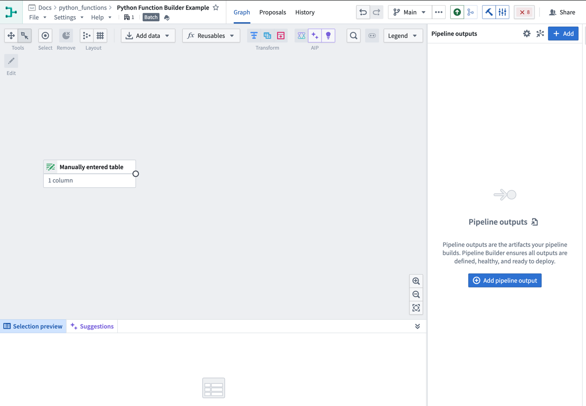
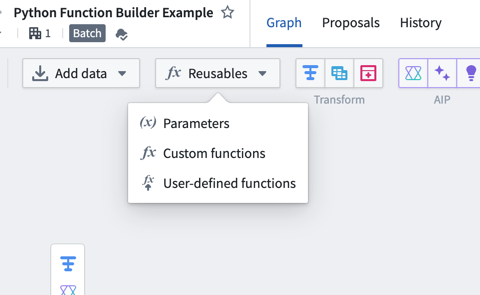
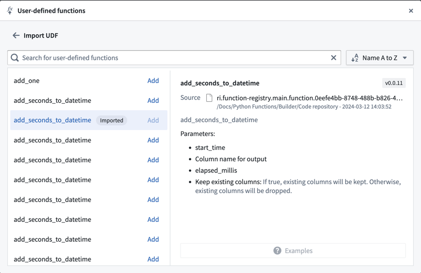
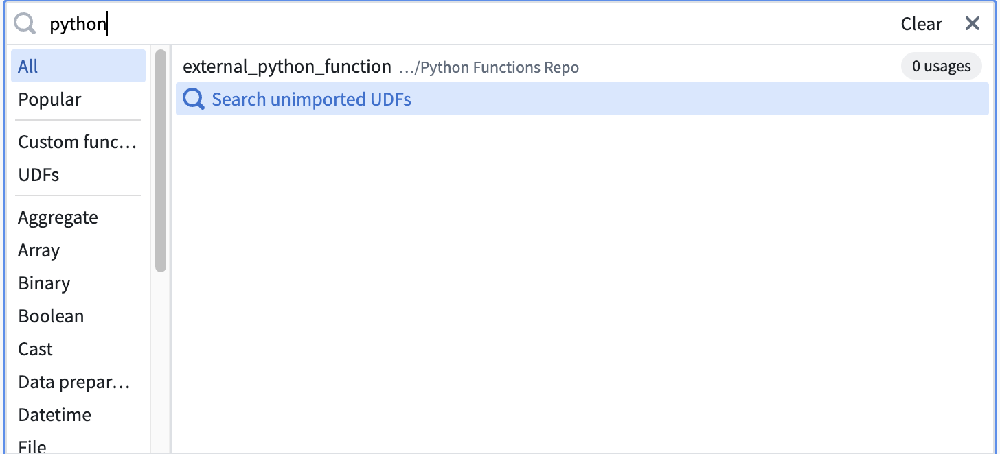
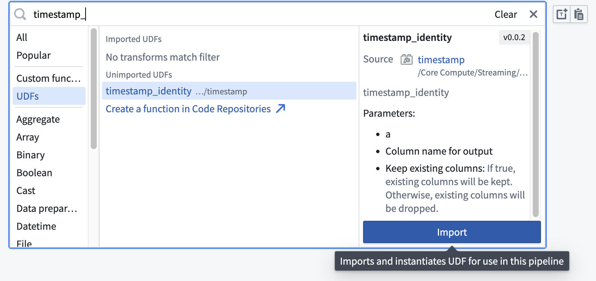
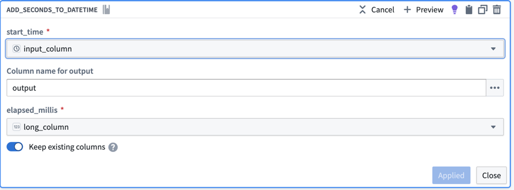
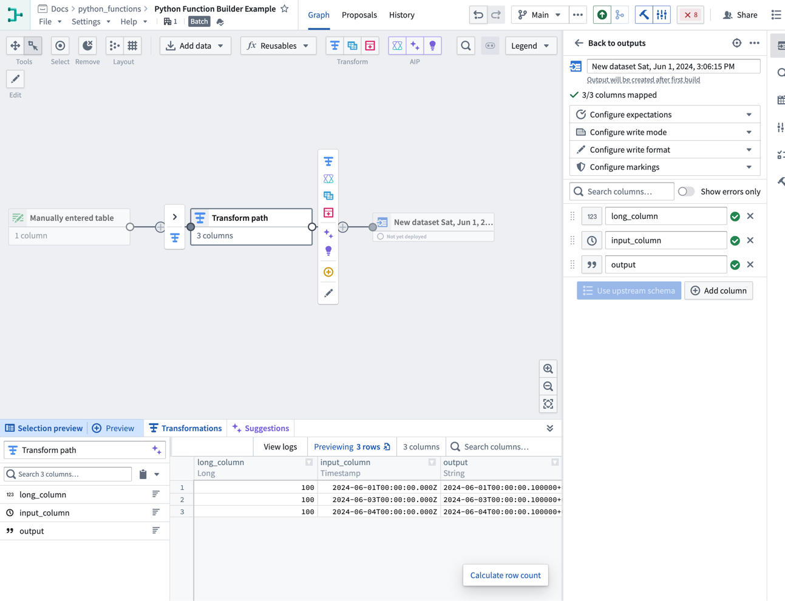
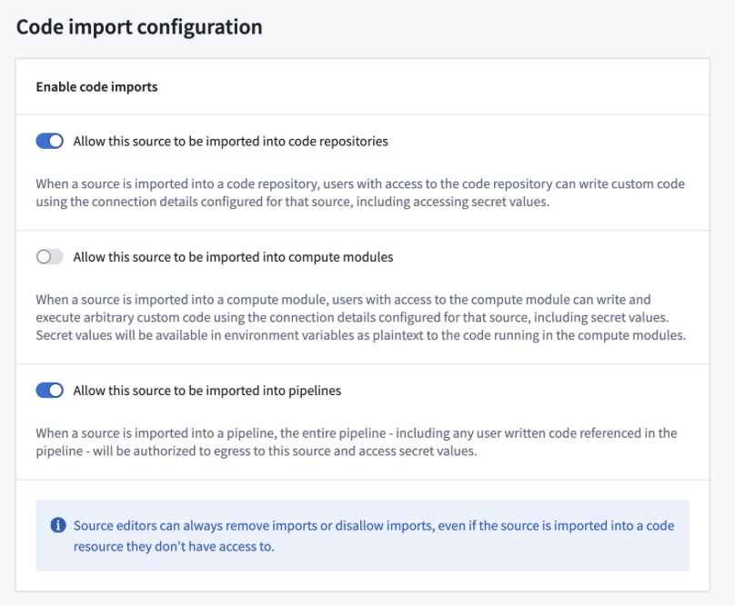

:::callout{theme="warning"}
注意：以下翻译的准确性尚未经过验证。这是使用 [AIP ↗](https://www.palantir.com/platforms/aip/) 从原始英文文本进行的机器翻译。
:::

# 在Pipeline Builder中使用Python函数

:::callout{theme="warning" title="测试版"}
Python函数目前处于测试状态，可能并非所有注册用户都能使用。
:::

## 前提条件

本指南假设您已经编写并发布了一个Python函数。请查阅我们的[Python函数入门](%E8%B5%B7%E5%A7%8B%E6%AD%A5%E9%AA%A4.md)文档进行学习。

## 架构

Python函数在Pipeline Builder管道中作为一个sidecar容器运行。这意味着函数无需部署，并且可以根据管道的规模动态扩展。嵌入的函数可以类似于Pipeline Builder中的其他变换[预览](https://www.palantir.com/docs/foundry/pipeline-builder/outputs-preview-pipeline/)。

## 在Pipeline Builder管道中使用您的函数

按照以下步骤准备并配置您的Python函数：

1. 打开您希望使用Python函数的Pipeline Builder管道。

2. 使用以下两种方法之一将您的UDF导入Pipeline Builder：
   * **从图视图：**
     1. 从管道图的上部选择**可复用项**，然后选择**用户定义函数**。   
        
       
     2\. 选择**导入UDF**并在可用函数中找到您想使用的函数。
     3\. 在函数名称旁边选择**添加**。该函数应显示一个**已导入**标签。      
     4\. 关闭导入对话框，并在Pipeline Builder图中选择您希望使用该函数的**变换**。
     5\. 在变换列表中，找到左侧的**UDFs**标签以查看您导入的函数。
   * **使用变换选择器：**
     1. 在管道图中选择**变换**。
     2. 输入您想导入的UDF名称。   
        
       
     3\. 选择**搜索未导入的UDF**。
     4\. 将鼠标悬停在所需的UDF上并选择**导入**。       
3. 填写变换定义，指定输入列和参数，然后选择**应用**。

现在，您应该可以在Pipeline Builder图中看到您的Python函数，并可以预览该函数的输出。

## 在Pipeline Builder中进行外部API调用

要从Pipeline Builder中向外部系统进行API调用，您可以发布一个具有外部系统访问权限的[Python函数](%E4%BB%8EPython%E5%87%BD%E6%95%B0%E8%BF%9B%E8%A1%8CAPI%E8%B0%83%E7%94%A8.md)。这将使您能够编写与外部系统通信的逻辑，并将其作为管道的一部分使用。

要在Pipeline Builder中作为用户定义函数（UDF）使用，函数中使用的所有源必须配置为可导入管道。要配置此设置，请导航到Data Connection中的源，然后转到**连接设置 > 代码导入配置**选项卡：

一旦您在源上启用了此选项并发布了您的Python函数，它就可以像其他Python函数一样在您的管道中使用。
