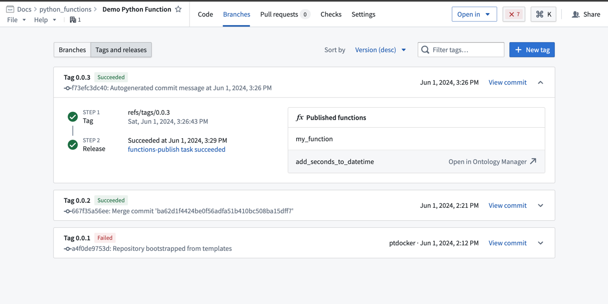
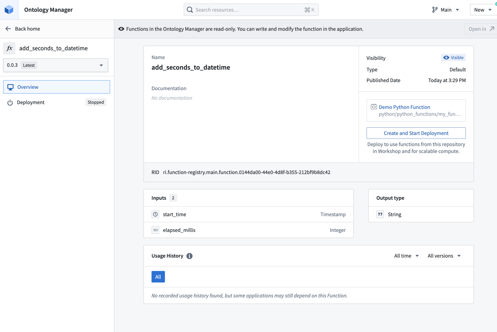
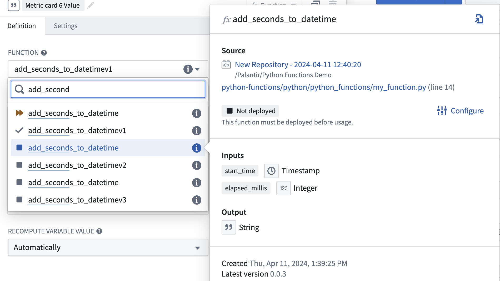
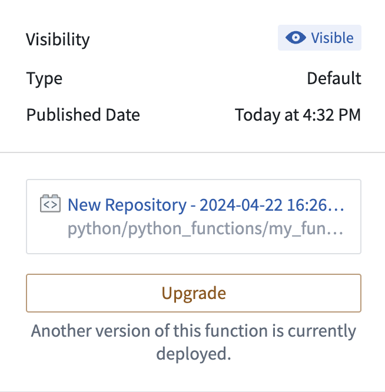
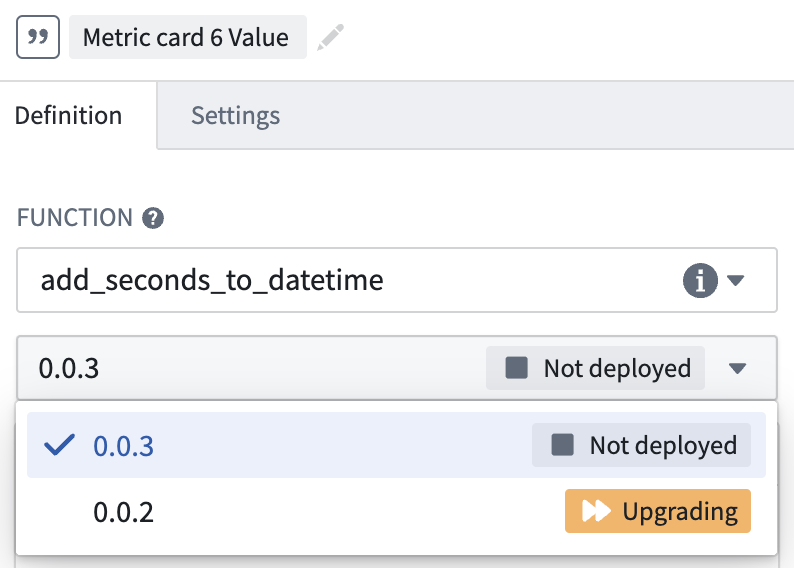
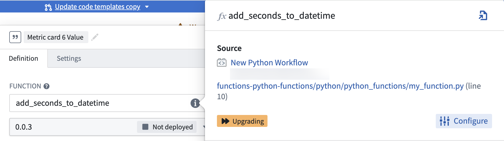
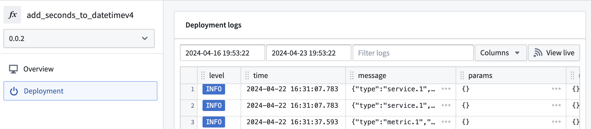

:::callout{theme="warning"}
注意：以下翻译的准确性尚未经过验证。这是使用 [AIP ↗](https://www.palantir.com/platforms/aip/) 从原始英文文本进行的机器翻译。
:::

# 在Workshop中使用Python函数

:::callout{theme="warning" title="Beta"}
Python函数目前处于Beta阶段，可能无法在所有注册中使用。
:::

## 先决条件

本指南假定您已经编写并发布了一个Python函数。请查看[使用Python函数入门](%E8%B5%B7%E5%A7%8B%E6%AD%A5%E9%AA%A4.md)文档以获取教程。有关如何使用Python SDK查询Ontology的示例，请参阅[Python Ontology SDK文档](https://www.palantir.com/docs/foundry/ontology-sdk/python-osdk/)。

## 架构

与运行在“无服务器”模式下的TypeScript函数不同，Python函数必须在可以在Workshop中使用之前部署。来自单个代码库的所有函数由单个部署托管。这意味着您可以通过在代码库中定义多个版本来同时运行多个版本的函数。

:::callout{theme="warning" title="计算成本"}
已部署的Python函数可能会产生运行部署的计算成本。
:::

## 部署Python函数

按照以下步骤在Workshop中准备和配置Python函数：

1. 打开您的Python函数代码库，并导航到**分支**选项卡，然后是**标签和发布**。
2. 将鼠标悬停在您想在Workshop中使用的函数上，然后选择**在Ontology管理器中打开**。

3. 从左侧的版本选择器中选择您想在Workshop模块中使用的Python函数版本。
4. 选择**创建并启动部署**。

5. 等待托管函数的部署启动。

## 在Workshop中使用Python函数

在Workshop中，从模块左侧的**变量**选项卡中搜索Python函数。已部署的函数将显示一个具有三种状态之一的图标，包括函数和函数版本：

* **运行中：** 此函数和版本可以处理请求。
* **已停止：** 此函数和版本不可用。在函数选择器中，将鼠标悬停在信息图标上，选择**配置**，然后选择**创建并启动部署**以使函数可用。
* **升级中：** 此函数和版本尚不可用。

### 发布新版本

在给定时间内，只有一个版本的函数代码库被托管。为了在有限的停机时间内更改函数，建议添加一个具有更改的新函数（如`function_v1`），并按[此处](%E8%B5%B7%E5%A7%8B%E6%AD%A5%E9%AA%A4.md#publish-the-function)所述进行标记。从您的标签和发布中的已发布函数中，选择**在Ontology管理器中打开**。

在Ontology管理器中，选择您希望在应用程序中使用的函数代码库版本，然后选择**升级**。

更新所有使用此代码库中的函数的下游应用程序到您已部署的新版本。请注意，之前的部署版本将不再运行，因此您的应用程序在进行此更改时将会有短暂的停机时间。您将同时拥有`function_v0`和`function_v1`，因此虽然您需要切换到新的部署版本，但您不必更改正在使用的函数。当`function_v0`不再使用时，您可以删除该函数。

### 调试错误

如果您的函数在Workshop中未按预期工作，首先检查问题是否与函数的逻辑或响应性有关。如果逻辑上有问题，请检查支持代码库中的源代码。如果函数无响应或抛出错误，请按照以下步骤操作：

1. 检查您选择的版本是否在函数选择器下拉菜单中当前运行。

2. 如果函数未部署或“升级中”，将鼠标悬停在函数的信息图标上并选择**配置**。这将带您到Ontology管理器，您可以选择**启动部署**以重新运行您的函数。

3. 如果您的函数“运行中”或您需要更多有关部署行为的信息，请从Ontology管理器的左侧面板中选择**部署**以查看详细日志。如果选择**查看实时**，还可以查看SLS日志。

