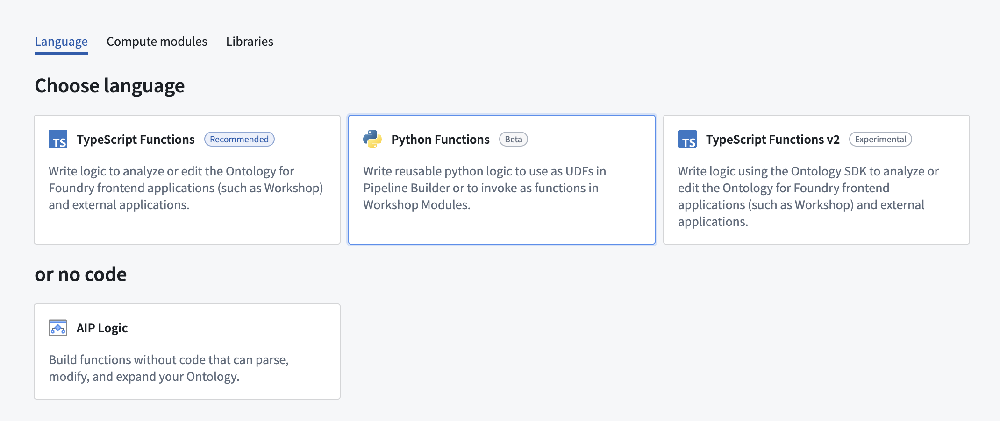
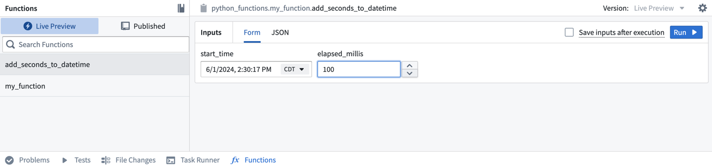
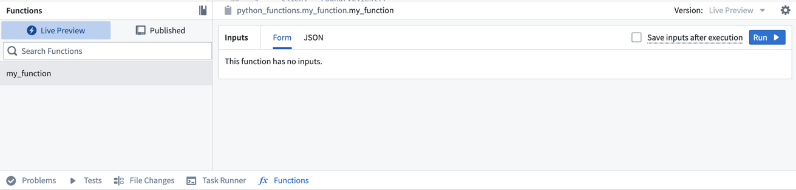
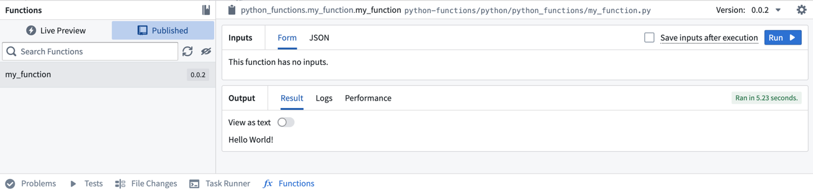

:::callout{theme="warning"}
注意：以下翻译的准确性尚未经过验证。这是使用 [AIP ↗](https://www.palantir.com/platforms/aip/) 从原始英文文本进行的机器翻译。
:::

# 起始步骤

:::callout{theme="warning" title="测试版"}
Python 函数目前处于测试阶段，可能无法在所有注册中使用。
:::

以下文档将指导您完成在 Palantir 平台上准备 Python 函数的初始步骤。您将学习如何创建 Python 函数库，提交并发布函数，在实时预览中测试等。

## 创建 Python 函数库

导航到您选择的项目，并通过选择 **+ New** > **Code repository** 创建一个新的代码库。选择 **Pythons Functions** 模板来初始化您的库。我们建议将所有用于 Workshop 或 Ontology 应用的函数分组在一个库中，以最小化成本。



库创建完成后，导航到 `python-functions/python/python-functions/my_function.py` 文件。

## 探索库

您的库将被初始化为包含一个 `my_function.py` 文件，其中包含一些示例函数，包括以下内容：

```python
from functions.api import function, String

@function
def my_function() -> String:
    # 返回字符串 "Hello World!"
    return "Hello World!"
```

请注意，该函数遵循以下约束：

* 函数必须使用来自 `functions.api` 包的 `@function` 装饰器进行装饰，以便被识别为 Python 函数。您可以有多个 Python 文件，每个文件中包含多个函数，但\_只有带有此装饰器的函数\_才会被注册为 Python 函数。
* 函数必须声明其所有输入的类型以及输出的类型，可以使用 functions API 包中的类型或其对应的 Python 类型。例如，上述示例的输出类型声明为来自 functions API 的 `字符串`，但也可以声明为对应的 Python 类型 `str`。

:::callout{theme="neutral"}
即使您使用 API 类型声明参数的类型（例如，`字符串`），在运行时您的函数将接收对应的 Python 类型（在本例中为 `str`）。
:::

有关 Python 函数中类型的完整概述，请参阅我们的[类型参考文档](%E7%B1%BB%E5%9E%8B%E5%8F%82%E8%80%83.md)。

## 在实时预览中测试

添加新函数后，您可以立即在 **函数** 助手中运行它。从屏幕左下角打开 **函数** 助手并选择 **实时预览**。选择 `add_seconds_to_datetime` 函数，输入输入值，然后选择 **运行** 以运行代码。



选择右上角的 **提交** 以将您的更改提交到存储库的 `master` 分支。

### 提交并发布您的函数

编写函数（或取消注释提供的示例函数之一）后，请按照以下步骤提交并发布它。

1. 在 **源代码控制** 选项卡中选择 **提交** 并添加提交消息以提交您的更改。
2. 从屏幕顶部中间选择 **分支** 选项卡，然后选择 **标签和发布**。
3. 选择 **新标签** 并为发布提供一个版本。

[官方图片已失效：选择可用的发布版本。](https://www.palantir.com/docs/resources/foundry/functions/python-functions-tag.png)

4. 选择 **标记并发布** 并等待发布步骤完成。

5. 检查成功后，选择 **代码** 选项卡，然后在页面底部打开 **函数** 选项卡。您将在结果中看到 `my_function`。



6. 选择该函数，然后选择 **运行** 以执行您刚刚发布的函数。



## 添加另一个函数

现在，我们将向此存储库添加一个更复杂的函数以进行测试和发布。复制并粘贴以下代码到 `my_function` 文件的底部。

```python
from functions.api import function, String
from datetime import datetime, timedelta

@function
def add_seconds_to_datetime(start_time: datetime, elapsed_millis: int) -> str:
    # 计算新的日期时间，添加指定的毫秒数
    dt = start_time + timedelta(milliseconds=elapsed_millis)
    # 返回ISO格式的日期时间字符串
    return dt.isoformat()
```

<br/>

有关如何在平台中使用 Python 函数的更多示例，请查阅我们关于[在 Pipeline Builder 中使用 Python 函数](%E5%9C%A8Pipeline%20Builder%E4%B8%AD%E4%BD%BF%E7%94%A8Python%E5%87%BD%E6%95%B0.md)和[在 Workshop 中使用 Python 函数](%E5%9C%A8Workshop%E4%B8%AD%E4%BD%BF%E7%94%A8Python%E5%87%BD%E6%95%B0.md)的文档。


> 配图缺失说明：本页有 1 个官方图片地址在抓取及重试时失效（返回 HTML 错误页）。下列地址保留用于溯源，未替换成其他版本的图片。

- 官方图片已失效：<https://www.palantir.com/docs/resources/foundry/functions/python-functions-tag.png>
