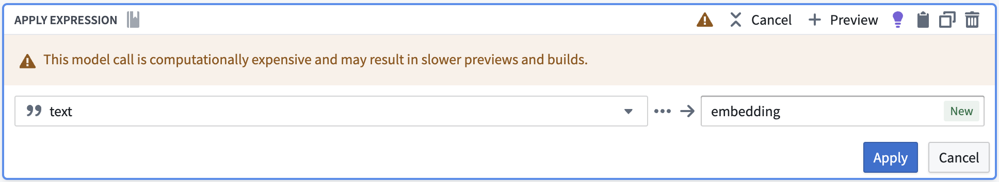
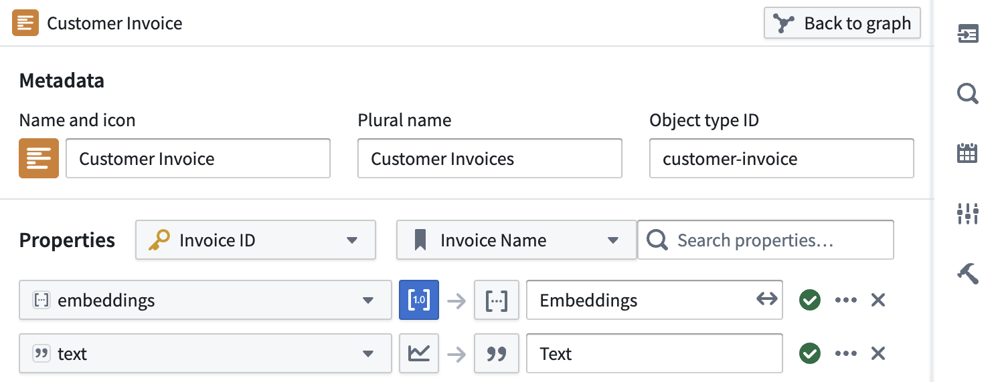
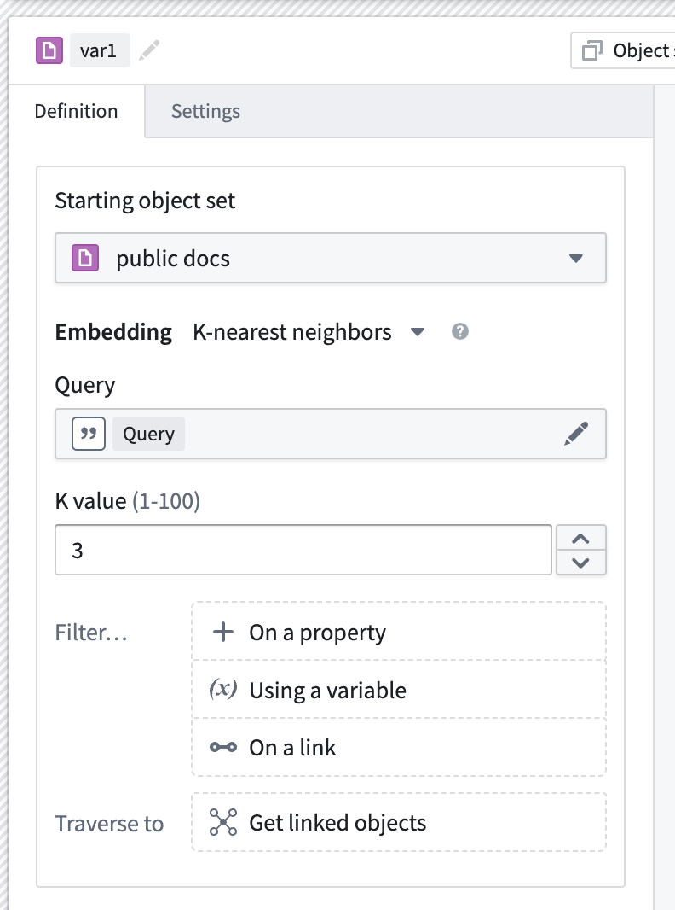
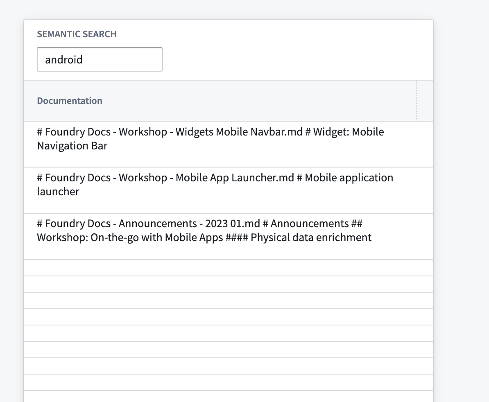
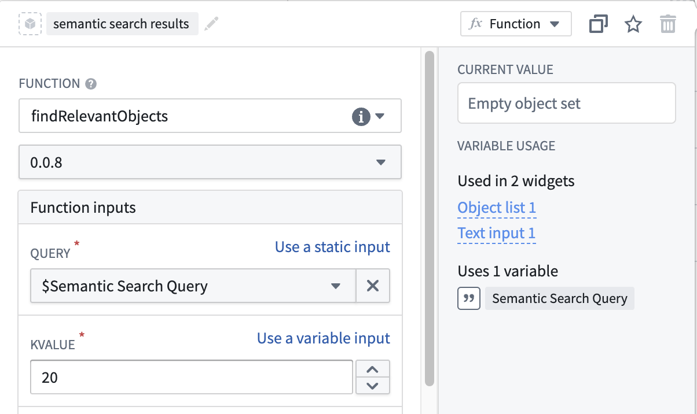

:::callout{theme="warning"}
注意：以下翻译的准确性尚未经过验证。这是使用 [AIP ↗](https://www.palantir.com/platforms/aip/) 从原始英文文本进行的机器翻译。
:::

# 使用Palantir提供的模型创建语义搜索工作流

:::callout{theme="neutral"}
要使用Palantir提供的语言模型，必须先在您的注册中[启用AIP](https://www.palantir.com/docs/foundry/administration/enable-aip-features/)。您还必须拥有使用[AIP开发者功能](https://www.palantir.com/docs/foundry/platform-overview/aip-capabilities/#aip-developer-capabilities)的权限。使用自定义模型？请查看[使用自定义模型创建语义搜索工作流](%E4%BD%BF%E7%94%A8%E8%87%AA%E5%AE%9A%E4%B9%89%E6%A8%A1%E5%9E%8B%E5%88%9B%E5%BB%BA%E8%AF%AD%E4%B9%89%E6%90%9C%E7%B4%A2%E5%B7%A5%E4%BD%9C%E6%B5%81.md)。
:::

本页说明了使用[Palantir提供的嵌入模型](https://www.palantir.com/docs/foundry/platform-overview/aip-capabilities/#supported-llms)构建概念性的端到端语义搜索工作流的过程。

## 说明

首先，您需要生成嵌入并将其存储在具有[`vector`类型](../../%E5%AF%B9%E8%B1%A1%E9%93%BE%E6%8E%A5%E7%B1%BB%E5%9E%8B/Properties/%E5%85%83%E6%95%B0%E6%8D%AE%E5%8F%82%E8%80%83.md#property-base-types-with-limited-support)的对象类型中。然后，您可以在[Workshop](https://www.palantir.com/docs/foundry/workshop/overview/)中设置语义搜索工作流，搭建一个[AIP Agent](https://www.palantir.com/docs/foundry/chatbot-studio/retrieval-context/#ontology-context)增强的工作流，或创建一个自定义语义搜索函数以用于[Workshop](https://www.palantir.com/docs/foundry/workshop/overview/)和[AIP Logic](../../../%E5%BA%94%E7%94%A8/%E9%80%BB%E8%BE%91/%E6%A6%82%E8%BF%B0.md)。

前提条件：

* [生成嵌入并创建对象类型](#generate-embeddings-and-create-object-type)

选项：

* [在Workshop中使用KNN对象集（无代码）创建简单的语义搜索工作流](#create-a-simple-semantic-search-workflow-within-workshop-using-a-knn-object-set-no-code)
* [启用AIP Agent进行对象的语义搜索（无代码）](#use-aip-agent-no-code)
* [创建一个函数以在Workshop和/或AIP Logic中跨对象进行语义搜索](#create-a-function-to-use-elsewhere-in-workshop-or-aip-logic)

## 生成嵌入并创建对象类型

我们将使用[Pipeline Builder](https://www.palantir.com/docs/foundry/pipeline-builder/overview/)将数据集中的文本嵌入为向量，使用[**Text to Embeddings**表达式](https://www.palantir.com/docs/foundry/pipeline-builder/pipeline-builder-aip/#embeddings)。该表达式接收一个字符串并使用一个Palantir提供的模型将其转换为向量 - 在我们的案例中使用`text-embedding-ada-002`嵌入模型。



然后可以将这些嵌入作为向量属性添加到Ontology中。



如果您希望对使用Palantir提供的模型生成嵌入有更多控制，请参见[Python变换中的语言模型](https://www.palantir.com/docs/foundry/transforms-python/palantir-provided-models/#embeddings)。

## 在Workshop中使用KNN对象集（无代码）创建简单的语义搜索工作流

在[Workshop](https://www.palantir.com/docs/foundry/workshop/overview/)中配置一个[KNN对象集](../Functions%20on%20objects/API%EF%BC%9A%E5%AF%B9%E8%B1%A1%E9%9B%86.md#k-nearest-neighbors-knn)是构建语义搜索工作流的简单无代码方法。

1. 创建一个对象集[变量](https://www.palantir.com/docs/foundry/workshop/concepts-variables/)并选择包含嵌入属性的对象类型。
2. 选择筛选`+ On a property`选项，然后从菜单中的属性列表中选择您的嵌入属性。
3. 选择后，K-nearest-neighbors配置应出现。如果此配置未出现，请验证您选择的属性是嵌入属性。



在此面板中，您可以配置：

* K值：一个介于1-100之间的数字，用于指示在语义搜索中返回多少个对象。
* 查询：在执行语义搜索时用作查询的字符串变量。

4. 接下来，创建一个[字符串选择器](https://www.palantir.com/docs/foundry/workshop/widgets-string-selector/)微件并将其输出变量添加到上述KNN查询选项中。
5. 最后，添加一个[对象表](https://www.palantir.com/docs/foundry/workshop/widgets-object-table/)微件并将其输入变量配置为新创建的[KNN对象集](../Functions%20on%20objects/API%EF%BC%9A%E5%AF%B9%E8%B1%A1%E9%9B%86.md#k-nearest-neighbors-knn)。



有关更自定义的语义搜索逻辑，请参见[函数部分](#create-a-function-to-use-elsewhere-in-workshop-or-aip-logic)。

## 使用AIP Agent（无代码）

在[AIP Chatbot Studio](https://www.palantir.com/docs/foundry/chatbot-studio/overview/)中创建的AIP Agent非常适合起始跨对象的语义搜索，因为它们不需要任何代码。了解更多关于[结合语义搜索以更好控制功能性](#create-a-function-to-use-elsewhere-in-workshop-or-aip-logic)。

按照[入门指南](https://www.palantir.com/docs/foundry/chatbot-studio/getting-started/)中的说明创建一个AIP Agent，并添加[Ontology上下文](https://www.palantir.com/docs/foundry/chatbot-studio/retrieval-context/#ontology-context)或一个**Ontology语义搜索**[工具](https://www.palantir.com/docs/foundry/chatbot-studio/tools/#types-of-tools)。此初始设置将使您能够请求AIP Agent进行对象的语义搜索。

## 创建一个函数以在Workshop或AIP Logic中使用

我们可以[创建一个typescript代码库](../%E5%85%A5%E9%97%A8.md)并创建一个函数来查询我们的对象类型。总体目标是能够接收一些用户输入，使用与之前相同的Palantir提供的模型[生成向量](#1-generate-embeddings-and-create-object-type)，然后对我们的对象类型进行[KNN搜索](../Functions%20on%20objects/API%EF%BC%9A%E5%AF%B9%E8%B1%A1%E9%9B%86.md#k-nearest-neighbors-knn)。有关如何导入Palantir提供的模型的更多信息，请查看[函数中的语言模型](../%E5%87%BD%E6%95%B0%E4%B8%AD%E7%9A%84%E8%AF%AD%E8%A8%80%E6%A8%A1%E5%9E%8B.md#embeddings)。

:::callout{theme="success" title="替换"}
在下面的代码片段中，将每个`ObjectApiName`实例替换为您的唯一ObjectType。请注意，标识符有时可能以小写字母`objectApiName`出现。
:::

:::callout{theme="warning" title="为函数启用向量属性"}
在继续之前，确保在您的Functions代码库中的`functions.json`文件中存在条目`"enableVectorProperties": true`。如果此条目不存在，请将其添加到`functions.json`并提交更改以继续。如需进一步协助，请联系您的Palantir代表。
:::

### functions-typescript/src/index.ts

```typescript
import { Function, Integer } from "@foundry/functions-api";
import { Objects, ObjectApiName } from "@foundry/ontology-api";
import { TextEmbeddingAda_002 } from "@foundry/models-api/language-models"

// 定义一个名为 MyFunctions 的类
export class MyFunctions {
    // 使用装饰器标记该方法为一个函数
    @Function()
    // 定义一个异步方法 findRelevantObjects，用于查找相关对象
    public async findRelevantObjects(
        query: string, // 输入查询字符串
        kValue: Integer, // 需要返回的对象数量
    ): Promise<ObjectApiName[]> { // 返回一个 ObjectApiName 数组的 Promise
        // 如果查询字符串为空，返回空数组
        if (query.length < 1) {
            return []
        }
        // 使用 TextEmbeddingAda_002 模型创建查询字符串的嵌入
        const embedding = await TextEmbeddingAda_002.createEmbeddings({inputs: [query]}).then(r => r.embeddings[0]);

        // 在对象中查找与嵌入最相似的对象，并按相关性排序，返回前 kValue 个对象
        return Objects.search()
                    .objectApiName()
                    .nearestNeighbors(obj => obj.embeddings.near(embedding, {kValue: kValue}))
                    .orderByRelevance()
                    .take(kValue);
    }
}
```

此时，我们已经有一个可以运行语义搜索以使用自然语言查询Objects的函数。记得[发布函数](../%E5%85%A5%E9%97%A8.md#publish-the-function)以便该函数可以在Foundry内的任何地方使用。

### 在Workshop中使用语义搜索函数

1. 首先[创建一个Workshop应用](https://www.palantir.com/docs/foundry/workshop/getting-started/)。
2. 添加一个[文本输入微件](https://www.palantir.com/docs/foundry/workshop/widgets-text-input/)，它将用作已发布KNN文档获取函数的输入。
3. 添加一个[对象列表微件](https://www.palantir.com/docs/foundry/workshop/widgets-object-list/)，并使用从[函数生成的对象集](https://www.palantir.com/docs/foundry/workshop/functions-use/#function-backed-variables-in-workshop)作为输入，如下所示：



4. 将`kValue`设置为您希望返回的结果数量，受[指定限制](../Functions%20on%20objects/API%EF%BC%9A%E5%AF%B9%E8%B1%A1%E9%9B%86.md#k-nearest-neighbors-knn)的约束。

### 在AIP Logic中使用语义搜索函数

将已发布的函数作为[工具](../../../%E5%BA%94%E7%94%A8/%E9%80%BB%E8%BE%91/%E5%85%A5%E9%97%A8%E6%8C%87%E5%8D%97.md#call-function)添加到AIP Logic中。使用类似以下的提示指示语言模型使用该工具：

> 使用fetchRelevantObjects工具并将kValue设置为5，以找到最相关的Objects。使用工具时，记得在查询周围添加引号。
