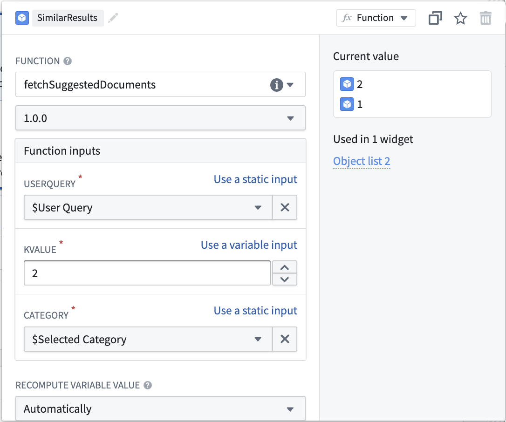

:::callout{theme="warning"}
注意：以下翻译的准确性尚未经过验证。这是使用 [AIP ↗](https://www.palantir.com/platforms/aip/) 从原始英文文本进行的机器翻译。
:::

# 使用自定义模型创建语义搜索工作流

:::callout{theme="warning"}
本教程适用于使用非Palantir提供的嵌入模型的用户。请参阅[Palantir提供的模型列表](https://www.palantir.com/docs/foundry/platform-overview/aip-capabilities/#supported-llms)和[Palantir提供的模型语义搜索教程](%E4%BD%BF%E7%94%A8Palantir%E6%8F%90%E4%BE%9B%E7%9A%84%E6%A8%A1%E5%9E%8B%E5%88%9B%E5%BB%BA%E8%AF%AD%E4%B9%89%E6%90%9C%E7%B4%A2%E5%B7%A5%E4%BD%9C%E6%B5%81.md)。
:::

此页面展示了构建一个概念性端到端文档搜索服务的过程，该服务能够在给定提示时检索相关文档。该服务将使用[Foundry建模目标](https://www.palantir.com/docs/foundry/model-integration/objectives/)来嵌入文档并将其特征提取到向量中。这些文档和嵌入将存储在具有向量属性的对象类型中。

在本例中，我们首先在Foundry中设置一个模型并创建一个生成嵌入的管道。然后，我们将创建一个新的对象类型和一个函数，以通过自然语言对其进行查询。

我们从一个当前拥有解析文档和元数据的数据集开始，比如`Document_Content`和`Link`。接下来，我们将从`Document_Content`生成嵌入，使我们可以通过语义搜索查询它们。

[官方图片已失效：生成嵌入的数据集](https://www.palantir.com/docs/resources/foundry/functions/dataset-to-generate-embeddings.png)

要了解KNN功能的详细信息，请查看Foundry文档中的[KNN函数对象](../Functions%20on%20objects/API%EF%BC%9A%E5%AF%B9%E8%B1%A1%E9%9B%86.md#k-nearest-neighbors-knn)部分。

:::callout{theme="success" title="值替换"}
在整个工作流中，您可以替换您选择的值，只要每个实例保持一致。例如，每个`ObjectApiName`实例总是替换为`Document`。

您必须替换的值是：

* `ObjectApiName`：唯一ObjectType的标识符，在我们的例子中是`Document`。*注意：* 标识符有时可能显示为小写的`objectApiName`。
* `ModelApiName`：唯一模型的标识符。
* `OutputDatasetRid`：来自[嵌入变换](#1-create-embeddings-using-models-in-foundry)的输出数据集的标识符。
* `InputDatasetRid`：用于[嵌入变换](#1-create-embeddings-using-models-in-foundry)的输入数据集的标识符。
* `ModelRid`：用于[嵌入变换](#1-create-embeddings-using-models-in-foundry)和[创建实时建模部署](#3-create-a-live-modeling-deployment)的模型标识符。
:::

## 1. 使用Foundry中的模型创建嵌入

在Foundry中从模型创建嵌入有几种选择。在本例中，我们将创建一个变换以与[导入的开源模型](https://www.palantir.com/docs/foundry/integrate-models/language-models-import/)进行交互。我们将使用`all-MiniLM-L6-v2`模型，这是一个通用文本嵌入模型，将创建维度（大小）为384的向量。该模型可以与任何其他现有的模型互换，这些模型输出与[Foundry Ontology `vector`类型](../../%E5%AF%B9%E8%B1%A1%E9%93%BE%E6%8E%A5%E7%B1%BB%E5%9E%8B/Properties/%E5%85%83%E6%95%B0%E6%8D%AE%E5%8F%82%E8%80%83.md#property-base-types-with-limited-support)兼容的向量。要导入新的开源模型，请查看我们的[语言模型文档](https://www.palantir.com/docs/foundry/integrate-models/language-models-add-new/)。

在本例中，我们使用此模型运行变换以生成嵌入并执行任何必要的后处理。在这种情况下，我们将数据通过模型以返回一个`embedding`，然后将`embedding`值（双数组）转换为浮点数，以匹配向量嵌入所需的类型。

有几点需要考虑：

* `schema`变量中的每个`StructField`都与处理过的输入数据集（`InputDatasetRid`）中存在的列相关联，加上模型添加的`embedding`列。
* 在处理大规模数据时，如果使用过大的Pandas数据帧，变换可能会出错。在这些情况下，变换将需要在Spark中执行。
* 可以利用图形处理单元（GPU）来提高变换生成嵌入的速度。通过在变换中添加`@configure`装饰器可以使用GPU。如果您有兴趣在您的环境中启用此功能，请联系您的Palantir代表。

下面显示了一个示例变换：

```python
from transforms.api import configure, transform, Input, Output
from palantir_models.transforms import ModelInput
from pyspark.sql.functions import pandas_udf, PandasUDFType
from pyspark.sql.types import StructType, StructField, IntegerType, StringType, FloatType, ArrayType
import numpy as np


@configure(profile=["DRIVER_GPU_ENABLED"]) # 如果环境中没有启用GPU，请移除此行
@transform(
    dataset_out=Output("OutputDatasetRid"),
    dataset_in=Input("InputDatasetRid"),
    embedding_model=ModelInput("ModelRid")
)
def compute(ctx, dataset_out, dataset_in, embedding_model):
    # 匹配模型的输入列
    spark_df = dataset_in.dataframe().withColumnRenamed("Document_Content", "text")

    def embed_df(df):
        # 创建嵌入
        output_df = embedding_model.transform(df).output_data
        # 转换为浮点数数组
        output_df["embedding"] = output_df["embedding"].apply(lambda x: np.array(x).astype(float).tolist())
        # 删除不必要的列
        return output_df.drop('inference_device', axis=1)

    # 更新后的模式
    schema = StructType([
        StructField("UID", IntegerType(), True),
        StructField("Category", StringType(), True),
        StructField("text", StringType(), True),
        StructField("Link", StringType(), True),
        StructField("embedding", ArrayType(FloatType()), True)
    ])

    # 定义pandas UDF，用于对每个分组进行操作
    udf = pandas_udf(embed_df, returnType=schema, functionType=PandasUDFType.GROUPED_MAP)
    output_df = spark_df.groupBy('UID').apply(udf)

    # 写入输出DataFrame
    dataset_out.write_dataframe(output_df)
```

接下来，我们需要一个实时建模部署，以根据用户查询创建嵌入，并用于搜索我们现有的向量。此部分使用的模型应与当前步骤中用于生成初始嵌入的模型相同。

## 2. 创建对象类型

到现在为止，我们应该有一个新的数据集，其中包含使用批量建模部署[从我们的第一步和前一步](#1-create-embeddings-using-models-in-foundry)生成的浮点向量嵌入的列。接下来，我们将创建一个对象类型。

我们将对象类型命名为`Document`，并将`embedding`属性设置为属性类型`Vector`。这需要配置两个值：

1. **维度：** 这是列`embedding`中生成的数组的长度。
2. **相似性函数：** 计算来自不同对象的两个`embedding`值之间距离的方法。

[官方图片已失效：新向量属性类型](https://www.palantir.com/docs/resources/foundry/functions/vector-property-in-oma.jpg)

一旦创建了此对象类型，我们将拥有一个可以用于语义搜索`Documentation`对象的属性（`embedding`）。

`ObjectApiName`的值将在对象类型保存后可用，可以在创建的对象类型的配置页面中找到。有关更多信息，请参阅文档中的[创建对象类型](../../%E5%AF%B9%E8%B1%A1%E9%93%BE%E6%8E%A5%E7%B1%BB%E5%9E%8B/Object%20types/%E5%88%9B%E5%BB%BA%20Object%20%E7%B1%BB%E5%9E%8B.md#add-metadata-for-a-new-object-type)部分。

## 3. 创建实时建模部署

现在我们的对象具有嵌入作为属性，我们需要为用户查询生成低延迟的嵌入。这些嵌入将用于查找具有相似嵌入值的对象。为此，请创建一个实时模型部署，以通过函数实现快速、低延迟的访问。

查看[配置实时建模部署的说明](https://www.palantir.com/docs/foundry/manage-models/set-up-live/)，或建模部分中的相关[常见问题](https://www.palantir.com/docs/foundry/manage-models/live-faq/)。

请注意，您为[实时部署API名称](https://www.palantir.com/docs/foundry/manage-models/set-up-live/#api-name)配置的值等同于上面提到的替代值`ModelApiName`。

## 4. 在模型上使用函数创建嵌入

:::callout{theme="warning" title="为函数启用向量属性"}
在继续之前，请确保在您的函数代码库中的`functions.json`文件中同时存在条目`"enableVectorProperties": true`和`"useDeploymentApiNames": true`。如果这些条目不存在，请将它们添加到`functions.json`并提交更改以继续。如需进一步帮助，请联系您的Palantir代表。
:::

最后一步是创建一个函数来查询此对象类型。对于搜索阶段，总体目标是能够获取一些用户输入，使用实时建模部署[之前创建的](#3-create-a-live-modeling-deployment)生成一个向量，然后对我们的对象类型执行[KNN搜索](../Functions%20on%20objects/API%EF%BC%9A%E5%AF%B9%E8%B1%A1%E9%9B%86.md#k-nearest-neighbors-knn)。
此应用案例的一个示例函数如下所示，包括它们应驻留的文件结构。

可以通过操作和函数对向量属性进行编辑。

有关更多信息，请参阅[模型上的函数文档](../%E6%A8%A1%E5%9E%8B%E4%B8%8A%E7%9A%84%E5%87%BD%E6%95%B0.md)。

### 文件结构

```
|-- functions-typescript
|   |-- src
|   |   |-- tests
|   |   |   |-- index.ts          // 测试文件，包含单元测试代码
|   |   |-- index.ts              // 主入口文件，包含核心逻辑
|   |   |-- semanticSearch.ts     // 语义搜索功能的实现
|   |   |-- service.ts            // 服务相关的功能模块
|   |   |-- tsconfig.json         // TypeScript 配置文件
|   |   |-- types.ts              // 类型定义文件，定义 TypeScript 类型
|   |-- functions.json            // 函数配置文件，定义函数的元数据
|   |-- jest.config.js            // Jest 配置文件，用于设置测试框架
|   |-- package-lock.json         // 锁定依赖版本的文件
|   |-- package.json              // 项目配置文件，包含项目依赖和脚本
|-- version.properties            // 版本信息文件
```

### functions-typescript/src/types.ts

```typescript
import { Double } from "@foundry/functions-api";

// 定义一个接口 IEmbeddingModel，表示嵌入模型的接口
export interface IEmbeddingModel {
    // 定义一个方法 embed，接收一个字符串参数 content，返回一个 Promise，其结果为 IEmbeddingResponse
    embed: (content: string) => Promise<IEmbeddingResponse>;
}

// 定义一个接口 IEmbeddingResponse，表示嵌入操作的响应
export interface IEmbeddingResponse {
    text: string // 原始文本
    embedding: Double[] // 嵌入后的向量表示
    inference_device?: string // 可选的推理设备信息
}

// 定义一个接口 IEmbeddingRequest，表示嵌入请求
export interface IEmbeddingRequest {
    text: string // 要嵌入的文本
}
```

### functions-typescript/src/service.ts

```typescript
import { ModelApiName } from "@foundry/models-api/deployments";
import { IEmbeddingRequest, IEmbeddingResponse } from "./types";

// 提供模型嵌入服务的类
export class EmbeddingService {
    // 异步方法，用于嵌入文本内容
    public async embed(content: string): Promise<IEmbeddingResponse> {
        // 创建请求对象，包含需要嵌入的文本
        const request: IEmbeddingRequest = {
                                "text": content,
                            };
        // 调用模型API的transform方法，返回第一个结果并将其转换为IEmbeddingResponse类型
        return await ModelApiName.transform([request])
                                 .then((output: any) => output[0]) as IEmbeddingResponse;
    }
}
```

### functions-typescript/src/semanticSearch.ts

```typescript
import { Function, Integer, Double } from "@foundry/functions-api";
import { Objects, ObjectApiName } from "@foundry/ontology-api";

import { EmbeddingService } from "./service";
import { IEmbeddingResponse, IEmbeddingModel } from './types';

export class SuggestedDocs {
    embeddingService: IEmbeddingModel = new EmbeddingService;

    @Function()
    public async fetchSuggestedDocuments(userQuery: string, kValue: Integer, category: string): Promise<ObjectApiName[]> {
        const embedding: IEmbeddingResponse = await this.embeddingService.embed(userQuery);
        const vector: Double[] = embedding.embedding;

        return Objects.search()
                      .objectApiName()
                      .filter(obj => obj.category.exactMatch(category))
                      .nearestNeighbors(obj => obj.embedding.near(vector, {kValue: kValue}))
                      .orderByRelevance()
                      .take(kValue);
    }

    /**
     * 以下是 fetchSuggestedDocuments 的替代方法，该方法应用了一个相似度阈值。
     * 否则，无论相似程度如何，总是返回 kValue 数量的文档。
     * 距离函数的计算取决于为嵌入属性定义的距离函数。这里我们假设是余弦相似度，
     * 如果嵌入模型生成标准化向量，则可以通过简单的向量点积来计算。
     */
    @Function()
    public async fetchSuggestedDocumentsWithThreshold(userQuery: string, kValue: Integer, category: string, thresholdSimilarity: Double): Promise<ObjectApiName[]> {
        const embedding: IEmbeddingResponse = await this.embeddingService.embed(userQuery);
        const vector: Double[] = embedding.embedding;

        return Objects.search()
                      .objectApiName()
                      .filter(obj => obj.category.exactMatch(category))
                      .nearestNeighbors(obj => obj.embedding.near(vector, {kValue: kValue}))
                      .orderByRelevance()
                      .take(kValue)
                      .filter(obj => SuggestedDocs.dotProduct(vector, obj.embedding! as number[]) >= thresholdSimilarity);
    }

    // 计算两个向量的点积，如果向量长度不一致会抛出错误。
    private static dotProduct<K extends number>(arr1: K[], arr2: K[]): number {
        if (arr1.length !== arr2.length) {
            throw EvalError("Two vectors must be of the same dimensions");
        }
        return arr1.map((_, i) => arr1[i] * arr2[i]).reduce((m, n) => m + n);
    }
}
```

### functions-typescript/src/index.ts

```typescript
// 从“semanticSearch”模块中导出SuggestedDocs
export { SuggestedDocs } from "./semanticSearch";
```

## 5. 发布函数并在示例中使用

此时，我们有一个函数可以运行语义搜索，以自然语言查询对象。最后一步是[发布该函数](../%E5%85%A5%E9%97%A8.md#publish-the-function)并在工作流中使用它。为了继续基于文档搜索示例进行搭建，我们将创建一个Workshop应用程序，以调用此函数并通过文本输入返回给用户匹配的两篇文档文章。

在示例中为文档服务创建语义搜索的过程如下：

1. 首先[创建一个Workshop应用程序](https://www.palantir.com/docs/foundry/workshop/getting-started/)。
2. 添加一个[文本输入](https://www.palantir.com/docs/foundry/workshop/widgets-text-input/)和一个[字符串选择器](https://www.palantir.com/docs/foundry/workshop/widgets-string-selector/)。字符串选择器将被用于在选择一个文档类别进行筛选。文本输入和字符串选择器都将作为已发布KNN文档获取函数的输入。
3. 最后，添加一个[对象列表微件](https://www.palantir.com/docs/foundry/workshop/widgets-object-list/)，其中包含从函数生成的输入对象集和所选输入，如下所示：



从此时起，输入将被用于语义搜索对象类型中的文档，并返回两个最相关的。这只是向量属性和语义搜索的一个简单应用案例。请参见下面截图中的结果Workshop应用程序示例：

[官方图片已失效：示例语义搜索Workshop](https://www.palantir.com/docs/resources/foundry/functions/completed-knn-workshop.png)


> 配图缺失说明：本页有 3 个官方图片地址在抓取及重试时失效（返回 HTML 错误页）。下列地址保留用于溯源，未替换成其他版本的图片。

- 官方图片已失效：<https://www.palantir.com/docs/resources/foundry/functions/completed-knn-workshop.png>
- 官方图片已失效：<https://www.palantir.com/docs/resources/foundry/functions/dataset-to-generate-embeddings.png>
- 官方图片已失效：<https://www.palantir.com/docs/resources/foundry/functions/vector-property-in-oma.jpg>
