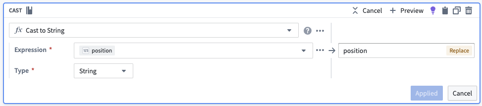
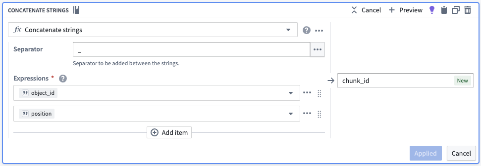

:::callout{theme="warning"}
注意：以下翻译的准确性尚未经过验证。这是使用 [AIP ↗](https://www.palantir.com/platforms/aip/) 从原始英文文本进行的机器翻译。
:::

# 分块

本页概述如何在语义搜索工作流中整合基本的分块策略。在此上下文中，分块是指将较大的文本块拆分为较小的文本块。这是有利的，因为嵌入模型对文本具有最大输入长度，且较小的文本块在搜索过程中将更具语义区分性。分块通常用于解析大型文档，如[PDF](PDF%E5%A4%84%E7%90%86.md)。

主要目标是将长文本拆分为较小的“块”，每个块都与原始对象[关联](../../%E5%AF%B9%E8%B1%A1%E9%93%BE%E6%8E%A5%E7%B1%BB%E5%9E%8B/Link%20types/%E5%88%9B%E5%BB%BA%E9%93%BE%E6%8E%A5%E7%B1%BB%E5%9E%8B.md)的Ontology对象相关联。

## 分块示例

作为起始点，我们将展示如何在不使用代码的情况下在[Pipeline Builder](https://www.palantir.com/docs/foundry/pipeline-builder/overview/)中实现基本的分块策略。对于更高级的策略，我们建议将[代码仓库](https://www.palantir.com/docs/foundry/code-repositories/overview/)作为管道的一部分。

为了说明，我们将使用一个简单的两行数据集，包含两列，`object_id`和`object_text`。为了便于理解，下面的`object_text`示例故意简短。

|object\_id|object\_text|
|---------|--------|
|abc|gold ring lost|
|xyz|fast cars zoom|

我们首先使用**Chunk String**面板，该面板引入一个额外的列，其中包含将`object_text`分段为较小部分的数组。面板支持多种分块方法，如重叠和分隔符，以确保每个语义概念保持连贯和独特。

下面的**Chunk String**面板截图显示了一个简单的策略，您可以根据自己的应用案例进行修改。以下配置将尝试返回大小约为256字符的块。有效地，面板根据最高优先级分隔符拆分文本，直到每个块等于或小于块大小。如果没有更多最高优先级分隔符可以拆分且某些块仍然过大，则移动到下一个分隔符，直到所有块等于或小于块大小或没有更多分隔符可用。最后，面板将确保每个识别出的块，其后面的块具有覆盖前一个块最后20个字符的重叠。

[官方图片已失效：Chunk string board](https://www.palantir.com/docs/resources/foundry/functions/chunk-string-board.png)

|object\_id|object\_text|chunks|
|---------|--------|-------|
|abc|gold ring lost|\[gold,ring,lost]|
|xyz|fast cars zoom|\[fast,cars,zoom]|

接下来，我们希望数组中的每个元素都有其自己的行。我们将使用**Explode Array with Position**面板将数据集变换为一个包含六行的数据集。每行中的新列（如下所示）是一个结构（映射），包含两个键值对，数组中的位置和数组中的元素。

[官方图片已失效：Explode chunks](https://www.palantir.com/docs/resources/foundry/functions/explode-chunks.png)

|object\_id|object\_text|chunks|chunks\_with\_position|
|---------|--------|-------|----------------------------------|
|abc|gold ring lost|\[gold,ring,lost]|{position:0, element:gold}|
|abc|gold ring lost|\[gold,ring,lost]|{position:1, element:ring}|
|abc|gold ring lost|\[gold,ring,lost]|{position:2, element:lost}|
|xyz|fast cars zoom|\[fast,cars,zoom]|{position:0, element:fast}|
|xyz|fast cars zoom|\[fast,cars,zoom]|{position:1, element:cars}|
|xyz|fast cars zoom|\[fast,cars,zoom]|{position:2, element:zoom}|

从这里，我们将位置和元素提取到它们自己的列中。

[官方图片已失效：Get chunk position](https://www.palantir.com/docs/resources/foundry/functions/get-chunk-position.png)
[官方图片已失效：Get chunk](https://www.palantir.com/docs/resources/foundry/functions/get-chunk.png)

|object\_id|object\_text|chunks|chunks\_with\_position|position|chunk|
|---------|--------|-------|----------------------------------|--|--|
|abc|gold ring lost|\[gold,ring,lost]|{position:0, element:gold}|0|gold|
|abc|gold ring lost|\[gold,ring,lost]|{position:1, element:ring}|1|ring|
|abc|gold ring lost|\[gold,ring,lost]|{position:2, element:lost}|2|lost|
|xyz|fast cars zoom|\[fast,cars,zoom]|{position:0, element:fast}|0|fast|
|xyz|fast cars zoom|\[fast,cars,zoom]|{position:1, element:cars}|1|cars|
|xyz|fast cars zoom|\[fast,cars,zoom]|{position:2, element:zoom}|2|zoom|

为了为每个块创建一个唯一标识符，我们将块在其数组中的位置转换为字符串，然后将其与原始对象ID连接。我们还将删除不必要的列。

[官方图片已失效：Drop unnecessary object\_text, chunks, position, and chunks\_with\_position columns](https://www.palantir.com/docs/resources/foundry/functions/drop-unnecessary-columns.png)

|object\_id|chunk|chunk\_id|
|---------|-----|--|
|abc|gold|abc\_0|
|abc|ring|abc\_1|
|abc|lost|abc\_2|
|xyz|fast|xyz\_0|
|xyz|cars|xyz\_1|
|xyz|zoom|xyz\_2|

现在，我们有六行代表六个不同的块，每个块都有`object_id`（用于链接）、新的`chunk_id`作为新的主键，以及`chunk`用于如[语义搜索工作流](%E4%BD%BF%E7%94%A8Palantir%E6%8F%90%E4%BE%9B%E7%9A%84%E6%A8%A1%E5%9E%8B%E5%88%9B%E5%BB%BA%E8%AF%AD%E4%B9%89%E6%90%9C%E7%B4%A2%E5%B7%A5%E4%BD%9C%E6%B5%81.md)中描述的嵌入。这导致如下表：

|object\_id|chunk|chunk\_id|embedding|
|---------|-----|--|--|
|abc|gold|abc\_0|\[-0.7,...,0.4]
|abc|ring|abc\_1|\[0.6,...,-0.2]
|abc|lost|abc\_2|\[-0.8,...,0.9]
|xyz|fast|xyz\_0|\[0.3,...,-0.5]
|xyz|cars|xyz\_1|\[-0.1,...,0.8]
|xyz|zoom|xyz\_2|\[0.2,...,-0.3]

> 配图缺失说明：本页有 5 个官方图片地址在抓取及重试时失效（返回 HTML 错误页）。下列地址保留用于溯源，未替换成其他版本的图片。

- 官方图片已失效：<https://www.palantir.com/docs/resources/foundry/functions/chunk-string-board.png>
- 官方图片已失效：<https://www.palantir.com/docs/resources/foundry/functions/drop-unnecessary-columns.png>
- 官方图片已失效：<https://www.palantir.com/docs/resources/foundry/functions/explode-chunks.png>
- 官方图片已失效：<https://www.palantir.com/docs/resources/foundry/functions/get-chunk-position.png>
- 官方图片已失效：<https://www.palantir.com/docs/resources/foundry/functions/get-chunk.png>
