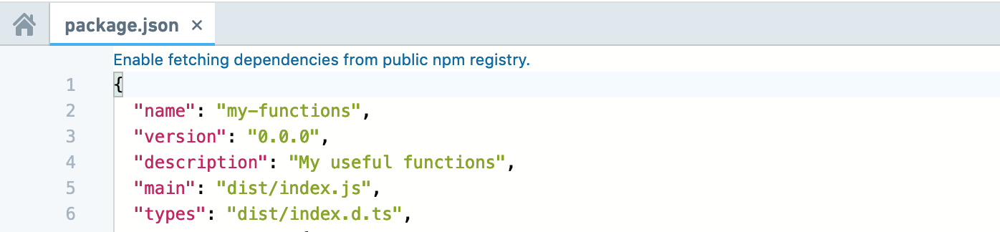
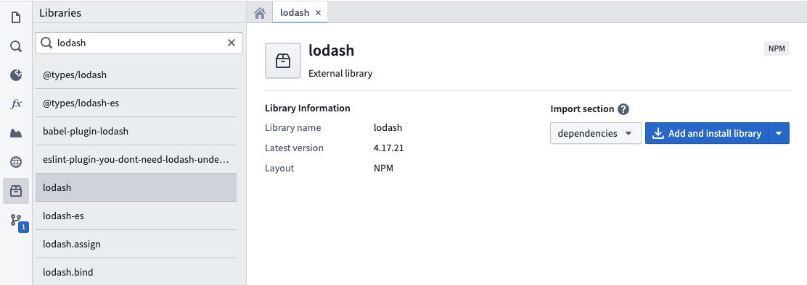
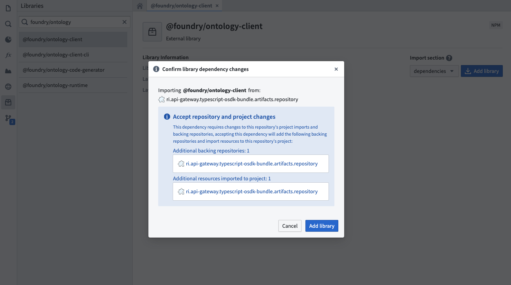
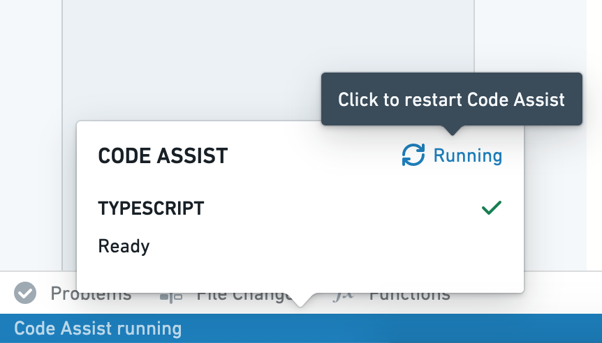

:::callout{theme="warning"}
注意：以下翻译的准确性尚未经过验证。这是使用 [AIP ↗](https://www.palantir.com/platforms/aip/) 从原始英文文本进行的机器翻译。
:::

# 添加 npm 依赖项

函数存储库使用 [npm ↗](https://npmjs.com/) 以 管理依赖项，包括用于基于 Foundry Ontology 生成代码和在代码中发现函数的包。您可以使用 `npm` 将外部依赖项安装到您的存储库中，使用标准包以操控数字和日期、执行统计计算或处理诸如 XML 等数据格式。

请注意，函数运行时仅支持纯 JavaScript 库—任何依赖 NodeJS 运行时并进行系统调用的包都不支持。

## 启用从公共 npm 注册表获取依赖项

默认情况下，函数存储库不从公共 npm 注册表获取包。

如果您的存储库尚未从公共 npm 注册表获取依赖项，当您在代码存储库中打开 `package.json` 文件时，将出现一个启用的横幅。



## 在代码存储库中添加依赖项

您可以使用 **代码存储库** 中的库侧边栏将包添加到您的函数存储库中。搜索所需的包，并选择一个结果以查看最新版本等详细信息。结果包括 Foundry 和 <https://npmjs.com> 的包。



选择是否将包添加到 `package.json` 文件中的 `dependencies` 或 `devDependencies`。选择 **添加并安装库** 以将包添加到您的存储库中。



如果包的来源存储库尚未配置为支持存储库，将出现一个对话框提示您导入其他资源。**添加并安装库** 按钮会自动将包及其依赖项导入您的函数存储库，更新您的 `package.json` 和 `package-lock.json`。

一旦运行的安装任务完成，包将在您的存储库中可供使用。

如果您使用的 `typescript-functions` 模板版本低于 0.520.0，通过任务运行器安装将被禁用。在这种情况下，提交您更新的 `package.json` 文件，确保检查成功通过，然后重新启动代码辅助以使新包可用。

## 手动添加依赖项

您可以通过在代码存储库中修改 `package.json` 文件手动添加包。如果您需要安装特定版本的包，这将非常有用。打开 `package.json`，从 <https://npmjs.com> 添加您选择的相关版本的依赖项，然后选择 **提交**。在验证检查成功通过后，重新启动代码辅助以使新包可用。



以下是手动将 `d3-array` 包添加到存储库中的 `package.json` 文件的示例：

```typescript
  "dependencies": {
    ...
    "d3-array": "^2.3.1" // 正式依赖：d3-array库，用于数组操作和数值计算
  },
  "devDependencies": {
    ...
    "@types/d3-array": "^2.0.0" // 开发依赖：d3-array的TypeScript类型定义，帮助在开发中提供类型检查
  }
```
