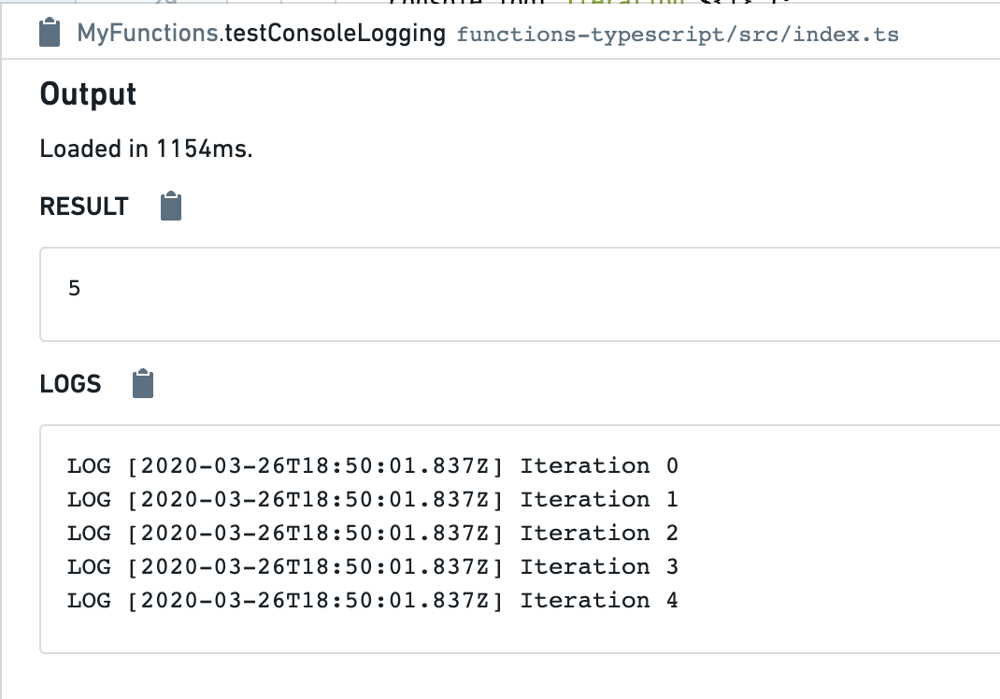

:::callout{theme="warning"}
注意：以下翻译的准确性尚未经过验证。这是使用 [AIP ↗](https://www.palantir.com/platforms/aip/) 从原始英文文本进行的机器翻译。
:::

# 调试函数

当您编写函数时，可能需要检查执行状态以解决代码正确性或性能问题。以下是您可以用来执行此操作的功能。

## 控制台日志记录

函数支持在执行期间发出控制台日志以进行调试。为此，只需使用 `console.log` 命令来发出日志。例如：

```typescript
    @Function()
    public testConsoleLogging(n: Integer): Integer {
        for (let i = 0; i < n; i++) {
            console.log(`Iteration ${i}`); // 打印当前迭代次数
        }
        return n; // 返回输入参数 n
    }
```

当您在**编写**中使用**函数助手**运行此函数时，控制台日志将被捕获并显示在下方，伴随时间戳：



以这种方式使用控制台日志可以帮助调试正确性问题。您还可以添加控制台日志以识别代码中的性能瓶颈。请参阅[优化性能](../Performance%20and%20limits/%E4%BC%98%E5%8C%96%E6%80%A7%E8%83%BD.md)指南，以获取有关如何提高链接遍历逻辑性能的更多信息。
