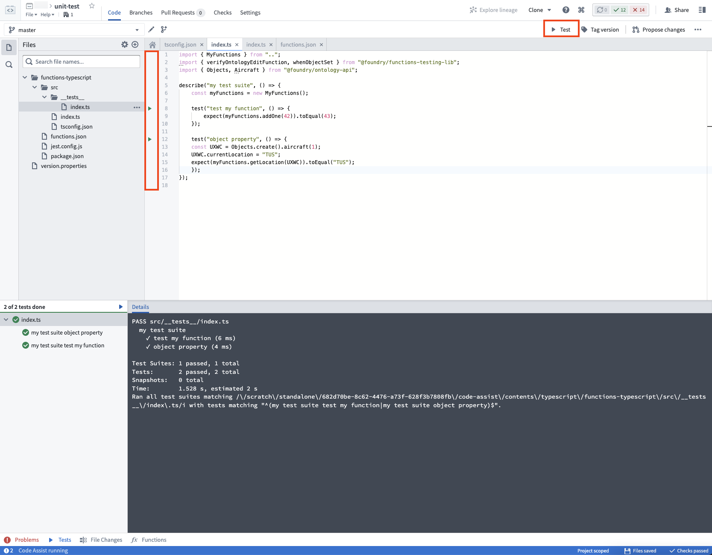
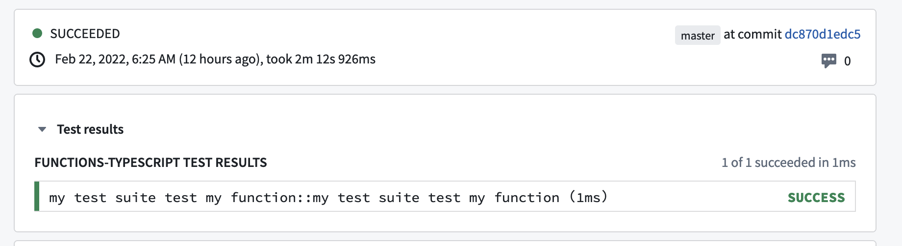

:::callout{theme="warning"}
注意：以下翻译的准确性尚未经过验证。这是使用 [AIP ↗](https://www.palantir.com/platforms/aip/) 从原始英文文本进行的机器翻译。
:::

# 入门指南

函数自带支持[Jest ↗](https://jestjs.io/)单元测试。按照本指南中的步骤为您的代码库设置单元测试工具。

默认情况下，函数包含一个位于测试文件`functions-typescript/src/__tests__/index.ts`中的单元测试。您可以在`__tests__`文件夹中的任何位置创建测试文件。

## 示例

例如，我们可能想要测试位于`functions-typescript/src/index.ts`中的以下函数`addOne`:

```typescript
import { Function, Integer } from "@foundry/functions-api";

export class MyFunctions {

    @Function()
    public addOne(n: Integer): Integer {
         return n + 1; // 将输入的整数n加1后返回
    }
}
```

我们可以通过编写以下测试 `test add one` 来测试函数 `addOne`:

```typescript
import { MyFunctions } from ".."

// 描述一个测试套件，名称为 "example test suite"
describe("example test suite", () => {
    // 创建 MyFunctions 类的一个实例
    const myFunctions = new MyFunctions();

    // 定义一个测试用例，名称为 "test add one"
    test("test add one", () => {
        // 调用 myFunctions 的 addOne 方法，参数为 42，期望返回结果为 43
        expect(myFunctions.addOne(42)).toEqual(43);
    });
});
```

请参考 [Jest API ↗](https://jestjs.io/docs/en/api) 了解完整的测试API。

## 运行测试

您可以通过点击右上角的 `Test` 按钮运行所有测试，或者通过点击每个测试行号旁边的三角形“播放”按钮来运行每个单独的测试。



当您点击 **Commit** 时，所有测试也将在 Checks 中运行：



## 下一步

接下来，了解用于测试与Ontology交互的函数的各种选项：

* [创建存根对象](%E5%88%9B%E5%BB%BA%E5%AD%98%E6%A0%B9%E5%AF%B9%E8%B1%A1.md)
* [验证Ontology编辑](%E9%AA%8C%E8%AF%81Ontology%E7%BC%96%E8%BE%91.md)
* [存根Object搜索和聚合](%E5%AD%98%E6%A0%B9%E5%AF%B9%E8%B1%A1%E6%90%9C%E7%B4%A2%E5%92%8C%E8%81%9A%E5%90%88.md)
