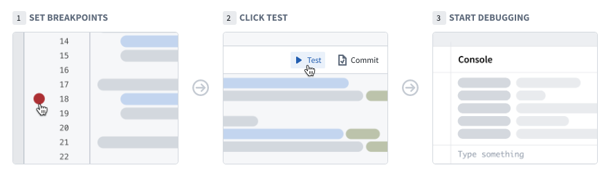
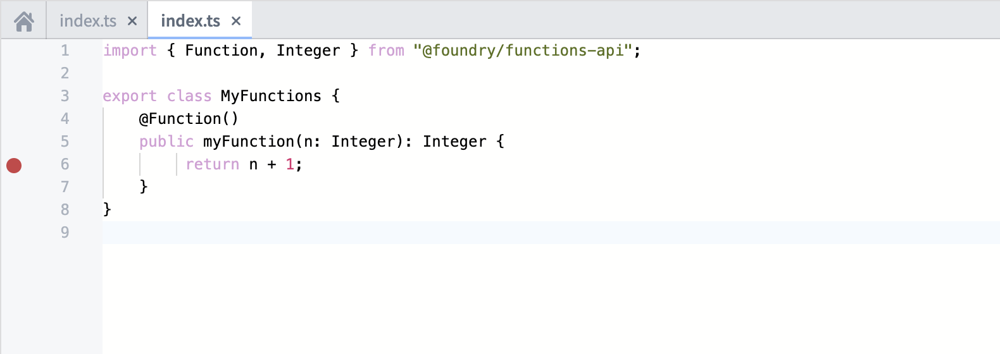
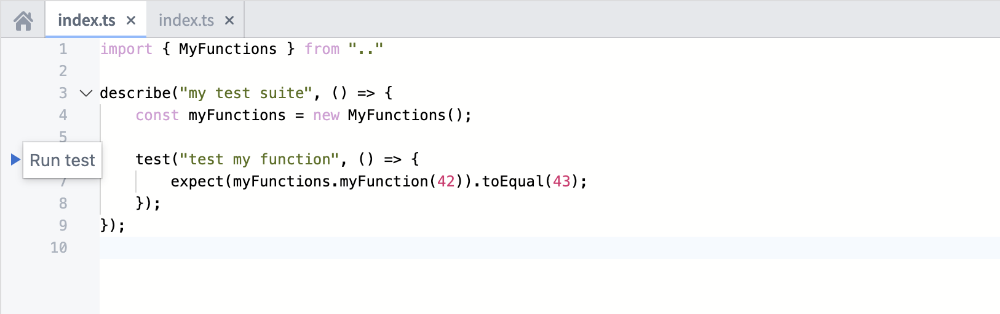
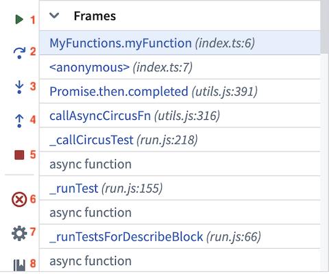
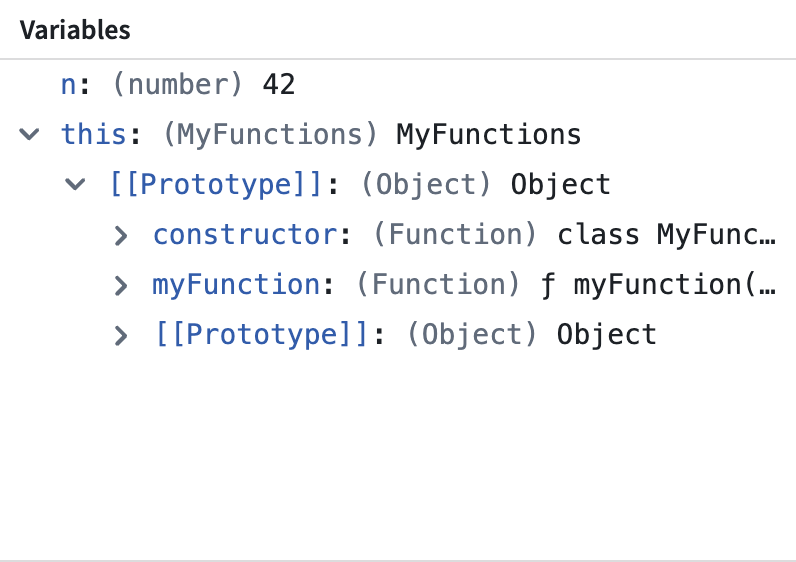
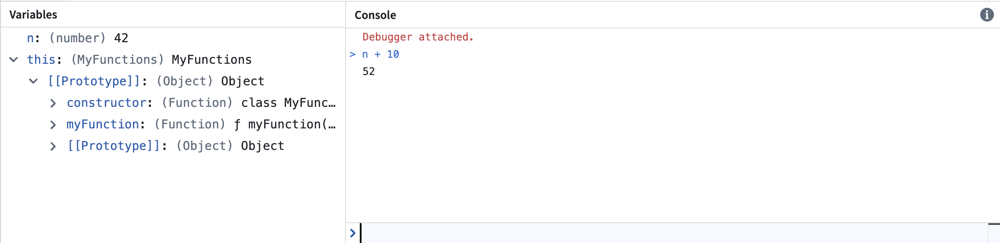

:::callout{theme="warning"}
注意：以下翻译的准确性尚未经过验证。这是使用 [AIP ↗](https://www.palantir.com/platforms/aip/) 从原始英文文本进行的机器翻译。
:::

# 调试

使用代码库中的调试工具检查单元测试运行时的行为。设置断点以暂停单元测试的执行，从而检查变量，并理解函数和库。

## 设置断点

要使用调试器，您需要设置断点。这些断点指示调试器应暂停代码执行的特定点，从而使您能够与变量进行交互。

通过选择每行代码边缘的淡红色点设置断点。调试器会在标记的行运行*之前*暂停执行。如果需要，您可以在多个文件中设置多个断点。

## 运行调试器

在代码中添加断点后，选择位于代码编辑器中单元测试旁边的**运行测试**。调试器面板将打开并在遇到的第一个断点处暂停。调试器的左侧栏允许您导航代码、移除断点以及完成/停止调试会话。

当您在代码中导航时，编辑器会突出显示要执行的下一行代码。使用以下按钮来推进调试器：

1. **继续执行：** 继续执行直到完成或被下一个断点暂停。
2. **单步跳过：** 执行代码行而不进入内部函数。
3. **单步进入：** 如果该行代码中存在内部函数，则进入内部函数。
4. **单步跳出：** 跳出内部函数并推进调试器。
5. **停止执行：** 完全停止调试器。
6. **移除断点：** 从库中移除所有断点，并在不暂停执行的情况下运行单元测试。
7. **设置：** 切换调试器开/关（不会清除断点）。
8. **文档：** 打开文档以获取更多详细信息。

## 检查变量

在调试器运行时，您可以检查代码执行点的变量和数据。

### 桢

桢表示调试器处于活动状态或存在断点的函数。每个桢指示函数名称，后跟文件名称和编写函数的行号。

选择一个桢以检查该桢内的变量并对其运行控制台命令。

### 变量

变量部分显示在变换执行时存储在局部变量和全局变量中的值。

### 控制台

控制台允许您在运行调试器时使用JavaScript控制台命令与数据进行交互。在控制台中常用的两种模式为：

:::callout{theme="neutral"}
请注意，控制台在选定桢的上下文中操作。尝试在不同桢的局部变量上执行命令将导致出错。
:::

