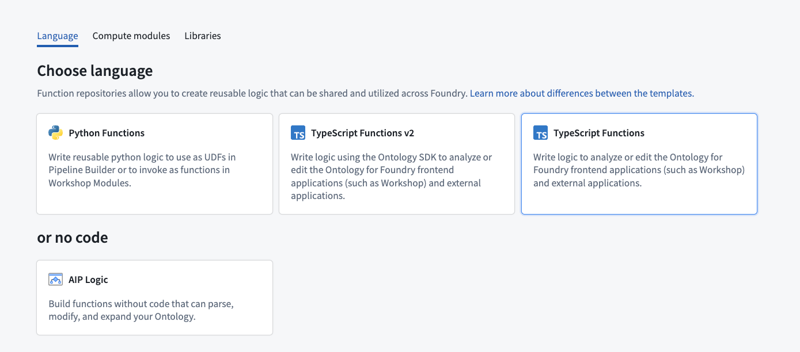
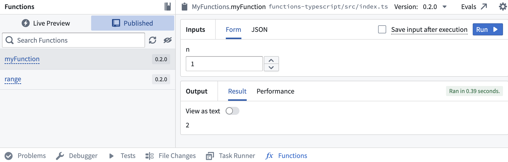
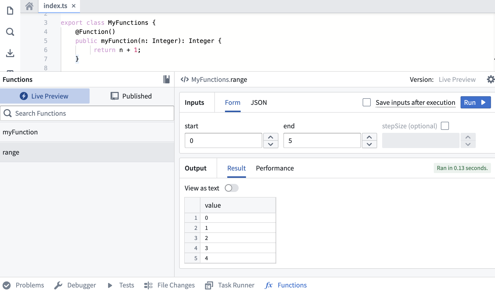
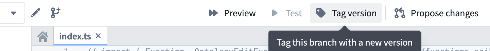
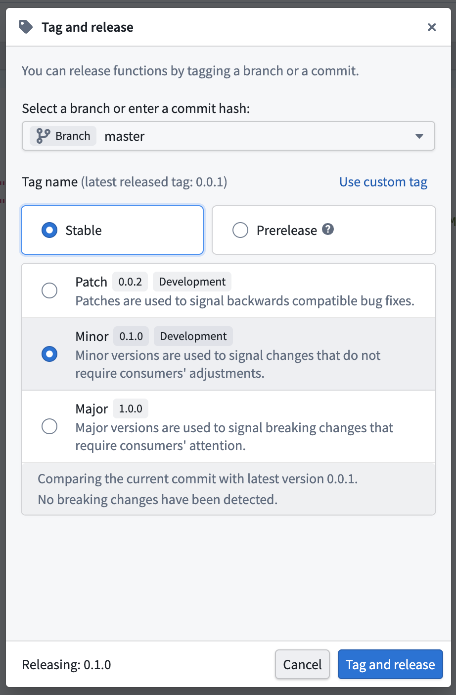
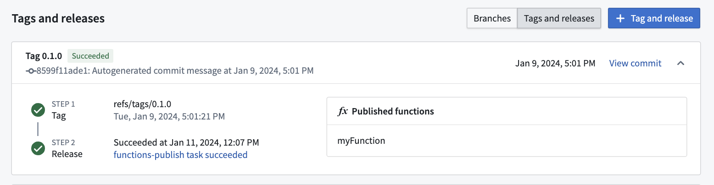
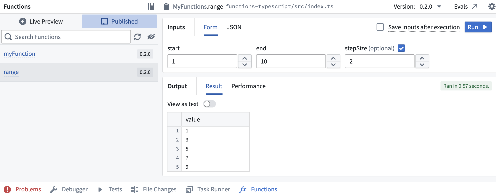

:::callout{theme="warning"}
注意：以下翻译的准确性尚未经过验证。这是使用 [AIP ↗](https://www.palantir.com/platforms/aip/) 从原始英文文本进行的机器翻译。
:::

# 入门

## 创建 TypeScript 函数代码库

导航到您选择的项目，并通过选择 **+ 新建** > **代码库** 创建一个新的代码库。选择 TypeScript 函数模板以初始化您的代码库。



代码库创建后，导航到 `functions-typescript/src/index.ts` 文件。

## 浏览代码库

您的代码库将已初始化一个包含单个函数的 `index.ts` 文件：

```typescript
export class MyFunctions {
    @Function() // 装饰器 @Function() 用于标记 myFunction 方法为一个函数
    public myFunction(n: Integer): Integer { // 接收一个整数 n 作为参数，并返回一个整数
        return n + 1; // 返回 n 加 1 的结果
    }
}
```

该类包含一个名为 `myFunction` 的单个函数，它仅将提供给它的整数加上 `1`。

切换到页面顶部的 **检查** 选项卡，您会看到一个正在运行的检查。选择它，并等待直到其成功。

[官方图片已失效：选择检查以查看进度。](https://www.palantir.com/docs/resources/foundry/functions/tsv1-functions-publish.png)

检查成功后，再次选择 **代码** 选项卡，然后打开 **函数助手**。您将在结果中看到 `myFunction`。

[官方图片已失效：打开函数助手。](https://www.palantir.com/docs/resources/foundry/functions/tsv1-functions-helper-open.png)

选择它，为 `n` 选择一个值，然后选择 **运行** 以执行刚刚发布的函数。



## 添加另一个函数

现在，让我们向此存储库添加一个更复杂的函数，测试并发布它。将下面的代码复制并粘贴到 `MyFunctions` 类的底部。

```typescript
    /**
     * 生成一个从 start 到 end 的整数范围，间隔由可选的 stepSize 指定。
     *
     * @param start 范围的开始
     * @param end 范围的结束
     * @param stepSize 范围内数字之间的步长。默认为 1。
     */
    @Function()
    public range(start: Integer, end: Integer, stepSize: Integer = 1): Integer[] {
        const result = [];
        for (let current = start; current < end; current += stepSize) {
            result.push(current);
        }
        return result;
    }
```

## 在实时预览中测试

添加新函数后，可以在函数助手中立即运行它。打开 **函数助手** 并选择 **实时预览**。选择 `range` 函数，输入值，然后选择 `Run` 运行代码。



在右上角选择 **Commit** 以提交更改到代码库的 `master` 分支。

## 发布函数

提交工作后，将看到 **Tag version** 选项。这将发布代码库中的所有函数。



选择 **Tag version** 以标记 `master` 分支的一个发布版本。根据更改的范围设置标签名称，然后选择 **Tag and release**。



要查看函数标记和发布的进度，请选择 **View** 弹出窗口或导航到 **代码库** 中的 **Branches** 标签，并在右侧切换到 **Tags and releases**。一旦 **步骤2：发布** 完成，选择已发布的函数以在函数注册表中查看它们。

:::callout{theme="warning"}
在权限传播期间，函数可能无法在 Workshop 或函数库注册表中按名称立即搜索到。
:::



## 使用新函数

标签检查通过后，返回 **代码库** 中的 **代码** 标签并选择 **函数助手**。现在应该可以在 **已发布** 部分看到新的 `range` 函数。选择它，并尝试运行新函数：



### 后续步骤

在本教程中，您学习了如何使用代码库编写、发布和测试代码库中的函数。接下来，我们建议学习如何在 [Objects 上编写函数](Functions%20on%20objects/%E5%85%A5%E9%97%A8.md)。


> 配图缺失说明：本页有 2 个官方图片地址在抓取及重试时失效（返回 HTML 错误页）。下列地址保留用于溯源，未替换成其他版本的图片。

- 官方图片已失效：<https://www.palantir.com/docs/resources/foundry/functions/tsv1-functions-helper-open.png>
- 官方图片已失效：<https://www.palantir.com/docs/resources/foundry/functions/tsv1-functions-publish.png>
