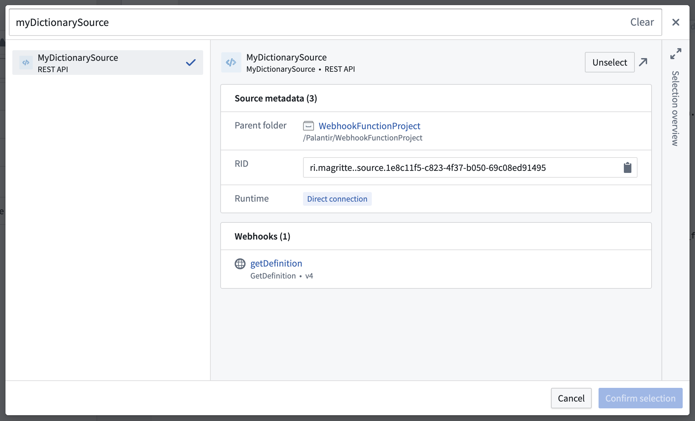
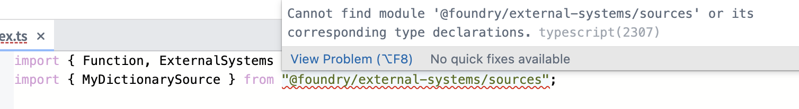
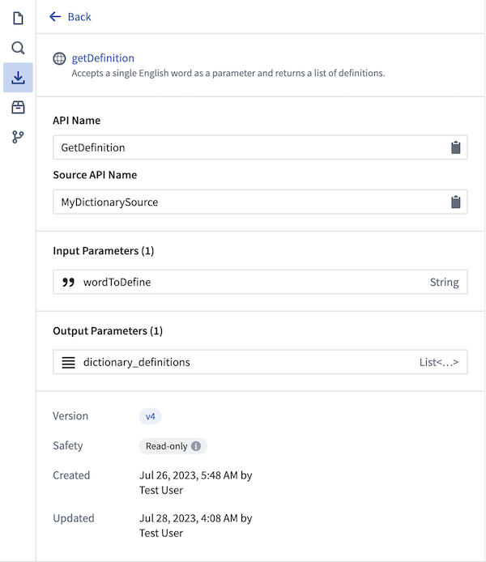

:::callout{theme="warning"}
注意：以下翻译的准确性尚未经过验证。这是使用 [AIP ↗](https://www.palantir.com/platforms/aip/) 从原始英文文本进行的机器翻译。
:::

# 函数中的外部来源

本指南将指导您设置一个可以使用[webhooks](https://www.palantir.com/docs/foundry/data-connection/webhooks-overview/)向外部系统发出请求的函数。

:::callout{theme="neutral" title="先决条件"}
本指南假设您已经创建了一个数据连接来源和一个 webhook。有关更多信息，请参阅[如何创建数据连接来源和 webhook 的文档](https://www.palantir.com/docs/foundry/data-integration/external-functions/)。
:::

## 将来源导入到函数库中

在遵循本指南之前，请确保您已经创建了一个函数库，并了解如何按照[我们的教程](%E5%85%A5%E9%97%A8.md)编写和发布函数。

要在函数中使用 webhook，必须首先将 webhook 的支持 REST API 来源导入库中。选择[屏幕左侧的**资源导入**侧边栏](%E5%B0%86%E8%B5%84%E6%BA%90%E5%AF%BC%E5%85%A5%E4%BB%A3%E7%A0%81%E5%BA%93.md)，查看导入库中的来源。选择**添加 > 来源**以显示搜索对话框，您可以在其中选择要导入的来源。只有具有 API 名称的来源可以通过此对话框导入。



:::callout{theme="neutral"}
来源导入到函数库中与导入到 Python 变换库和计算模块中有所不同。导入给定来源的函数库将\_不会\_显示在来源概览中显示的库列表中。任何对某一来源具有`只读`访问权限的用户都可以在外部函数中导入和使用这些 webhooks。
:::

## 在函数中使用 webhooks

一旦您将 REST API 来源导入函数库，它将在 TypeScript 环境中可用，并可通过该来源的命名空间进行访问：

```javascript
import { Sources } from "@foundry/external-systems";
// 从外部系统模块中导入Sources对象
```

如果您遇到错误 `Cannot find module '@foundry/external-systems' or its corresponding type declarations.`, 请确保在 `functions-typescript/functions.json` 文件中将 `enableExternalSystems` 的值设置为 `true`。一旦您更新并提交更改，系统应安装必要的包，包括 `@foundry/external-systems`。



### 示例：从一个函数进行多次调用

在下面的示例中，我们将解释如何使用单个函数对字典 API 进行多次调用。

如果您的函数不进行任何 Ontology 编辑，您将创建一个 `@Query()` 函数。如果您希望进行 Ontology 编辑，则需要使用 `@OntologyEditFunction` 装饰器。了解更多关于在函数中进行 Ontology 编辑的信息，请参考我们的[文档](Ontology%20edits/API-%20Ontology%E7%BC%96%E8%BE%91.md)。

使用标准的 [TypeScript async/await 模式 ↗](https://www.typescriptlang.org/docs/handbook/release-notes/typescript-1-7.html#asyncawait-support-in-es6-targets-node-v4)，可以从一个函数中同时进行多个 webhook 调用。使用从 `@foundry/functions-api` 导出的 `isOk` 辅助函数检查调用是否成功。

以下函数接受一个词列表作为 TypeScript 字符串数组，并对每个词进行一次调用：

```typescript
import { Sources } from "@foundry/external-systems";
import { OntologyEditFunction, isOk } from "@foundry/functions-api";

export class MyFunctions {

    @OntologyEditFunction()
    public async defineWords(words: string[]): Promise<void> {

        // 使用Promise.all并行获取每个单词的定义
        const results = await Promise.all(words.map(word => Sources.MyDictionarySource.webhooks.GetDefinition.call({
            wordToDefine: word
        })));

        // 遍历获取的结果
        results.forEach((result, i) => {
            // 检查结果是否成功
            if (isOk(result)) {
                const output = result.value.output;
                // 遍历单词的字典定义
                output.dictionary_definitions.forEach(definitions_for_word => {
                    // 遍历定义中的每个意义
                    definitions_for_word.meanings.forEach(meaning => {
                        // 遍历每个词性的定义
                        meaning.definitions.forEach(def_for_part_of_speech => {
                            // 打印出每个词性下的定义
                            console.log(`Found a ${meaning.partOfSpeech} definition for "${words[i]}": ${def_for_part_of_speech.definition}`);
                        })
                    })
                });
            }
        });
    }
}
```

日志输出对于输入`["tuba", "cool"]`:

```markdown
LOG [2023-07-28T03:16:22.968Z] Found a noun definition for "tuba": A large brass musical instrument, usually in the bass range, played through a vibration of the lips upon the mouthpiece and fingering of the keys.
LOG [2023-07-28T03:16:22.968Z] Found a noun definition for "tuba": A type of Roman military trumpet, distinct from the modern tuba.
LOG [2023-07-28T03:16:22.968Z] Found a noun definition for "tuba": A large reed stop in organs.
LOG [2023-07-28T03:16:22.968Z] Found a noun definition for "tuba": A Malayan plant whose roots are a significant source of rotenone, Derris malaccensis.
LOG [2023-07-28T03:16:22.968Z] Found a noun definition for "tuba": A reddish palm wine made from coconut or nipa sap.
LOG [2023-07-28T03:16:22.968Z] Found a noun definition for "tuba": A tube or tubular organ.
LOG [2023-07-28T03:16:22.968Z] Found a noun definition for "cool": A moderate or refreshing state of cold; moderate temperature of the air between hot and cold; coolness.
LOG [2023-07-28T03:16:22.968Z] Found a noun definition for "cool": A calm temperament.

# 中文注释
# 上述代码为记录日志的输出示例，以下是对日志中名词定义的翻译：
# "tuba" 的定义：
# 1. 一种大型铜管乐器，通常在低音范围，通过嘴唇在吹口处振动和按键演奏。
# 2. 一种罗马军用喇叭，与现代大号不同。
# 3. 管风琴中的大型簧管。
# 4. 一种马来植物，其根是鱼藤酮的重要来源，学名为 Derris malaccensis。
# 5. 一种由椰子或尼帕树汁液制成的红色棕榈酒。
# 6. 管或管状器官。

# "cool" 的定义：
# 1. 一种适度或清爽的冷；空气在冷热之间的适度温度；凉爽。
# 2. 冷静的性情。
```

## 错误处理

为帮助缓解使用网络系统时的故障，函数通过使用 Result 对象公开从 webhooks 传播的错误，这些对象提供有关发生的错误类型的信息：

```typescript
import { Sources } from "@foundry/external-systems";
import { OntologyEditFunction, isOk } from "@foundry/functions-api";

export class MyFunctions {

    @OntologyEditFunction()
    public async defineWords(words: string[]): Promise<void> {

        const results = await Promise.all(words.map(word => Sources.MyDictionarySource.webhooks.GetDefinition.call({
            wordToDefine: word
        })));

        results.forEach((result, i) => {
            if (isOk(result)) {
                // Extract the response
                // 提取响应
            } else {
                const errorName = result.error.name;

                if (errorName === "WebhookExecutionFailedToStart") {
                    console.log("We were unable to initiate a request to the dictionary API.");
                    // 无法启动对字典 API 的请求。
                } else if (errorName === "ParsingResponseFailed") {
                    console.log("The external request succeeded, but the response couldn't be parsed.");
                    // 外部请求成功，但响应无法解析。
                } else {
                    console.log("Something went wrong.");
                    // 出现了未知错误。
                }
            }
        });
    }
}
```

This code defines a class `MyFunctions` with an asynchronous method `defineWords` that takes an array of words and retrieves their definitions using a dictionary API. It handles different error scenarios based on the error name returned from the API.
在处理出错时，编写的代码应监听特定名称并相应地作出反应。目前，函数返回以下出错：

| 出错 | 描述 |
| ----- | ----------- |
| `WebhookExecutionFailedToStart` | webhook启动失败。如果返回此出错，可以安全地假设没有请求发送到外部系统。 |
| `WebhookExecutionTimedOut` | webhook执行已开始，但在配置的webhook时间限制内未收到来自外部系统的响应。 |
| `RemoteRestApiReturnedError` | 外部系统返回了一个出错。仅在配置于REST API源的webhook中返回。 |
| `RemoteApiReturnedError` | 外部系统返回了一个出错。仅在配置于非REST API源的webhook中返回。 |
| `ParsingResponseFailed` | webhook执行成功，但无法成功解析来自外部系统的响应。这可能发生在例如外部系统的响应中不包含预期字段的情况下。由于webhook调用的结果不一定会被使用，是否将其标记为对终端用户的失败取决于应用程序搭建者。 |
| `ServerError` | 在webhooks服务或连接器内发生了内部问题。 |
| `UnknownError` | 发生了一个无法直接归因于任何Foundry服务的出错。 |

此出错类型列表可能会更改；用户应构建其代码以包含默认情况，以防函数执行器返回具有新名称的出错。

### 示例：处理从单个函数进行多个webhook调用时的出错

以下代码描述了如何处理在同一函数中某些成功某些失败的多个webhook调用。在我们的示例中，如果字典服务器找不到给定单词的定义，则返回`RemoteRestApiReturnedError`。

```typescript
import { Sources } from "@foundry/external-systems";
import { OntologyEditFunction, isOk } from "@foundry/functions-api";

export class MyFunctions {

    @OntologyEditFunction()
    public async defineWords(words: string[]): Promise<void> {

        // 使用 Promise.all 并行获取每个单词的定义
        const results = await Promise.all(words.map(word => Sources.MyDictionarySource.webhooks.GetDefinition.call({
            wordToDefine: word
        })));

        // 遍历每个结果
        results.forEach((result, i) => {
            // 如果调用成功，处理定义信息
            if (isOk(result)) {
                const output = result.value.output;
                output.dictionary_definitions.forEach(definitions_for_word => {
                    definitions_for_word.meanings.forEach(meaning => {
                        meaning.definitions.forEach(def_for_part_of_speech => {
                            console.log(`Found a ${meaning.partOfSpeech} definition for "${words[i]}": ${def_for_part_of_speech.definition}`);
                        })
                    })
                });
            } else {
                // 如果调用失败，输出错误信息
                if (result.error.name === "RemoteRestApiReturnedError") {
                    console.log(`ERROR: ${words[i]} could not be defined`, result.error.message);
                }
            }
        });
    }
}
```

这段代码是一个用于定义单词的类`MyFunctions`，其中包含一个异步方法`defineWords`。该方法会调用外部系统中的字典服务来获取单词的定义，并处理成功或失败的情况。
将 `["asdf", "shire"]` 输入到上述函数会返回以下结果：

```
LOG [2023-07-28T15:38:47.263Z] ERROR: asdf could not be defined Request returned an unsuccessful response code: 404
# 错误：无法定义“asdf”，请求返回了不成功的响应代码：404
# 响应体：{"title":"No Definitions Found","message":"Sorry pal, we couldn't find definitions for the word you were looking for.","resolution":"You can try the search again at later time or head to the web instead."}
# 响应内容：标题："未找到定义"，信息："抱歉，我们找不到您要查找的单词的定义。"，解决方法："您可以稍后再试，或者直接在网上搜索。"

LOG [2023-07-28T15:38:47.264Z] Found a noun definition for "shire": Physical area administered by a sheriff.
# 找到“shire”的名词定义：由治安官管理的物理区域。

LOG [2023-07-28T15:38:47.264Z] Found a noun definition for "shire": Former administrative area of Britain; a county.
# 找到“shire”的名词定义：英国的旧行政区划；一个郡。

LOG [2023-07-28T15:38:47.264Z] Found a noun definition for "shire": The general area in which a person lives or comes from, used in the context of travel within the United Kingdom.
# 找到“shire”的名词定义：一个人生活或来自的地区，一般用于英国境内旅行时的语境。

LOG [2023-07-28T15:38:47.264Z] Found a noun definition for "shire": A rural or outer suburban local government area of Australia.
# 找到“shire”的名词定义：澳大利亚的农村或外郊地方政府区域。

LOG [2023-07-28T15:38:47.264Z] Found a noun definition for "shire": A shire horse.
# 找到“shire”的名词定义：一种夏尔马。

LOG [2023-07-28T15:38:47.264Z] Found a verb definition for "shire": To (re)constitute as one or more shires or counties.
# 找到“shire”的动词定义：将某地（重新）划分为一个或多个郡。
```

## 限制

目前，在一个Ontology编辑函数中可以发出的请求数量没有限制，但现有的[函数资源限制](Performance%20and%20limits/%E5%BC%BA%E5%88%B6%E9%99%90%E5%88%B6.md)仍然适用。[Webhook限制](https://www.palantir.com/docs/foundry/data-connection/webhooks-reference/#limits)也会被强制执行。

函数目前支持以下输入和输出类型的webhooks：

* 附件
* 布尔值
* 整数
* 长整型
* 双精度数
* 字符串
* 非必填
* 日期
* 时间戳
* 列表
* 枚举（允许的字符串类型值列表）
* 具有和不具有预期字段的记录

当从`@Query`函数调用webhooks时，webhook必须仅执行不改变外部系统的`Read API`调用。查询函数通常会在页面加载时被重试或静默执行，因此不提供与`@OntologyEditFunction`相同水平的结构化的有意执行。在配置webhook时，可以通过使用`Read API`或`Write API`选项来指定它是否可以安全地从查询函数中执行。

### 不支持的webhook特性

* 使用`OR`类型作为输入或输出参数的webhooks目前不支持。对于这些webhooks，不会生成代码。
* 配置为通过[Outbound Applications](https://www.palantir.com/docs/foundry/administration/configure-outbound-applications/)使用交互式OAuth的REST API源的webhooks目前不支持。

## 处理函数和webhooks的版本更改

函数和webhooks都有版本，调用者可以调用任何版本的函数或webhook。当一个函数被发布时，那个时间点上可用的最新webhook版本将被固定到它上面。

当在[代码库](https://www.palantir.com/docs/foundry/code-repositories/overview/)应用中打开一个函数库时，用于自动补全的生成代码绑定将始终使用最新版本的webhook。此webhook版本显示在左侧的**资源导入**侧边栏中。



:::callout{theme="warning"}
确保webhook在依赖其功能的函数发布之前是稳定的。
:::

当对webhook或函数进行更改时，请记得重新发布函数并将用户提升到新版本。先前发布的、固定的函数版本仍然可供使用。

## 权限

下表总结了创作、发布和使用外部函数所需的权限。

| 操作 | 用户 | 所需权限 |
|--------|------|---------------------|
| 将源导入到函数库 | 函数编辑者 | 源上的`source:viewer`权限，授予**Viewer**默认角色。 |
| 发布调用webhook的函数 | 函数编辑者 | 源上的`webhooks:execute`权限，仅授予**Owner**和**Editor**默认角色。 |
| 配置一个调用webhooks的`@OntologyEditFunction()`的操作 | 操作编辑者 | webhook上的`webhooks:grant-action-validated-execution`权限和函数上的`Viewer`权限 |
| 从Workshop执行`@Query()` webhook | 终端用户 | 源上的`webhooks:execute`权限，仅授予`Owner`和`Editor`默认角色。 |
| 从操作中执行`@OntologyEditFunction()` | 终端用户 | 用户必须满足操作的[提交标准](../%E5%8A%A8%E4%BD%9C%E7%B1%BB%E5%9E%8B/%E6%8F%90%E4%BA%A4%E6%A0%87%E5%87%86.md)。在这种情况下，不会检查源、webhook或函数上的权限。创建和管理操作的用户必须确保提交标准配置得当。 |

## 监控、故障排除和调试

使用以下平台工具深入了解从函数执行的webhook：

* [Webhook执行历史](https://www.palantir.com/docs/foundry/data-connection/webhooks-reference/#webhook-history)，在[数据连接](https://www.palantir.com/docs/foundry/data-connection/overview/)中查看单个webhook时可在**历史**标签中查看。
* 函数使用历史，可在[Ontology管理器](../../%E5%BA%94%E7%94%A8/%E6%9C%AC%E4%BD%93%E7%AE%A1%E7%90%86%E5%99%A8/%E6%A6%82%E8%BF%B0.md)中查看，显示函数执行的历史记录，包括输入、输出和触发函数的用户。
* [函数代码创作预览](Functions%20on%20objects/%E5%85%A5%E9%97%A8.md#test-in-live-preview)，提供性能分析、调试输出等功能。

## 最佳实践

在使用外部源从函数调用webhooks时，我们推荐以下最佳实践：

* 在尝试在函数中使用这些webhook之前，通过数据连接中的[测试webhook侧边栏](https://www.palantir.com/docs/foundry/data-connection/webhooks-setup/#test-the-webhook)彻底测试webhooks。
* 使用具有预期字段的`record`类型参数作为webhook输入和输出，如果可能的话。使用显式类型而非JSON意味着函数代码不太可能抛出意外的运行时错误。
* 使用从`@foundry/functions-api`导出的`isOk`和`isErr`内置函数来检查成功和出错状态，并通过名称字段缩小错误类型。
* 如果用户将通过单个函数调用写入外部系统和Ontology，记住即使写入外部系统成功，写入Ontology也可能失败。确保采取措施处理这种不一致，并在需要时为用户提供对两个系统修改状态的可见性。
