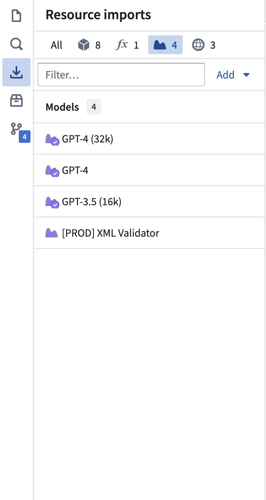
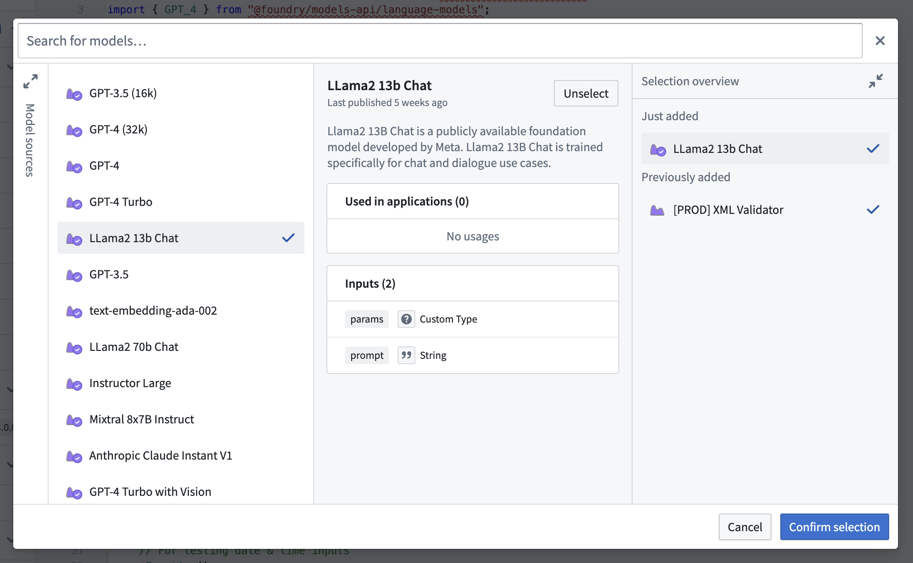

:::callout{theme="warning"}
注意：以下翻译的准确性尚未经过验证。这是使用 [AIP ↗](https://www.palantir.com/platforms/aip/) 从原始英文文本进行的机器翻译。
:::

# 函数中的语言模型

Palantir 提供了一组可以在函数中使用的语言模型。[阅读更多关于Palantir提供的大型语言模型（LLM）](https://www.palantir.com/docs/foundry/platform-overview/aip-capabilities/#palantir-provided-large-language-models-llms)。

:::callout{title="先决条件" theme="neutral"}
要使用Palantir提供的语言模型，[必须先在您的注册中启用AIP](https://www.palantir.com/docs/foundry/administration/enable-aip-features/)。您还必须拥有使用[AIP开发者功能](https://www.palantir.com/docs/foundry/platform-overview/aip-capabilities/#aip-developer-capabilities)的权限。
:::

## 导入语言模型

要开始使用语言模型，您必须通过以下步骤将特定模型导入到您编写函数的代码库中：

1. 导航并打开**模型导入**侧边栏以查看所有现有的已导入模型。



2. 要导入新的语言模型，请在**资源导入**面板的右上角选择**添加**并选择**模型**。这将打开一个新窗口，您可以在其中看到可用的Palantir提供的模型。



3. 您还将看到一个选项卡，您可以在其中查看通过建模目标应用程序先前创建的自定义模型。有关使用这些模型的更多信息，请参阅[函数在模型上](%E6%A8%A1%E5%9E%8B%E4%B8%8A%E7%9A%84%E5%87%BD%E6%95%B0.md)文档。

4. 选择您想要导入的模型，然后点击**确认选择**以将这些模型导入到您的代码库中。任务运行器将执行`localDev`任务，生成与这些模型交互的代码绑定。

5. 导入语言模型后，您现在可以通过添加以下导入语句在您的代码库中使用它们，将GPT\_4o替换为您已导入到代码库中的语言模型的名称：

```typescript
import { GPT_4o } from "@foundry/models-api/language-models"
// 导入 GPT_4o 模型模块，从 @foundry/models-api/language-models 中引入
```

## 编写使用语言模型的函数

在这个阶段，我们可以编写一个使用我们导入的语言模型的函数。对于这个例子，我们假设已经按照上述描述导入了GPT\_4o。

我们首先在文件中添加以下导入语句：
每个语言模型都将具有生成的方法，其输入和输出为强类型。例如，GPT\_4o模型提供了一个createChatCompletion方法，允许用户传递一组消息以及其他参数以修改模型的行为，如温度或最大词元数。

在以下示例中，我们使用提供的GPT\_4o模型对用户提供的一段文本运行简单的情感分析。该函数将文本分类为“好”、“坏”或“不确定”。

```typescript
@Function()
public async sentimentAnalysis(userPrompt: string): Promise<string> {
    // 系统提示，指示AI提供用户文本情感的估计，只能选择"Good"、"Bad"或"Uncertain"
    const systemPrompt = "Provide an estimation of the sentiment the text the user has provided. \
    You may respond with either Good, Bad, or Uncertain. Only choose Good or Bad if you are overwhelmingly \
    sure that the text is either good or bad. If the text is neutral, or you are unable to determine, choose Uncertain."

    // 创建系统信息和用户信息
    const systemMessage = { role: "SYSTEM", contents: [{ text: systemPrompt }] };
    const userMessage = { role: "USER", contents: [{ text: userPrompt }] };

    // 调用GPT-4o接口获取情感分析的结果，参数temperature为0.7
    const gptResponse = await GPT_4o.createChatCompletion({messages: [systemMessage, userMessage], params: { temperature: 0.7 } });

    // 返回GPT的响应结果，如果没有内容则返回"Uncertain"
    return gptResponse.choices[0].message.content ?? "Uncertain";
}
```

该函数可以在整个平台中被用于在。

## 嵌入

除了生成语言模型，Palantir还提供可以用于生成嵌入的模型。一个简单的例子如下：

```typescript
@Function()
public async generateEmbeddingsForText(inputs: string[]): Promise<Double[][]> {
    // 调用 TextEmbeddingAda_002 的 createEmbeddings 方法生成文本嵌入
    const response = await TextEmbeddingAda_002.createEmbeddings({ inputs });
    // 返回生成的嵌入
    return response.embeddings;
}
```

这通常被用于执行[语义搜索](Semantic%20search/%E4%BD%BF%E7%94%A8Palantir%E6%8F%90%E4%BE%9B%E7%9A%84%E6%A8%A1%E5%9E%8B%E5%88%9B%E5%BB%BA%E8%AF%AD%E4%B9%89%E6%90%9C%E7%B4%A2%E5%B7%A5%E4%BD%9C%E6%B5%81.md)工作流程。

## 性能注意事项

请注意，某些模型可能会有速率限制，限制在特定时间段内可以传递的词元数量。这将在适用于函数的任何标准限制的同时执行。

***

注意：AIP功能的可用性可能会发生更改，并且可能因客户而异。
