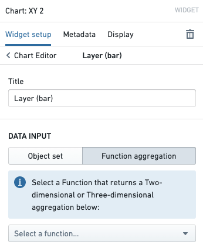
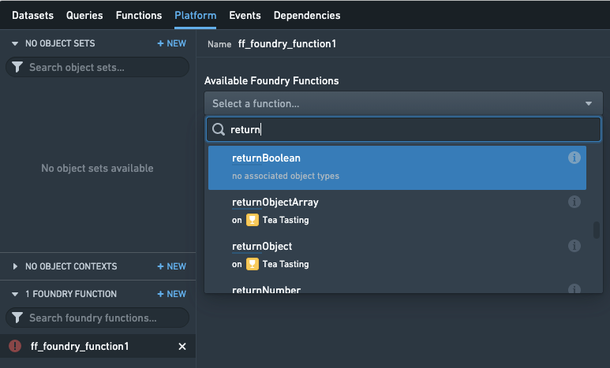

:::callout{theme="warning"}
注意：以下翻译的准确性尚未经过验证。这是使用 [AIP ↗](https://www.palantir.com/platforms/aip/) 从原始英文文本进行的机器翻译。
:::

# 在平台中使用函数

本节记录了在 Foundry 平台中使用函数的各种方式。此列表大多是最新的，但可能还有其他未在此捕获的函数使用方式。

## Workshop

[Workshop](https://www.palantir.com/docs/foundry/workshop/overview/) 支持以多种方式与函数集成，允许在 Workshop 中搭建的模块中使用自定义逻辑。

### 变量

大多数 Workshop [变量](https://www.palantir.com/docs/foundry/workshop/concepts-variables/) 可以由函数支持，允许应用程序搭建者使用函数计算值，然后在整个 Workshop 中使用。默认情况下，当另一个它依赖的变量更新时，变量的值将重新计算。这允许灵活地响应用户反馈重新计算值，例如，当用户编辑输入组件时，依赖的由函数支持的对象集变量将自动重新计算。

要了解更多信息，请查看[如何使用函数支持 Workshop 变量的教程](https://www.palantir.com/docs/foundry/workshop/functions-use/#function-backed-variables-in-workshop)。

以下是 Workshop 变量类型及其在 TypeScript 中的等效类型的映射。每种给定类型的 Workshop 变量都可以由返回列出有效类型之一的函数支持。[了解更多关于可用函数类型的文档。](TypeScript%20basics/%E8%BE%93%E5%85%A5%E5%92%8C%E8%BE%93%E5%87%BA%E7%B1%BB%E5%9E%8B.md)

* Boolean: `boolean`
* String: `string`
* Numeric: `Integer`, `Long`, `Float`, `Double`
* Date: `LocalDate`
* Timestamp: `Timestamp`
* Array: `BaseType[]` 或 `Set<BaseType>`
* Object Set: `ObjectSet<ObjectType>` (推荐), `ObjectType[]`, 或 `Set<ObjectType>`

### 对象表：派生属性

Workshop 的 **对象表** 微件可以配置为计算由函数支持的列，该列可以根据用户输入更新，并在终端用户滚动浏览表格时实时重新计算。您可以查看[使用此功能的完整教程](https://www.palantir.com/docs/foundry/workshop/widgets-object-table/#function-backed-columns)。

### 图表：派生聚合

Workshop 的 **图表: XY** 微件支持使用由函数支持的聚合来按需派生聚合值。如果您希望聚合数据基于用户选择，这可能会很有用。要在图表微件中使用函数，只需单击配置图表层并选择*函数聚合*。

提供了[聚合 API 的参考](TypeScript%20basics/%E8%BE%93%E5%85%A5%E5%92%8C%E8%BE%93%E5%87%BA%E7%B1%BB%E5%9E%8B.md#aggregations)。对于更高级的应用案例，您可能想阅读关于[如何计算自定义聚合](Functions%20on%20objects/%E5%88%9B%E5%BB%BA%E8%87%AA%E5%AE%9A%E4%B9%89%E8%81%9A%E5%90%88.md)的文档。

## 操作

[操作类型](../%E5%8A%A8%E4%BD%9C%E7%B1%BB%E5%9E%8B/%E6%A6%82%E8%BF%B0.md) 允许应用程序更改 Foundry Ontology 中的对象，并以灵活且安全的方式分发外部通知和副作用。在操作中，函数提供了完全的灵活性，使代码作者能够定义对象应如何更新或副作用应如何配置。

### 函数支持的操作

函数支持的操作使用 [Ontology 编辑](Ontology%20edits/API-%20Ontology%E7%BC%96%E8%BE%91.md) API 来定义对象应如何更新的逻辑。这允许您在代码中表达复杂的编辑，例如，更新每个链接到某个起始对象的对象。[查看如何端到端使用函数支持的操作的教程。](../%E5%8A%A8%E4%BD%9C%E7%B1%BB%E5%9E%8B/Function-backed%20actions/%E5%85%A5%E9%97%A8.md)

### 副作用：通知

可以配置操作以向指定用户发送通知。您可以使用函数计算应接收通知的用户以及通知本身的内容。这提供了灵活性，例如加载存储在对象中的接收用户 ID，或基于对象数据呈现电子邮件内容。要了解更多信息，请查阅[有关通知的完整文档](../%E5%8A%A8%E4%BD%9C%E7%B1%BB%E5%9E%8B/Side%20effects/%E9%80%9A%E7%9F%A5.md)和[如何使用函数配置通知的指南](%E9%85%8D%E7%BD%AE%E9%80%9A%E7%9F%A5.md)。

### 副作用：Webhooks

操作还可以配置为在应用时触发 Webhook。Webhooks 使 Foundry 能够与其他系统集成，使用户应用操作能够写回 Foundry 外部的 API。您可以使用函数计算应发送到将被执行的 Webhook 的参数，从而实现基于对象数据填充 Webhook 参数的工作流程。[查看有关 Webhooks 的完整文档。](../%E5%8A%A8%E4%BD%9C%E7%B1%BB%E5%9E%8B/Side%20effects/Webhooks.md)

## Slate

[Slate](https://www.palantir.com/docs/foundry/slate/overview/) 在 **平台** 选项卡中包含对查找和使用函数的原生支持。在编辑 Slate 文档时，打开平台选项卡并在左下角添加一个 **Foundry 函数**。现在，您可以搜索函数、配置参数，并在 Slate 文档中使用结果。

请注意，由于历史原因，Slate 产品有其自己的“函数”概念，它是位于每个 Slate 文档中的 JavaScript 逻辑片段。这就是为什么函数产品被称为“Foundry 函数”并位于 **平台** 选项卡下的原因。Slate 的函数功能允许在文档中快速、轻松地进行数据操作，但不支持对象。

您可以将 Slate 的函数与 Foundry 函数结合使用——例如，您可以从 Foundry 函数返回数据并在 Slate 函数中操作它，或使用 Slate 函数计算应传递给 Foundry 函数的参数。

## Quiver

Quiver 中的 [对象集图](https://www.palantir.com/docs/foundry/quiver/cards-charts/#objects-charts) 使用与 Workshop 的 Chart: XY 微件相同的底层组件。因此，您也可以在 Quiver 分析中使用函数支持的聚合。
