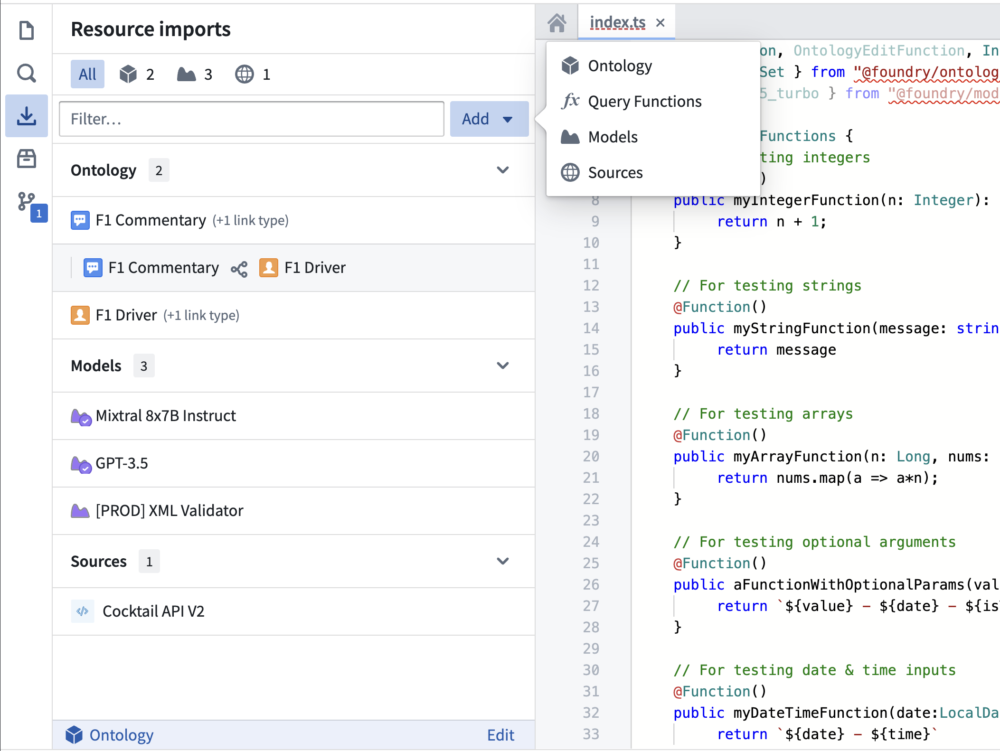
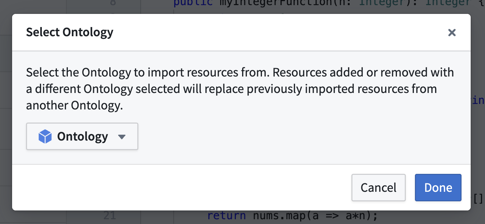
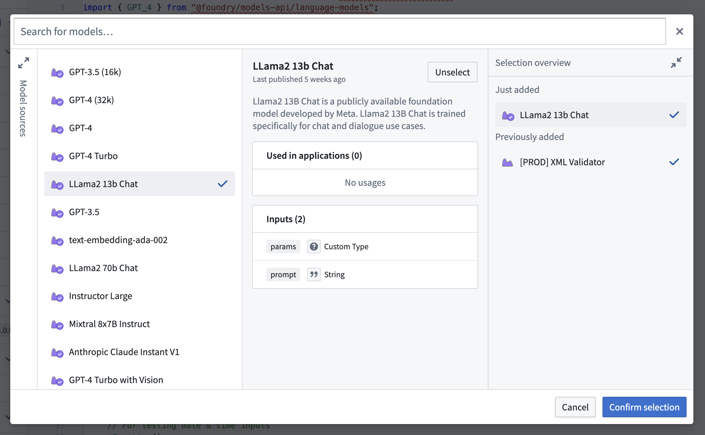
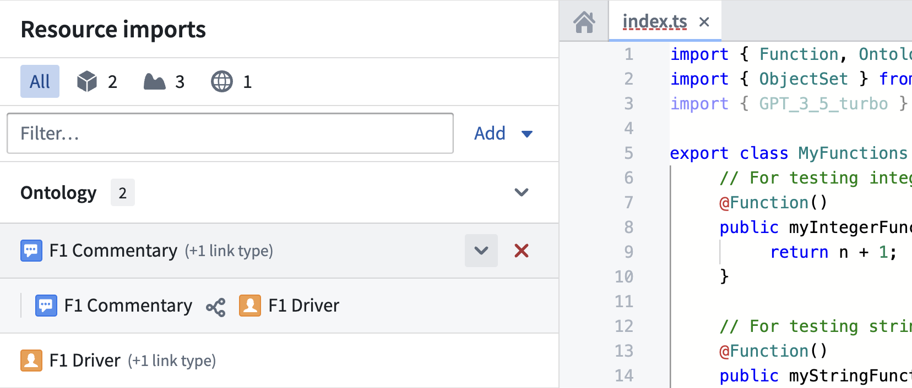
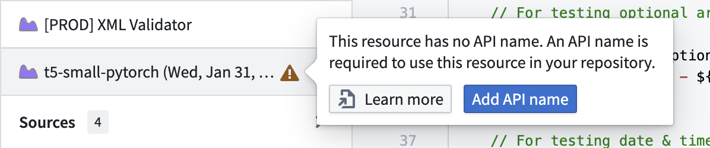

:::callout{theme="warning"}
注意：以下翻译的准确性尚未经过验证。这是使用 [AIP ↗](https://www.palantir.com/platforms/aip/) 从原始英文文本进行的机器翻译。
:::

# 将资源导入代码库

代码库中的资源导入侧边栏提供了一个集中接口，以管理在您的 TypeScript 函数库中导入的 Foundry 资源。侧边栏允许您导入、移除和查看各种资源的详细信息，包括 Ontology 类型、LMS 语言模型、实时部署和外部系统，如 REST API。



## 选择一个 Ontology

导入 Object 和链接类型需要一个 Ontology。要选择一个 Ontology：

1. 选择 **添加** 打开资源选择器菜单，然后选择 **Ontology** 开始导入 Ontology 类型。如果未选择 Ontology，这将自动打开 Ontology 选择器对话框。

如果您已经至少导入了一个 Ontology 类型，该类型的 Ontology 将自动选择。要更改 Ontology，请选择所选 Ontology 名称旁边的 **编辑** 按钮以打开 Ontology 选择器对话框。



您库中的所有导入资源必须与同一个 Ontology 关联。请注意，更改 Ontology 后导入资源将覆盖来自其他 Ontology 的任何现有导入。

## 导入资源

要使用侧边栏导入资源：

1. 使用侧边栏右上角的 **添加** 按钮并选择所需的资源类型。这将打开该资源的选择器对话框。
2. 使用搜索栏和筛选定位您想要导入的资源。
3. 选择一个资源以显示其详细信息的预览面板。
4. 使用 **选择** 按钮将资源添加到您的选择中。
5. 展开购物车面板以查看您的选择，并选择 **确认选择** 进行确认。

确认选择后，代码助手将重新启动以重新运行必要的代码生成任务以应用您的更改。



了解更多关于导入特定类型资源的信息：

* [Ontology 类型](Functions%20on%20objects/%E5%AF%BC%E5%85%A5Object%E5%92%8C%E9%93%BE%E6%8E%A5%E7%B1%BB%E5%9E%8B.md#import-object-and-link-types)
* [语言模型](%E5%87%BD%E6%95%B0%E4%B8%AD%E7%9A%84%E8%AF%AD%E8%A8%80%E6%A8%A1%E5%9E%8B.md#import-a-language-model)
* [实时部署](%E6%A8%A1%E5%9E%8B%E4%B8%8A%E7%9A%84%E5%87%BD%E6%95%B0.md#import-a-live-deployment)
* [外部来源](%E5%87%BD%E6%95%B0%E4%B8%AD%E7%9A%84%E5%A4%96%E9%83%A8%E6%9D%A5%E6%BA%90.md)

## 管理导入的资源

资源在侧边栏中按类型分类：

* Ontology：Object 和链接类型
* 模型：LMS 模型和实时部署
* 来源：外部系统，如 REST API

选择侧边栏顶部的相应资源图标以按类型筛选，或使用文本输入按名称搜索。要移除资源，将鼠标悬停在资源图标上并选择 **移除** 按钮。要同时添加或移除多个资源，请使用选择器对话框。要查看更多详细信息，选择已导入的资源以打开其预览面板。

某些资源类型可能在其他资源之间存在依赖关系。例如，链接类型在其各自的 Object 类型下组织。如果导入的资源有依赖关系，将在资源标题旁显示类似“(1 个链接类型)”的消息。要查看资源的依赖关系，将鼠标悬停在资源图标上并选择出现的箭头。



## 导入没有 API 名称的资源

资源必须具有 API 名称才能在 TypeScript 函数库的代码中引用。如果资源缺少 API 名称，将显示警告。将鼠标悬停在警告标志上以了解更多信息，或通过选择 **添加 API 名称** 轻松配置 API 名称。或者，选择 **了解更多** 查看关于为特定资源类型添加 API 名称的文档。



## 启用资源类型

默认情况下，某些资源类型可能未启用于您的库中。启用的资源类型由您的 `functions.json` 文件确定。这是一个典型默认 `functions.json` 文件的内容。

```json
{
  "useOntologyApiNames" : true, // 启用本体API名称
  "enableModelFunctions" : false, // 禁用模型函数
  "enableModelGraphFunctions" : false, // 禁用模型图形函数
  "enableDiscoverImproperOntologyAccess": false, // 禁用发现不当本体访问
  "enableQueries": false, // 禁用查询
  "enableModelMetadata": false, // 禁用模型元数据
  "useDeploymentApiNames": true, // 启用部署API名称
  "enableVectorProperties": true, // 启用向量属性
  "enableTimeSeriesProperties": false, // 禁用时间序列属性
  "enableExternalSystems": false, // 禁用外部系统
  "enableMediaReferenceProperties": false // 禁用媒体引用属性
}
```

在 `functions.json` 文件中不启用相应标志导入资源可能导致存储库中的检查失败。要使用导入的实时部署，请将 `enableModelFunctions` 设置为 true。要使用导入的源，请将 `enableExternalSystems` 设置为 true。
