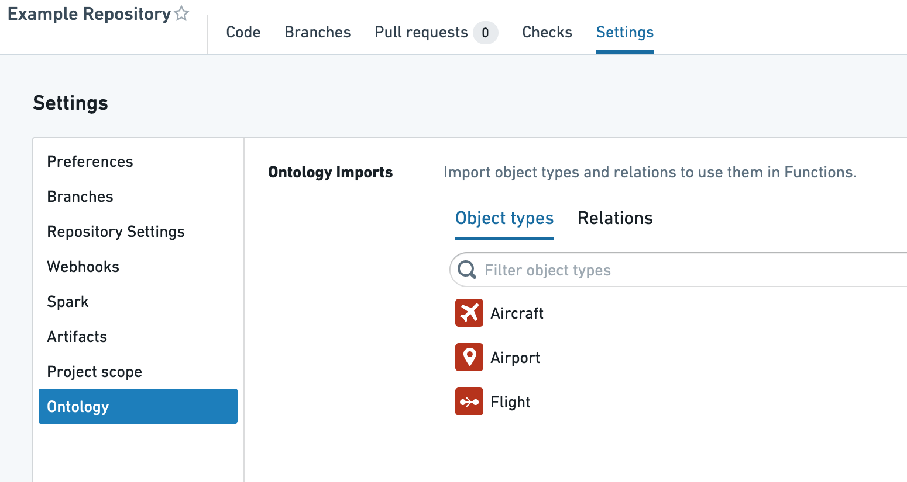
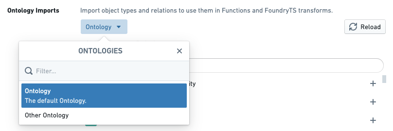
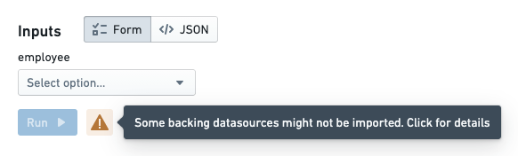

:::callout{theme="warning"}
注意：以下翻译的准确性尚未经过验证。这是使用 [AIP ↗](https://www.palantir.com/platforms/aip/) 从原始英文文本进行的机器翻译。
:::

# 权限

在平台上编写和执行函数受到多种权限检查的约束。本节概述了您需要注意的不同类型的权限以及可能遇到的常见问题。

## 函数编写

函数库必须获得适当的权限以：

1. 访问Ontology，以便生成适当的代码绑定。
2. 加载Objects以运行函数执行的实时预览。

请注意，库权限必须明确授予，并且与授予您的用户帐户的权限不同。因此，您必须采取特定步骤将Object类型、链接类型和支持的数据源导入到包含您库的项目中。

有关这些步骤的教程，请参阅[本节](Functions%20on%20objects/%E5%AF%BC%E5%85%A5Object%E5%92%8C%E9%93%BE%E6%8E%A5%E7%B1%BB%E5%9E%8B.md)。下面，我们解释导入的具体资源以及授予这些资源的权限。

### Ontology实体权限

在库中，每当运行检查或启动代码助手时，函数插件根据库的权限加载最新的Ontology，并为加载的每个Object和链接类型生成代码绑定。加载的Object和链接类型集取决于以下资源类型的导入：

* Ontologies
* Ontology分支
* [Object类型](../%E5%AF%B9%E8%B1%A1%E9%93%BE%E6%8E%A5%E7%B1%BB%E5%9E%8B/Object%20types/%E6%A6%82%E8%A7%88.md)
* [链接类型](../%E5%AF%B9%E8%B1%A1%E9%93%BE%E6%8E%A5%E7%B1%BB%E5%9E%8B/Link%20types/%E6%A6%82%E8%BF%B0.md)

在函数库中，您可以通过导航到 **设置** > **Ontology** 来导入所需的Ontology资源。此界面允许您选择Object和链接类型以导入到您的项目中。

如果您的用户帐户有权访问多个Ontology，您还可以选择要使用的Ontology。目前，不支持将多个Ontology导入到单个项目中。

:::callout{theme="warning" title="警告"}
尽管上述界面显示在函数库中，但您导入的任何Ontology、Object类型和链接类型都是在**项目**级别添加的。这意味着在一个库中更改导入可能会影响同一项目中的其他库。如果您希望有两个依赖于不同Ontology实体的库，则应将它们分隔到不同的项目中。
:::

### Object加载权限

库中的**函数助手**允许用户通过两种方式执行函数：执行已发布的函数，或在实时预览中执行代码。在实时预览中执行时，函数代码在代码助手中编译并执行，这是为代码作者快速迭代而设计的基础架构。

由于它与库相关联，代码助手需要遵循与代码生成相同的权限要求，如上所述。这意味着在实时预览中运行函数时，您希望使用的每种Object类型所依赖的支持数据源必须导入到项目中。

在函数助手中，如果您的项目中导入了Object类型而未导入相应的数据源，则会在实时预览中显示警告，提示您更新导入：

对于大多数Object类型，**导入支持数据源**对话框会提示您导入一个Foundry数据集。对于启用了[行级安全](../../%E6%9C%AC%E4%BD%93%E6%9E%B6%E6%9E%84/%E5%AF%B9%E8%B1%A1%E6%9D%83%E9%99%90%E7%AE%A1%E7%90%86/%E9%85%8D%E7%BD%AE%E5%8F%97%E9%99%90%E8%A7%86%E5%9B%BE%E6%94%AF%E6%8C%81%E7%9A%84%E5%AF%B9%E8%B1%A1%E7%B1%BB%E5%9E%8B.md)的Object类型，您将被提示导入一个[受限视图](https://www.palantir.com/docs/foundry/security/restricted-views/)。

## 已发布函数执行

一旦函数已发布，它就可以被更广泛的用户群体使用，并可以配置以在[Workshop](https://www.palantir.com/docs/foundry/workshop/overview/)和[Actions](../%E5%8A%A8%E4%BD%9C%E7%B1%BB%E5%9E%8B/Function-backed%20actions/%E6%A6%82%E8%BF%B0.md)等应用程序中执行。在执行已发布函数的权限方面仍需注意一些考虑事项。

### 函数权限

为了执行函数，用户必须在发布该函数的库中具有**只读**角色。通常，最好将函数库与依赖于该库中函数的最终用户应用程序放在同一项目中，无论这些应用程序是使用Workshop、Slate还是其他工具创建的。如果用户遇到表示他们缺乏读取函数权限的错误（ReadFunctionsPermissionDenied），请检查他们是否具有对库的读取访问权限。[了解更多关于如何移动和共享资源。](https://www.palantir.com/docs/foundry/projects/move-and-share-resources/)

:::callout{theme="neutral"}
侧边栏中的**检查访问**面板可用于检查某人对Workshop或Slate应用程序的访问权限，包括对依赖函数的访问。有关更多信息，请参阅[检查访问面板文档](https://www.palantir.com/docs/foundry/security/checking-permissions/)。
:::

[函数支持的操作](../%E5%8A%A8%E4%BD%9C%E7%B1%BB%E5%9E%8B/Function-backed%20actions/%E6%A6%82%E8%BF%B0.md)是一种特殊情况，其中最终用户不一定需要读取函数的访问权限即可应用使用该函数的操作。配置操作以使用函数时，管理员用户必须具有读取函数的访问权限。之后，用户将能够根据[操作级权限](../%E5%8A%A8%E4%BD%9C%E7%B1%BB%E5%9E%8B/%E6%9D%83%E9%99%90.md)应用操作，而不管他们对函数的访问权限如何。

### Object加载权限

当函数加载Object数据时，无论是作为参数还是通过[Object搜索](Functions%20on%20objects/API%EF%BC%9A%E5%AF%B9%E8%B1%A1%E9%9B%86.md)，运行函数的最终用户的权限决定了加载哪些Objects。对于使用行级权限保护的Object类型，这意味着执行相同函数的不同用户可能会收到不同的结果。这种行为是有意为之的——用户只应看到他们有权限访问的Objects，这种行为使得单个函数能够适用于具有不同个体Object访问权限的用户。
