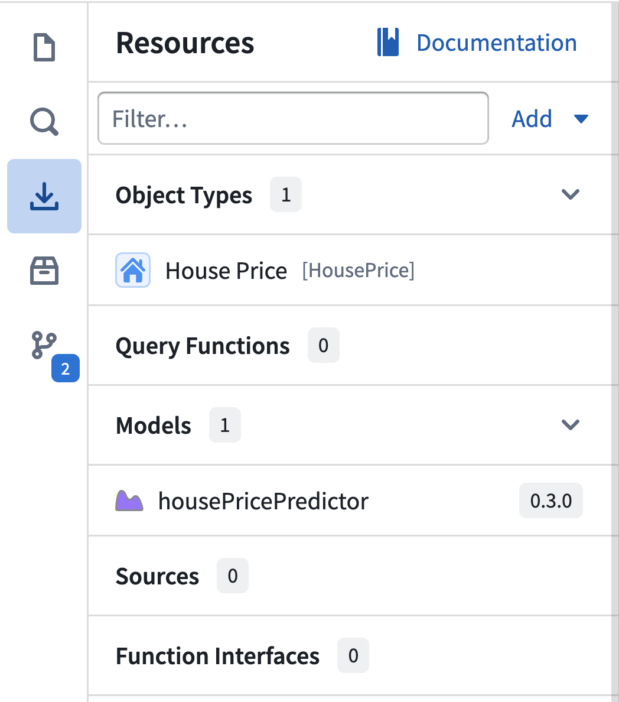
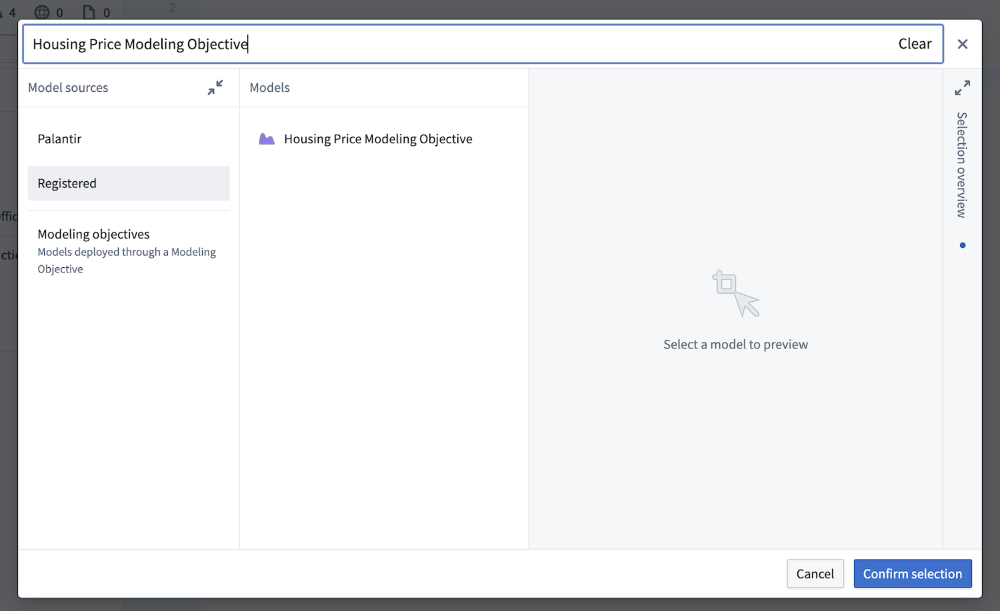

:::callout{theme="warning"}
注意：以下翻译的准确性尚未经过验证。这是使用 [AIP ↗](https://www.palantir.com/platforms/aip/) 从原始英文文本进行的机器翻译。
:::

# 模型上的函数

您可以通过使用在运行时调用模型的函数，在Ontology的上下文中使模型可操作。模型可以通过建模目标或模型实时部署提供，并导入到函数库中以供代码使用。

:::callout{title="先决条件" theme="neutral"}
在模型上创建函数之前，请确保首先创建并[设置一个建模目标实时部署](https://www.palantir.com/docs/foundry/manage-models/set-up-live/)或一个[模型实时部署](https://www.palantir.com/docs/foundry/manage-models/create-a-model-deployment/)。
:::

有关创建函数的更多信息，请参阅[入门](%E5%85%A5%E9%97%A8.md)指南。

### 导入实时部署

一旦创建了实时部署，就必须将其导入以便在特定库中使用。选择 **资源导入** 侧边栏以查看已经导入的模型部署。



要导入其他模型，请在 **资源导入** 侧边栏中选择 **添加** 以打开建模目标的搜索窗口。由于这是一个没有Ontology导入的库，您将只能导入与此库位于同一[空间](https://www.palantir.com/docs/foundry/security/orgs-and-spaces/#spaces)的目标。如果您的函数库已经从给定的[Ontology](../%E6%9C%AC%E4%BD%93/%E6%A6%82%E8%BF%B0.md)导入了Object类型，您将只能导入与该Ontology位于同一空间的目标。在这里，您可以选择代表`PRODUCTION`或`STAGING`发布的部署，或从特定模型提交中选择一个沙盒部署。在此示例中，我们将导入航班延误模型。



通过选择 **确认选择** 来确认模型导入。任务运行器将执行 `localDev` 任务，生成与这些模型交互的代码绑定。

在您的代码中，您现在可以从 `@foundry/models-api/deployments` 包中导入模型类型。每个模型都作为一个常量提供，其名称为其定义的API名称。

### 编写一个模型支持的函数

让我们编写一个将航班延误模型连接到Ontology的函数。一旦代码助手完成，从 `"@foundry/models-api/deployments"` 添加一个导入语句，并在括号中输入您为模型定义的API名称。或者，您可以从 **模型导入** 侧边栏复制API名称。

```typescript
import { FlightModelDeployment } from "@foundry/models-api/deployments";
// 从 "@foundry/models-api/deployments" 模块中导入 FlightModelDeployment 类或模块
```

然后，编写一个函数，该函数接收一个航班列表，准备模型所需的数据，并解释模型执行的结果。每个导入的模型都带有一个异步的`transform`方法，该方法表示其输入和输出规范。基于此，TypeScript可以在编译时确保发送到模型部署和从模型部署接收的数据结构是正确的。除非另有说明，建模目标的实时部署以行列表进行操作。

```typescript
@Function()
public async predictFlightDelays(flights: Flight[]): Promise<FunctionsMap<Flight, Double>> {
    let functionsMap = new FunctionsMap();
    // 准备模型预期的输入数据格式，将航班信息转换为模型输入
    const modelInput = flights.map(flight => ({
        "lastArrivalTime": flight.lastArrivalTime, // 上一次到达时间
        "lastExpectedArrivalTime": flight.lastExpecptedArrivalTime, // 上一次预计到达时间
    }));
    // 调用 Foundry 机器学习模型的实时部署进行预测
    const modelOutput = await FlightModelDeployment.transform(modelInput);
    // 将每个航班与其对应的模型输出结果进行映射
    for (let i = 0; i < flights.length; i++) {
        functionsMap.set(flights[i], modelOutput[i].prediction); // 将预测结果与航班绑定
    }
    return functionsMap;
}
```

### 由模型数据集支持的函数

模型上的函数针对服务于[模型资产](https://www.palantir.com/docs/foundry/integrate-models/model-asset-code-repositories/)的部署进行了优化。来自数据集的模型也支持，但`transform`方法期望并返回一个`list<Row<str, any>>`，因此实际上是无类型的。您可能需要在运行时检查数据的有效性。

### 性能考量

模型作为函数运行时的一部分被执行，因此所有标准[限制](Performance%20and%20limits/%E5%BC%BA%E5%88%B6%E9%99%90%E5%88%B6.md)均适用。
如果您的函数支持一个操作，对结果编辑的数量有[进一步限制](../%E5%8A%A8%E4%BD%9C%E7%B1%BB%E5%9E%8B/%E8%A7%84%E6%A8%A1%E5%92%8C%E5%B1%9E%E6%80%A7%E9%99%90%E5%88%B6.md#edit-limits)。
在调用实时部署时，模型输入和输出数据通过网络传输，上限为50 Mb。包括额外的吞吐量在内，函数的总执行时间不能超过30秒。如果您希望增加每个函数的超时限制，请联系您的Palantir代表。
