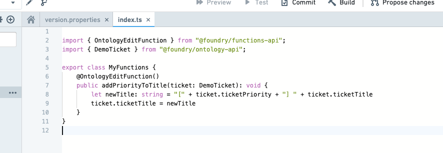
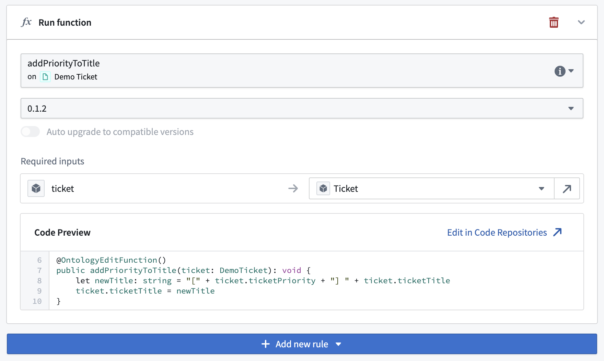
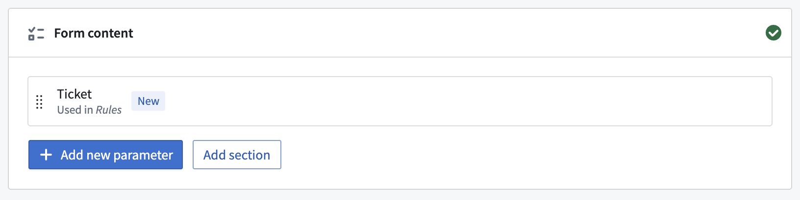
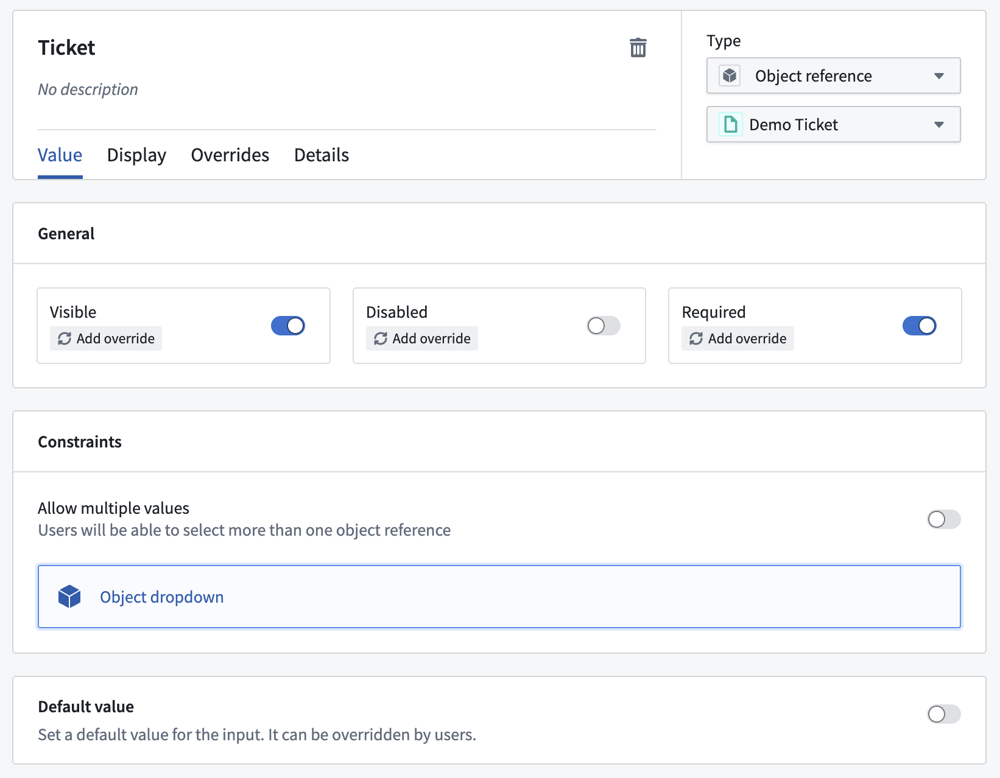
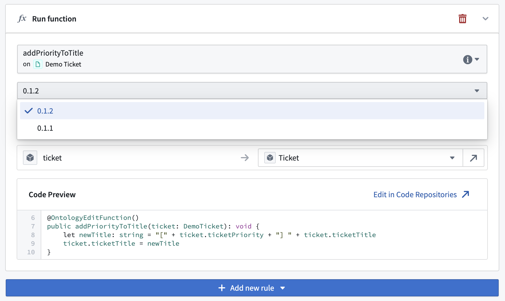

:::callout{theme="warning"}
注意：以下翻译的准确性尚未经过验证。这是使用 [AIP ↗](https://www.palantir.com/platforms/aip/) 从原始英文文本进行的机器翻译。
:::

# 入门

本教程解释了如何创建一个由[Ontology 编辑函数](../../%E5%87%BD%E6%95%B0/Ontology%20edits/%E6%A6%82%E8%BF%B0.md)支持的操作类型。

## 先决条件

在本教程中，我们将使用与[操作入门教程](../%E5%85%A5%E9%97%A8.md)中相同的`Demo Ticket`对象类型和示例对象。

首先编写一个Ontology 编辑函数，以执行操作所需的更改。这需要：

* 使用TypeScript模板在对象上设置一个函数存储库，
* 将相关对象类型导入到您的存储库中，并且
* 发布Ontology 编辑函数以供操作读取。

有关这些步骤的信息可以在函数文档中找到：

* [入门](../../%E5%87%BD%E6%95%B0/%E5%85%A5%E9%97%A8.md)——遵循本教程创建一个基本的函数存储库并发布一个函数
* [对象上的函数](../../%E5%87%BD%E6%95%B0/Functions%20on%20objects/%E6%A6%82%E8%BF%B0.md)——遵循本教程创建一个使用对象数据的函数
* [Ontology 编辑](../../%E5%87%BD%E6%95%B0/Ontology%20edits/API-%20Ontology%E7%BC%96%E8%BE%91.md)——使用此参考来创建一个Ontology 编辑函数

一旦您编写并发布了一个Ontology 编辑函数，下面的步骤将连接该函数到一个操作，以便可以使用该函数来对对象进行编辑。为了本教程的目的，我们已经从一个存储库中编写并发布了以下Ontology 编辑函数：



为了方便起见，代码可在此处获得：

```typescript
@OntologyEditFunction()
public addPriorityToTitle(ticket: DemoTicket): void {
    // 将优先级添加到标题中
    // 通过将优先级放在方括号中，并将其连接到原始标题的前面
    let newTitle: string = "[" + ticket.ticketPriority + "]" + ticket.ticketTitle;
    ticket.ticketTitle = newTitle; // 更新 ticket 的标题
}
```

:::callout{theme="warning"}
以操作类型中使用的函数必须注释为`@OntologyEditFunction()`，而不是`@Function()`。更多详细信息可以在[对象上的函数](../../%E5%87%BD%E6%95%B0/Ontology%20edits/API-%20Ontology%E7%BC%96%E8%BE%91.md#declaring-an-edit-function)文档中找到。
:::

## 创建一个基于函数的操作

在**规则**部分，添加一个类型为**函数**的单一规则。搜索您作为[先决条件](#prerequisites)一部分发布的函数，并选择最新版本。配置输入以匹配操作参数，如下所示。请注意，函数规则不能与[其他规则](../%E8%A7%84%E5%88%99.md)结合使用。



在选择函数时，函数的所有输入将自动创建为参数并添加到**表单**选项卡中。在这些截图中显示的示例中，已创建类型为**Object引用**的`Demo Ticket`参数。现在可以根据需要进一步自定义该参数。





保存您的操作并按照[与其他应用程序集成的指导](../%E5%9C%A8%E5%B9%B3%E5%8F%B0%E4%B8%AD%E4%BD%BF%E7%94%A8%E6%93%8D%E4%BD%9C.md)在整个平台上进行配置。

## 更改函数逻辑

如果Ontology编辑函数逻辑更改了，操作不会自动更新以匹配它。相反，您必须返回到操作的**规则**部分并升级操作所引用的函数版本。例如，如果我们发布了0.1.2版本的函数，我们需要在这里更新它：


