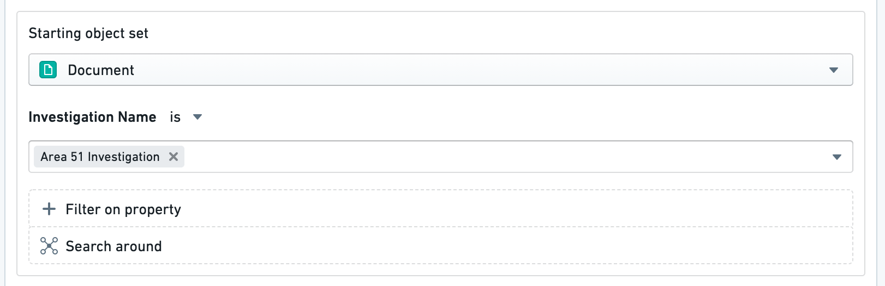
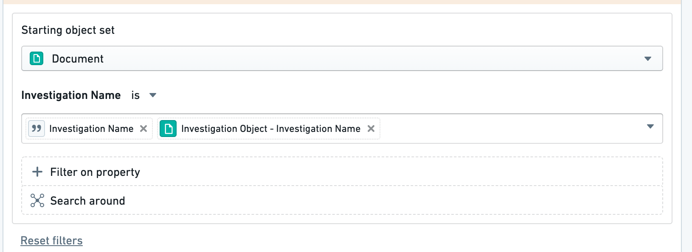

:::callout{theme="warning"}
注意：以下翻译的准确性尚未经过验证。这是使用 [AIP ↗](https://www.palantir.com/platforms/aip/) 从原始英文文本进行的机器翻译。
:::

# 对象下拉菜单安全注意事项

对象下拉菜单验证中的静态值筛选会暴露给所有可以查看操作类型的用户。使用这些筛选有暴露属性值组合给没有权限查看被筛选对象的用户的风险。通过依赖对象属性或参数来筛选对象集可以减轻这一风险。值不会直接在界面中可见。

## 示例：数据隐私问题

例如，假设我们有一个 `Document` Object，具有一个 `Investigation Name` 属性。在我们的操作类型中，我们在对象引用参数上添加一个筛选，仅显示 **Documents**，其中 **Investigation Name** 为 `Area 51 Investigation`。

在此情况下，我们可能会向无法查看这些文档的用户透露 `Area 51 Investigation` 是某些 `Document` Object 的一个属性值。

这仅适用于**静态值筛选**。当通过参数或通过另一个对象的属性筛选 `Investigation Name` 属性时，没有对 `Area 51 Investigation` 的引用，因为：

* `Investigation Name` 参数是用户提供的。关于基础数据的信息不会暴露给操作类型只读用户。
* `Investigation Object` 参数将遵循现有的对象可见性限制。

因此，这些搜索查询均不构成数据隐私问题。

## 技术细节

在大多数情况下，操作的后台会在操作类型定义中去除敏感信息，以避免暴露敏感属性值。例如，无法编辑操作类型的用户将无法看到操作提交条件。同样，用户无法在界面中或在检查后台响应时看到操作类型定义中的新对象下拉菜单筛选。

然而，在查看操作表单时，对象下拉菜单验证会被转换为对象集。这意味着用户可以查看包含该对象集的网络请求。在上述示例中，用户将收到一个对象集RID，其中包含 `Investigation Name = ‘Area 51 Investigation’` 筛选，即使他们无法查看其对应的任何对象，也会暴露该属性值的存在。

这意味着这些值对任何用户来说在界面中**不可见**。如果可见性比安全性更重要，可以忽略此警告。
