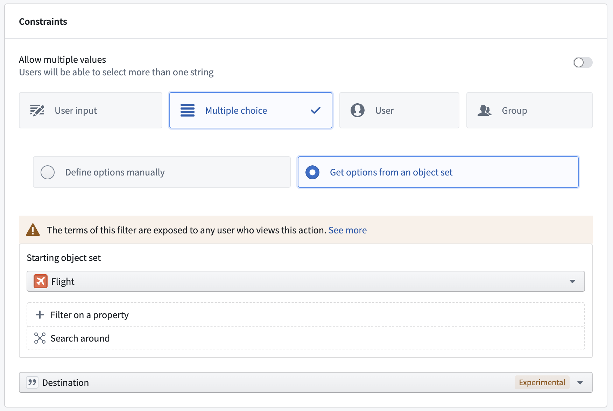
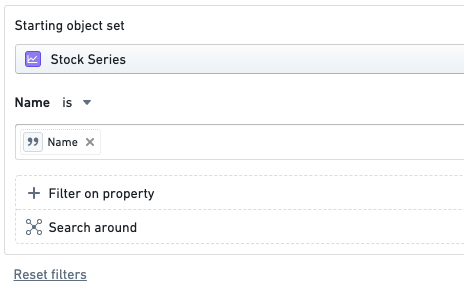
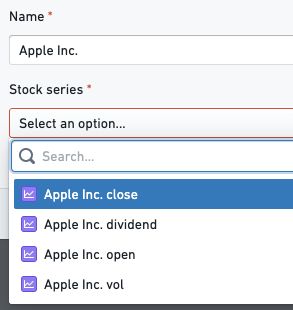
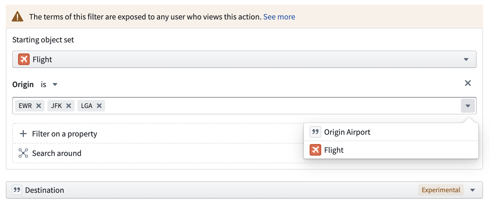
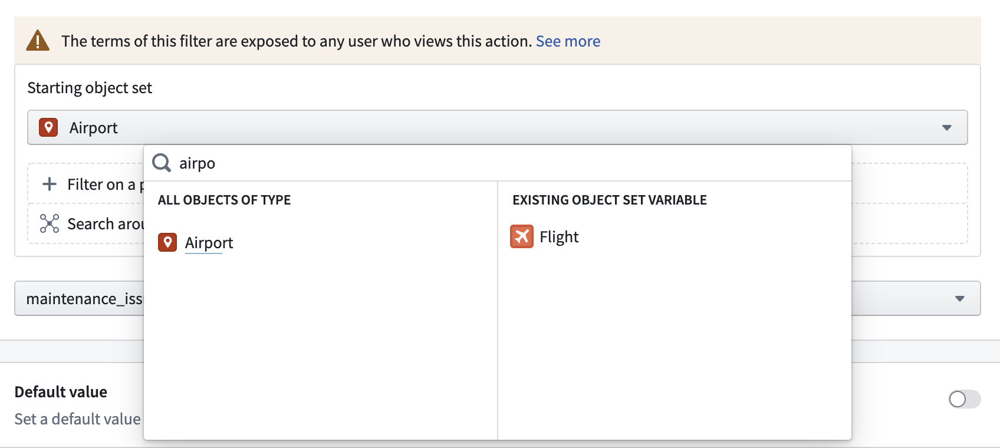
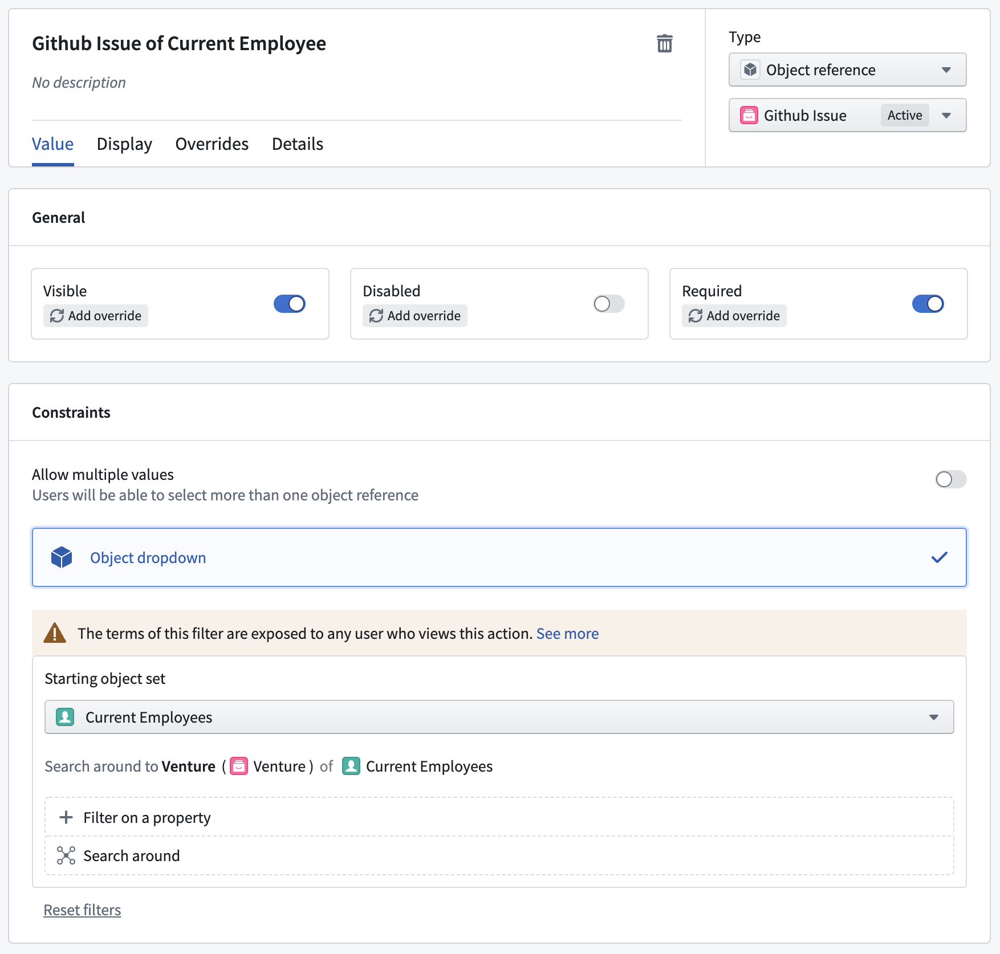

:::callout{theme="warning"}
注意：以下翻译的准确性尚未经过验证。这是使用 [AIP ↗](https://www.palantir.com/platforms/aip/) 从原始英文文本进行的机器翻译。
:::

# 筛选参数下拉菜单的结果

添加筛选到非对象引用的多选或单对象引用参数将决定在参数下拉菜单中可选择的允许值。

## 多选参数下拉菜单

在配置多选参数下拉菜单时，操作编辑器可以将允许值减少到仅限于对象集的属性。这可以用于显示或预填基于链接对象属性的值。要实现此目的，请确保参数设置为显示多选，选择**从对象集获取选项**，配置所需的对象集，并选择包含参数下拉菜单所有允许值的属性。如果在结果对象集中只有一个链接对象可用且参数是必需的，则参数下拉菜单将自动预填对应的属性值。结果的多选选项将来自用户有权查看的对象集。换句话说，当从对象集中获取多选选项时，用户将无法看到他们无权访问的对象属性。

## 对象下拉菜单

在参数配置视图中，操作编辑器可以指定筛选和搜索范围，以限制在所有操作界面中显示在下拉菜单中的对象。配置筛选后，操作表单将呈现一个仅包含与筛选匹配的对象的下拉菜单。选择的值也将在操作执行前进行验证。

例如，一个对象下拉菜单配置为仅显示**库存系列**，其**名称**等于`Name`参数中的值。

下图显示了`Name`参数的可能值：

### 数据隐私影响

在对象参数上使用新的验证时，数据可能会被所有可以查看操作类型的人查看。如果参数筛选中有敏感的静态值，即使用户无法查看被筛选的底层对象，他们也能够查看这些值。[了解更多关于数据隐私影响的信息。](%E5%AF%B9%E8%B1%A1%E4%B8%8B%E6%8B%89%E8%8F%9C%E5%8D%95%E5%AE%89%E5%85%A8%E6%B3%A8%E6%84%8F%E4%BA%8B%E9%A1%B9.md)

## 支持的操作

### 在属性上筛选

对象下拉菜单仅显示指定属性匹配任一提供值的对象。

值可以由用户静态定义，从另一个参数推断，或是`对象引用`参数的属性。如果提供了多个值进行比较，结果将是一个**或**操作。

### 更改起始对象集

查询的**起始集**默认为对象类型的所有对象，但可以更改为任何其他类型。起始集也可以设置为`对象引用`列表参数。

### 搜索范围

搜索范围将通过遍历当前集每个对象上的链接创建一个新集。例如，`当前员工的Github问题`将获取当前集中的`员工`并创建一个与这些`员工`链接的`Github问题`结果集。

