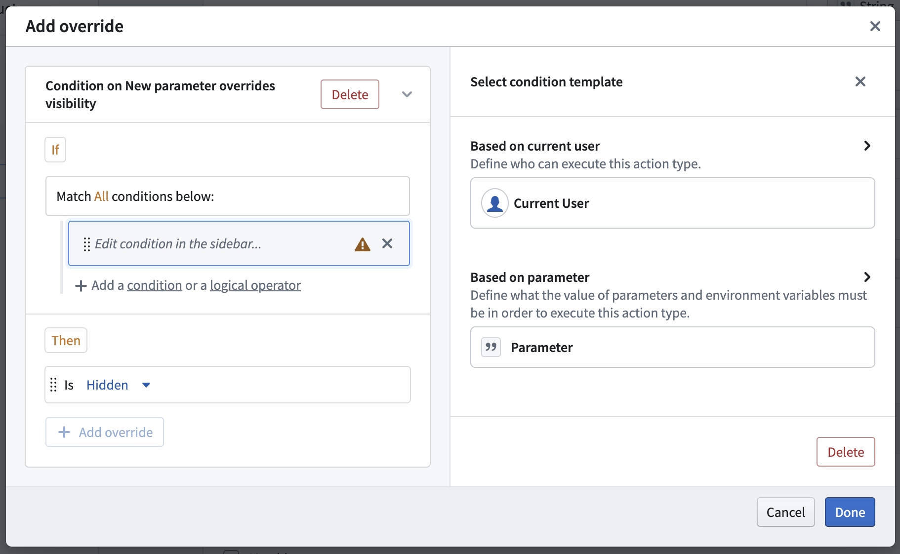
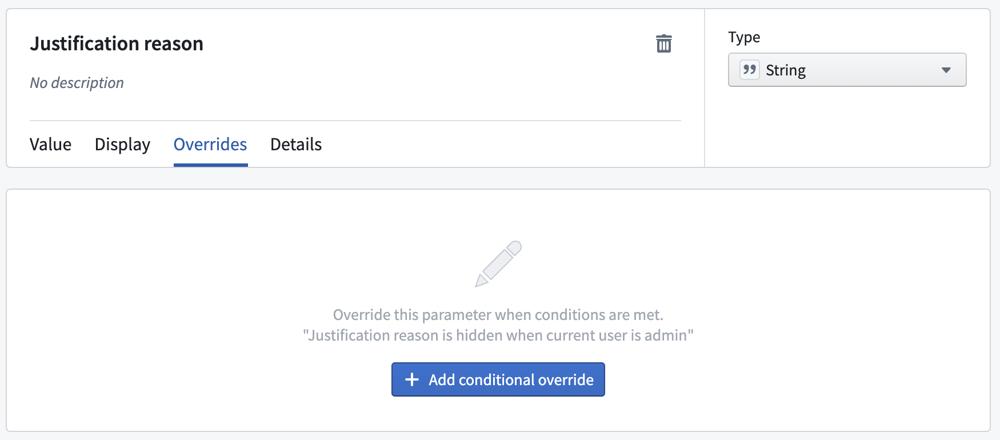
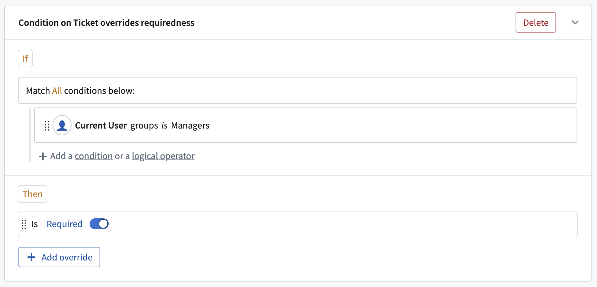

:::callout{theme="warning"}
注意：以下翻译的准确性尚未经过验证。这是使用 [AIP ↗](https://www.palantir.com/platforms/aip/) 从原始英文文本进行的机器翻译。
:::

# 覆盖

覆盖用于在特定情况下更改参数的行为和配置。使用覆盖，参数和表单可以变得更加灵活，无需为仅有细微变化的情况配置单独的操作类型。适当使用覆盖可以通过引导用户完成操作提交来改善用户体验。

例如，假设您有一个操作类型可以更改客服支持工单对象的状态，并且您希望将操作提交限制为经理和指派人。虽然指派人可以更改状态，但经理需要提供理由。使用覆盖，可以让`理由`参数对经理是必填且可见的，而对指派人则是隐藏且非必填的。

## 添加和编辑覆盖

您可以从参数视图的不同地方添加和编辑覆盖。添加新覆盖的最简单方法是直接从**常规**部分的**值**选项卡中进行。通过点击三个选项之一的**添加覆盖**，您可以通过弹出窗口轻松创建覆盖，该窗口现在会根据选定的选项自动配置覆盖。**常规**部分还显示何时以及已经为某个选项配置了多少个覆盖。要编辑现有的覆盖，选择覆盖按钮。

您还可以通过**覆盖**选项卡手动添加覆盖。覆盖选项卡显示了为参数配置的所有覆盖的概览。您可以从这里添加覆盖块，或为现有块添加新条件或覆盖。

## 覆盖块

覆盖块是覆盖的基础。它定义了条件（显示在"if"部分）和覆盖（显示在"then"部分）。每个块的标题显示了逻辑的摘要。每个参数可以包含多个覆盖块，但是，如果有多个为true，则只有第一个会被执行。

### "If"和条件

每个块可以包含一个或多个条件。要了解有关条件和如何配置它们的更多信息，请参阅[提交标准文档中的条件](../%E6%8F%90%E4%BA%A4%E6%A0%87%E5%87%86.md#conditions)。覆盖条件和提交标准条件之间的唯一区别是，只有表单层次结构中当前参数之上的参数可以在覆盖条件中被引用。

### "Then"和覆盖

**Then**部分定义了在满足块条件时将应用的覆盖。每个块的**Then**部分可以包含多个覆盖，它们将一起应用。覆盖可以更改参数约束、可见性、必填性和默认值的配置。如果配置的覆盖与参数上已设置的默认值相同，则会在覆盖本身上显示警告。

### 多个覆盖块

您可以为单个参数添加多个覆盖块。如果有多个块为true，则仅执行第一个覆盖。
