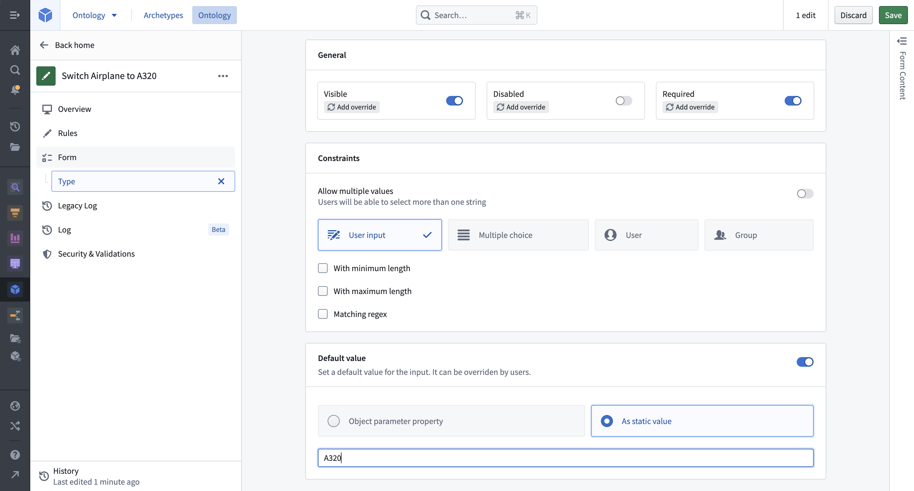
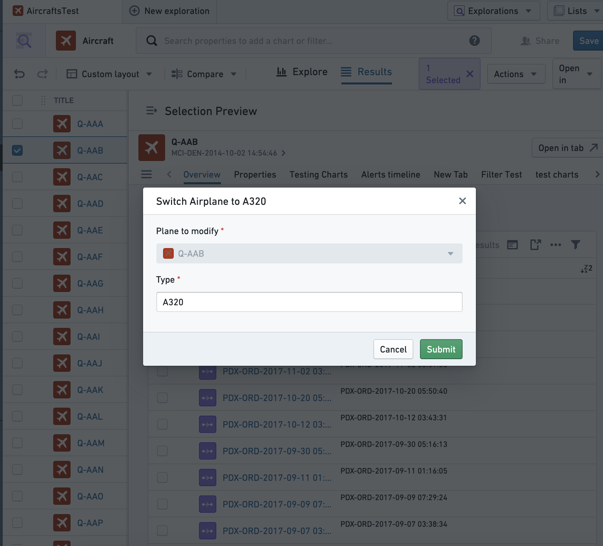
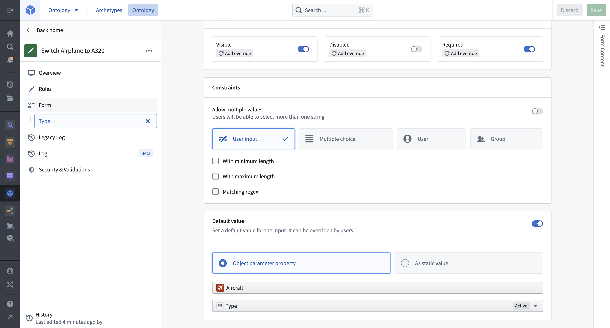
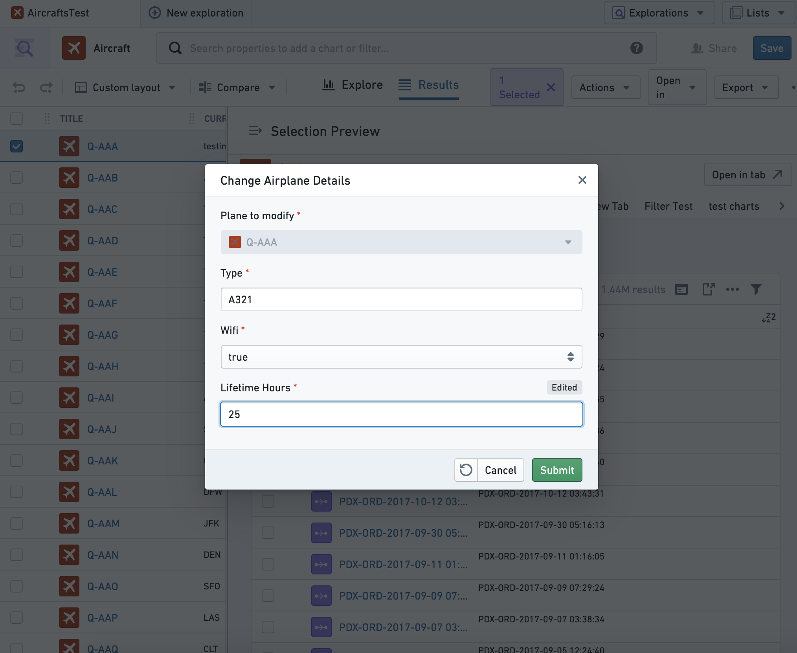
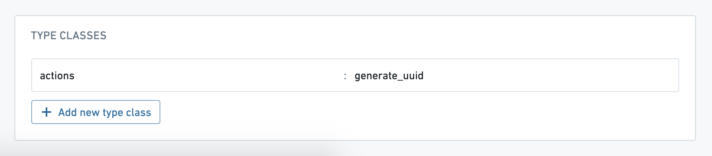

:::callout{theme="warning"}
注意：以下翻译的准确性尚未经过验证。这是使用 [AIP ↗](https://www.palantir.com/platforms/aip/) 从原始英文文本进行的机器翻译。
:::

# 设置参数默认值

操作类型参数的默认值用于在操作表单中预填参数。默认值在参数级别进行配置，并支持在Workshop、Object Explorer、Object Views、Quiver和Slate中使用。它们可以部署以标准化跨多个应用程序的操作逻辑，从而无需在每个应用程序中单独添加默认值。

参数可以设置为默认值，以显示固定值或所选Object的属性。

## 默认值与局部变量的交互

局部默认值（例如，Workshop变量）始终优先于全局默认值。当将任何Workshop变量传递给具有默认值的操作时，操作表单将用Workshop变量中的值进行预填。同样的模式适用于Object Views中的环境变量和Slate中的默认值。每个操作实例中提供的默认值具有优先权。因此，任何迁移到默认值的过程将需要移除局部覆盖。

## 配置默认值

选择任何参数将打开该参数的参数配置视图。选择参数是应默认设置为固定值还是Object参数属性的值。

### 静态默认值

想象一个示例操作类型，它将所选`Aircraft` Object的`Type`属性修改为`A320`。要进行配置，点击进入`Type`参数并添加一个静态默认值。

为了在没有默认值的情况下实现类似的用户体验，需要在使用参数的每个应用程序中配置输入值。更新此行为（例如，改为`A380`）将需要手动修改行为，可能跨多个应用程序。

### Object属性默认值

要将Object属性设置为参数的默认值，首先选择要配置的Object参数。假设一个更通用的操作类型称为`更改飞机详细信息`，例如，用户需要知道某个属性的当前值才能进行编辑。这可以通过配置每个参数的值从当前选定的Object（在我们的例子中，要修改的`Plane` Object）中预填来实现。只有在输入列表中位于参数上方的Object引用参数可用作默认值。

在Object Explorer中，`更改飞机详细信息`操作将用当前值预填。在这种情况下，用户可以选择只修改一个属性，其他保持不变。这种默认逻辑将在任何提交操作的地方存在。请注意，一旦操作用户更新此默认值，`Lifetime Hours`值将显示为已编辑。

### 类型类预填

通过使用类型类注释，操作参数可以用特殊值（例如，自动生成的UUID或当前用户的ID）预填。Ontology文档中有[可用类型类的完整列表](../../%E5%AF%B9%E8%B1%A1%E9%93%BE%E6%8E%A5%E7%B1%BB%E5%9E%8B/Metadata/%E7%B1%BB%E5%9E%8B%E7%B1%BB.md)。

在大多数情况下，您应该将参数可见性设置为`隐藏`，以便用户不会手动更改这些特殊的预填值。
