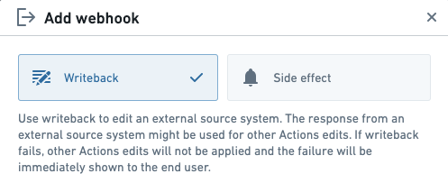
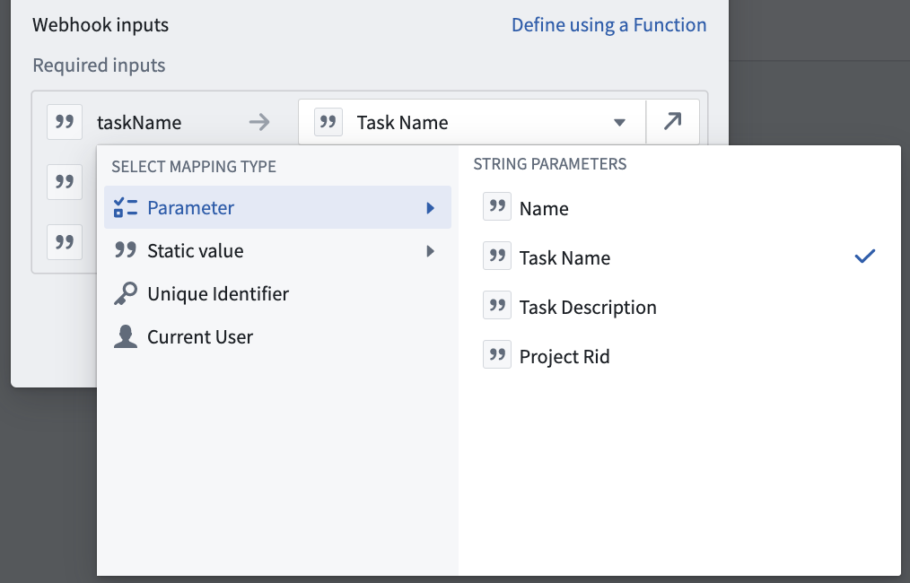
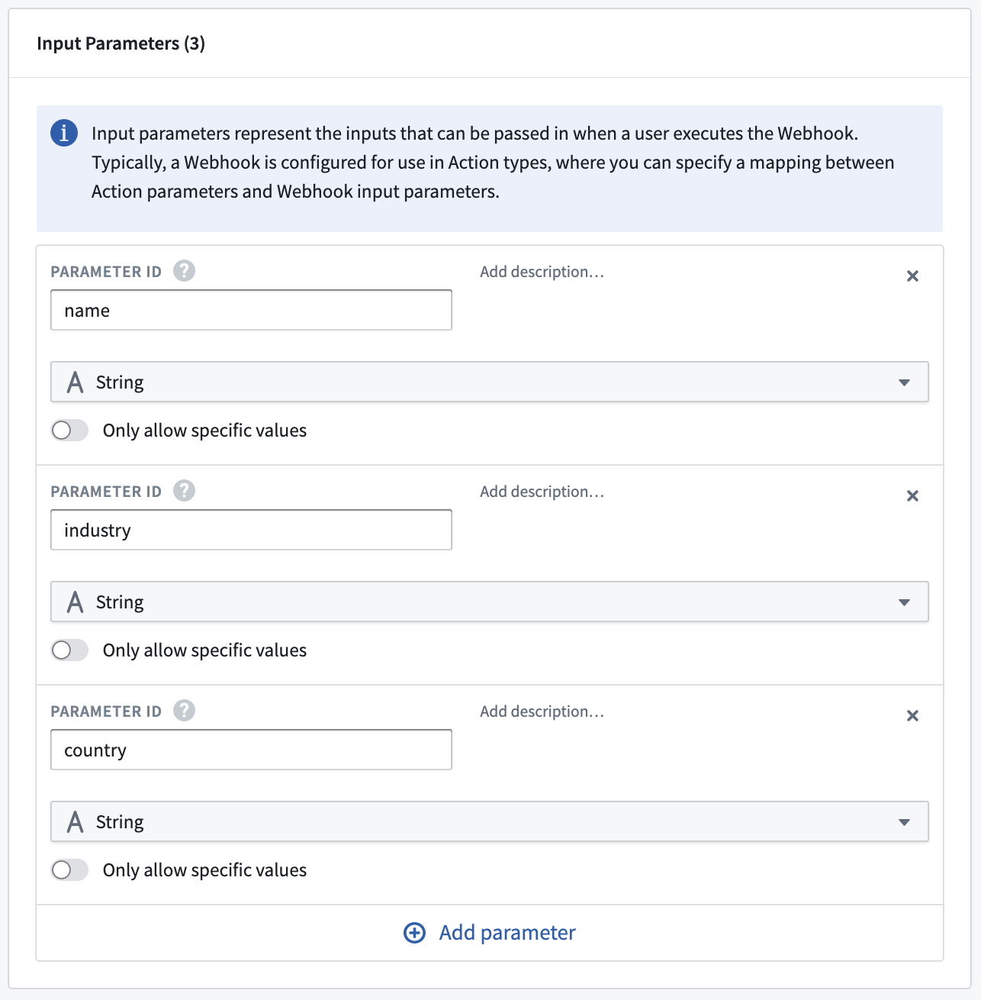
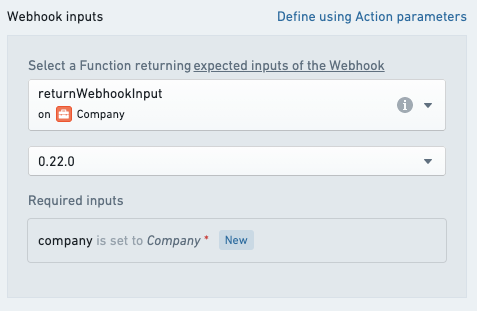
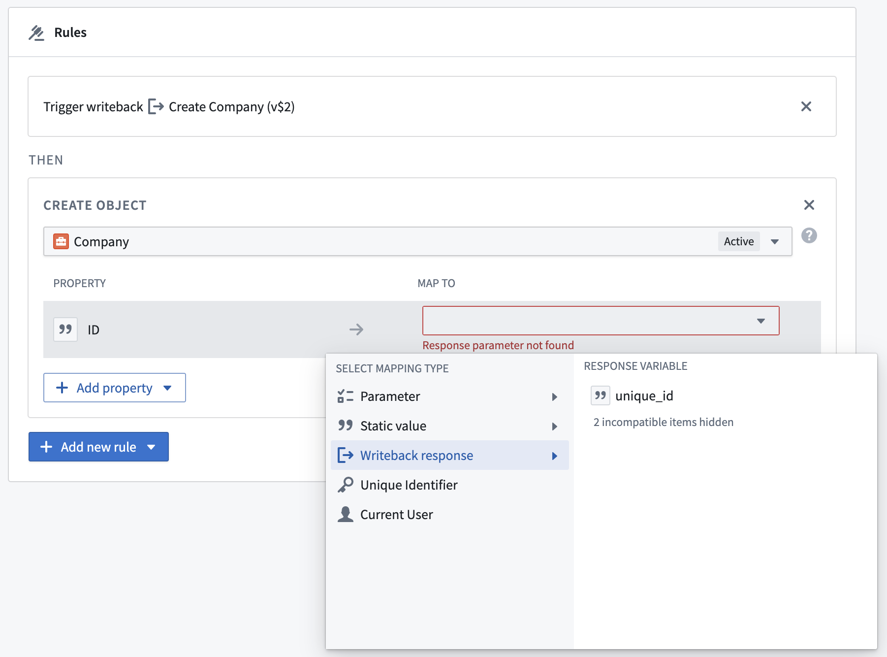

:::callout{theme="warning"}
注意：以下翻译的准确性尚未经过验证。这是使用 [AIP ↗](https://www.palantir.com/platforms/aip/) 从原始英文文本进行的机器翻译。
:::

# Webhooks

[Webhook](https://www.palantir.com/docs/foundry/data-connection/webhooks-overview/) 是数据连接中的一个概念，它可以向外部系统（如 Salesforce、SAP 或任何已配置的 HTTP 服务器）发送请求，通常用于修改该外部系统中的数据。

通过设置 Webhook 并将其配置用于一个操作，当终端用户在 Foundry 中应用一个操作时，可以将数据发送到外部系统。这使得 Foundry 中的工作流程能够直接连接到源系统，并将数据和决策写入这些系统。

本节详细介绍了在操作中配置 Webhooks 的各种选项。有关分步教程，请参阅[如何在操作中添加 Webhook](%E8%AE%BE%E7%BD%AE%20Webhook.md)的文档。

## Webhooks: 数据输出与副作用

在操作中配置 Webhooks 有两种方式：作为 **数据输出** 或作为 **副作用**。



为了方便起见，下面是一个比较数据输出和副作用 Webhooks 行为的表格。

| 类型 | 应用时间 | 是否向终端用户显示失败？ | 时机 |
|--- |--- |--- |--- |
| **数据输出** | Object 更改之前 | 是 | 用户看到成功或失败之前 |
| **副作用** | Object 更改之后 | 否 | 可能在用户看到成功消息之后 |

以下部分更详细地描述了数据输出 Webhooks 和副作用 Webhooks。

### 数据输出 Webhooks

当配置为 **数据输出** 时，Webhook 将在评估任何其他规则*之前*执行；如果 Webhook 执行失败，则不会进行其他更改。如果您希望确保在外部系统之前不在 Foundry 中进行更改，您应将 Webhook 设置为数据输出。

这种行为在一定程度上实现了 Foundry 与外部系统之间的事务性。使用数据输出 Webhook 可确保如果对外部系统的请求失败，Foundry Ontology 中不会应用任何更改。然而，仍然有可能外部请求成功但 Ontology 更改失败。

由于当数据输出 Webhook 失败时操作停止应用，您只能将单个 Webhook 配置为数据输出。如果此 Webhook 在操作应用时失败，将向终端用户显示描述失败的错误。

当 Webhook 配置为数据输出时，其输出参数可以在后续规则中使用。有关详细信息，请参阅下面的[输出参数](#output-parameters)部分。

### 副作用 Webhooks

当配置为 **副作用** 时，Webhook 将在评估其他规则*之后*执行。这意味着在应用副作用之前，Foundry 对象的修改将会发生。您可以在单个操作中配置多个副作用 Webhooks，它们将以无特定顺序执行。在具有副作用 Webhooks 的操作中，终端用户将在 Foundry 对象被修改后看到成功消息；执行副作用可能发生在显示成功消息之后。

如果您需要从单个操作中多次调用 Webhook，可以通过提供一个作为输入的有效负载列表来实现，这可以通过副作用 Webhook 实现。这将触发 Webhook 多次，具体次数取决于提供的列表中的有效负载数量，并将在无保证顺序下进行处理。有关示例，请参阅下面的[输入参数](#input-parameters)部分。

当您希望发送尽力而为的通知或写回多个外部系统时，应使用副作用 Webhooks。

## 输入参数

为了在操作中配置 Webhook，您必须填写其所有必需的输入参数。有关 Webhook 输入参数的一般参考资料，请参阅[数据连接文档](https://www.palantir.com/docs/foundry/data-connection/webhooks-reference/#input-parameters)。

有两种方式配置 Webhook 输入参数：通过映射到操作参数，或使用函数。

当映射到 **操作参数** 时，每个必需的 Webhook 输入必须设置为相同类型的操作参数、静态值或对象参数的属性。



使用[函数](../../%E5%87%BD%E6%95%B0/%E6%A6%82%E8%BF%B0.md)时，必须选择一个返回包含所有必需 Webhook 输入参数且与 Webhook 类型强匹配的自定义类型的函数，否则您将收到 `OntologyMetadata:ActionWebhookInputsDoNotHaveExpectedType` 错误。使用函数填充 Webhook 输入参数在您希望使用逻辑填充输入时非常有用，尤其是当此逻辑基于 Ontology 对象时。例如，您可以检索关联对象并从这些对象中提取属性值来预填充 Webhook 输入。

例如，假设您有一个 Webhook 需要三个输入参数，ID 分别为 `name`、`industry` 和 `country`：



您可以编写一个返回相同结构自定义接口的函数：

```typescript
// 定义一个接口 MyWebhookInput，用于表示 webhook 输入的数据结构
export interface MyWebhookInput {
    name: string;      // 用户的姓名
    industry: string;  // 用户所属的行业
    country: string;   // 用户所在的国家
}
```

然后，您可以在配置操作中的Webhook输入时选择此函数，将操作参数映射到函数所需的参数：



下面是一个完整的代码示例，展示了如何从Ontology对象加载数据并将其用于填充Webhook输入。

```typescript
import { Function, UserFacingError } from "@foundry/functions-api";
import { Company } from "@foundry/ontology-api";

// 定义一个接口，用于表示 Webhook 输入的数据结构
export interface MyWebhookInput {
    name: string; // 公司名称
    industry: string; // 所属行业
    country: string; // 所在国家
}

// 定义一个类，包含处理 Webhook 输入的函数
export class MyWebhookFunctions {
    @Function() // 标记为一个函数，使其可被外部调用
    public returnWebhookInput(company: Company): MyWebhookInput {
        // 检查公司对象的必填字段是否为空
        if (!company.name || !company.industry || !company.country) {
            throw new UserFacingError("Some required fields are not set."); // 抛出用户可见的错误信息
        }
        // 返回符合 MyWebhookInput 接口的对象
        return {
            name: company.name,
            industry: company.industry,
            country: company.country,
        }
    }
}
```

通过从一个函数返回一个有效负载列表，可能会多次调用副作用Webhook。下面是一个示例函数，该函数以两家公司为输入，返回一个包含两个有效负载的列表，这些有效负载与Webhook预期的输入参数匹配。如果从操作中使用此函数来返回副作用Webhook的输入，将导致两个独立的Webhook执行。

```typescript
import { Function } from "@foundry/functions-api";
import { Company } from "@foundry/ontology-api";

// 定义一个接口 MyWebhookInput，包含两个字符串属性 arg1 和 arg2
export interface MyWebhookInput {
    arg1: string;
    arg2: string;
}

// 定义一个类 MyFunctions
export class MyFunctions {
    // 使用装饰器 @Function() 标记的方法
    @Function()
    // 定义一个公共方法 createWebhookRequest，接受两个 Company 类型的参数，并返回 MyWebhookInput 类型的数组
    public createWebhookRequest(company1: Company, company2: Company): MyWebhookInput[] {
        return [
        {
           // 使用 company1 的属性 someProperty 和 someOtherProperty 赋值给 arg1 和 arg2
           arg1: company1.someProperty,
           arg2: company1.someOtherProperty,
        },
        {
           // 使用 company2 的属性 someProperty 和 someOtherProperty 赋值给 arg1 和 arg2
           arg1: company2.someProperty,
           arg2: company2.someOtherProperty,
        }
        ];
    }
}
```

## 输出参数

当Webhook被配置为[数据输出 Webhook](#writeback-webhooks)时，可以在后续规则中使用其输出参数。当外部系统返回的数据需要立即写入Foundry对象或在后续的[通知](%E9%80%9A%E7%9F%A5.md)或[副作用 Webhook](#side-effect-webhooks)中使用时，这将非常有用。

有关Webhook输出参数的一般参考资料，请参阅[数据连接文档](https://www.palantir.com/docs/foundry/data-connection/webhooks-reference/#output-parameters)。

要在后续逻辑规则中使用输出参数，请在为逻辑规则填充值时选择**数据输出响应**，然后选择您希望使用的特定输出：


