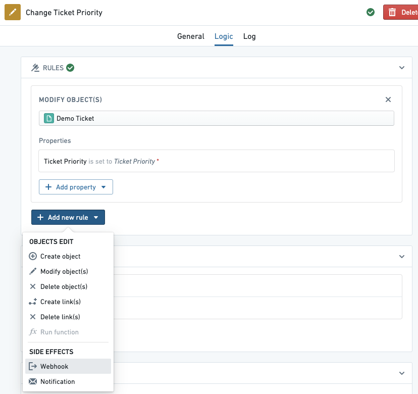
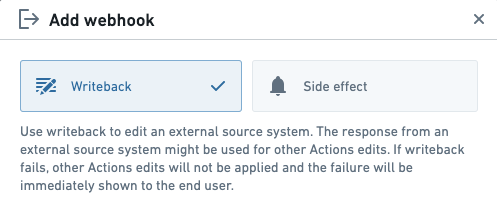
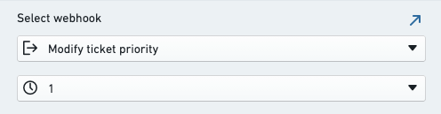
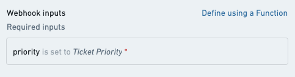
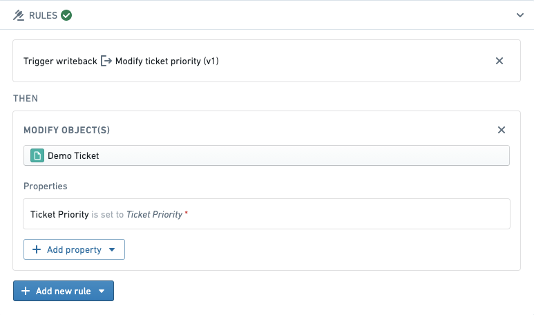
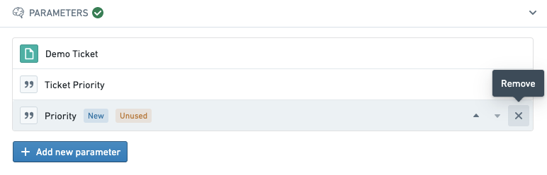

:::callout{theme="warning"}
注意：以下翻译的准确性尚未经过验证。这是使用 [AIP ↗](https://www.palantir.com/platforms/aip/) 从原始英文文本进行的机器翻译。
:::

# 设置 Webhook

## 前提条件

1. 完成 [入门](../%E5%85%A5%E9%97%A8.md) 教程，了解如何设置基本的操作。
2. 设置 [Webhook](https://www.palantir.com/docs/foundry/data-connection/webhooks-setup/)，以创建与外部系统的连接。您可能需要与具有连接到源系统权限的系统管理员合作，才能创建 Webhook。

## 步骤

在下面的示例中，假设我们有一个名为 **修改工单优先级** 的 Webhook，它接受一个 `priority` 字符串值并将其发送到外部系统。

导航到您的操作，选择 **逻辑** 选项卡，选择 **添加新规则**，然后选择 **Webhook**。

默认情况下，新添加的 Webhook 被配置为 **副作用**；这使得 Webhook 在 Foundry 中编辑 Object 后运行。或者，可以选择 **数据输出**，以便 Webhook 在编辑 Object 之前运行。

在下面的菜单中，选择您想执行的 Webhook。在此示例中，我们选择 **修改工单优先级** Webhook。如果您愿意，可以选择不同版本的 Webhook。

接下来，根据操作参数配置 Webhook 输入参数。默认情况下，为每个 Webhook 输入生成一个新的操作参数，除非已存在同名的操作参数，在这种情况下，现有参数会被自动配置。在此示例中，我们将名为 `priority` 的 Webhook 输入映射到一个名为 `Ticket Priority` 的现有操作参数。

选择 **添加 webhook** 以完成将 Webhook 规则添加到您的操作。请注意，添加 Webhook 后，规则部分显示数据输出将在 Object 被修改之前发生。

您可能想要移除在添加 Webhook 时创建的任何现已未使用的自动生成参数。

选择右上角的 **保存**，以保存对操作的更改。现在，当应用操作时，将在对 Foundry 中的 Object 应用任何更改之前向外部系统发出请求。

## 下一步

本教程演示了如何向操作添加 Webhook。要了解更多信息，请尝试以下资源：

* 查看 [Webhooks](Webhooks.md) 部分，了解操作中 Webhooks 的所有可用选项。
* 学习如何使用 [函数](Webhooks.md#input-parameters) 配置 Webhook 输入参数。
* 了解更多关于数据连接中的 [Webhooks 概念](https://www.palantir.com/docs/foundry/data-connection/webhooks-overview/)。
