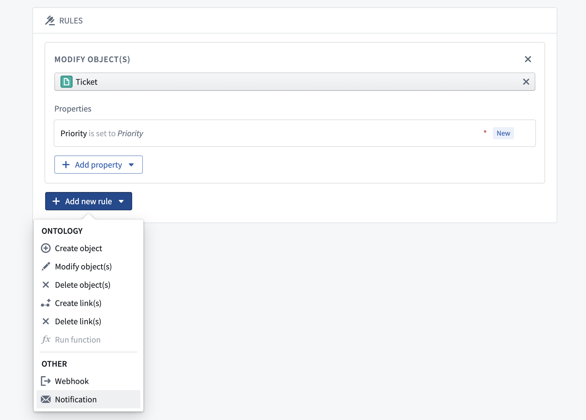
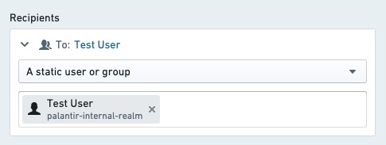
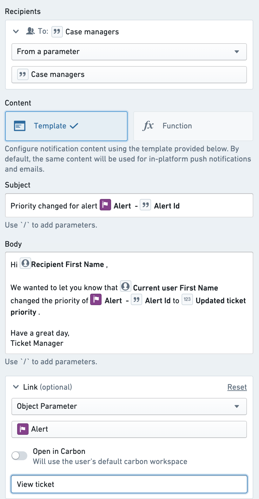

:::callout{theme="warning"}
注意：以下翻译的准确性尚未经过验证。这是使用 [AIP ↗](https://www.palantir.com/platforms/aip/) 从原始英文文本进行的机器翻译。
:::

# 设置通知

本教程演示如何设置带有通知的操作。

我们将使用一个操作来更新 `Alert` 对象的 `Priority` 属性，并通知存储在该 Alert 对象上的 `指派人`（一个 Foundry 用户）。如果您想跟随本教程，您需要事先设置以下内容：

* 一个具有正确属性的对象，并配置为可通过操作进行编辑
* 一个操作，该操作接收您的一个对象以及包含新优先级的参数，并更新指定对象上的优先级属性。如果您之前已经完成了[操作入门教程](../%E5%85%A5%E9%97%A8.md)，您应该已经设置好了。

如果您是管理对象的新手，可以阅读[如何设置对象类型](../../%E5%AF%B9%E8%B1%A1%E9%93%BE%E6%8E%A5%E7%B1%BB%E5%9E%8B/Object%20types/%E5%88%9B%E5%BB%BA%20Object%20%E7%B1%BB%E5%9E%8B.md)。

## 前提条件

### 完成入门教程

本教程假定您已经完成了操作的[入门](../%E5%85%A5%E9%97%A8.md)教程。

### 向您的对象类型添加指派人属性

对于本教程，您需要在 `Alert` 对象上有一个名为 `Case Managers` 的属性，其中包含当前指派用户的 Foundry 用户 ID。通常，如果您使用操作来构建您的工作流程，您将能够使用应用程序中的用户选择器组件捕获和存储用户 ID。这些将在 Foundry 中显示的地方显示为完整用户名。

## 添加通知

首先，导航到您的更新工单优先级的操作。在 **规则** 部分下选择 **添加新规则**，然后选择 **通知**。这将打开添加通知的配置对话框。

## 配置收件人

在此示例中，您将向作为被编辑的 `Alert` 对象的一个属性存储的指派人发送通知。要做到这一点，请在 **收件人** 下拉菜单中使用“从对象参数的属性中获取收件人”选项。选择作为操作参数提供的 `Alert` 对象，然后在提示时选择 `Case managers` 属性。

您应该会在配置的 **收件人** 部分看到所选对象参数和属性。请记住，收件人必须始终是 Foundry 用户 ID。如果此属性包含其他内容，例如字符串电子邮件地址，则不会发送通知。

:::callout{theme="neutral"}
在测试时，您可能想要最初用硬编码收件人配置操作，以验证逻辑和通知内容是否如预期配置。
:::

[了解更多关于其他收件人配置选项的信息。](%E9%80%9A%E7%9F%A5.md#recipients)

## 配置通知内容

接下来，您将通过自定义通知以收件人的名字称呼他们，并在内容中包含 `Alert` 对象的旧优先级和新优先级，从而配置通知的内容。下面提供了一个示例通知配置。

首先，从内容选项中选择“模板”。这是配置内容的最简单方法，不需要编写任何代码。

对于主题行，输入您想要的消息。要添加参数引用，请添加一个正斜杠 `/` 并从下拉列表中选择所需的参数。如果您的选择是一个对象参数，您将被要求选择要引用的属性。

对于正文，输入以收件人名字称呼他们的文本，标识出更改的用户，并报告之前和更新后的状态。

与主题中的对象引用一样，您可以从下拉列表中选择“收件人”、“当前用户”和任何参数选项，以生成对这些用户属性的正确引用。

[了解如何生成具有更复杂需求的通知内容。](%E9%80%9A%E7%9F%A5.md#content)

## 配置链接

最后，您将向 Object Explorer 中指定 `Alert` 的 Object View 添加一个链接。选择“Object View”，然后从下拉菜单中选择您的工单对象参数。然后，为链接按钮添加一个标签，写上 `查看工单`。

现在您可以保存整个通知配置：

[了解更多关于可以配置的其他类型链接的信息。](%E9%80%9A%E7%9F%A5.md#content)

## 发送测试通知

为了验证，创建一个指派人为您自己的测试警报。为了运行操作，您需要在 Object Explorer 中或通过 Workshop 模块中的按钮来公开该操作，如[操作文档](https://www.palantir.com/docs/foundry/workshop/actions-overview/)中所述。

一旦您进行了测试更改，您应该会收到平台内推送通知和发送到您 Foundry 用户个人资料中指定的电子邮件账户的电子邮件通知。平台内和电子邮件通知的预览会在通知配置视图中显示。

如果您没有收到电子邮件，可能是因为您禁用了电子邮件和/或平台内通知。您可以在 **用户设置** 下的 **通知** 中验证这一点。

## 后续步骤

* 探索其他非必填功能，例如当收件人选择通过电子邮件接收通知时的[自定义内容](%E9%80%9A%E7%9F%A5.md#content-components)。
* 使用[函数](../../%E5%87%BD%E6%95%B0/%E9%85%8D%E7%BD%AE%E9%80%9A%E7%9F%A5.md)配置收件人或内容的复杂逻辑。
