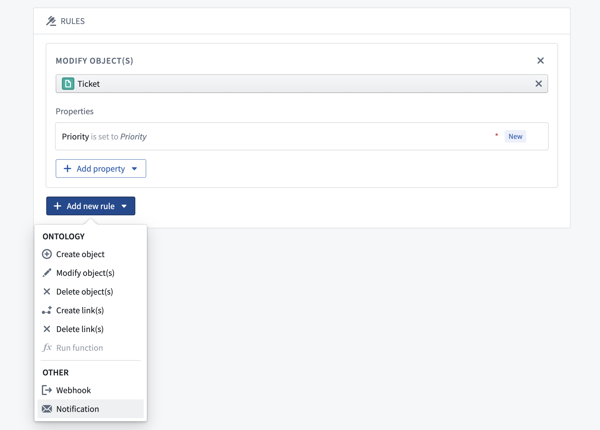
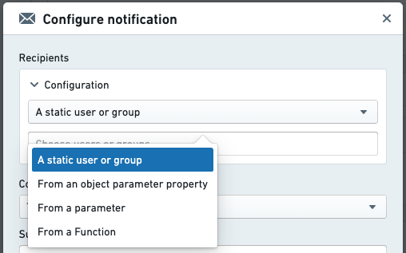
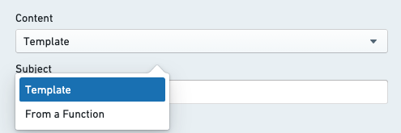
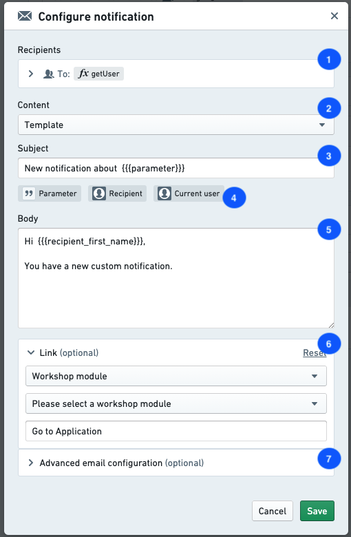
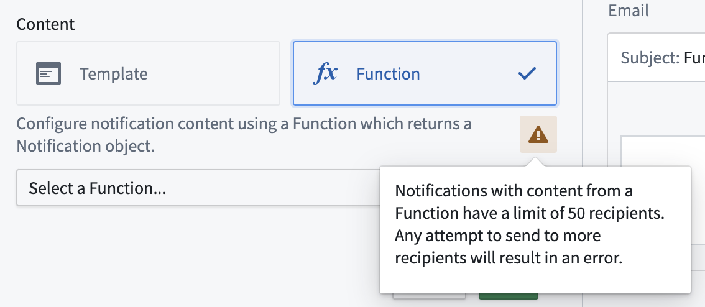
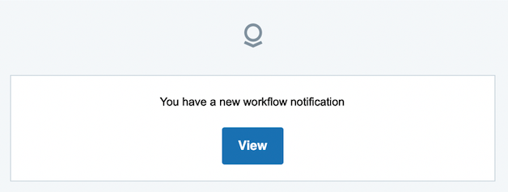

:::callout{theme="warning"}
注意：以下翻译的准确性尚未经过验证。这是使用 [AIP ↗](https://www.palantir.com/platforms/aip/) 从原始英文文本进行的机器翻译。
:::

# 通知

可以通过 **添加新规则** 下拉菜单将通知添加到操作中。[了解有关如何添加通知的更多信息。](%E8%AE%BE%E7%BD%AE%E9%80%9A%E7%9F%A5.md)

配置通知需要指定 [收件人](#recipients) 和 [内容](#content)。以下部分提供了这些选项的详细信息。

## 收件人

配置通知的 **收件人** 选项可以让您指定在操作运行时将收到通知的一组 Foundry 用户。通知将分别发送给每个收件人。添加用户作为电子邮件通知的抄送收件人是不支持的。

有几种支持的指定收件人的方式：

* **静态:** 在配置中，您可以选择一组用户或组，这些用户或组将在操作运行时始终收到通知。
* **来自参数:** 如果操作的一个参数是 Foundry 用户或组 ID，您可以将其指定为通知的收件人。
  * 这可以用于允许发送者在使用此操作的应用程序或模块的用户界面中选择一个或多个收件人，或自动检测并向运行操作的用户发送通知。
* **来自对象参数的属性:** 如果操作有一个对象参数，并且该对象的一个属性包含一个 Foundry 用户或组 ID，您可以将该参数的属性指定为收件人。这对于包含 Foundry 用户和组 ID 的列表也是可能的。
* **来自函数:** 如果您的应用案例不包括在上述选项中，您可以编写一个自定义函数，该函数接收操作参数并返回应通知的用户或组列表。[了解有关如何编写返回用户或组列表的函数的更多信息。](../../%E5%87%BD%E6%95%B0/TypeScript%20basics/%E8%BE%93%E5%85%A5%E5%92%8C%E8%BE%93%E5%87%BA%E7%B1%BB%E5%9E%8B.md#principals-users-and-groups)

  基于函数的收件人应用案例示例包括：

  * 组合其他收件人选项；例如，通知从对象参数属性指定的 `指派人`，并始终通知一组静态的附加收件人。
  * 基于其他参数或参数属性值的收件人选择；例如，每当 EMEA 有新任务时，通知一组用户；每当北美有新任务时，通知另一组用户。
  * 任何其他不适合结构化选项的自定义逻辑。

:::callout{theme="neutral"}
收件人可以更改他们的通知传递偏好。例如，一个用户可能选择只在其网页浏览器中接收通知，而另一个用户可能选择同时接收平台内弹窗和电子邮件通知。如果用户在个人偏好中关闭了操作通知，他们将不会被通知。但是，他们仍然可以在登录 Foundry 后通过转到“通知”然后点击“查看全部”来查看他们的通知。
:::

## 内容

有多种选项可用于自定义通知内容。内容可以通过 *模板* 配置或通过自定义 *函数* 提供。选择模板内容将允许您直接在配置对话框中配置完整内容。函数内容将要求您拥有一个已发布的函数，该函数返回相应的通知类型。

### 内容组件

1. **主题:** 通常，内容将包括主题行。默认情况下，这对所有传递机制都是相同的。

2. **正文:** 通知的正文。对于平台内通知，这将显示在通知弹窗内。对于电子邮件，这将显示在电子邮件正文内。

3. **链接:** 您可以指定一个链接。该链接将显示为通知正文下方的一个按钮。按钮的文本可以自定义。
   * 以下选项可用于配置链接：
     * 链接到现有对象参数
     * 链接到 Workshop 应用
     * 链接到 Carbon 工作区
     * 链接到新创建的对象

4. **高级电子邮件配置:** 在配置通知时，您可以指定一个自定义内容正文用于通过电子邮件传递通知。此选项允许您使用 HTML 进行更高级的格式化，这在平台内通知中是不支持的。预览将向您显示通知的外观，不包括任何参数引用。只有在收件人设置了通过电子邮件接收通知的偏好时，他们才会收到此内容。

:::callout
可以在上述提到的主题、正文和链接中使用三重花括号来引用参数和用户属性。编辑某个部分时，点击一个可用参数将自动生成该参数或用户属性的正确花括号引用。
:::

5. **来自函数:** 选择“来自函数”时，您不会配置上述部分。相反，您必须提供一个函数，该函数返回一个具有适当属性的 `通知` 对象，指定您自定义内容的每个部分。如果符合以下任何一项，您可能需要使用函数：
   * 通知内容根据收件人或操作的输入参数完全不同。
   * 您希望为电子邮件和平台内通知使用不同的主题行。
   * 您希望使用完整的链接 URL，包括链接到 Foundry 之外的外部系统或应用程序。
   * 您希望在渲染内容时执行搜索、聚合或查询超出参数范围的数据。
   * 您有任何其他通过模板内容选项无法实现的自定义要求。

更多关于通知返回类型的信息可以在 [函数文档](../../%E5%87%BD%E6%95%B0/%E9%85%8D%E7%BD%AE%E9%80%9A%E7%9F%A5.md) 中找到。

:::callout{theme="neutral"}
用于生成通知内容的任何 Ontology 数据将反映在应用当前操作的编辑之前的 Ontology 状态。为了使通知收件人能够访问特定对象的最新状态，可以在通知中嵌入通过对象参数引用的对象链接，或嵌入新创建对象的链接（如果这些对象是通过“创建对象”规则而不是通过函数创建的）。
:::

***

## 示例配置

这是一个通知的示例配置。

1. **收件人** 配置
2. **内容** 配置
   * 从模板中选择（直接在 Ontology 应用对话框中配置）或函数（指定一个返回完整 `通知` 对象的函数）。
3. 模板通知的 **主题** 行。
4. 基于操作的可用参数，点击一个参数以生成 `{{{}}}` 语法来引用该参数。
5. 模板通知的 **正文** 内容。
6. 模板通知的 **链接** 配置（可选）。
7. 模板通知的 **自定义 HTML 电子邮件内容**（可选）。

***

## 其他关键信息

### 最大收件人限制

* 使用“来自函数”选项渲染通知内容时，收件人最多为 50 人。在选择内容配置选项下的“来自函数”时，配置面板中会有警告，并且每次运行操作时都会检查收件人数量。如果收件人数超过限制，将显示红色错误弹窗，并且操作将无法运行。
* 单个操作通知的最大收件人数为 500 人，当内容直接在配置对话框中使用“模板”选项配置时。

### 内容长度限制

* 主题的最大长度为 250 个字符。
* 正文的最大长度为 1,000 个字符。渲染自定义 HTML 电子邮件内容时，最大长度为 51,200 个字符。

请注意，这些最大内容长度将在通知渲染时进行验证和截断。这意味着如果渲染的内容是动态的（例如，如果通知内容包含对象数据），任何超过允许的最大长度的内容将被截断，并以尾随 `...` 表示。

### 严格编辑

如果您的 Foundry 实例启用了“严格编辑”或“组编辑”出站电子邮件通知，自定义通知内容将不会被渲染。相反，用户将收到如下所示的通用消息。选择“查看”将引导他们进入 Foundry，在那里他们可以查看完整的通知内容。[了解有关 Foundry 中电子邮件内容编辑的更多信息。](https://www.palantir.com/docs/foundry/email/email-content-redaction/)

### 收件人用户帐户

* 组将解析为单个用户，以在发送通知之前检查数据的权限。
* Foundry 用户和组 ID 可以通过设置下的帐户找到。通知的配置界面在选择静态收件人集时提供用户和组的选择器。这将仅显示配置操作的人具有足够权限的用户和组。
* 如果通过引用对象属性配置收件人，请确保属性将 Foundry 用户或组 ID 存储为字符串。您可以使用条件格式显示关联的用户或组显示名称（有关更多详细信息，请参阅 [值格式化文档](../../%E5%AF%B9%E8%B1%A1%E9%93%BE%E6%8E%A5%E7%B1%BB%E5%9E%8B/Properties/%E6%94%AF%E6%8C%81%E7%9A%84%E5%80%BC%E6%A0%BC%E5%BC%8F%E5%8C%96.md)）。
* 直接发送到电子邮件地址是不支持的。

### 链接到新创建的对象

链接时必须引用新对象的主键，因为在通知渲染时不会生成对象 RID。

**示例:** 您有一个创建新 `task` 对象的操作，并将在创建任务时生成一个唯一 ID。在操作通知中，您可以使用 [对象资源管理器提供的参数选项](../../../%E5%BA%94%E7%94%A8/%E5%AF%B9%E8%B1%A1%E6%B5%8F%E8%A7%88%E5%99%A8/%E7%94%9F%E6%88%90%20Object%20Explorer%20%E9%93%BE%E6%8E%A5.md) 渲染一个链接到新创建对象的链接。

* 使用函数生成内容时，指定 URL 链接有两种支持的方式：
  * 完整链接示例: `https://<your-foundry-instance>.com/workspace/module/view/latest/<module-rid>`
  * 相对链接示例: `/module/view/latest/<module-rid>`

### 收件人所需的数据访问权限

* 用户只能接收包含他们有权查看的数据的通知。
* 如果有多个收件人，所有收件人必须有权访问通知内容中呈现的对象数据。
* 在配置您的操作时，**安全性和提交标准** 选项卡底部有两种处理通知失败的方法：
  * **要求所有用户具有权限（默认）:** 如果任何收件人没有所需的访问权限，在尝试应用操作时将显示错误。如果发生这种情况，则不会编辑任何数据，也不会发送通知。
  * **要求任何用户具有权限:** 如果至少一个用户可以查看对象，操作将成功。只有具有权限的用户会收到通知。
