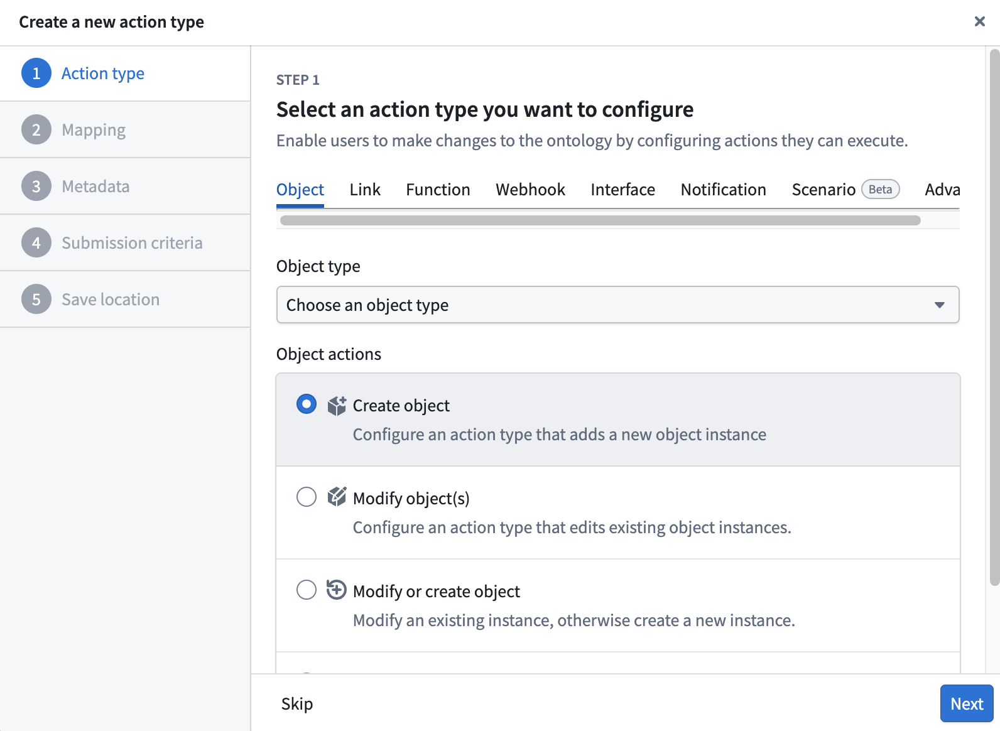
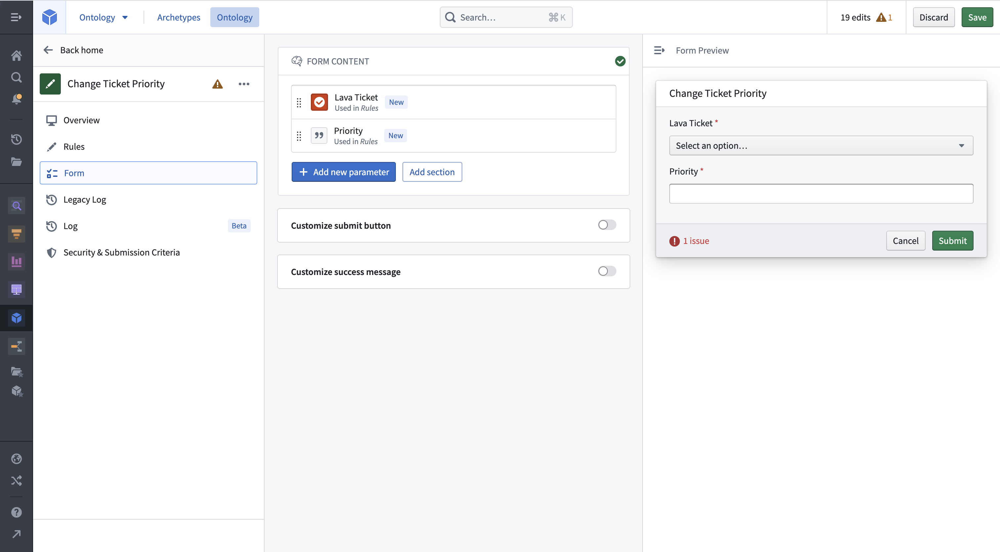
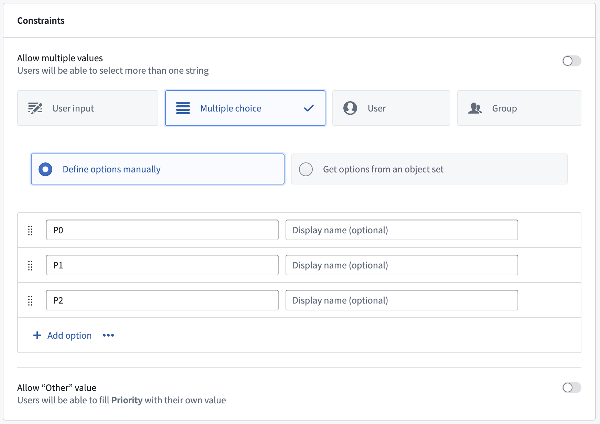
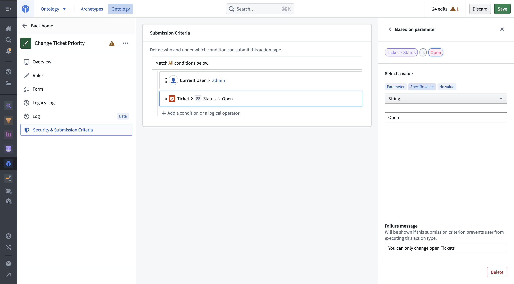
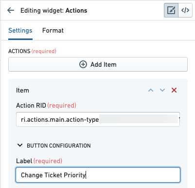
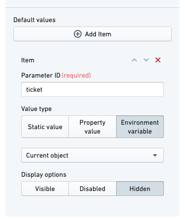
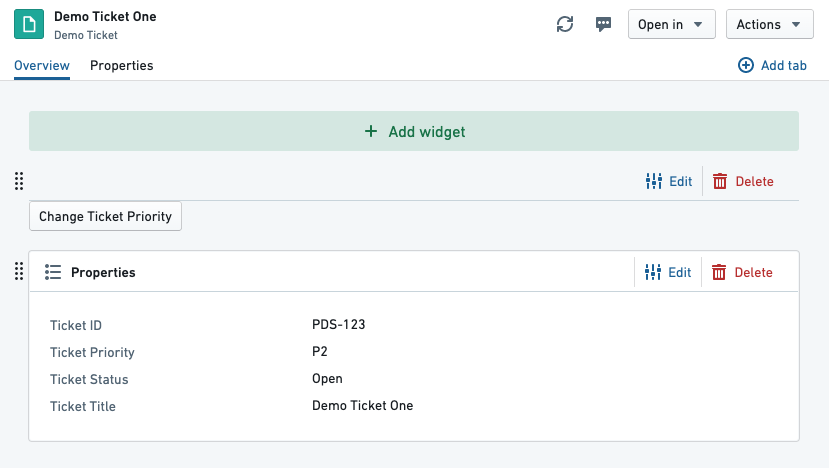
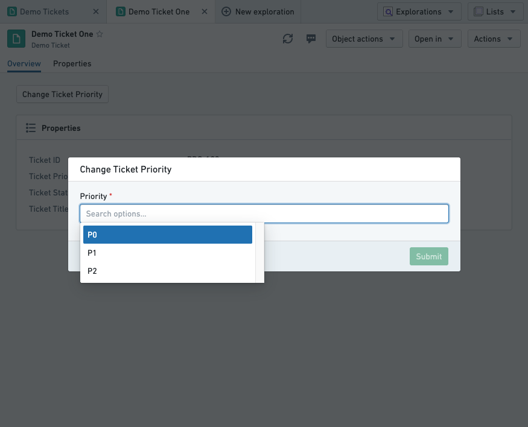
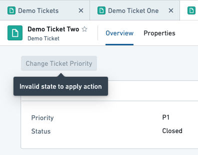

:::callout{theme="warning"}
注意：以下翻译的准确性尚未经过验证。这是使用 [AIP ↗](https://www.palantir.com/platforms/aip/) 从原始英文文本进行的机器翻译。
:::

# 入门

在本指南中，我们将创建一个简单的操作类型，以更改工单的优先级。

我们将配置提交条件，以确保优先级为 `P0`、`P1` 或 `P2`，并且工单状态为 `Open`。

## 先决条件

对于本指南，我们将使用一个 `Demo Ticket` 对象类型，它有四个属性：

* `Ticket ID`
* `Title`
* `Priority`
* `Status`

我们还有两个可用的演示对象：

|Ticket ID|Title          |Status|Priority|
|---------|---------------|------|--------|
|PDS-123  |Demo Ticket One|Open  |P2      |
|PDS-124  |Demo Ticket Two|Closed|P1      |

如果需要，您可以在您的Ontology中重新创建这些对象，但这不是必需的。

请注意，为了使用户能够执行在操作类型配置中定义的操作，[需要额外的配置](../%E5%AF%B9%E8%B1%A1%E9%93%BE%E6%8E%A5%E7%B1%BB%E5%9E%8B/%E5%85%81%E8%AE%B8%E7%94%A8%E6%88%B7%E7%BC%96%E8%BE%91Objects%E5%92%8C%E9%93%BE%E6%8E%A5.md#set-up-the-prerequisites)。对于对象存储V1（Phonograph），必须创建一个数据输出数据集；对于对象存储V2，用户必须通过切换按钮启用编辑。

## 创建新的操作类型

我们首先创建一个新的操作类型，以更改工单的优先级。在Ontology管理器中，点击左侧边栏的 **操作类型**，然后在视图的右上角选择 **新建操作类型**。

创建向导允许您配置操作类型的最重要特性。输入操作类型的**显示名称**。接下来，选择 **更改对象** 选项并将其设置为 **修改**。从接下来的下拉菜单中，选择 `Demo Ticket` 对象类型并通过点击 **添加属性** 来添加 `Priority` 属性。最后，点击右下角的 **创建**。

现在您可以看到操作类型的完整详细视图。您可以进行额外的调整，例如在 **概览** 选项卡中添加 **描述**，或者在 **规则** 选项卡中添加要修改的额外属性。

## 编辑参数

选择 **表单** 选项卡以获取参数概览。根据 **规则**，`Ticket` 和 `Priority` 参数已经被创建。

选择 `Priority` 参数来限制它可以接受的值。将约束从 **用户输入** 更改为 **多选**。这将允许您选择可以为此参数选择的值。添加 `P0`、`P1` 和 `P2` 作为选项。如果您现在将操作应用于一个对象，您可以将工单的优先级更改为 `P0`、`P1` 或 `P2`。您现在将添加提交条件，以限制您只能更改开放工单的优先级。

## 添加提交条件

从侧边栏打开 **安全性和提交条件** 选项卡中的提交条件部分。通过在 **执行** 部分选择 **条件** 来创建新条件。使用 **参数** 条件模板，在 `Ticket Status` 对象参数的 `Ticket` 属性上设置一个条件。使用 `等于` 操作符，您可以在工单状态和特定值 `Open` 之间进行精确字符串比较。

添加一个失败消息，以便用户可以看到操作失败的原因。您的操作定义现在已经完成，您可以配置它以显示在Object Explorer中的对象视图旁边。

## 将操作添加到对象视图

进入 **Demo Ticket One** 并编辑其对象视图。在顶部添加一个新的微件，并选择 **操作** 微件。在侧边栏中，点击 **添加项目**。从Ontology管理器中复制操作RID并粘贴到操作RID字段中。将标签命名为“更改工单优先级”。

默认情况下，操作表单将显示每个参数作为操作表单中的一个字段，包括 `Ticket` 参数。此外，操作并不知道它应该为 `Ticket` 参数填入当前对象。我们将配置操作表单以隐藏工单字段（以便用户无法更改不同工单的状态），并将其值设置为当前对象。在 **默认值** 下，点击 **添加项目**。输入 `Ticket` 参数的参数ID—在本教程中，我们将其设置为 `ticket`。将值类型更改为 **环境变量** 并选择 **当前对象**。最后，将显示选项更改为 **隐藏**。

您现在将在预览页面上看到操作按钮：

您现在可以保存并发布对象视图。

## 应用操作

访问一个开放工单并点击我们配置的 **更改工单优先级** 按钮。您应该会看到操作表单出现在视图上方。点击 **Priority** 字段将显示我们在参数上配置的单个选定提交条件：

选择一个优先级并点击提交。表单将消失，对象视图将更新为新的优先级。我们的提交条件表示不应该在关闭的工单上运行此操作—如果我们打开Demo Ticket Two（已关闭），我们将看到以下内容：

## 解决用户编辑（操作）和数据源更新的冲突

Foundry Ontology中的对象实例可以由输入数据源和用户编辑/操作创建和修改。当单个对象实例（即具有特定主键值的行或对象）从输入数据源和用户编辑同时接收数据时，必须通过冲突解决策略透明地解决这些接收的值。

解决冲突有两种策略：

* 策略1：应用用户编辑（默认）
* 策略2：应用最近值（有限测试版）

[了解更多关于如何解决用户编辑和数据源更新的冲突。](../../%E6%9C%AC%E4%BD%93%E6%9E%B6%E6%9E%84/%E5%AF%B9%E8%B1%A1%E7%BC%96%E8%BE%91/%E7%94%A8%E6%88%B7%E7%BC%96%E8%BE%91%E7%9A%84%E5%BA%94%E7%94%A8%E6%96%B9%E5%BC%8F.md#resolve-conflicting-user-edits-and-datasource-updates)

## 下一步

* [了解更多关于操作权限。](%E6%9D%83%E9%99%90.md)
* [创建一个函数支持的操作。](Function-backed%20actions/%E5%85%A5%E9%97%A8.md)
* [在平台的其他地方使用操作。](%E5%9C%A8%E5%B9%B3%E5%8F%B0%E4%B8%AD%E4%BD%BF%E7%94%A8%E6%93%8D%E4%BD%9C.md)
* [解决用户编辑（操作）和数据源更新的冲突](../../%E6%9C%AC%E4%BD%93%E6%9E%B6%E6%9E%84/%E5%AF%B9%E8%B1%A1%E7%BC%96%E8%BE%91/%E7%94%A8%E6%88%B7%E7%BC%96%E8%BE%91%E7%9A%84%E5%BA%94%E7%94%A8%E6%96%B9%E5%BC%8F.md#resolve-conflicting-user-edits-and-datasource-updates)
