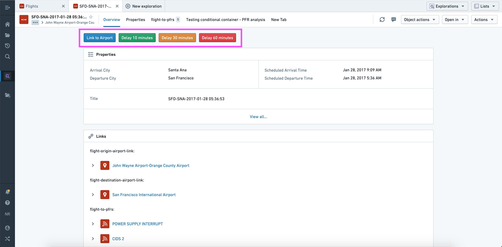
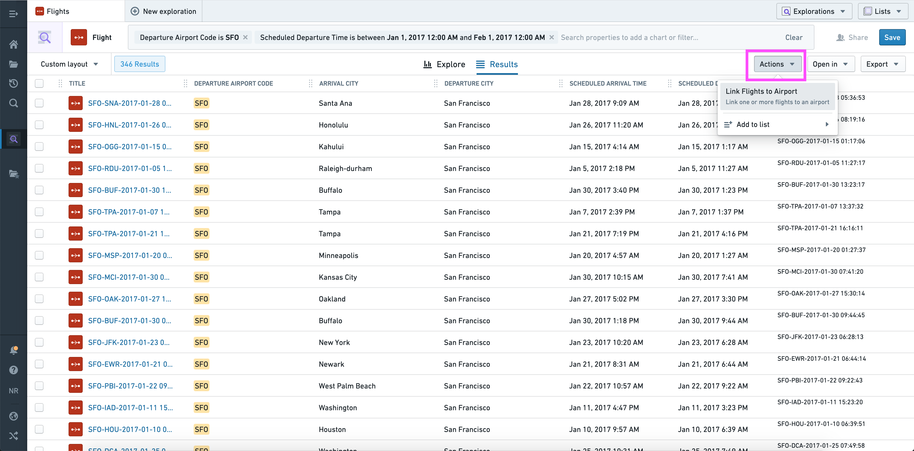
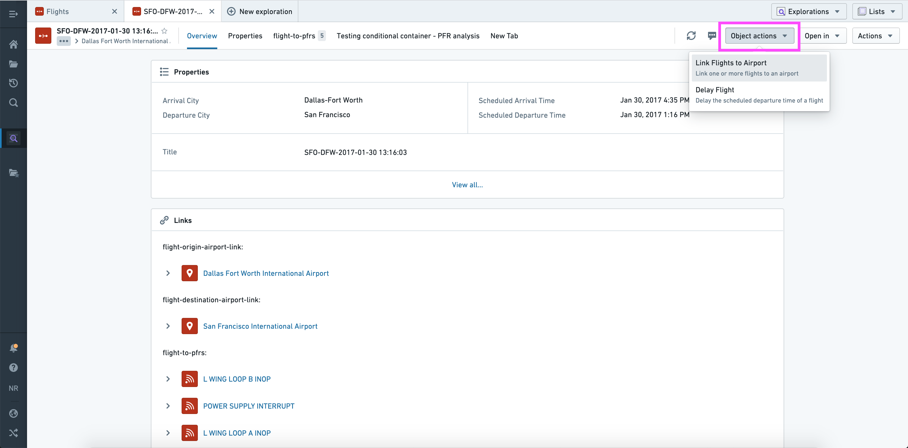
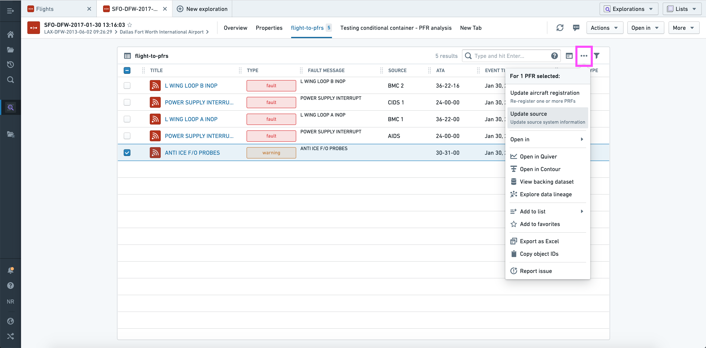
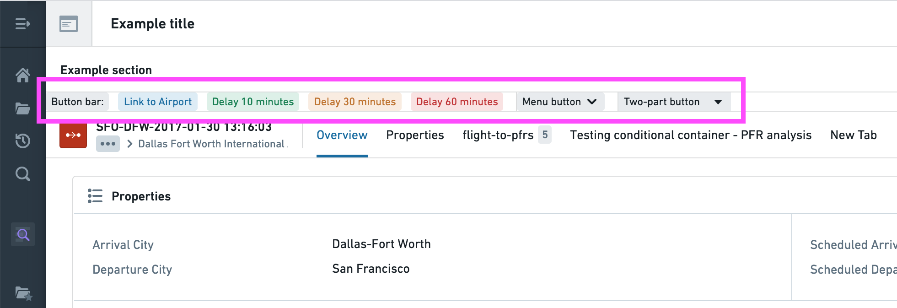

:::callout{theme="warning"}
注意：以下翻译的准确性尚未经过验证。这是使用 [AIP ↗](https://www.palantir.com/platforms/aip/) 从原始英文文本进行的机器翻译。
:::

# 在平台中使用操作

操作类型可以在Foundry的各个应用程序中无缝集成。继续阅读以了解如何从[Object Explorer](../../%E5%BA%94%E7%94%A8/%E5%AF%B9%E8%B1%A1%E6%B5%8F%E8%A7%88%E5%99%A8/%E6%A6%82%E8%BF%B0.md)和[Workshop](https://www.palantir.com/docs/foundry/workshop/overview/)配置和应用操作。

在下面的示例中，我们使用术语**单一操作类型**来指代使用对象引用参数的操作类型，使用术语**批量操作类型**来指代使用对象引用列表参数的操作类型。

## 对象视图

可以使用**操作部分**将操作添加到[对象视图](../../%E5%BA%94%E7%94%A8/%E5%AF%B9%E8%B1%A1%E8%A7%86%E5%9B%BE/%E6%A6%82%E8%A7%88.md)中。

配置**操作部分**时，您可以选择：

* 添加任何操作作为部分中的按钮。
* 为每个按钮提供自己的标签和颜色。
* 将默认点击行为从打开表单更改为使用默认值（如果有效）立即应用操作。
* 指定如果不可见参数无效，按钮是否应该被隐藏或禁用（考虑到可见参数可以在打开表单时进行更正）。
* 为每个参数提供默认值；这可以是当前对象的属性值或“本地”值（当前用户、当前时间戳、当前对象或手动输入的值）。
* 覆盖每个参数的可见性。

如上所示，因此您可以使用此部分为同一通用操作提供多个结构化版本（“延迟10分钟”，“延迟30分钟”等）。

## Object Explorer

操作将自动显示在[Object Explorer](../../%E5%BA%94%E7%94%A8/%E5%AF%B9%E8%B1%A1%E6%B5%8F%E8%A7%88%E5%99%A8/%E6%A6%82%E8%BF%B0.md)的三个位置：

1. 从探索视图中的**操作**下拉菜单（右上角）。

使用当前对象集，此下拉菜单会自动填充适用的批量操作。

2. 从对象视图中的**对象操作**下拉菜单（右上角）。

使用当前对象，此下拉菜单会自动填充适用的单一和批量操作类型。

3. 从对象视图中的**链接对象视图部分**（顶部）。

使用所选对象，此下拉菜单会自动填充适用的单一和/或批量操作类型。

:::callout
在“批量”上下文中（显示多个对象的列表视图），仅显示接受正确类型的对象列表参数的操作。
:::

## Workshop

在[Workshop](https://www.palantir.com/docs/foundry/workshop/overview/)中，可以使用[**按钮组**微件](https://www.palantir.com/docs/foundry/workshop/widgets-button-group/)配置和应用操作。

此微件具有与对象视图中的[操作部分](#actions-section)相同的配置选项，但有一些显著扩展：

* 有三种可能的设计，如上所示。
* 按钮有额外的显示选项，包括左/右图标、最小样式和标签样式。
* 除了操作外，单个按钮还可以触发Workshop事件、URL或对象集导出。

还有一个区别：

* 默认值可以是[变量](https://www.palantir.com/docs/foundry/workshop/concepts-variables/)、当前用户或当前时间戳。

阅读更多关于[Workshop中的操作](https://www.palantir.com/docs/foundry/workshop/actions-overview/)，或阅读[按钮组微件](https://www.palantir.com/docs/foundry/workshop/widgets-button-group/)的完整参考，以了解所有可用的配置选项。
