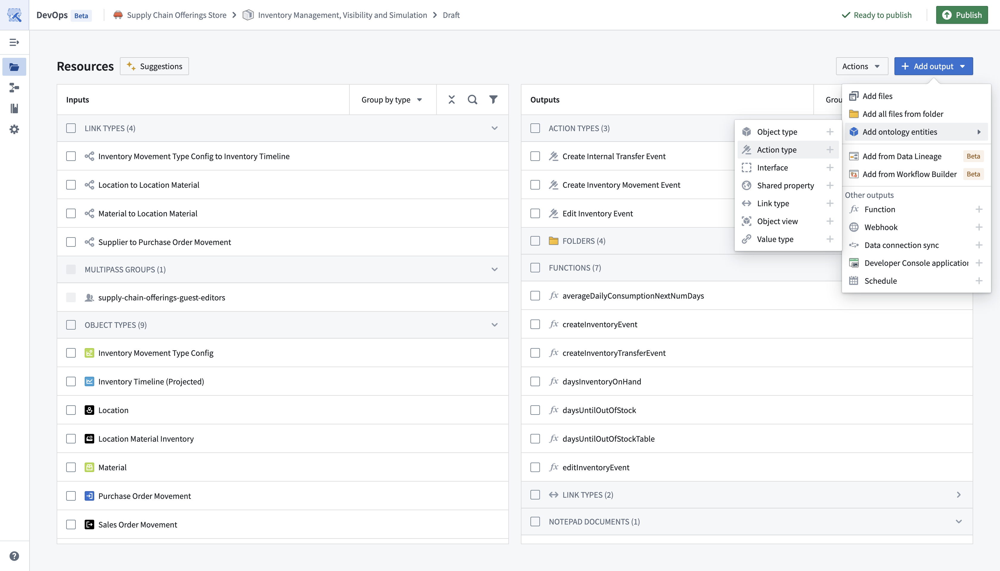
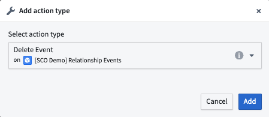
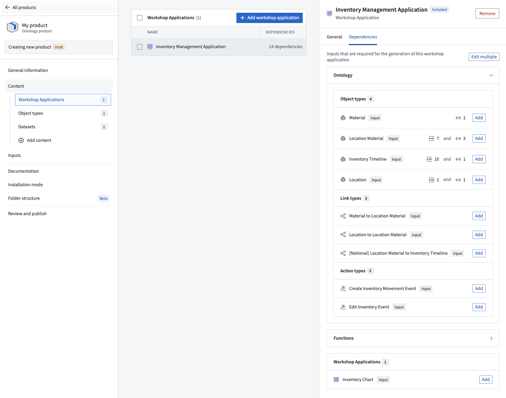

:::callout{theme="warning"}
注意：以下翻译的准确性尚未经过验证。这是使用 [AIP ↗](https://www.palantir.com/platforms/aip/) 从原始英文文本进行的机器翻译。
:::

# 将操作类型添加到Marketplace产品 \[Beta]

使用[Foundry DevOps](https://www.palantir.com/docs/foundry/devops/overview/)将您的操作类型包含在[Marketplace产品](https://www.palantir.com/docs/foundry/devops/core-concepts/#product)中，以供其他用户安装和重用。[了解如何创建您的第一个产品。](https://www.palantir.com/docs/foundry/foundry-devops/create-products/)

## 支持的功能

大多数操作类型功能都支持，除了一些引用[具有不支持功能的Object类型](../%E5%AF%B9%E8%B1%A1%E9%93%BE%E6%8E%A5%E7%B1%BB%E5%9E%8B/%E5%B0%86Object%E5%92%8C%E9%93%BE%E6%8E%A5%E7%B1%BB%E5%9E%8B%E6%B7%BB%E5%8A%A0%E5%88%B0Marketplace%E4%BA%A7%E5%93%81.md#supported-features)的操作。在为打包准备操作类型时，确保您的操作类型[**安全性和提交标准**](%E5%85%A5%E9%97%A8.md#add-submission-criteria)不引用用户；将任何用户引用更新为引用群组。

## 将操作类型添加到产品

要将操作类型添加到产品，首先[创建一个产品](https://www.palantir.com/docs/foundry/foundry-devops/create-products/)，然后选择如下所示的**操作类型**内容类型。

然后系统会提示您选择一个操作类型。

虽然您可以直接选择操作类型，但我们建议首先添加像[Workshop应用程序](https://www.palantir.com/docs/foundry/workshop/marketplace-workshop/)这样的内容，然后通过如下所示的[依赖面板](https://www.palantir.com/docs/foundry/foundry-devops/create-products/#content)选择相关的操作。

