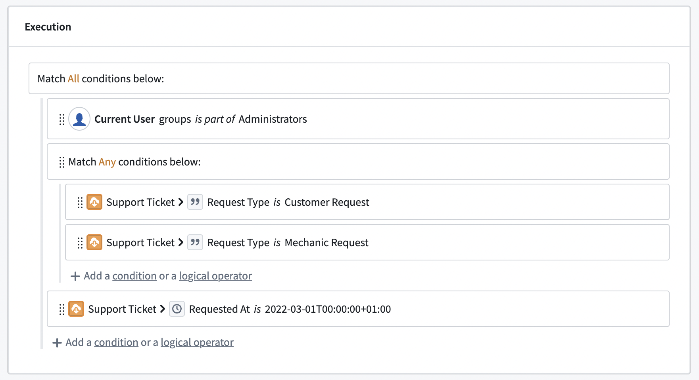
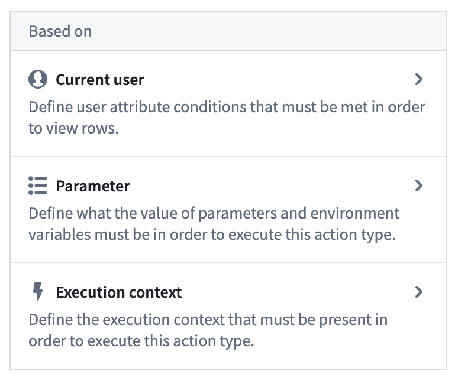
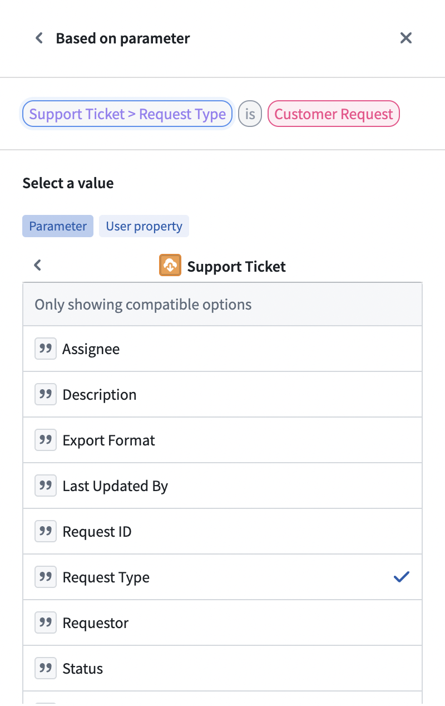
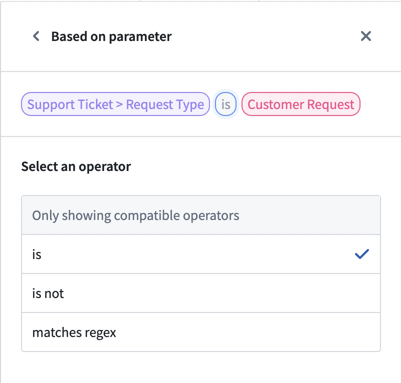
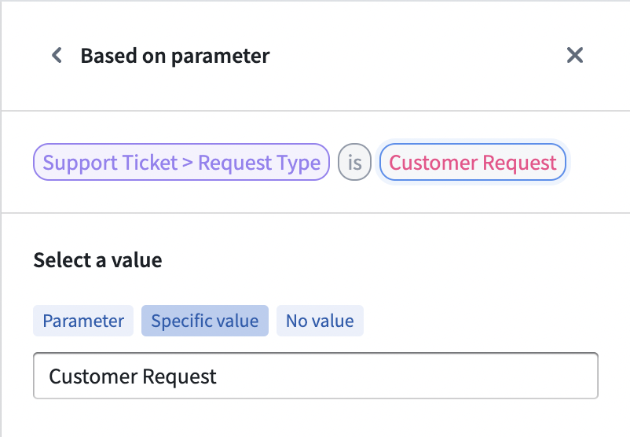

:::callout{theme="warning"}
注意：以下翻译的准确性尚未经过验证。这是使用 [AIP ↗](https://www.palantir.com/platforms/aip/) 从原始英文文本进行的机器翻译。
:::

# 提交标准

**提交标准**（以前称为验证）是决定操作是否可以提交的条件。提交标准支持将业务逻辑编码到数据编辑权限中，确保Ontology数据质量和编辑治理。

提交标准是通过结合基于上下文（如用户或参数）和静态信息的条件来创建逻辑语句。提交标准可以将对象、关系，甚至用户信息纳入逻辑语句中，以确定操作是否可以提交。

:::callout{title="示例"}
例如，一家航空公司可能希望更改特定航班的飞机列表。配置的操作允许用户更改与`Flight`对象链接的`Aircraft`对象。然而，航空公司只希望选定的用户（如航班控制员）能够使用此操作，以确保仅使用仍在运营中的飞机。使用提交标准，搭建者可以确保只有在满足条件时，才能提交更改航班飞机的操作，通过结合用户的组成员身份与操作提交时飞机的状态来实现。
:::

提交标准由条件和运算符组成。条件是控制参数或用户属性值的单个语句。运算符用于组合和嵌套不同的条件。

通过使用不同类型的运算符，我们可以创建更复杂的语句，反映它们的业务流程和要求。只有当所有提交标准都满足时，操作才能提交。这与管理用户是否可以编辑操作类型本身的权限无关。虽然一个对象类型可以具有多个添加、修改和删除对象的操作类型，但每个操作类型都有独立的提交标准。

## 条件

条件是两个值之间的单一比较检查。每个条件根据其参数或用户输入通过或失败。条件可以使用两种条件模板之一进行配置：“基于当前用户”或“基于参数”。这些模板为条件的其余部分提供了框架。每个条件都是使用中间的运算符在两个值之间进行简单的比较。

:::callout{title="示例"}
继续我们的示例，航班控制员要求可以使用`当前用户`模板，因为它需要提交操作人员的上下文。要知道一架飞机是否仍在运营，需要通过`参数`模板使用`Aircraft`对象。
:::

### 当前用户

`当前用户`模板定义了基于提交操作的用户的权限。`当前用户`输入可用于检查用户的ID、通过组ID的组成员身份或任何其他可用的多重认证属性（如用户的组织）。Foundry将用户ID视为字符串，可以与静态定义的用户ID列表或存储用户ID的任何字符串参数进行比较。

组ID选项允许您创建条件，使用操作的用户是其成员（无论是直接还是继承成员身份）的组。可以将这些组与静态选择的组或其他参数提供的组ID进行比较。

多重认证属性被视为字符串列表，只能与其他字符串或字符串列表进行比较。用户将有一个用户可以访问的建议多重认证属性列表。使用`其他用户属性`字段，可以针对用户无权访问的属性配置条件。如果用户无权访问某个属性，他们将无法通过条件。

:::callout{title="示例"}
在我们的示例中，要知道用户是否是航班控制员，我们需要检查用户是否是航班控制员组的成员。
:::

### 参数

提交标准还可以使用在参数部分中定义的参数。参数从其他应用程序或用户自身传递到操作类型。使用参数上的条件允许搭建者将业务逻辑嵌入操作类型中，防止用户在不符合业务要求的数据上提交操作。

:::callout{title="示例"}
在我们的示例中，运行状态通过`Aircraft`对象给出，并且每架飞机都可以更改。条件需要基于`Aircraft`对象类型参数构建。
:::

提交标准不支持附件和对象集参数。这些参数类型已从选择面板中移除。

### 选择一个值

选择条件模板后，选择要比较的值。某些参数（如列表或对象参数）需要更细粒度的选择，以确定应在比较中使用哪个值。我们还可以选择比较列表的长度而不是其内容。

:::callout{title="示例"}
在飞机示例中，飞机的运行状态存储在`Aircraft`对象的属性中。
:::

### 运算符

运算符定义了两个值之间的比较。为了简化配置工作流，运算符经过预筛选，仅显示参数有效的运算符。当参数更改时，需要重新配置所有使用该参数的条件。

根据所选参数的不同，有多种运算符可用。对于单值参数，提供以下运算符：

|运算符	|示例	|数据示例	|描述	|
|---	|---	|---	|---	|
|等于	|name *等于* John Doe	|"John Doe" 等于 "John Doe" = TRUE	|左值与右值完全匹配。	|
|不等于	|**当前用户** *不等于* John Doe	|“John Doe" 不等于 "Maria Smith" = TRUE	|左值和右值不匹配。	|
|匹配	|name *匹配* ^\[A|E|I|O|U]\*	|"John Doe" 匹配	|左值匹配正则表达式。	|
|小于	|Aircraft > 引擎数量 *小于* 2	|4 小于 2 = TRUE	|左值小于右值。	|
|大于或等于	|Aircraft > 引擎数量 *大于或等于* 2	|4 大于或等于 2 = TRUE	|左值大于右值。	|

对于具有多个值的参数，以下运算符可用。对象引用列表被转换为值列表（要么是对象值，要么是定义属性的值）：
|运算符	|示例	|数据示例	|描述	|
|---	|---	|---	|---	|
|包含	|Aircrafts > 飞行员名称 *包含* "John Doe"	|\[ "John Doe", "Maria Smith" ] 包含 "John Doe" = TRUE	|至少一个左值与右值完全匹配。	|
|包含任何	|名称列表 *包含任何* Aircrafts > 飞行员名称	|\["King Louis", "John Doe"] 包含在 \[ "John Doe", "Maria Smith" ] = TRUE	|至少一个左值与至少一个右值完全匹配。	|
|包含于	|name *包含于* \[ "John Doe", "Maria Smith" ]	|  "John Doe" 包含于 \[ "John Doe", "Maria Smith" ] = TRUE	|左值与至少一个右值完全匹配。	|
|每个等于	|Aircrafts > 飞行员名称 *每个等于* "John Doe"	|\[ "John Doe", "Maria Smith" ] 每个等于 "John Doe" = FALSE	|所有左值与右值完全匹配。	|
|每个不等于	|Aircrafts > 飞行员名称 *每个不等于* "John Doe"	|\[ "John Doe", "Maria Smith" ] 每个不等于 "King Louis" = TRUE	|所有左值与右值不完全匹配。	|

:::callout{title="示例"}
由于我们示例中的用户是多个组的成员，但比较是单个组，我们需要选择`包含`运算符来检查重叠。然而，运行状态需要与预期状态完全匹配，因此必须设置`等于`运算符。
:::

### 值

值表示比较的另一侧。值可以基于现有参数、静态值或无值。无值检查第一个值是否为空（或为null）。与运算符一样，可用选项取决于第一个值的类型。

:::callout{title="示例"}
我们现在可以完成飞机示例中所需的两个条件。对于航班控制员，正确的组需要作为静态参数选择。这是因为组不应更改，而是在每次提交操作时保持相同，无论上下文如何。因此，使用`特定值`，通过下拉菜单选择所需的组。飞机在运行状态属性为`Yes`时被视为运营，这可以再次使用特定值选项设置。
:::

## 逻辑运算符

逻辑运算符可用于组合不同的条件。逻辑运算符也可以嵌套，以创建更复杂的逻辑，并可以要求所有、任何或没有其下的条件被满足才能通过。

## 失败消息

失败消息支持定义在操作无法提交时应显示的错误。每个根级别的条件和逻辑运算符都有其自己的失败消息。如果较低级别的条件不满足，将显示相应根级别（父级）的失败消息。每当条件不满足时，失败消息将在Foundry（Object Explorer、Workshop或Quiver）中显示给最终用户。失败消息通知用户他们为何被阻止提交操作。
