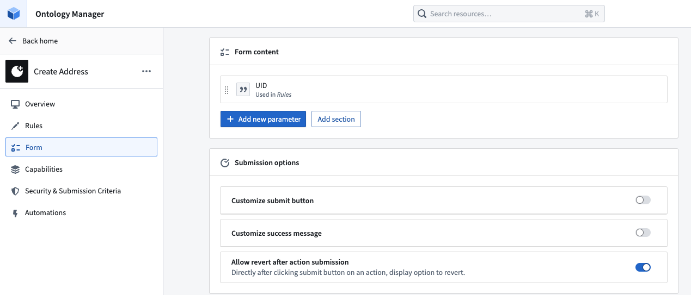

:::callout{theme="warning"}
注意：以下翻译的准确性尚未经过验证。这是使用 [AIP ↗](https://www.palantir.com/platforms/aip/) 从原始英文文本进行的机器翻译。
:::

# 撤销或取消操作

在 [Ontology Manager](../../%E5%BA%94%E7%94%A8/%E6%9C%AC%E4%BD%93%E7%AE%A1%E7%90%86%E5%99%A8/%E6%A6%82%E8%BF%B0.md) 中，操作撤销允许在操作应用后立即撤销（即取消）操作。您可以通过在任何成功操作应用后的成功消息中选择 **撤销** 来撤销操作。

新的操作默认是可以撤销的。

:::callout{theme="neutral"}
操作撤销仅适用于 Object Storage v2；这意味着只有在 [OSv2](../../%E6%9C%AC%E4%BD%93%E6%9E%B6%E6%9E%84/%E5%AF%B9%E8%B1%A1%E5%90%8E%E7%AB%AF/Object%20Storage%20v1%E4%B8%8EObject%20Storage%20v2%E4%B9%8B%E9%97%B4%E7%9A%84%E9%87%8D%E5%A4%A7%E5%8F%98%E6%9B%B4.md) 中修改或创建对象类型的操作才能被撤销。如果您的对象类型目前未存储在 Object Storage v2 中，您可以按照此 [指南](../../%E6%9C%AC%E4%BD%93%E6%9E%B6%E6%9E%84/%E5%AF%B9%E8%B1%A1%E5%90%8E%E7%AB%AF/%E4%BB%8E%E5%AF%B9%E8%B1%A1%E5%AD%98%E5%82%A8%20v1%20%28Phonograph%29%20%E8%BF%81%E7%A7%BB%E5%88%B0%E5%AF%B9%E8%B1%A1%E5%AD%98%E5%82%A8%20v2.md#migrate-from-object-storage-v1-phonograph-to-object-storage-v2) 进行迁移。
:::

## 配置可撤销的操作

目前，操作只能由应用操作的用户撤销。

在操作的 **表单** 选项卡中，打开 **在操作提交后允许撤销** 按钮。一旦该切换正确配置并保存到 Ontology 中，您的操作就可以被撤销。

对于2024年5月之后创建且仅修改OSv2对象类型的操作，**表单** 选项卡中的 **在操作提交后允许撤销** 切换将默认启用。
如果一个操作在2024年5月之前存在并修改了OSv2中的对象类型，则操作撤销不会默认开启，但可以手动启用。

如果一个操作仅修改了OSv1对象类型，您将无法撤销该操作。

## 撤销操作

:::callout{theme="warn" title="撤销操作"}
下面的提示是您撤销操作的唯一机会。这在执行删除操作时尤其重要。
:::

一旦成功撤销，用户将看到类似于原始操作成功的提示，如下所示。

应用的编辑：

已撤销的编辑：

## 注意事项

在某些情况下，操作撤销可能失败：

* 一旦对对象进行了任何后续编辑，某个对象上的操作就无法被撤销，即使该编辑是针对不同的属性。换句话说，只有当操作是对象的最新编辑时，才能撤销该操作。
* 如果在操作提交后操作撤销被关闭，即使之后再次开启，也无法撤销该操作。

操作撤销仅撤销对象实例的编辑，但不会撤销副作用，如通知或webhooks，也不会像应用操作那样调用它们。

### 在没有撤销操作提示的情况下撤销删除操作

如果执行了删除操作并且您希望撤销删除，但撤销操作提示不再可用，唯一的补救选项是：

* 迁移到新的对象类型并使用函数复制所需的编辑；或
* 删除对象类型上的所有编辑。
