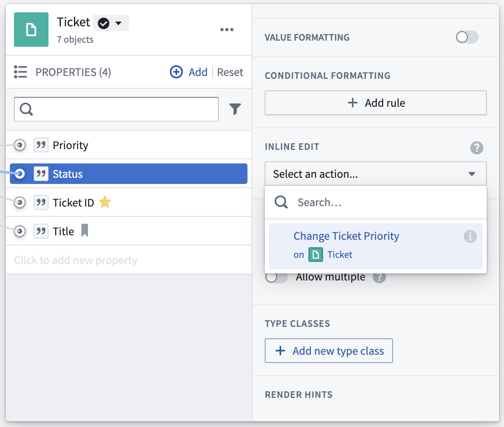

:::callout{theme="warning"}
注意：以下翻译的准确性尚未经过验证。这是使用 [AIP ↗](https://www.palantir.com/platforms/aip/) 从原始英文文本进行的机器翻译。
:::

# 行内编辑

以操作支持的行内编辑与标准[操作](%E5%85%A5%E9%97%A8.md)的验证和提交方式不同。对于标准操作，需要设置多个参数以使操作有效。然而，对于以操作支持的行内编辑，每个参数都是非必填的，并默认使用对象的现有值，因此用户可以逐个更改属性。

本文档讨论如何避免在使用行内编辑时出现意外结果。行内编辑在Workshop和Object Explorer中均可用。行内编辑操作的配置取决于操作的使用位置。

## Object Explorer 行内编辑

行内编辑允许用户快速编辑[Object Explorer 结果视图](../../%E5%BA%94%E7%94%A8/%E5%AF%B9%E8%B1%A1%E6%B5%8F%E8%A7%88%E5%99%A8/Analyze%20and%20compare/%E6%9F%A5%E7%9C%8B%E7%BB%93%E6%9E%9C.md)或本地Object视图微件（如属性或指标卡片微件）中对象的值。

### 配置

要设置行内编辑操作，请导航到对象类型的**属性**标签，然后在Ontology Manager中导航到**交互**标签。选择一个属性并在侧边栏中导航到**行内编辑**。在下拉菜单中，选择一个可用的操作类型或创建一个新操作类型。创建一个新操作类型将触发操作类型创建工作流。每个属性只能有一个行内编辑操作类型。

您可以将相同的操作类型用作多个属性的行内编辑，或者可以为不同的属性设置单独的操作类型。

#### 行内编辑的操作类型要求

并非所有操作类型都可以用作行内编辑操作类型。要被接受，操作类型必须满足以下要求：

* 只能修改单一对象类型的单一对象。
* 必须启用默认值。
* 默认值必须来自定义行内操作的对象引用参数。因此，在操作中被更改的属性不能映射到静态值或特殊值如"当前用户"或"当前时间"。
* 可设置可见性状态和覆盖；然而，如果在Object Explorer和Object视图中使用行内编辑，它们将被忽略。

## Workshop 行内编辑

在Workshop中使用操作类型作为行内编辑不需要额外配置，但并非所有操作都适合单元级编辑。有关如何配置行内编辑的信息，请参阅[Workshop文档](https://www.palantir.com/docs/foundry/workshop/widgets-object-table/#inline-edits-or-cell-level-writeback)。

### 背景

在运行单个操作时，编辑是逐个验证和提交的（顺序）。行内编辑不同之处在于它们是批量验证和提交的。由于此原因，并非所有操作都适合行内编辑。由于行内编辑可能导致失败或出现意外结果的操作包括：

* 任何尝试读取其他操作可能已写入的数据的操作，或
* 尝试写入同一对象的两个操作。

### 有效的行内操作

操作必须提交不冲突的编辑，以便作为以操作支持的行内编辑有效。在实践中，这意味着在同一表编辑微件中配置的多个操作不得：

* 写入同一对象，
* 创建相同的链接，或
* 试图保持聚合值一致。

### 无效的行内操作

\*\*如果行内编辑尝试两次编辑同一对象，操作将返回错误。\*\*此外，添加或删除合并表链接不支持行内编辑，并将导致面向用户的错误消息。

当用户应用行内编辑时，[提交标准](%E6%8F%90%E4%BA%A4%E6%A0%87%E5%87%86.md)将应用于每次编辑，但编辑将批量提交。每个编辑对象的参数和全局提交标准都将被评估，但引用共享或链接对象的提交标准与行内编辑不兼容。这是因为在应用行内编辑时，累积提交标准将编辑值与该列的未编辑值进行比较。在最终提交时，编辑将同时提交，如果它们都通过了相应对象的参数和全局提交标准，则提交将成功。

多个操作类型或链接对象之间共享的对象上的提交标准因此在每次编辑之前评估一次。

:::callout{theme="warning"}
引用共享操作类型或链接对象的提交标准与行内编辑不兼容，批量更新对象可能会违反按顺序（逐个）应用时正常工作的提交标准规则。
:::

#### 示例：无效的行内操作

想象一个`延迟航班`操作，可以将单个航班延迟最多20分钟，而某机场可以将所有航班延迟最多50分钟。

* 每次更新单元格时，两个提交标准——20分钟要求和50分钟总量——将被评估。
  * 因为尚未提交编辑，50分钟总量将新延迟与列中未编辑延迟（行内编辑开始前的延迟）之和进行比较。
* 第二个提交标准（机场所有延迟总和小于50分钟）依赖于聚合值，并由列中的所有对象共享。
  * 由于行内编辑是批量提交的，第二个提交标准在限制给定机场的航班延迟总时长方面将无效；结果编辑可能总和超过第二个提交标准允许的50。
* 该操作不适合表编辑，因为它会导致与单独为每个单元格运行操作相比不一致的结果。
