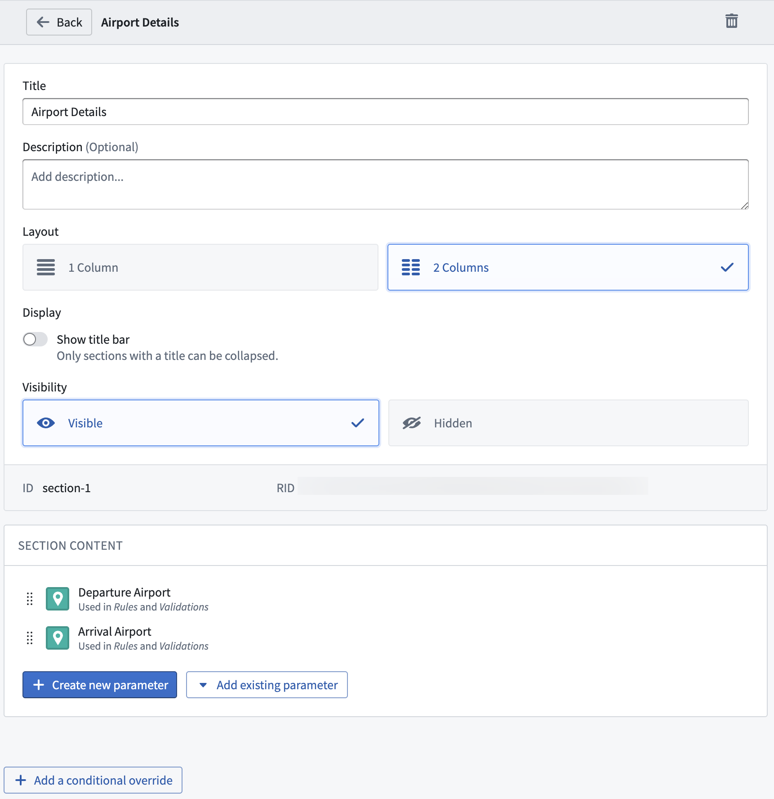

:::callout{theme="warning"}
注意：以下翻译的准确性尚未经过验证。这是使用 [AIP ↗](https://www.palantir.com/platforms/aip/) 从原始英文文本进行的机器翻译。
:::

# 配置部分

操作表单可以通过**部分**进行自定义。这些部分提供参数的逻辑分组，以组织操作表单。部分还支持列、描述和条件覆盖。

## 向操作表单添加部分

在表单选项卡中，点击**添加部分**。这将打开一个详细的部分配置模式，您可以在其中添加标题、选择列设计，并非必填地编写面向用户的描述。描述没有样式化，与参数描述不同，它将始终显示在部分本身，而不是在工具提示中。

您可以在列中组织参数，以更好地利用表单内的空间或将相关参数更紧密地分组。一个部分可以分为一列或两列。当您使用不需要占用太多表单空间的参数时，单独的列特别有用。

部分也是可折叠的，可以完全隐藏，并且可以利用条件覆盖，为您提供更多自定义表单行为的方式。所有功能也将适用于部分内的参数。结合使用这些功能可以创建更智能的表单，在适当的情况下呈现所需的参数。一个部分可以最初隐藏，并且仅在基于先前参数时显示。

## 向部分添加参数

有两种方法可以向部分添加参数：在部分配置视图中，或在**表单**选项卡中。

在部分配置视图中，点击**添加新参数**。从这里，配置新添加的部分内的参数。或者，点击**添加现有参数**，将现有参数移动到部分中。

**表单**选项卡在单一概览中列出带有参数的部分。点击参数左侧的八个点，并将其拖动到现有部分。参数和部分在表单中的显示基于它们在此**表单内容**部分中的顺序。
