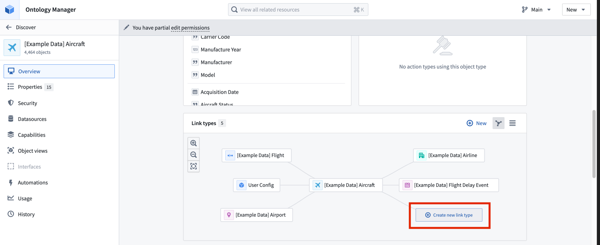
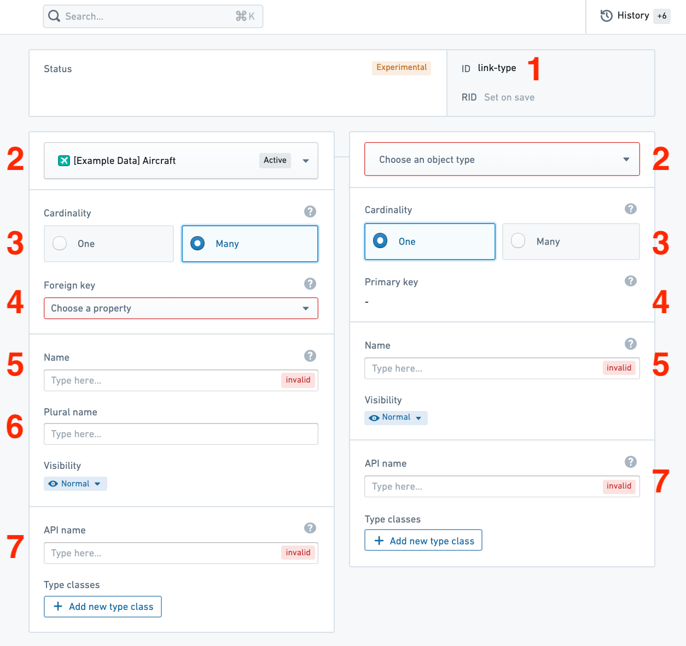

:::callout{theme="warning"}
注意：以下翻译的准确性尚未经过验证。这是使用 [AIP ↗](https://www.palantir.com/platforms/aip/) 从原始英文文本进行的机器翻译。
:::

# 创建链接类型

要创建新的链接类型，您可以：

* 从主页标题中的链接类型卡片选择**新建链接类型**；或者，

  [官方图片已失效：从卡片创建新链接类型](https://www.palantir.com/docs/resources/foundry/object-link-types/create-new-link-type-card.png)

* 导航到您想要链接的Object类型，并在该Object类型的**概览**页面中的链接类型图中选择**创建新链接类型**按钮。

  

## 配置新链接类型

创建新链接类型后，必须配置并保存链接类型。在保存新链接类型之前，需要进行以下配置步骤：

1. **ID:** 选择链接类型的唯一标识符，主要用于在配置应用程序时引用此类型的链接。
   * ID可以包含小写字母、数字和短划线。
   * ID的第一个字符**必须**是小写字母。
   * 一旦ID被保存，ID就**不能**更改。
2. **Object类型:** 选择您想要链接到起始Object类型的Object类型。
3. **基数:** 选择链接类型每一侧的基数。Object类型可以通过四种不同类型的基数进行关联：一对一、一对多、多对一和多对多。在下面的示例中，假设有两个通过基数相关的Object类型：`Aircraft` Object类型和`Flight` Object类型。
   * *一对一基数:* 这表示一个`Aircraft`应该链接到一个`Flight`。注意，一对一基数作为预期关系的指示，但不强制执行一对一映射。
   * *一对多基数:* 这表示一个`Aircraft`可以链接到多个`Flights`。
   * *多对一基数:* 这表示多个`Aircraft`可以链接到一个`Flight`。
   * *多对多基数:* 这表示一个`Aircraft`可以链接到多个`Flights`，并且一个`Flight`可以链接到多个`Aircraft`。
     * 注意，当您选择多对多基数时，系统会提示您上传一个数据源，其中包含第一个Object类型的主键（在此示例中为`Aircraft`）和第二个Object类型（在此示例中为`Flight`）之间所有链接组合。
   * 多对多基数，需要一个支持的数据源，以便用户能够编辑或回写链接类型。[了解更多关于允许用户编辑数据的信息。](../%E5%85%81%E8%AE%B8%E7%94%A8%E6%88%B7%E7%BC%96%E8%BE%91Objects%E5%92%8C%E9%93%BE%E6%8E%A5.md)
4. **键:** 选择用于创建链接的属性或列。
   * 在一对一或一对多基数链接类型中，一个Object类型的**外键**属性必须引用另一个Object类型的**主键**属性。
     * 例如，`Aircraft ID`属性是`Aircraft` Object类型的主键。`Flight` Object类型上的`assigned aircraft ID`属性是外键。当`Aircraft`的`Aircraft ID`与`Flight`的`assigned aircraft ID`匹配时，将在`Aircraft`和`Flight` Object类型之间创建链接。
   * 在多对多基数链接类型中，选择链接类型支持的数据源中映射到每个链接的Object类型的主键的列。
     * 如果Object类型的主键属性的基本类型与在链接类型支持的数据源中映射主键的列的类型不同，将会导致出错，阻止您保存。
5. **显示名称:** 填写链接类型每一侧的显示名称。链接类型的一侧表示*到*该Object类型的链接。在本例中，您可以选择显示名称`Assigned Aircraft`，因为一个`Flight`具有一个`Assigned Aircraft`。
6. **复数显示名称:** 对于基数为多的链接类型的侧面，您还需要填写一个复数显示名称，以便用户应用程序在显示链接对象时能够显示正确的名称。在我们的示例中，`Flight` Object类型的复数显示名称将描述从`Aircraft`*到*`Flight`的链接。我们可能选择复数显示名称为`Scheduled Flights`，因为一个`Aircraft`有多个`Scheduled Flights`。
7. **API名称:** 填写在代码中以编程方式引用链接类型时使用的API名称字段。链接类型一侧的API名称可以用于返回该类型的Object。例如，如果链接类型`Aircraft`侧的API名称是`assignedAircraft`，那么调用`Flight.assignedAircraft.get()`将返回链接到这些`Flight`对象的`Aircraft`对象。
   * 链接类型API名称*必须*：
     * 以小写字符开头，并仅由字母数字字符组成。
     * 使用驼峰命名法。
     * 在与同一Object类型关联的所有链接类型中必须是唯一的。
   * [了解更多关于API名称的信息。](../../%E5%87%BD%E6%95%B0/Functions%20on%20objects/API-%20Object%E5%92%8C%E9%93%BE%E6%8E%A5.md)

填写这些字段后，您将能够保存您的链接类型。要执行此操作，请按照[如何保存Ontology更改](../../../%E5%BA%94%E7%94%A8/%E6%9C%AC%E4%BD%93%E7%AE%A1%E7%90%86%E5%99%A8/Change%20management/%E4%BF%9D%E5%AD%98%E5%AF%B9Ontology%E7%9A%84%E6%9B%B4%E6%94%B9.md)中的说明进行操作。

## 故障排除

### 出错: `Phonograph2:DatasetAndBranchAlreadyRegistered`

如果您收到错误`Phonograph2:DatasetAndBranchAlreadyRegistered`，则您尝试保存的链接类型所支持的数据源已经支持Ontology中的其他链接类型，无法再次使用。

> 配图缺失说明：本页有 1 个官方图片地址在抓取及重试时失效（返回 HTML 错误页）。下列地址保留用于溯源，未替换成其他版本的图片。

- 官方图片已失效：<https://www.palantir.com/docs/resources/foundry/object-link-types/create-new-link-type-card.png>
