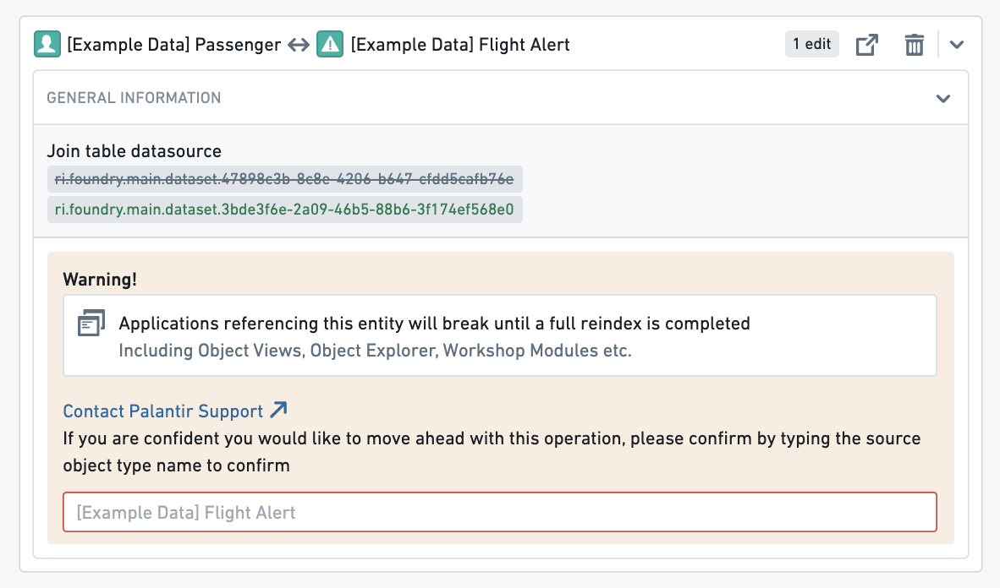
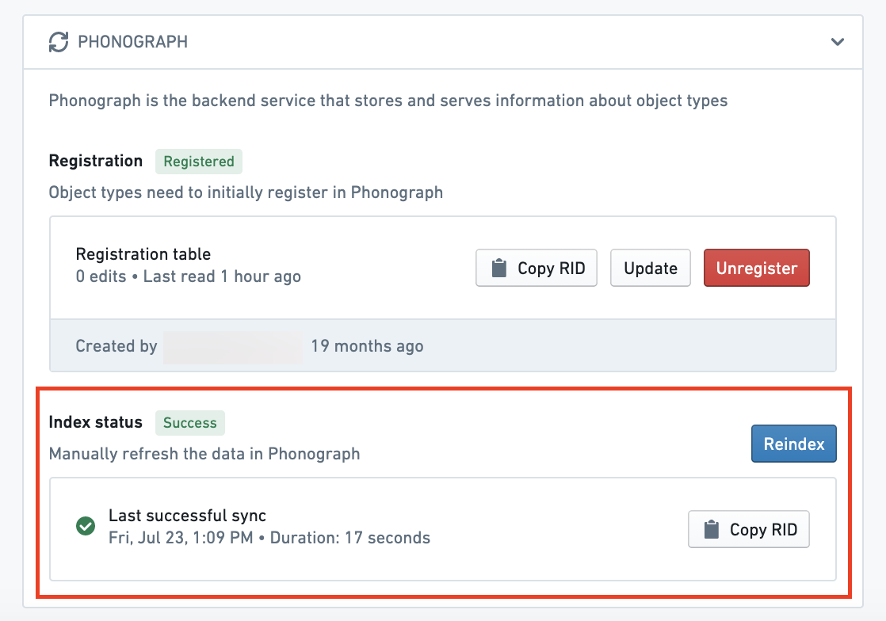
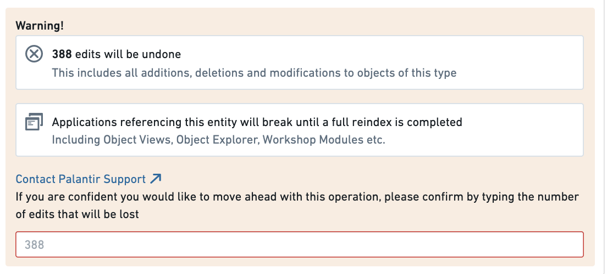
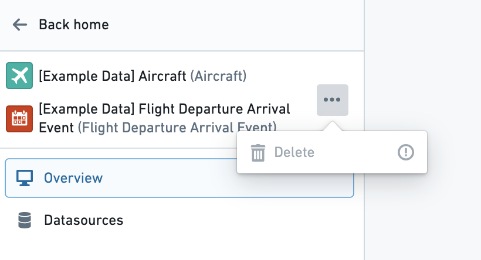
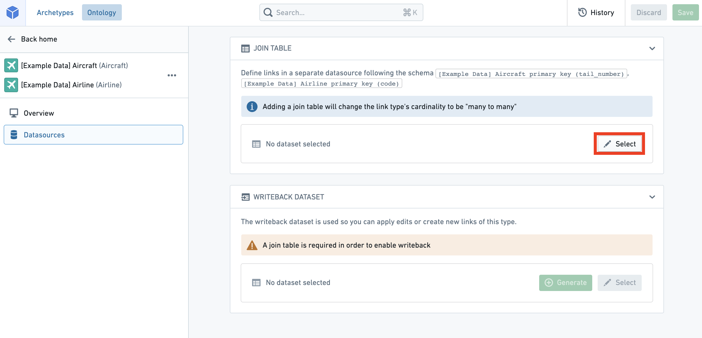
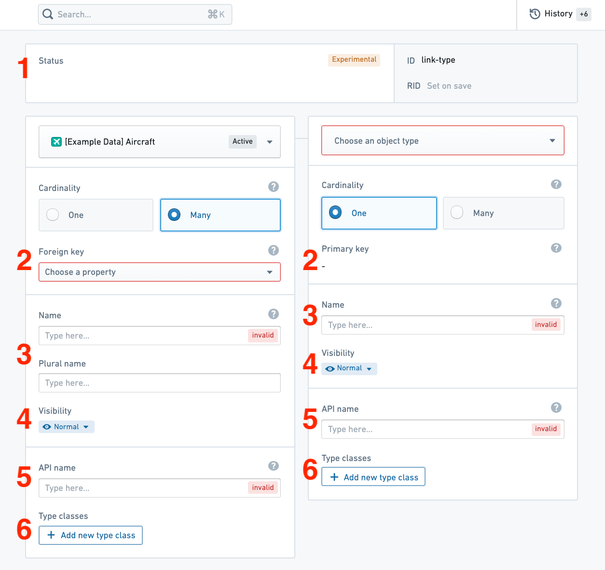

:::callout{theme="warning"}
注意：以下翻译的准确性尚未经过验证。这是使用 [AIP ↗](https://www.palantir.com/platforms/aip/) 从原始英文文本进行的机器翻译。
:::

# 编辑链接类型

:::callout{theme="warning" title="警告"}
编辑链接类型可能会产生**应用程序中断的后果**，从而破坏用户工作流。在进行任何链接类型编辑**之前**，请阅读下面关于[潜在破坏性更改](#potential-breaking-changes)的部分。
:::

## 潜在破坏性更改

### 无数据输出的链接类型

需要 Object Storage v1 (Phonograph) 注销并重新注册链接类型的支持数据源的更改将在重新索引期间使用户应用程序中的该类型链接**不可用**；这些更改如下所述。

以下更改将在保存时注销并重新注册（或删除）链接类型的支持数据源：

* 更改多对多链接类型的支持数据源。
* 更改链接类型的基数。
* 更改链接类型的外键。
* 删除链接类型。

当您尝试保存这些更改时，系统会警告您这些更改对用户应用程序的潜在影响。

例如，如果在 Workshop 应用程序中使用了链接类型进行周边搜索，该 Workshop 应用程序将在重新索引完成之前中断。您可以在其 **Datasources** 页面上的 **Phonograph** 面板中跟踪链接类型重新索引的进度。

[了解更多关于 Object Storage v1 (Phonograph) 的信息。](../../../%E6%9C%AC%E4%BD%93%E6%9E%B6%E6%9E%84/%E5%AF%B9%E8%B1%A1%E6%95%B0%E6%8D%AE%E5%BA%93/%5B%E9%81%97%E7%95%99%5D%20Object%20Storage%20v1%20%28Phonograph%29.md)

### 启用了数据输出的链接类型

如果链接类型启用了数据输出，编辑该链接类型时应格外小心。对链接类型所做编辑的历史记录存储在 Object Storage v1 (Phonograph) 中。每次构建数据输出数据集时，编辑历史记录都会重新应用，以获得数据输出数据集中编辑链接的最终状态。当链接类型的支持数据源从 Object Storage v1 (Phonograph) 注销时，Object Storage v1 (Phonograph) 中的编辑历史记录将被删除，未来的数据输出数据集构建将失败。

除了前述[无数据输出的链接类型](#link-type-without-writeback)中列出的需要注销的更改外，当对**任何**曾经收到编辑的链接类型的支持数据源的列进行架构更改时，即使当前没有接收编辑，也需要注销。架构更改包括对列名称和基本类型的更改。

:::callout{theme="warning" title="警告"}
Object Storage v1 (Phonograph) **不会**自动注销链接类型的支持数据源以响应这些架构更改之一。相反，重新索引将失败，只有在撤消保存的架构更改，或在链接类型的 Datasources 页面上的 Phonograph 面板中手动注销并重新注册支持数据源时，重新索引才会成功。
:::

当您尝试保存任何可能擦除编辑历史的更改时，系统会警告您对编辑的潜在影响。

现在您已经了解编辑现有链接类型的注意事项，您可以安全地进行更改。

## 编辑现有链接类型

* [导航到现有链接类型](#navigate-to-an-existing-link-type)
* [删除链接类型](#delete-a-link-type)
* [更改支持数据源](#change-a-backing-datasource)
* [编辑链接类型的元数据](#edit-a-link-types-metadata)

### 导航到现有链接类型

您可以通过从主页侧边栏选择链接类型页面并从列表中选择不同的链接类型来更改正在处理的链接类型。您也可以在应用程序头部的搜索栏中始终搜索新链接类型。阅读更多关于[导航](../../../%E5%BA%94%E7%94%A8/%E6%9C%AC%E4%BD%93%E7%AE%A1%E7%90%86%E5%99%A8/%E5%AF%BC%E8%88%AA.md)的信息。

### 删除链接类型

您可以通过选择链接类型视图侧边栏右上角的 （三个点）图标，然后从下拉菜单中选择 **删除** 选项来删除对象类型。将弹出一个对话框以确认您要暂存链接类型以进行删除。

* 请注意，链接类型的删除仅在保存更改后生效，并将破坏任何引用对象类型的视图或应用程序。
* 请注意，状态为 `active` 的链接类型无法删除。阅读更多关于[状态](../Metadata/%E7%8A%B6%E6%80%81.md)的信息。

### 更改支持数据源

您可以更改支持数据源：

1. 导航到链接类型视图的 **Datasources** 页面。
2. 选择现有数据源旁边的  **选择** 图标。这将允许您浏览并选择 Foundry 中可用的数据源。

:::callout{theme="warning" title="警告"}
更改链接类型的支持数据源将移除旧数据源中列与定义您链接类型的键之间的任何连接。仅当您更改为与旧数据源具有**相同架构**的新数据源时，键才会为您自动重新映射。否则，您将需要将键重新映射到新数据源。
:::

### 编辑链接类型的元数据

1. **状态：** 选择链接类型面板顶部的现有状态以打开可用状态的下拉菜单。从 `deprecated`、`experimental` 和 `active` 状态中选择。
   * 阅读更多关于[状态](../Metadata/%E7%8A%B6%E6%80%81.md)的信息。
2. **键：** 从下拉菜单中选择以更改外键或多对多链接类型中的列映射。
   * 请注意，在具有多对多基数的链接类型中，支持数据源中的列必须映射到对象类型的主键。如果对象类型主键属性的类型与其在链接类型的支持数据源中映射到的列的类型不同，错误将阻止您保存。
   * 在具有任何其他基数的链接类型中，应用程序要求一个对象类型的键必须映射到该对象类型的主键，以确保基数的“一”侧是唯一的。
3. **显示名称：** 选择现有显示名称以编辑文本。
4. **可见性：** 从链接可见性列表中检查可见性。一个 `重要` 的链接类型将导致应用程序首先向用户显示此链接类型。一个 `隐藏` 的链接类型将不会出现在用户应用程序中。
5. **API 名称：** 选择现有的 API 名称以更改其值。
   * 请注意，您不能更改状态为 `active` 的链接类型的 API 名称。
     * 阅读更多关于[状态](../Metadata/%E7%8A%B6%E6%80%81.md)的信息。
     * 阅读更多关于[有效的 API 名称](../Object%20types/%E5%88%9B%E5%BB%BA%20Object%20%E7%B1%BB%E5%9E%8B.md#configure-api-names)的信息。
6. **类型类：** 应用可被应用程序解释的额外元数据类型类。
   * 查阅[可用类型类列表](../Metadata/%E7%B1%BB%E5%9E%8B%E7%B1%BB.md)以获取更多信息。
