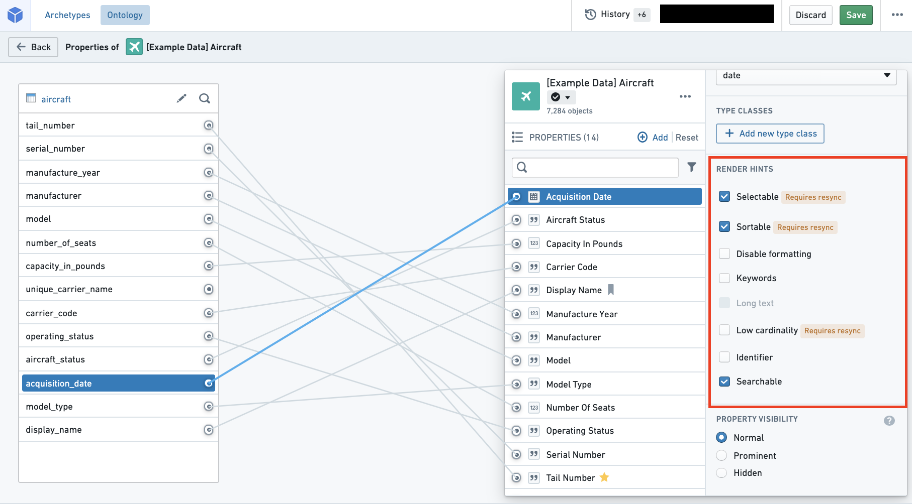

:::callout{theme="warning"}
注意：以下翻译的准确性尚未经过验证。这是使用 [AIP ↗](https://www.palantir.com/platforms/aip/) 从原始英文文本进行的机器翻译。
:::

# 渲染提示

Foundry 使用**渲染提示**来传达有关在平台上使用 Ontology [属性](../Properties/%E6%A6%82%E8%A7%88.md)到 [Object Storage v1 (Phonograph)](../../../%E6%9C%AC%E4%BD%93%E6%9E%B6%E6%9E%84/%E5%AF%B9%E8%B1%A1%E6%95%B0%E6%8D%AE%E5%BA%93/%5B%E9%81%97%E7%95%99%5D%20Object%20Storage%20v1%20%28Phonograph%29.md)和用户应用程序的信息。例如，字符串属性上的 `sortable` 渲染提示告诉应用程序允许用户对该属性进行排序，如在时间轴或图表中。

许多渲染提示与对象类型的重新索引性能相关。例如，您可以使用渲染提示向 [Object Storage v1 (Phonograph)](../../../%E6%9C%AC%E4%BD%93%E6%9E%B6%E6%9E%84/%E5%AF%B9%E8%B1%A1%E6%95%B0%E6%8D%AE%E5%BA%93/%5B%E9%81%97%E7%95%99%5D%20Object%20Storage%20v1%20%28Phonograph%29.md) 指示某个属性不需要在应用程序中进行聚合或排序，从而使 Object Storage v1 在索引这些属性时的工作量减少。

您可以在属性编辑器的属性窗格中选择和取消选择渲染提示（参见下图）。

下表分享了每个可用渲染提示的**名称**和**描述**。该表还提供了有关渲染提示的两个技术方面的信息：“是否添加原始索引？”和“是否需要重新索引？”（如下面所述）。

* **是否添加原始索引？**
  * 为了应用添加原始索引的渲染提示，Object Storage v1 (Phonograph) 通过在存储支持的数据集时创建另一个索引来存储渲染提示信息。
  * 由于这个额外的索引，对于应用了渲染提示的属性，将有两列被计入索引到 Object Storage v1 (Phonograph) 中的总列数。
  * 这解释了为什么取消选择这些渲染提示可以提高重新索引到 Object Storage v1 (Phonograph) 的性能。
* **是否需要重新索引？**
  * 一些渲染提示将在其选择保存在 Ontology 管理器中后立即在用户应用程序中应用。
  * 对于需要重新索引的其他渲染提示，必须将对象类型的支持数据源重新索引到 Object Storage v1 (Phonograph) 中，才能在用户应用程序中反映更改。
  * 您可以等待下次触发的重新索引，或者可以通过导航到对象类型的 **数据源** 选项卡并在 **Phonograph** 窗格中选择蓝色 **重新索引** 按钮来手动启动重新索引。

|名称   |描述    |是否添加原始索引？    |是否需要重新索引？  |
|---    |---    |---    |---    |
|禁用格式化 |- **启用** 如果属性值不应根据浏览器位置的本地数字格式标准在 Object 视图中格式化。   |   |   |
|标识符 |- **启用** 以提高重新索引性能并指定具有数字基类型且不需要格式化或作为数字处理的主键和外键。      - 例如，Object 视图将不会将属性值格式化为数字，Object Explorer 将不会启用通过范围筛选键。    |   |   |
|关键词   |- **启用** 以在显示属性时在 Object 视图中突出显示此属性。     |   |   |
|长文本  |- **启用** 如果属性值包含大量文本。      - 例如，Object 视图将以更易读的格式显示此属性的值。    |   |   |
|低基数    |- **启用** 以指示应用程序此属性的可能值不多。      - 例如，某些 Object 视图微件将仅允许筛选可能值不多的属性。  - 搜索渲染提示 **还必须选择** 低基数。     |是    |是    |
|可选择 |- **启用** 在字符串属性上以允许用户对该属性执行聚合。      - 例如，此属性将在 Object Explorer 直方图和 Object 视图图表中聚合。  - **启用** 在数字和日期属性上以允许用户对精确项值执行聚合，而不仅仅是分布。  - **禁用** 以提高重新索引性能如果该属性不会在应用程序中被聚合。  - **启用** 以使用精确匹配筛选功能。  -  - 搜索渲染提示 **还必须选择** 可选择。     |是    |是    |
|可排序   |- **启用** 在字符串属性上以允许用户对该属性进行排序。      - 数字和日期属性始终可排序。      - 例如，Object 视图中的时间轴和图表将根据此属性进行排序。  - **禁用** 以提高重新索引性能如果该属性不会在应用程序中被排序。  - **不推荐用于数组**，它将根据数组中的最小值进行排序。  - 搜索渲染提示 **还必须选择** 可排序。     |是    |是    |
|可搜索 |- **禁用** 以提高重新索引性能如果该属性不会在应用程序中被搜索或排序。      - 如果属性包含大字符串，性能改进将尤其显著。  - 搜索 **必须选择** 以便应用程序应用可选择、可排序或低基数渲染提示。     |是    |是    |
