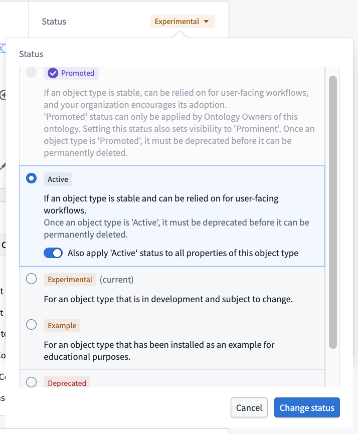
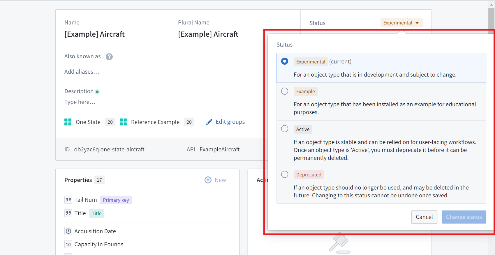
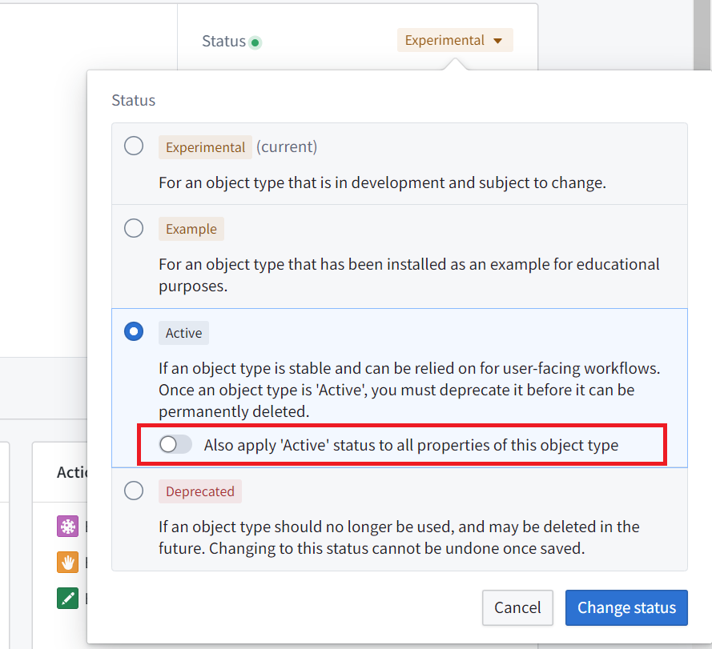
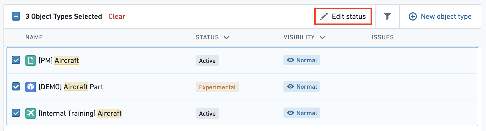

:::callout{theme="warning"}
注意：以下翻译的准确性尚未经过验证。这是使用 [AIP ↗](https://www.palantir.com/platforms/aip/) 从原始英文文本进行的机器翻译。
:::

# 状态

Ontology中的每个Object类型、属性、链接类型、操作或接口都有一个**状态**，指示其开发状态。一个本体资源的状态可以是活跃、实验性、已弃用或示例。状态元数据帮助Ontology编辑用户了解哪些资源被用户应用程序积极依赖。这些状态可在[**Object Explorer**](../../../%E5%BA%94%E7%94%A8/%E5%AF%B9%E8%B1%A1%E6%B5%8F%E8%A7%88%E5%99%A8/%E6%A6%82%E8%BF%B0.md)、[**Object Views**](../../../%E5%BA%94%E7%94%A8/%E5%AF%B9%E8%B1%A1%E8%A7%86%E5%9B%BE/%E6%A6%82%E8%A7%88.md)和[**Workshop**](https://www.palantir.com/docs/foundry/workshop/overview/)中查看，以提供关于哪些Object类型是用于用户应用程序的更多信息。

状态可以取以下四个值之一：

* **活跃：** 表示资源正在用户应用程序中积极使用，并且不会在Ontology Manager中进行重大破坏性更改。
* **实验性：** 表示资源仍在开发中。可能会进行更改，使实验性项目在用户应用程序中不可用。
* **已弃用：** 表示资源即将被删除。不应在用户应用程序中依赖已弃用的项目。
  * 一个已弃用的资源也包含以下元数据：
    * 关于其为何被弃用的描述；
    * 预计将其从系统中删除的截止日期；以及
    * 旨在替换被弃用资源的资源。
* **示例：** 表示资源已作为示例安装。示例资源是概念性的，仅适用于培训或早期阶段的探索性使用。示例*不*用于生产工作流。

## 不允许的操作

鉴于应用程序依赖于本体资源，当资源的状态为`活跃`时，有几种潜在的破坏性操作是不允许的：

* 不能被删除。资源的状态必须为`实验性`或`已弃用`，才能被删除。
* `活跃`Object类型的主键不能更改。仅标记为`实验性`的Object类型可以更改主键。
* 活跃资源的API名称不能更改。仅标记为`实验性`的资源可以更改API名称。

状态为`已弃用`的资源不能通过状态选择器再次设为`实验性`、`活跃`或`示例`。相反，您需要[使用编辑历史对话框将Ontology资源恢复到具有所需状态的版本](../../../%E5%BA%94%E7%94%A8/%E6%9C%AC%E4%BD%93%E7%AE%A1%E7%90%86%E5%99%A8/Change%20management/%E5%AE%A1%E6%9F%A5%E5%92%8C%E6%81%A2%E5%A4%8D%E6%9B%B4%E6%94%B9.md#review-changes-made-to-a-single-ontology-resource)。

## 编辑状态

默认情况下，任何新的本体资源将被赋予`实验性`状态。要更改状态：

1. 选择当前状态旁边的下拉菜单。
2. 选择新状态。

当将资源更改为`已弃用`状态时，您将被提示：

* 填写关于为何被弃用的描述，
* 输入预计将其从系统中删除的截止日期，以及
* 非必填地，选择一个旨在替换您要弃用的资源的资源。

这些状态可在Object Explorer、Object Views和Workshop中查看，以提供关于哪些Object类型是用于用户应用程序的更多信息。

Ontology Manager确保Object类型及其相关属性或链接类型之间的状态一致性。例如，如果一个Object类型从`活跃`更改为`实验性`，其所有属性也将被标记为`实验性`。

下表指示了不同状态的Object类型之间的链接类型可用状态。总体而言：

* 如果链接类型中的至少一个Object类型更改为`实验性`，则链接类型将自动更改为`实验性`。
* 如果链接类型中的至少一个Object类型更改为`示例`，则链接类型将自动更改为`示例`。
* 如果链接类型中的至少一个Object类型更改为`已弃用`，则链接类型将自动更改为`已弃用`。

|*如果Object类型A是…* |而Object类型B是…  |
|---    |---    |
| |实验性 |活跃 |已弃用 |
|*实验性* |仅限实验性  |仅限实验性  |仅限已弃用    |
|*活跃*   |仅限实验性  |可以是实验性、活跃或已弃用 |仅限已弃用    |
|*已弃用*   |仅限已弃用    |仅限已弃用    |仅限已弃用    |

链接类型的外键也有相同的要求。当更改属性时，应用程序会更改链接类型的状态：

* 如果外键属性更改为`实验性`，其链接类型将更改为`实验性`。
* 如果外键属性更改为`示例`，其链接类型将更改为`示例`。
* 如果外键属性更改为`已弃用`，其链接类型将更改为`已弃用`。

应用程序更改状态以防止无效状态。如果外键属性为`实验性`且仍在开发中，其链接类型不应标记为`活跃`并在生产中依赖。相反，当将属性标记为`活跃`时，应用程序不会将引用该属性作为外键的链接类型更改为`活跃`，因为外键属性在生产中是有效的，而链接类型及其支持数据源仍在开发中。

## 批量编辑状态

### 属性

当将Object类型从`实验性`更改为`活跃`时，可以选择将`活跃`状态也应用于Object类型的所有属性：

当您将Object类型更改为`示例`时，其所有属性将自动变为`示例`。

Object类型属性的状态也可以在Object类型的**属性**页面中批量编辑。[阅读更多关于批量编辑属性的信息。](../Properties/%E7%BC%96%E8%BE%91Object%E7%B1%BB%E5%9E%8B%E5%B1%9E%E6%80%A7.md#bulk-edit-multiple-properties)

### Object类型

Object类型的状态也可以从主页Object视图页面批量编辑，方法是选择要编辑的Object类型的复选框，并在表格右上方选择**编辑状态**按钮。

## 故障排除

### 属性状态与链接类型状态之间的冲突

如果您收到错误`OntologyMetadata:ConflictBetweenLinkTypeStatusAndPropertyTypeStatus`，则表示链接类型状态与属性状态之间存在冲突。例如，如果外键是`已弃用`，则引用该外键的链接类型也应该是`已弃用`。

### Object类型状态与链接类型状态之间的冲突

如果您收到错误`OntologyMetadata:ConflictBetweenLinkTypeStatusAndObjectTypeStatus`，则表示链接类型状态与其相关联的某个Object类型的状态之间存在冲突。这可能发生在根据上述表格的无效Object类型-链接类型情况下。例如，`实验性`Object类型不能有`活跃`链接类型。
