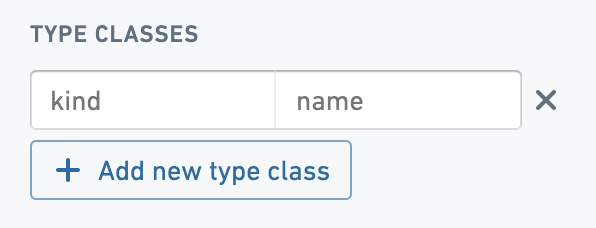

:::callout{theme="warning"}
注意：以下翻译的准确性尚未经过验证。这是使用 [AIP ↗](https://www.palantir.com/platforms/aip/) 从原始英文文本进行的机器翻译。
:::

# 类型类

类型类可应用于属性、链接类型和操作类型。它们定义了可由与Ontology交互的用户应用程序解释的附加元数据。例如，某些`hubble`属性类型类的规范会影响属性值在[Object视图](../../../%E5%BA%94%E7%94%A8/%E5%AF%B9%E8%B1%A1%E8%A7%86%E5%9B%BE/%E6%A6%82%E8%A7%88.md)中的呈现方式。其他类型类的规范，如`analyzer`，会影响属性值在[Object存储V1 (Phonograph)](../../../%E6%9C%AC%E4%BD%93%E6%9E%B6%E6%9E%84/%E5%AF%B9%E8%B1%A1%E6%95%B0%E6%8D%AE%E5%BA%93/%5B%E9%81%97%E7%95%99%5D%20Object%20Storage%20v1%20%28Phonograph%29.md)中被索引时的处理方式。

下表提供了已知类型类的列表。此表中的列如下：

* **已弃用**列指示类型类是否仍受支持。
  * **已弃用**列还指示是否应在**功能**页面中配置类型类。
    * 在Ontology管理器中，对象类型现在有一个**功能**页面，用于配置历史上定义为类型类的特性。所有受支持的类型类的配置将移至**功能**页面。
* **类型**列指示类型类是应用于属性、链接类型（以前称为关系）还是操作类型。
* **种类**和**名称**列包含在Ontology管理器中添加类型类时设置的两个用户定义字段的字符串值。这些值被Foundry产品用于标记类型类。

* **描述**列描述了用户应用程序在与添加了列出的类型类的属性值、链接或操作交互时的预期行为。
  * [Object Explorer](../../../%E5%BA%94%E7%94%A8/%E5%AF%B9%E8%B1%A1%E8%A7%86%E5%9B%BE/%E6%A6%82%E8%A7%88.md)是一个使用`hubble`类型类的应用程序。
  * [Object存储V1 (Phonograph)](../../../%E6%9C%AC%E4%BD%93%E6%9E%B6%E6%9E%84/%E5%AF%B9%E8%B1%A1%E6%95%B0%E6%8D%AE%E5%BA%93/%5B%E9%81%97%E7%95%99%5D%20Object%20Storage%20v1%20%28Phonograph%29.md)是一个使用`analyzer`类型类的服务。
  * [Quiver](https://www.palantir.com/docs/foundry/quiver/overview/)是一个使用`timeseries`类型类的应用程序。

|已弃用        |类型	|种类	|名称	| 描述	                                                                                                                                                                                                                                                                                                                                                                                                                                                                                                                                                                                                                                                                                                                                                                                                        |
|---	|---	|---	|---	|--- |
|	|属性	|hubble	|media\_url	| 当属性出现在Object视图中时，将其呈现为媒体项目。 |
|已弃用	|属性	|hubble	|editable	| 允许用户在Object视图中编辑属性。请改用[行内编辑](../../%E5%8A%A8%E4%BD%9C%E7%B1%BB%E5%9E%8B/%E8%A1%8C%E5%86%85%E7%BC%96%E8%BE%91.md#object-explorer-inline-edits)。 |
|	|属性	|hubble	|icon	| 指示存储为属性值的URL包含Object的图标。 |
|已弃用	|关系	|hubble	|creatable	| 允许用户从Object视图内的Linked Objects视图微件中创建特定链接类型的新Object。类型类放置在关系上，允许用户在一对多关系的“多”侧创建对象。有关支持用户创建新链接的方式，请参阅[操作](../../%E5%8A%A8%E4%BD%9C%E7%B1%BB%E5%9E%8B/%E6%A6%82%E8%BF%B0.md)。 |
|已弃用	|属性	|hubble	|endorsement\_status: endorsed	| 在Object Explorer和Object视图中，将Object标记为`endorsed`，当添加到对象类型的主键属性时。 |
|已弃用	|属性	|hubble	|endorsement\_status: not\_endorsed	| 在Object Explorer和Object视图中，将Object标记为`工作进展中`，当添加到对象类型的主键属性时。 |
|已弃用	|属性	|hubble	|thumbnail	| 使用存储为属性值的URL作为搜索结果卡片中的缩略图。  这仅在之前的Object Explorer版本中相关。 |
|已弃用	|属性	|hubble	|array	| 此类型类以前用于确保属性格式化为数组，但数组现在在Ontology管理器中被正确支持为属性基本类型。 |
|已弃用	|属性	|hubble	|default\_sort\_descending	| 会自动在Object Explorer中按降序排序列。  这仅在之前的Object Explorer版本中相关。 |
|已弃用	|属性	|hubble	|quick\_filter	| 在Object Explorer列表视图中，这些属性可用作默认筛选。  这仅在之前的Object Explorer版本中相关。 |
|	|关系	|hierarchy	|parent	| 表示在链接类型中，链接方向代表层次结构中的父级。Object视图将在层次结构的Object视图顶部显示面包屑（例如，'Europe -> France -> Paris -> Rue Cler'）。 |
|	|属性	|choropleth\_map\_ config\_id	|\<map\_config\_id>	| 可以为包含地理区域值（即国家代码）的任何属性类型创建等值线图，这些值可以在地图上绘制。所需的类型类`kind`是`choropleth_map_config_id`，而`name`取决于属性包含的区域代码类型。  例如： - 对于国家，使用`countries` - 美国州 → `us_states` - 美国县 → `us_counties` - 美国邮政编码 → `us_zip_codes`  有关其他区域边界选项或添加此类型类的其他帮助，请联系您的Palantir代表。  配置选项包括更改聚合类型以及使用的颜色比例。  要使用此类型类，必须将`selectable`或`sortable`渲染提示应用于属性。 |
|已弃用		|属性	|oe\_home\_page\_  object\_type\_group	|\<your\_object\_type\_   group\_name>	| 将此类型类添加到对象类型的主键属性中，以将所述对象类型添加到一个组中。  确保拼写正确以避免组重复。这些配置的对象类型组显示在Object Explorer的主页上。  如果您配置了组，任何未添加到组的非隐藏对象类型将被放置在页面底部的“其他”组下。这已被对象类型组功能所取代。 |
|	|操作类型	|hubble-oe	|hide-action	| 隐藏Object Explorer和Object视图中的操作类型；否则它们会自动在`操作`按钮下拉菜单中被发现。 |
|   |操作类型    |hubble-oe-object-set-rid    | \<object\_type\_RID>   | 实验性功能，允许创建动态对象集。 |
|   |操作类型    |hubble-oe-security-rid      | \<compass\_RID>   | 实验性功能，允许创建动态对象集。 |
|	|操作类型	|actions	|generate\_uuid	| 用UUID替换字符串参数。 |
|	|操作类型	|actions	|prefill\_current\_user	| 用当前用户替换字符串参数。 |
|	|操作类型	|actions	|view\_object\_with\_type	| 在成功提示中显示创建/修改的Object。 |
|	|属性	|analyzer	|not\_analyzed	| 阻止Phonograph/Elasticsearch对属性进行词元化；用于包含破折号等标识符属性。  类型类中支持的几个[ES内置分析器 ↗](https://www.elastic.co/guide/en/elasticsearch/reference/current/analysis-analyzers.html)，包括： -`simple` -`standard` -`whitespace` -`french` -`japanese` -`arabic` -`combined_arabic_english` |
|已弃用	|属性	|analyzer	|not\_indexed	| 阻止Phonograph/Elasticsearch对属性进行索引；用于不需要可搜索或可聚合的属性。  此类型类不再用于管理属性是否应被索引，因为这种功能现在由`searchable` [渲染提示](%E6%B8%B2%E6%9F%93%E6%8F%90%E7%A4%BA.md)管理。 |
|已弃用	|属性	|multipass	|user\_id	| 当应用于包含Multipass UID的属性时，属性将在Object Explorer和Object视图中呈现为用户的用户名（由multipass:given-name和multipass:family-name属性组成）。  此类型类不再用于确保属性格式化为用户名，Multipass UID现在在Ontology管理器中的值格式化功能中支持。 |
|已弃用	|属性	|global	|\<your\_property\_id>	| 可以被用于在将属性标记为全局。这允许通过一个公共属性筛选多个对象类型，只要这些属性在每个应通过此属性筛选的对象类型上具有相同的property\_id和全局类型类。  这仅在之前的Object Explorer版本中相关。	|
|已弃用	|属性	|geo	|geojson	| 表示属性包含GeoJSON数据（例如，多边形、线条等）。[Map应用程序](../../../%E5%BA%94%E7%94%A8/%E5%9C%B0%E5%9B%BE/%E6%A6%82%E8%A7%88.md)将在地图上呈现此GeoJSON。已弃用：请改用`geoshape`属性类型。	|
|已弃用	|属性	|geo	|latitude	| 表示属性包含在[Map应用程序](../../../%E5%BA%94%E7%94%A8/%E5%9C%B0%E5%9B%BE/%E6%A6%82%E8%A7%88.md)中使用的纬度。已弃用：请改用`geohash`属性类型。 |
|已弃用	|属性	|geo	|longitude	| 表示属性包含在[Map应用程序](../../../%E5%BA%94%E7%94%A8/%E5%9C%B0%E5%9B%BE/%E6%A6%82%E8%A7%88.md)中使用的经度。已弃用：请改用`geohash`属性类型。 |
|在对象类型的 **功能**页面中配置	|属性	|geo	|altitude	| 表示属性包含在[Map应用程序](../../../%E5%BA%94%E7%94%A8/%E5%9C%B0%E5%9B%BE/%E6%A6%82%E8%A7%88.md)中3D模式下使用的海拔/高度（以相对于海平面的米为单位）。 |
|    |属性   |vertex   |link\_merge    | 对于Vertex & Vortex相关对象搜索周围，总是将此对象视为中介——此对象将不再出现在相关对象列表中，但其第二度链接将会出现，并在图表上呈现为一条边。在对象的主键上放置类型类。    |
|    |关系   |vertex   |link\_merge\_incoming    | 与`link_merge`相同，但仅针对此特定关系——链接合并对象是此关系的目标/至侧。    |
|    |关系   |vertex   |link\_merge\_outgoing    | 与`link_merge`相同，但仅针对此特定关系——链接合并对象是此关系的源/从侧。    |
|    |关系   |vertex   |component    | 对于Vertex图表，指示链接到基对象的对象将在图表中使用。    |
|    |属性   |vertex   |component\_subtype    | 对于Vertex，允许比对象类型更细粒度的分组。在对象的主键上放置类型类。    |
|    |属性   |vertex   |event\_intent.\<intent\_>    | 将此设置在事件的主键属性上，以在Vertex & Vortex中使用，其中`intent`表示事件/警报的颜色/严重性（危险、警告、主要或成功）。例如：`event_intent.danger`    |
|    |属性   |vertex   |event\_value    | 表示事件的数值的属性。    |
|    |属性   |vertex   |event\_value\_unit.\<unit\_>    | 与`event_value`一起设置，其中`unit`是事件数值的度量单位。例如：`event_value_unit.Kilograms`    |
|    |属性   |vertex   |event\_property    | 在Vertex & Vortex事件卡片中显示此属性。    |
|    |属性   |vertex   |min    | 对于时间序列对象：当系列值低于此最小值时，Vertex将发出警报。 |
|    |属性   |vertex   |max    | 对于时间序列对象：当系列值超过此最大值时，Vertex将发出警报。    |
|    |属性   |vertex   |threshold\_measure.\<measure\_>    | 对于Vertex，将此设置在对象的主键属性上以指示用于阈值的度量。例如：`threshold_measure.Temperature`    |
|    |属性   |vertex   |threshold\_high\_limit    | 与`threshold_measure`一起使用以指示哪个属性代表上阈值界限。 |
|    |属性   |vertex   |threshold\_low\_limit    | 与`threshold_measure`一起使用以指示哪个属性代表下阈值界限。 |
|    |属性   |vertex   |threshold\_exceed\_intent.\<intent\_>    | 在对象的主键属性上与`threshold_measure`一起设置，其中`intent`表示阈值突破的颜色/严重性（危险、警告、主要或成功）。例如：`threshold_exceed_intent.danger`    |
|    |属性   |vertex   |key\_measure.\<measure\_>    | 列在这里的度量将在Vertex主页上显示。例如：`key_measure.Temperature`    |
|已弃用    |属性   |vertex   |enum\_values    | 对于时间序列对象：从数值到字符串值的JSON映射。类型类不再受支持。    |
|在对象类型的 **功能**页面中配置	|属性	|timeseries	|timeseries\_id	| 当应用于时间序列对象的主键时，此类型类指定该对象的*系列标识符* (`seriesId`)。该属性在所有时间序列对象中必须是全局唯一的，并且是您的对象在Quiver中可发现的唯一必需类型类。 |
|在对象类型的 **功能**页面中配置	|属性	|timeseries	|timeseries\_measure	| 指定时间序列对象[度量](https://www.palantir.com/docs/foundry/quiver/timeseries-overview/#create-time-series-in-quiver)的属性。  注意：类型类`timeseries.timeseries_sensor_type`以前用于相同目的；这将继续有效，但使用`timeseries.timeseries_measure`以保持一致性。 |
|已弃用	|属性	|timeseries	|timeseries\_sensor\_type	| 请参阅上面的`timeseries_measure`。 |
|在对象类型的 **功能**页面中配置	|属性	|timeseries	|timeseries\_units	| 指定时间序列对象*值*单位的属性（例如，股票价格时间序列可能将`美元`作为值单位）。 |
|在对象类型的 **功能**页面中配置	|属性	|timeseries	|timeseries\_internal\_interpolation	| 指定时间序列对象默认*内部插值*的属性。内部插值是Quiver在相邻数据点之间推断系列值的方式。 |
|在对象类型的 **功能**页面中配置	|属性	|timeseries	|timeseries\_root\_object\_id	| 指定时间序列对象[根对象](https://www.palantir.com/docs/foundry/quiver/timeseries-overview/#create-time-series-in-quiver)的属性。每个时间序列对象只能有一个根对象。 |
|在对象类型的 **功能**页面中配置	|属性	|timeseries	|timeseries\_is\_enum	| 任何具有枚举值的时间序列必须设置为`true`的布尔属性。  注意：此要求是临时的，可能会在未来更改。 |
|在对象类型的 **功能**页面中配置	|属性	|timeseries	|timeseries\_is\_deprecated	| 当设置为`true`时，布尔属性将从Object Explorer和Object视图搜索结果中过滤出时间序列。  注意：这只会在Quiver中后筛选出这些时间序列。这不会影响其他应用程序的搜索结果。 |
|	|关系	|timeseries	|parent	| 描述时间序列对象与每个父级之间的链接，类似于`hierarchy.parent`。 |
|   |属性   |timeseries |timeseries\_is\_value\_inverted | 当设置为true时，此布尔属性将自动反转Quiver中时间序列的y轴值，使得值向下上升。这对于绘制时间与深度序列非常有用，例如在跟踪地下钻探操作的进展时。   |
|   |属性   |timeseries |timeseries\_depth\_units  | 放置在包含复杂序列（深度序列、完井序列和光纤序列）深度单位的属性上。常规的`timeseries.timeseries_units`属性用于深度序列和完井序列的值单位。   |
|在对象类型的 **功能**页面中配置	|属性	|timeseries	|event\_id	| 指定事件对象*事件标识符*（`eventId`）的属性。应在所有事件对象中全局唯一。 |
|在对象类型的 **功能**页面中配置	|属性	|timeseries	|event\_start\_time	| 指定事件对象起始时间的属性。该字段应为时间值（例如`TIMESTAMP）`。 |
|在对象类型的 **功能**页面中配置	|属性	|timeseries	|event\_end\_time	| 指定事件对象结束时间的属性。该字段应为时间值（例如`TIMESTAMP）`。 |
|在对象类型的 **功能**页面中配置	|属性	|timeseries	|event\_description	| 指定事件对象字符串描述的属性。如果事件对象类型将被用于[注释数据输出](https://www.palantir.com/docs/foundry/quiver/timeseries-overview/#traditional-time-series-ontology)，这是必需的。 |
|在对象类型的 **功能**页面中配置	|属性	|timeseries	|event\_root\_object\_id	| 指定事件对象[根对象](https://www.palantir.com/docs/foundry/quiver/timeseries-overview/#create-time-series-in-quiver)的属性。每个事件对象只能有一个根对象。 |
|在对象类型的 **功能**页面中配置	|属性	|timeseries	|event\_linked\_series\_id	| 指定事件对象关联的[系列对象](https://www.palantir.com/docs/foundry/quiver/timeseries-overview/#create-time-series-in-quiver)的属性。支持字符串数组和单个字符串。 |
