:::callout{theme="warning"}
注意：以下翻译的准确性尚未经过验证。这是使用 [AIP ↗](https://www.palantir.com/platforms/aip/) 从原始英文文本进行的机器翻译。
:::

# 创建 Object 类型

创建和配置新 Object 类型的主要方法是使用[**分步指导助手**](#create-a-new-object-type-with-the-helper)。推荐使用指导助手的方法，但如果您在完成 Object 创建过程之前退出助手，您也可以通过指定新 Object 类型的元数据、支持数据源、属性映射和键（主键和标题键），以[**手动**](#create-a-new-object-type-manually)完成该过程。

创建新 Object 类型后，您可以从指派的默认值中[更改 API 名称](#configure-api-names)。

此页面还包含有关新 Object 类型创建过程的[故障排除](#troubleshooting)信息。

## 使用助手创建新 Object 类型

* [创建新 Object 类型并添加支持数据源](#create-a-new-object-type-and-add-a-backing-datasource)
* [选择支持数据源](#choose-a-backing-datasource)
* [Object 类型元数据](#object-type-metadata)
* [为 Object 类型创建属性](#create-properties-for-the-object-type)
* [配置主键和标题键](#configure-the-primary-key-and-title-key)
* [生成操作](#generating-actions)
* [完成新 Object 类型](#finalize-the-new-object-type)

### 创建新 Object 类型并添加支持数据源

要创建新 Object 类型，请从主页标题中选择**新建 Object 类型**按钮。

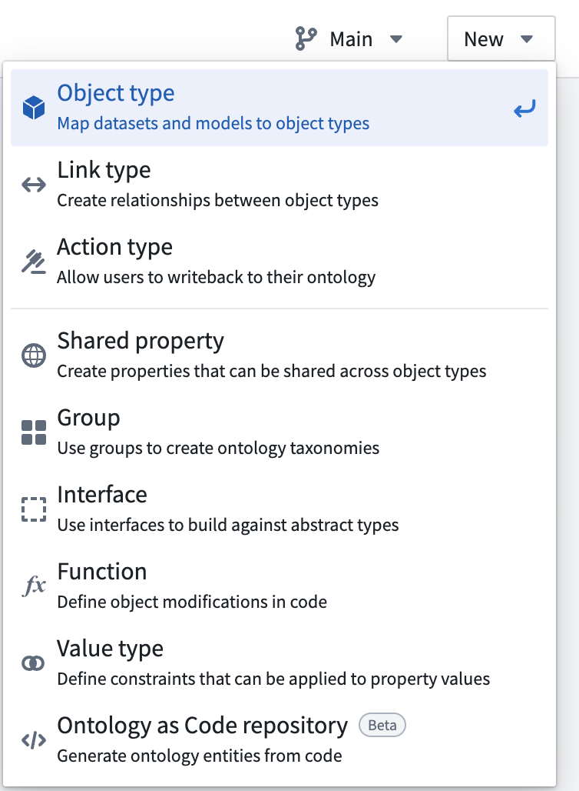

选择**新建 Object 类型**后，将出现**创建新 Object 类型**助手。

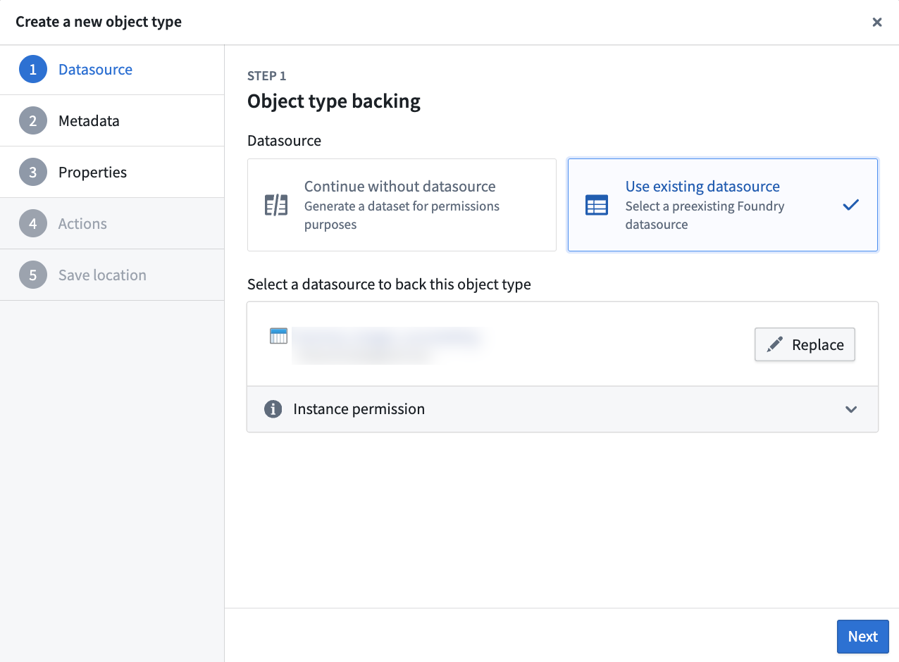

### 选择支持数据源

如果您在 Foundry 中已有包含用于支持 Object 类型的数据的数据源，则可以选择它。这将自动填充 Object 类型的元数据。它还会将支持数据源的每一列映射到一个属性，但您可以在**属性**步骤中丢弃添加的属性。

:::callout{theme="warning" title="警告"}
Object 类型的支持数据源可能不包含 `MapType` 或 `StructType` 列。
:::

如果您没有包含 Object 类型数据的现有数据源，您可以选择在没有现有数据源的情况下继续。如果您使用的是 Object Storage v1，则此选项不可用。由于 Object 的权限由其支持数据源的位置决定，您将被提示选择一个位置来保存一个空数据集。

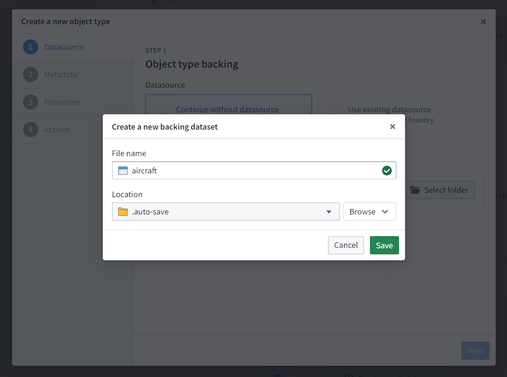

### Object 类型元数据

在下一步中，您将被提示提供有关新 Object 类型的以下信息：

* **显示名称：** 在用户应用程序中访问此类型的 Object 时显示的名称。
* **复数显示名称：** 在用户应用程序中访问多个此类型的 Object 时显示的名称。
* **描述：** 在用户应用程序中访问此类型的 Object 时的说明文字。例如，在 Object Explorer 中搜索的用户将在其搜索结果中查看 Object 类型的描述。
* **图标：** 选择默认图标以自定义 Object 类型的图标和颜色；当用户在用户应用程序中查看此类型的 Object 时，将显示此图标和颜色。
* **组：** 选择此 Object 类型是否会成为任何组的一部分。这是一种组织您的 Ontology 的机制，使您更容易筛选您以后想要处理的 Object 类型。

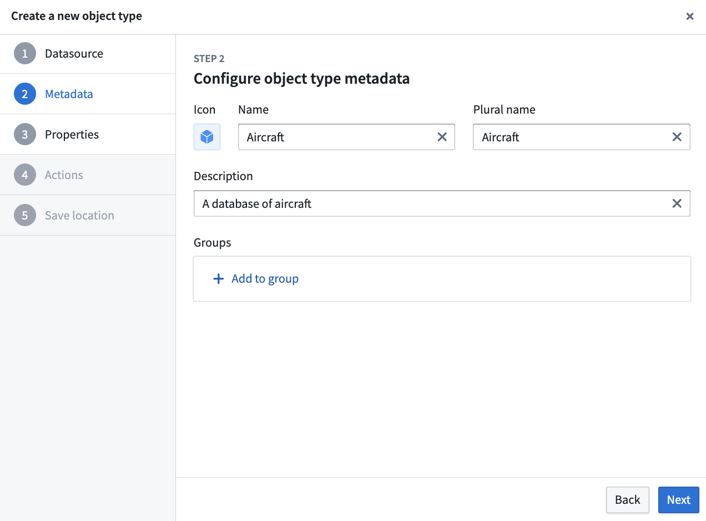

### 为 Object 类型创建属性

在对话框的第三步中，您可以自定义 Object 类型将具有的属性。如果您选择了现有的 Foundry 数据源，任何列将被自动映射，但可以在此步骤中丢弃。

每个 Object 类型至少需要一个属性。这是因为 Object 类型需要一个主键来唯一标识它们。向导允许您添加任何其他所需的属性。

请注意，需要高级配置的属性类型（例如媒体）不能作为启动向导的一部分生成，必须在您退出后添加。

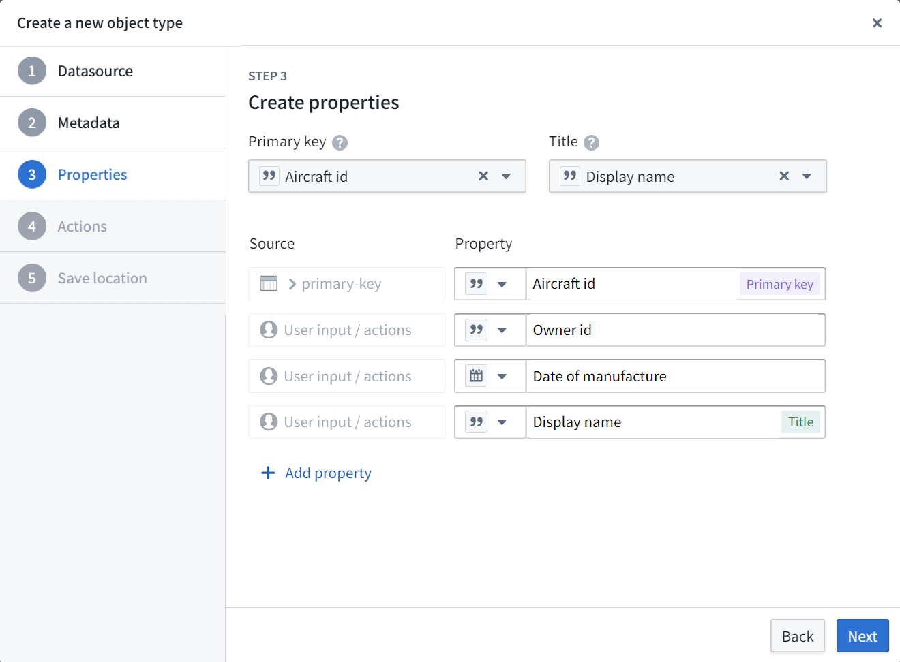

***

### 配置主键和标题键

作为**属性**步骤的一部分，您需要选择一个主键和标题键：

* **标题键：** 作为此类型 Object 的显示名称的属性。
  * 例如，选择 `full name` 属性作为 `Employee` Object 类型的标题键将使用该属性的值，如“Melissa Chang”、“Akriti Patel”或“Diego Rodriguez”作为每个相应虚构 `Employee` Object 的显示名称。
* **主键：** 作为每个 Object 类型实例的唯一标识符的属性。支持数据源中的每一行必须具有此属性的不同值。
  * 例如，将使用 `employee ID` 属性的值来标识“Melissa Chang”作为组织内的唯一员工。

支持的属性类型列表可以在[Object 类型属性文档](../Properties/%E6%A6%82%E8%A7%88.md#supported-property-types)中找到。

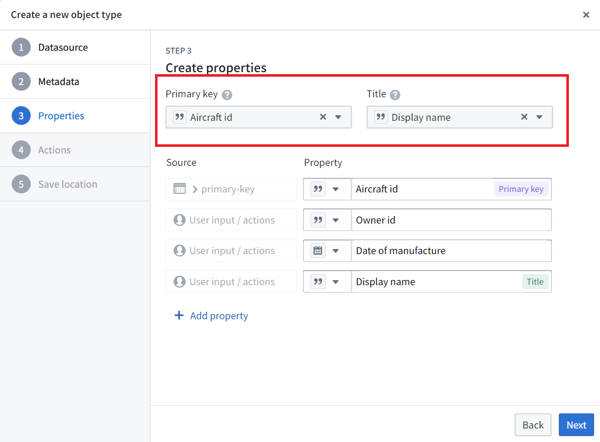

:::callout{theme="warning"}
请确保在指派主键之前检查您的支持数据集中的重复项。您选择的主键必须对数据集中的每条记录唯一。如果您的 Ontology 使用 [Object Storage v2](../../../%E6%9C%AC%E4%BD%93%E6%9E%B6%E6%9E%84/%E5%AF%B9%E8%B1%A1%E5%90%8E%E7%AB%AF/%E6%A6%82%E8%BF%B0.md)，重复的主键将导致[Funnel 批处理管道](../../../%E6%9C%AC%E4%BD%93%E6%9E%B6%E6%9E%84/%E5%AF%B9%E8%B1%A1%E7%B4%A2%E5%BC%95/Funnel%E6%89%B9%E5%A4%84%E7%90%86%E7%AE%A1%E9%81%93.md)错误，从而导致搭建失败。如果您使用的是 Object Storage v1（也称为 Phonograph），更新将显示为成功；然而，重复的主键可能会导致对您的 Ontology 的意外更改。
:::

:::callout{theme="warning"}
主键应具有确定性。如果主键是非确定性的并在搭建时更改，编辑可能会丢失且链接可能会消失。编辑可能会丢失，因为 Ontology 编辑与 Object 的主键相关联。如果搭建不协调更新链接 ID，Object 之间的链接可能会消失。为了确保确定性主键，您应定义管道逻辑，使主键是单列或多列的函数。避免使用编号行或随机键生成，因为这些可能会导致主键在搭建运行之间更改。
:::

### 生成操作

如果您使用的是 Object Storage v1，则此步骤不可用。在第四个也是最后一步中，您可以选择性地生成一组标准操作来编辑此类型的 Object，并指派可以运行这些操作的特定用户或组。

一旦您完成了 Object 类型并退出向导，您仍然可以对这些操作进行编辑或创建新的附加操作。

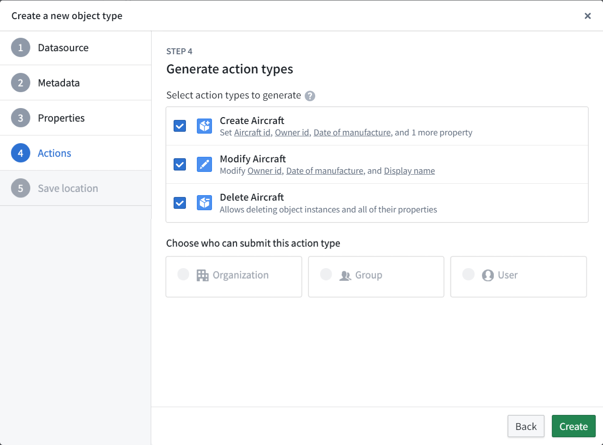

### 完成新 Object 类型

当您完成填写这些字段后，选择**创建**。选择**创建**只会暂存您的更改，并**不会保存**它们。要将新 Object 类型保存到 Ontology，请按照[如何保存到 Ontology 的更改](../../../%E5%BA%94%E7%94%A8/%E6%9C%AC%E4%BD%93%E7%AE%A1%E7%90%86%E5%99%A8/Change%20management/%E4%BF%9D%E5%AD%98%E5%AF%B9Ontology%E7%9A%84%E6%9B%B4%E6%94%B9.md)中的说明进行操作。

## 手动创建新 Object 类型

使用助手创建新 Object 类型时，可以在完成上述[**创建新 Object 类型**助手说明](#create-a-new-object-type-with-the-helper)中的所有步骤之前选择**创建**。在过程完成之前选择**创建**将退出助手并将您带到**概览**页面。

此时，Object 类型未保存，直到完成以下所有步骤才能保存。手动完成创建过程的步骤（在**创建新 Object 类型**助手之外）如下所述：

* [为新 Object 类型添加元数据](#add-metadata-for-a-new-object-type)
* [为新 Object 类型添加支持数据源](#add-a-backing-datasource-to-a-new-object-type)
* [添加新属性](#add-a-new-property)
* [将单个属性映射到数据](#map-a-single-property-to-data)
* [将所有未映射的列映射为新属性](#map-all-unmapped-columns-as-new-properties)
* [配置主键和标题键](#configure-the-primary-key-and-title-key)

### 为新 Object 类型添加元数据

在**概览**页面的元数据部分，您可以编辑 Object 类型的显示名称、复数显示名称、描述和 ID：

1. **显示名称：** 在用户应用程序中访问此类型的 Object 时显示的名称。
2. **复数显示名称：** 在用户应用程序中访问多个此类型的 Object 时显示的名称。
3. **别名：** 用户搜索时找到此 Object 类型的其他术语。
4. **描述：** 在用户应用程序中访问此类型的 Object 时的说明文字。例如，在 Object Explorer 中搜索的用户将在其搜索结果中查看 Object 类型的描述。
5. **组：** 一个或多个有助于分类 Object 类型的标签。
6. **ID：** Object 类型的唯一标识符，主要用于在配置用户应用程序时引用此类型的 Object。
   * ID 可以包含小写字母、数字和破折号。
   * ID 的第一个字符**必须**是小写字母。
   * 一旦属性的 ID 被保存并在用户应用程序中被引用，对属性 ID 的**任何**更改都将破坏应用程序。
7. **图标：** 从 Object 类型视图的侧边栏选择默认图标以自定义 Object 类型的图标和颜色；当用户在用户应用程序中查看此类型的 Object 时，将显示此图标和颜色。
8. **支持数据源：** 用作此类型 Object 的属性值的数据来源。

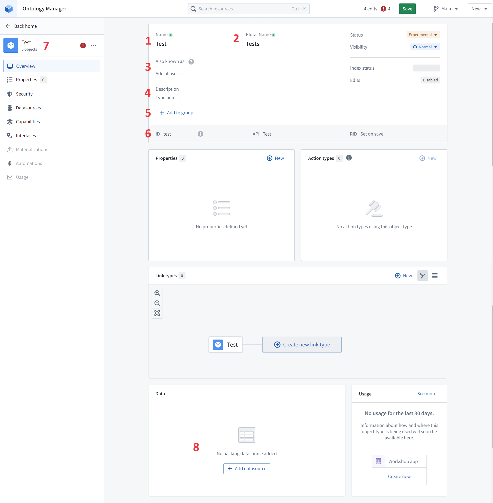

***

### 为 Object 类型添加组

[组](../Object%20%E7%B1%BB%E5%9E%8B%E7%BB%84.md)是帮助分类 Object 类型的标签。在 Object 类型元数据微件中，您可以：

* 从现有组列表中添加组。
* 通过键入该组的名称来创建新组。
* 从您的 Object 类型中移除组。

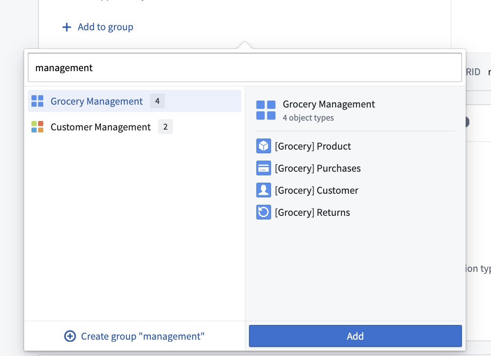

组在[Ontology 管理器的**搜索**栏和**搜索**栏对话框](../../../%E5%BA%94%E7%94%A8/%E6%9C%AC%E4%BD%93%E7%AE%A1%E7%90%86%E5%99%A8/%E5%AF%BC%E8%88%AA.md#header-search-bar)中可搜索。Ontology 管理器中的 Object 类型表支持按组显示和筛选。组也显示在[Object Explorer 主页](../../../%E5%BA%94%E7%94%A8/%E5%AF%B9%E8%B1%A1%E6%B5%8F%E8%A7%88%E5%99%A8/%E5%85%A5%E9%97%A8.md#group-exploration-b-c-d)上。

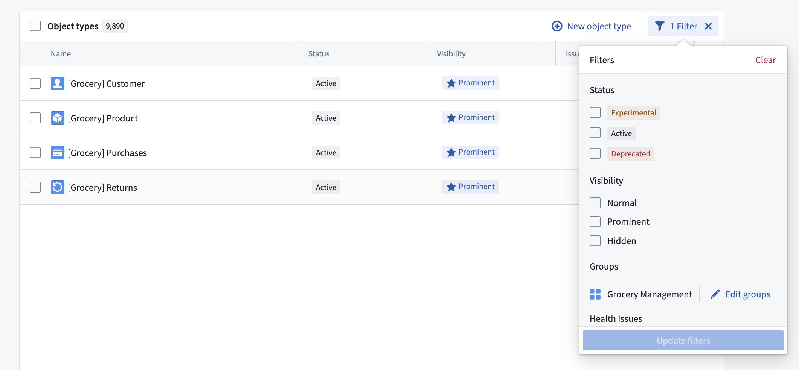

:::callout{theme="warning" title="警告"}
Object 类型元数据中的组作为标签取代了以前将 `oe_home_page_object_type_group` 类型类添加到主键属性的方法；这种以前的方法不再可用。
:::

***

### 为新 Object 类型添加支持数据源

为了用数据填充此类型 Object 的属性值，您必须添加一个支持数据源。您可以通过以下方式进行操作：

* 通过从**概览**页面的**属性**部分选择**新建**进入属性编辑器，或从 Object 类型视图侧边栏的**属性**页面选择**编辑属性映射**按钮。
* 然后，选择如下面图片所示的**添加支持数据源**按钮。这将允许您在 Foundry 中选择任何可用的数据源作为支持数据源。
  * 请注意，一个数据源只能用于支持一个 Object 类型。

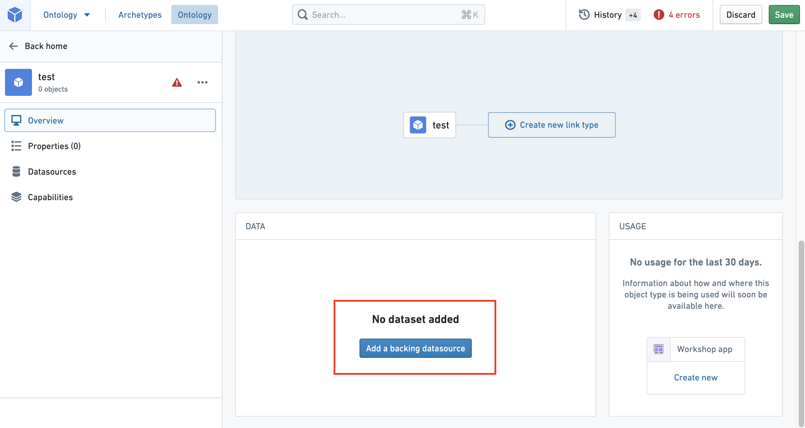

### 添加新属性

在属性编辑器中，选择屏幕右侧**属性**窗格中的**添加**。这将为 Object 类型添加一个新属性。

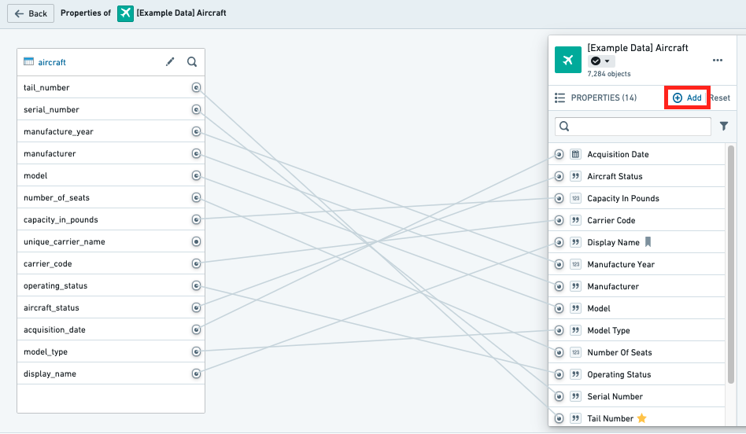

### 将单个属性映射到数据

可以通过以下任何方式将属性映射到支持数据源中的列：

* [将列映射为新属性](#map-a-column-to-a-new-property)
* [将列映射到现有属性](#map-a-column-to-an-existing-property)
* [将属性映射到列](#map-a-property-to-a-column)

#### 将列映射为新属性

在屏幕左侧的数据源窗格中（见下图），您可以看到数据源的所有列。将鼠标悬停在您要映射的列上，然后选择**添加为新属性**按钮，以创建映射到此列的新属性。属性 ID、显示名称和基础类型将从列名推断出来。

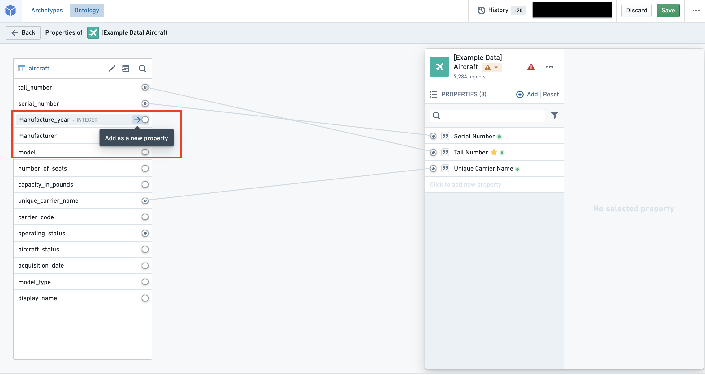

#### 将列映射到现有属性

在屏幕左侧的数据源窗格中，您可以看到数据源的所有列。将鼠标悬停在一个未映射的列上，然后选择**添加为新属性**按钮。如果已存在具有与列名匹配的属性 ID 的属性，则该列将映射到现有属性。

#### 将属性映射到列

在屏幕右侧的属性窗格中，将鼠标悬停在您要映射到列的属性上，然后选择**映射到列**。这将打开一个下拉菜单，您可以从中选择要映射到您属性的列。

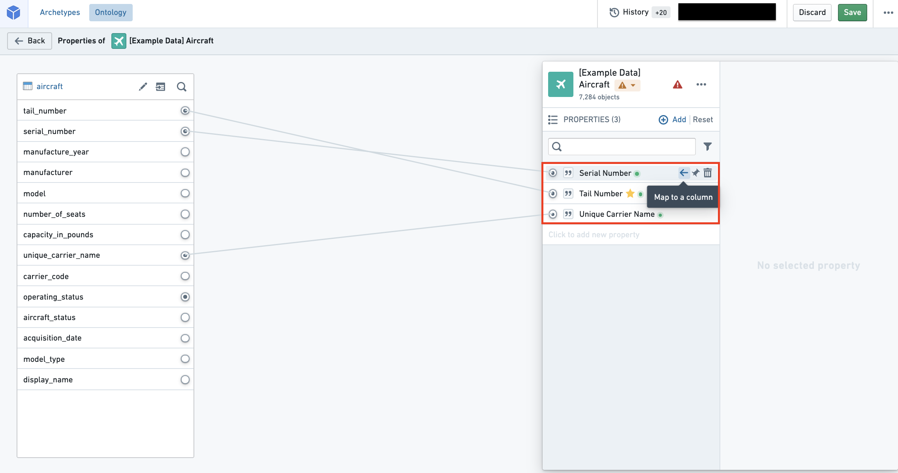

### 将所有未映射的列映射为新属性

在数据源窗格中的数据源名称旁边，您会找到一个**将所有未映射列添加为新属性**按钮。选择按钮将为数据源中所有未映射的列创建属性。属性的 ID、显示名称和基础类型将从数据源中的相应列推断出来。

* 一旦属性的 ID 被保存并在用户应用程序中被引用，对属性 ID 的**任何**更改都将破坏应用程序。

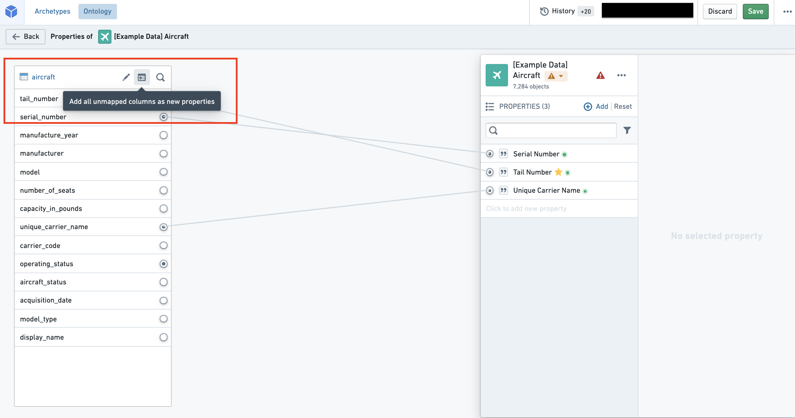

### 配置主键和标题键

现在，您已创建了新的 Object 类型，添加了一个支持数据源，并将其映射到新属性，但在能够保存 Object 类型之前，您仍然需要配置主键和标题键。您可以导航到属性编辑器中的属性元数据窗格（见下图），将某个属性设置为主键和标题键：

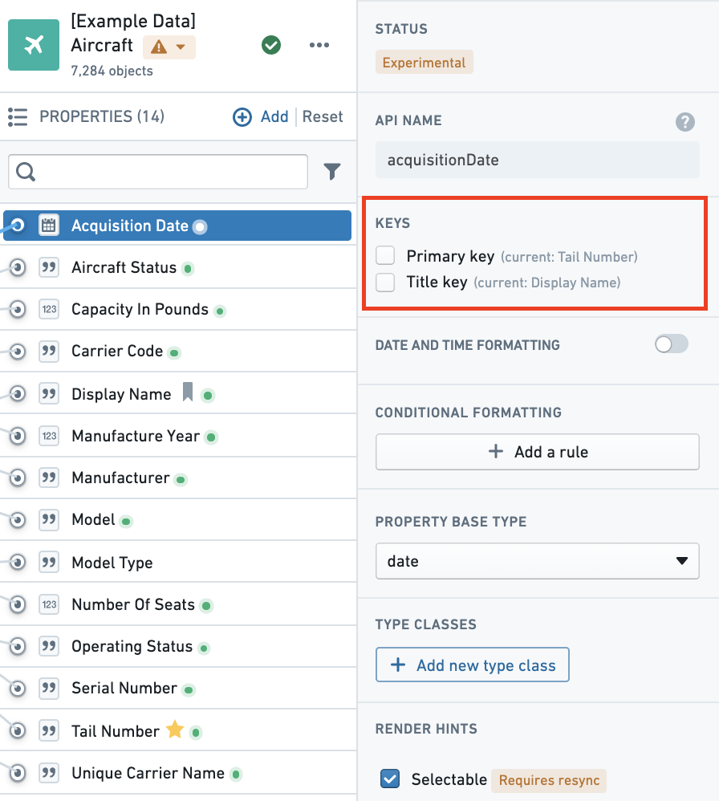

* **主键：** 作为每个 Object 类型实例的唯一标识符的属性。支持数据源中的每一行必须具有此属性的不同值。
  * 例如，将使用 `employee ID` 属性的值来标识“Melissa Chang“作为组织内的唯一（虚构）员工。
  * 要配置主键，请在属性编辑器的属性窗格中选择要指派为主键的属性，然后选中**主键**选项。
  * 编辑永久附加到您为其进行编辑的主键值。每当您更改 Object 类型的主键时，系统将提示您删除所有现有编辑。
* **标题键：** 作为此类型 Object 的显示名称的属性。
  * 例如，选择 `full name` 属性作为 `Employee` Object 类型的标题键将使用该属性的值，如“Melissa Chang”、“Akriti Patel”或“Diego Rodriguez”作为每个相应虚构 `Employee` Object 的显示名称。
  * 要配置标题键，请在属性编辑器的属性窗格中选择要指派为标题键的属性，然后选中**标题键**选项。
    请注意，直到此时，您的更改已暂存，但**尚未保存**。要将新 Object 类型保存到 Ontology，请按照[如何保存到 Ontology 的更改](../../../%E5%BA%94%E7%94%A8/%E6%9C%AC%E4%BD%93%E7%AE%A1%E7%90%86%E5%99%A8/Change%20management/%E4%BF%9D%E5%AD%98%E5%AF%B9Ontology%E7%9A%84%E6%9B%B4%E6%94%B9.md)中的说明进行操作。

:::callout{theme="warning"}
请确保在指派主键之前检查您的支持数据集中的重复项。您选择的主键必须对数据集中的每条记录唯一。如果您的 Ontology 使用 [Object Storage v2](../../../%E6%9C%AC%E4%BD%93%E6%9E%B6%E6%9E%84/%E5%AF%B9%E8%B1%A1%E5%90%8E%E7%AB%AF/%E6%A6%82%E8%BF%B0.md)，重复的主键将导致[Funnel 批处理管道](../../../%E6%9C%AC%E4%BD%93%E6%9E%B6%E6%9E%84/%E5%AF%B9%E8%B1%A1%E7%B4%A2%E5%BC%95/Funnel%E6%89%B9%E5%A4%84%E7%90%86%E7%AE%A1%E9%81%93.md)错误，从而导致搭建失败。如果您使用的是 Object Storage v1（也称为 Phonograph），更新将显示为成功；然而，重复的主键可能会导致对您的 Ontology 的意外更改。
:::

## 配置 API 名称

API 名称是在代码中以编程方式引用 Object 类型或属性时使用的名称。所有新 Object 类型和属性都会自动指派从其显示名称推断的 API 名称。[了解有关 API 名称的更多信息。](../../%E5%87%BD%E6%95%B0/Functions%20on%20objects/API-%20Object%E5%92%8C%E9%93%BE%E6%8E%A5.md)

您可以按以下方式更改自动指派的 API 名称：

* 可以在 Object 类型的**概览**页面中编辑 Object 类型的 API 名称。
* 可以在属性编辑器的属性窗格中编辑属性的 API 名称。

### 命名指南

Object 类型的 API 名称遵循功能编码标准。Object 类型的 API 名称必须：

* 以大写字母开头，并且仅由字母数字字符组成。
* 使用 PascalCase 编写（也称为 UpperCamelCase，其中复合词中的每个单词的首字母大写；例如，“ThisExampleName”）。
* 在所有 Object 类型中唯一。

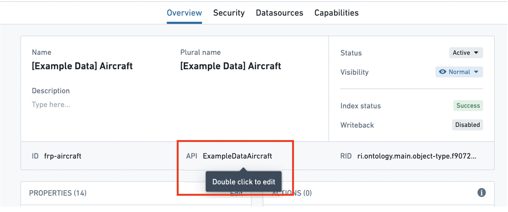

属性的 API 名称必须：

* 以小写字母开头，并且仅由字母数字字符组成。
* 使用 camelCase 编写（其中复合词中第一个单词之后的每个单词的首字母大写；例如，“thisExampleName”）。
* 在属于同一 Object 类型的所有属性中唯一。

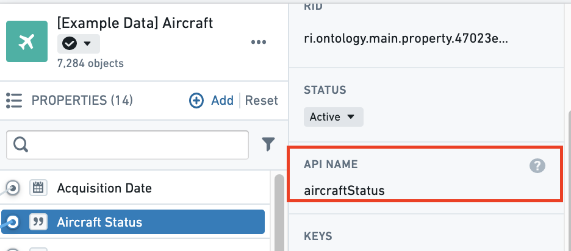

## 故障排除

### 必填的 Object 类型字段

要保存新的 Object 类型，以下 Object 类型字段不能为空：

* ID
* 显示名称
* 复数显示名称
* 支持数据源
* API 名称

此外，以下属性字段不能为空：

* 属性 ID
* 属性显示名称
* 支持列
* 属性 API 名称
* 标题键
* 主键

### 有效 ID 检查表

#### Object 类型 ID

Object 类型 ID：

* 可以由小写字母、数字和破折号组成。
* 应以字母开头。
* 在所有 Object 类型中必须唯一。

#### 属性类型 ID

属性类型 ID：

* 可以由小写或大写字母、数字、破折号和下划线组成
* 应以字母开头
* 在属于同一 Object 类型的所有属性中必须唯一

#### API 名称

根据功能编码标准，Object 类型的 API 名称必须：

* 以大写字母开头，并且仅由字母数字字符组成
* 使用 PascalCase 编写
* 在所有 Object 类型中唯一

属性的 API 名称必须：

* 是有效的 Unicode
* 在属于同一 Object 类型的所有属性中唯一。

请注意，有许多保留关键字不能用于 API 名称。它们是：`ontology`、`object`、`property`、`link`、`relation`、`rid`、`primaryKey`、`typeId` 和 `ontologyObject`。

### 错误

#### 错误：`Phonograph2:DatasetAndBranchAlreadyRegistered`

如果您收到错误 `Phonograph2:DatasetAndBranchAlreadyRegistered`，则您尝试保存的 Object 类型的支持数据源已在 Ontology 中支持了不同的 Object 类型，无法再次使用。
