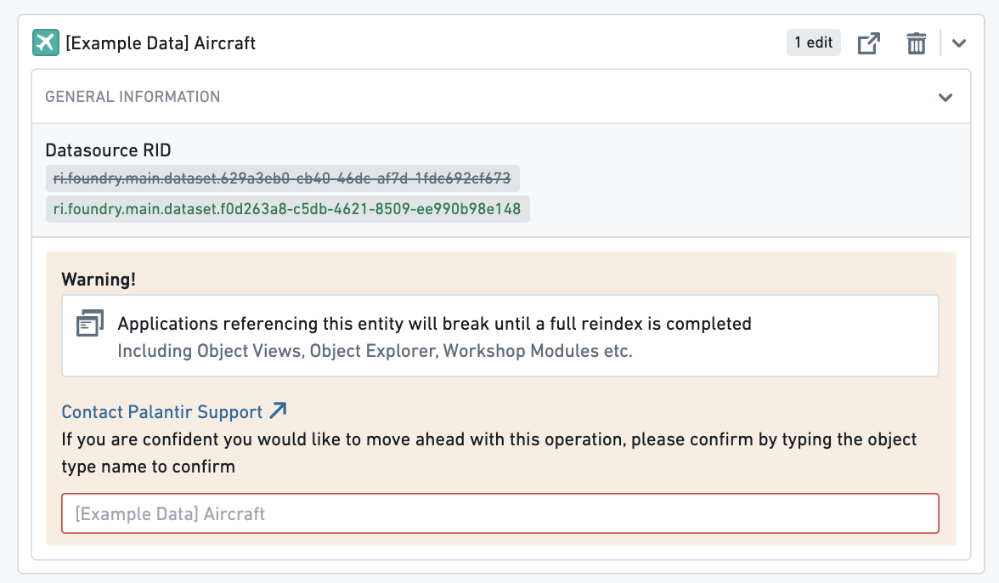
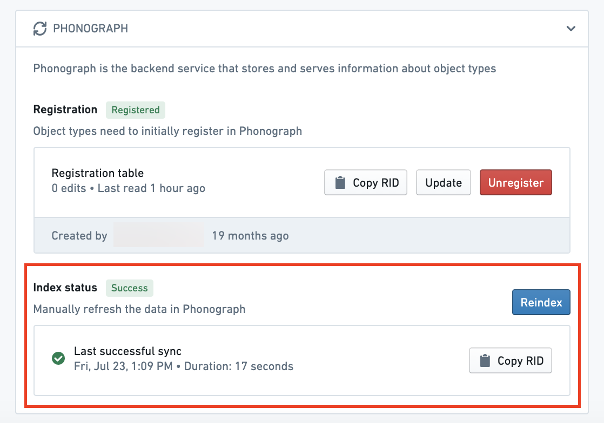
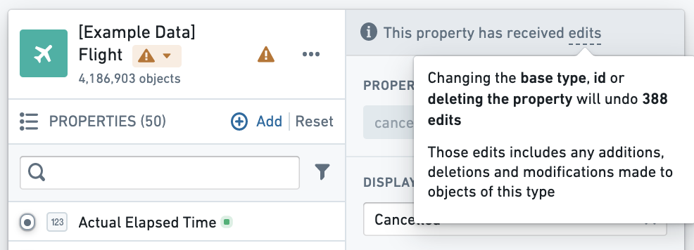
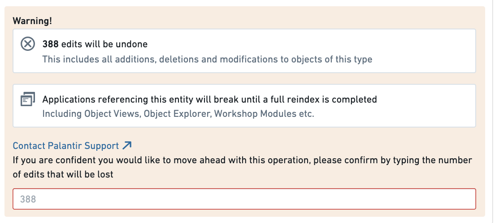
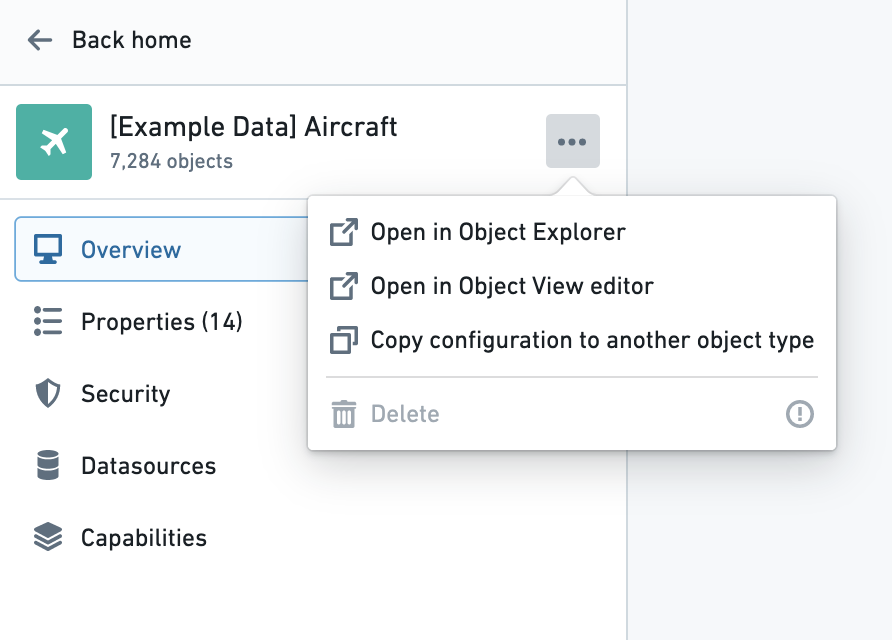
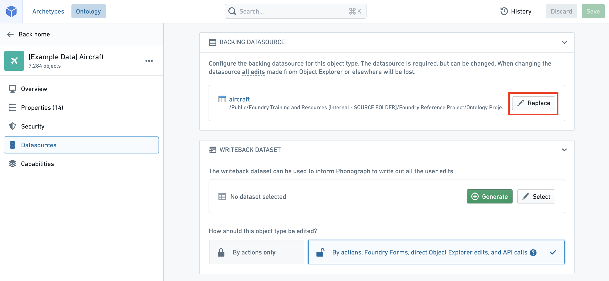
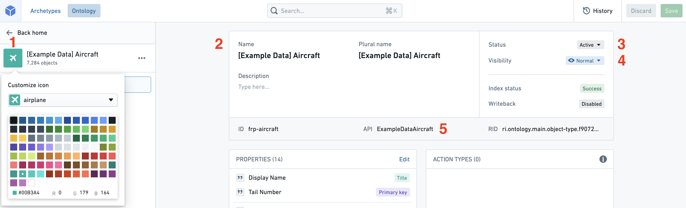

:::callout{theme="warning"}
注意：以下翻译的准确性尚未经过验证。这是使用 [AIP ↗](https://www.palantir.com/platforms/aip/) 从原始英文文本进行的机器翻译。
:::

# 编辑Object类型

:::callout{theme="warning" title="警告"}
编辑Object类型及其属性可能会导致**应用程序崩溃并中断用户工作流程**。在进行任何Object类型或属性编辑**之前**，请阅读下面有关[潜在破坏性更改](#potential-breaking-changes)的部分。
:::

## 潜在破坏性更改

### 无数据输出的Object类型

需要Object Storage v1 (Phonograph)注销并重新注册Object类型的支持数据源的更改，将导致在重新索引期间此类型的Object在用户应用程序中**不可用**；这些更改如下所述。

以下更改将在保存时注销并重新注册（或删除）Object类型的支持数据源：

* 更改Object类型的支持数据源。
* 更改Object类型的主键。
* 删除Object类型。

当您尝试保存这些更改中的任何一项时，系统会警告您对用户应用程序的潜在影响。

例如，如果Object类型在Workshop应用程序中使用，则该Workshop应用程序将被中断，直到重新索引完成。您可以在其**数据源**页面的**Phonograph**窗格中跟踪Object类型重新索引的进度。

[了解有关Object Storage v1 (Phonograph)的更多信息。](../../../%E6%9C%AC%E4%BD%93%E6%9E%B6%E6%9E%84/%E5%AF%B9%E8%B1%A1%E6%95%B0%E6%8D%AE%E5%BA%93/%5B%E9%81%97%E7%95%99%5D%20Object%20Storage%20v1%20%28Phonograph%29.md)

### 具有数据输出的Object类型

如果Object类型启用了数据输出，在对该Object类型进行编辑时应格外小心。对Object类型所做的编辑历史记录存储在Object Storage v1 (Phonograph)中。每次构建数据输出数据集时，都会重新应用编辑历史记录，以获取数据输出数据集中已编辑对象的最终状态。当Object类型的支持数据源从Object Storage v1 (Phonograph)中注销时，Object Storage v1 (Phonograph)中的编辑历史记录将被删除，未来的数据输出数据集构建将失败。

除了[上一节](#object-type-without-writeback)中列出的需要注销的更改外，对曾经接收过编辑的Object类型的任何属性进行模式更改时，具有数据输出的Object类型也需要注销，即使它当前未接收编辑。模式更改包括对属性的ID和基础类型的更改。

以下更&#x6539;***不需要***&#x6CE8;销，因此不会丢失编辑历史记录：

* 更改已接收编辑的属性的显示名称、标题键、渲染提示、类型类和可见&#x6027;***不需要***&#x4F7F;Object类型注销。
* 删除字段或对从未接收过编辑的字段进行模式更&#x6539;***不需要***&#x4F7F;Object类型注销，因此不会擦除或撤销正在接收编辑的其他字段上的编辑。

:::callout{theme="warning" title="警告"}
Object Storage v1 (Phonograph)不会自动注销Object类型的支持数据源以响应这些模式更改之一。相反，重新索引将失败，并且只有在撤销保存的模式更改或您手动注销并重新注册Object类型的支持数据源时，才能成功。
:::

属性编辑器中的属性窗格突出显示了字段是否曾经接收过编辑。

此外，当您尝试保存可能导致擦除编辑历史记录的任何更改时，系统会警告您对编辑的潜在影响。

现在您了解了编辑现有Object类型和属性的注意事项，您可以安全地进行更改。

## 编辑现有的Object类型

* [导航到现有Object类型](#navigate-to-an-existing-object-type)
* [删除Object类型](#delete-an-object-type)
* [更改支持数据源](#change-a-backing-datasource)
* [编辑Object类型的元数据](#edit-an-object-types-metadata)

### 导航到现有Object类型

您可以通过从主页侧边栏选择Object类型页面并从列表中选择不同的Object类型，随时更改正在处理的Object类型。您还可以在应用程序标题中的搜索栏中随时搜索新的Object类型。[阅读更多关于导航的信息。](../../../%E5%BA%94%E7%94%A8/%E6%9C%AC%E4%BD%93%E7%AE%A1%E7%90%86%E5%99%A8/%E5%AF%BC%E8%88%AA.md)

### 删除Object类型

您可以通过选择Object类型视图侧边栏右上角的  （三个点）图标（见下图），然后从下拉列表中选择**删除**选项来删除Object类型。将弹出一个对话框，以确认您要将Object类型及其所有关联的链接类型标记为删除。

* 请注意，Object类型的删除仅在您保存更改后生效，并将破坏任何引用该Object类型的视图或应用程序。
* 具有`active`状态的Object类型无法删除。[阅读更多关于状态的信息。](../Metadata/%E7%8A%B6%E6%80%81.md)

### 更改支持数据源

您可以通过以下步骤更改支持数据源：

1. 通过选择Object类型的**属性**页面顶部的**编辑属性映射**，导航到属性编辑器。
2. 选择**数据源**窗格顶部的  **替换**按钮。这将允许您浏览和选择Foundry中的可用数据源。

:::callout{theme="warning" title="警告"}
更改Object类型的支持数据源将删除旧数据源中的列与Object类型属性之间的任何连接。只有当您更改为与旧数据源具有**相同模式**的新数据源时，属性才会自动重新映射。否则，您将需要将Object类型的属性重新映射到新数据源。
:::

### 编辑Object类型的元数据

1. **图标：** 选择默认图标来自定义用户在应用程序中查看此类型Object时出现的图标和颜色。
2. **显示名称和描述：** 选择现有的显示名称或描述以编辑文本。
3. **状态：** 选择现有状态以打开可用状态的下拉列表。从`deprecated`、`experimental`和`active`状态中选择。
   * 阅读更多关于[状态](../Metadata/%E7%8A%B6%E6%80%81.md)的信息。
4. **可见性：** 选择现有可见性以打开可用可见性的下拉列表。一个`重要`的Object类型将引导应用程序首先向用户显示此Object类型。一个`隐藏`的Object类型将不会出现在用户应用程序中。
5. **API名称：** 选择现有API名称以更改其值。
   * 请注意，您不能更改具有`active`状态的Object类型的API名称。
     * 阅读更多关于[状态](../Metadata/%E7%8A%B6%E6%80%81.md)的信息。
     * 阅读更多关于[有效API名称](%E5%88%9B%E5%BB%BA%20Object%20%E7%B1%BB%E5%9E%8B.md#api-name)的信息。

:::callout{theme="neutral"}
Object类型的Object ID在初始Object类型创建过程后无法编辑。
:::

## 故障排除

#### 错误：`Phonograph2:FoundryColumnNameNotFound`

如果您收到错误`Phonograph2:FoundryColumnNameNotFound`，则说明您尝试保存的Object类型的支持数据源中删除了某个列，并且某个属性未映射。需要将该属性映射或删除。

#### 错误：`Phonograph2:InvalidColumnRemoval`

如果您收到错误`Phonograph2:InvalidColumnRemoval`，则说明删除了支持某个已接收编辑的属性的列。要么需要将该列添加回数据源，要么需要注销并重新注册Object类型。

请参阅上面的[潜在破坏性更改](#potential-breaking-changes)部分以了解更多信息。

#### 错误：`Phonograph2:InvalidColumnFieldSchemaChange`

如果您收到错误`Phonograph2:InvalidColumnFieldSchemaChange`，则说明某个已接收编辑的属性的ID或键已更改。要么需要撤销更改，要么需要注销并重新注册Object类型。

请参阅上面的[潜在破坏性更改](#potential-breaking-changes)部分以了解更多信息。

#### 错误：`OntologyMetadata:IncompatibleFoundryFieldSchemaForPropertyType`

如果您收到错误`OntologyMetadata:IncompatibleFoundryFieldSchemaForPropertyType`，则说明您尝试保存的属性的基础类型与支持它的列类型不兼容。例如，列X的类型可能已更改为“字符串”，但映射到基础类型为“整数”的属性X。

#### 错误：`Phonograph2:SchemaMismatch`

如果您收到错误`Phonograph2:SchemaMismatch`，您可能对支持Object的模式进行了有意更改，但尚未更新Ontology Manager中的Object属性类型。通过编辑属性的数据类型以接受新类型来修改Ontology。发布更改并重建数据集，然后启动Object的重新索引。

#### 错误：`FieldTypeIncompatibleWithOntologyPropertyType`

如果您收到错误`FieldTypeIncompatibleWithOntologyPropertyType`或收到消息“Failed to Update Object Type in Phonograph”，则说明数据集中支持您的Object的数据类型与Ontology期望的数据类型不匹配。您必须确保任何模式更新都在数据集和Ontology中得到反映。

如果您确实对Ontology或数据集进行了有意更改，请与Object及其支持数据源的所有者沟通以了解最近的更改。
