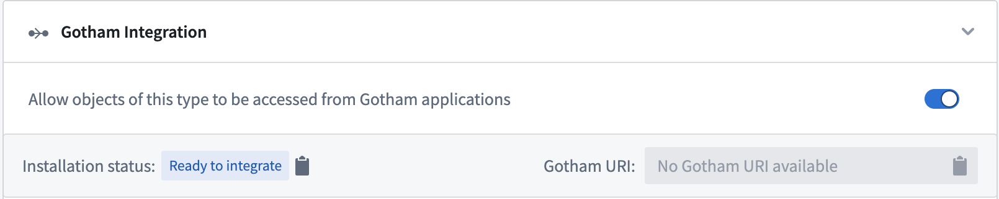
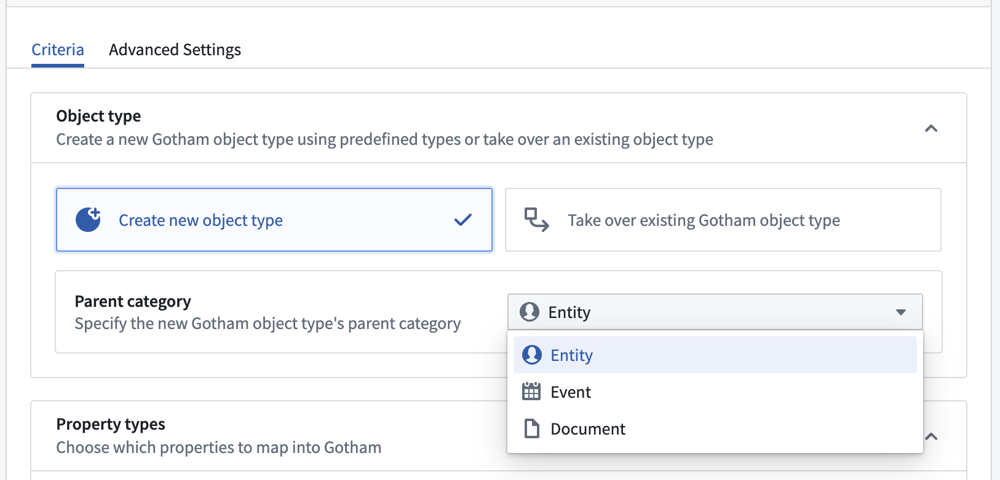

:::callout{theme="warning"}
注意：以下翻译的准确性尚未经过验证。这是使用 [AIP ↗](https://www.palantir.com/platforms/aip/) 从原始英文文本进行的机器翻译。
:::

# 通过类型映射启用 Gotham 集成

类型映射使用户能够在 Foundry 和 Gotham 中通过 Foundry 的 [Ontology Manager](../../../%E5%BA%94%E7%94%A8/%E6%9C%AC%E4%BD%93%E7%AE%A1%E7%90%86%E5%99%A8/%E6%A6%82%E8%BF%B0.md) 应用程序管理一个统一的 Ontology 表示。用户可以基于现有的 Foundry Object 类型、属性类型和共享属性类型创建新的 Gotham 类型，并在 Ontology 随时间演变时保持同步。完成类型映射过程后，Gotham 将能够通过 [Object Set Service](../../../%E6%9C%AC%E4%BD%93%E6%9E%B6%E6%9E%84/%E5%AF%B9%E8%B1%A1%E5%90%8E%E7%AB%AF/%E6%A6%82%E8%BF%B0.md#object-set-service-oss) 查询 Foundry Object 类型及其元数据——这是一个支持 Object 数据搜索、筛选、聚合和加载的 Foundry 后端服务。

:::callout{theme="neutral" title="注意"}
类型映射仅适用于同时使用 Foundry 和 Gotham 的注册用户，必须由平台管理员启用后方可使用。一旦为 Foundry Ontology 启用类型映射，则无法禁用。每个 Gotham 安装只能有一个 Foundry Ontology 启用类型映射。请联系 Palantir 客服支持以获取有关启用类型映射的帮助。
:::

## 在 Foundry 的 Ontology Manager 中开启类型映射

要将 Foundry Ontology 中的数据与 Gotham 集成，您首先需要在 Foundry 的 Ontology Manager 中为您感兴趣的 Object 类型开启类型映射，步骤如下：

1. 从您的主屏幕启动 Ontology Manager。
2. 找到并选择您要类型映射的 Object 类型。
3. 在 Object 类型的左侧面板中选择 **功能**。
4. 向下滚动到 **Gotham 集成** 面板，并开启 `允许此类型的对象从 Gotham 应用程序访问`。

:::callout{theme="neutral" title="注意"}
类型映射的对象必须包含一个 `Geohash` 属性才能在 Gaia 地图上显示。该属性可以是 Object 类型的支持数据集中的本地属性，或使用 Pipeline Builder 的 [Convert GeoPoint to Geohash](https://www.palantir.com/docs/foundry/pb-functions-expression/geoPointToGeohashV1/) 变换功能从纬度/经度对或 `GeoPoint` 派生而来。
:::

## 配置 Object 类型的父类别和 Gotham 属性类型

一旦开启 **Gotham 集成**，您可以按照以下步骤创建一个从现有 Foundry Object 类型派生的新 Gotham Object 类型，指定 Object 类型的 **父类别**，并配置其 **属性类型**：

1. 在 **Gotham 集成** 的 **Object 类型** 部分中选择 **创建新的 Object 类型**，以从现有 Foundry Object 类型创建新的 Gotham Object 类型。
2. 通过选择 `实体`（例如人、组织或车辆）、`事件`（例如航班、会议或演唱会）或 `文档`（例如 PDF 文件、文本文档或报告）来识别新 Object 类型在 Gotham 中的 **父类别**，这基于您的应用案例。
3. 使用 **属性类型** 部分将 Foundry Object 类型属性映射到 Gotham - 属性可以是共享的或克隆到 Gotham Ontology 中。一旦您在给定属性上完成配置，您将看到属性名称旁边的蓝色 `映射` 标签。
   * `指派到共享属性` 使您能够选择一个*现有的*共享属性进行映射。
   * `提升为共享属性` 创建一个*新的*共享属性供其他对象使用。
   * `在 Gotham 中创建属性的本地克隆` 在 Gotham 中创建兼容其应用程序的所选属性的副本。
   * `不将属性映射到 Gotham` 是默认选项 - 您未映射的 Foundry 属性不会在 Gotham Ontology 中传播。
4. 在屏幕顶部的右侧带状区选择绿色的 **保存** 按钮并查看。
5. 查看对您的 Object 类型所做的更改并选择 **保存到 Ontology**。

在您将更改保存到 Ontology 后，向上滚动回到 Object 类型的 **功能** 页面的 **Gotham 集成** 部分。您现在将看到分配给 Object 类型的 `Gotham URI` 并能够查看由 Gotham 报告的 `安装状态`。

Foundry 的 Ontology Manager 将显示以下安装状态之一：

* `准备集成`: Object 类型已准备好进行类型映射以启用 Gotham 集成。
* `安装进行中`: Object 类型的安装过程正在进行中。
* `安装完成`: 安装过程已完成，因此 Object 类型可在 Gotham 中使用。
* `安装失败: {failureMessage}`: Object 类型的安装至少失败过一次，并将在下次安装运行时重试。`{failureMessage}` 阐明了失败的原因。常见的安装失败包括：
  * *实时重建索引*: 如果 Gotham 上正在运行实时重建索引，则无法更新 Ontology。在此期间，安装将失败并在实时重建索引完成后自动重试。
  * *所需类型未安装*: Object 类型成功安装的所有相关属性安装或映射必须完成，包括共享属性类型。
  * *其他 Ontology 更新*: 如果有 Ontology 更新同时运行，则类型映射器将无法更新 Ontology 并将自动重试。

一旦您的 Object 类型的安装状态显示 `安装完成`，您将能够在 Gotham 的应用程序中搜索并使用您的 Object 类型。

要在 Gotham 中废弃一个类型映射的 Object 类型，您可以在 Foundry 的 Ontology Manager 中删除该 Object 类型。一旦在 Foundry 中删除，Gotham 中的对应 Object 类型及其属性类型将无法访问或被其应用程序使用。

:::callout{theme="neutral"}
Gotham 模仿了 Foundry 数据集的安全性和权限标记，这意味着通过类型映射在 Gotham 中可用的 Foundry 数据将携带相同的访问控制和分类。
:::
